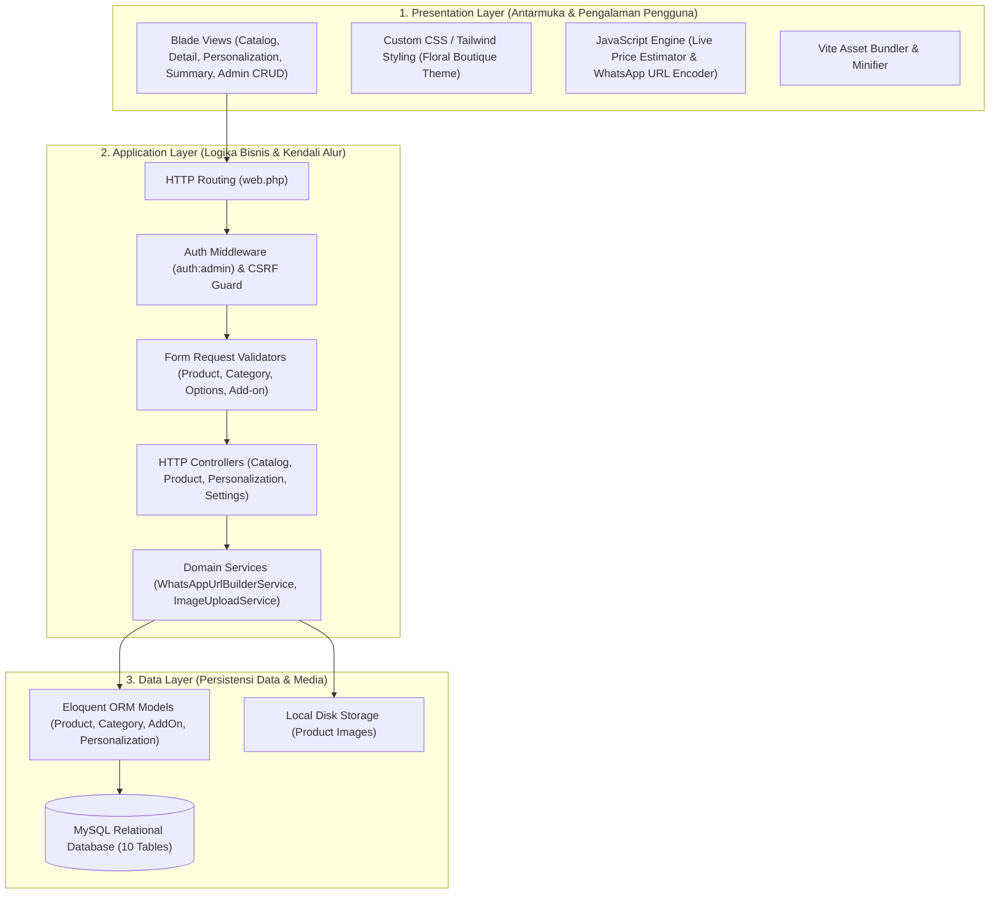
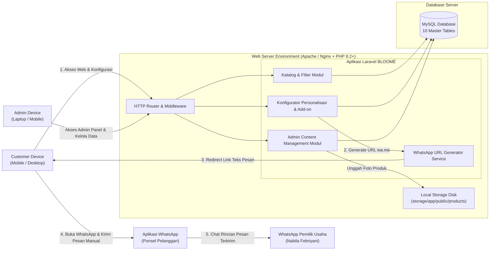
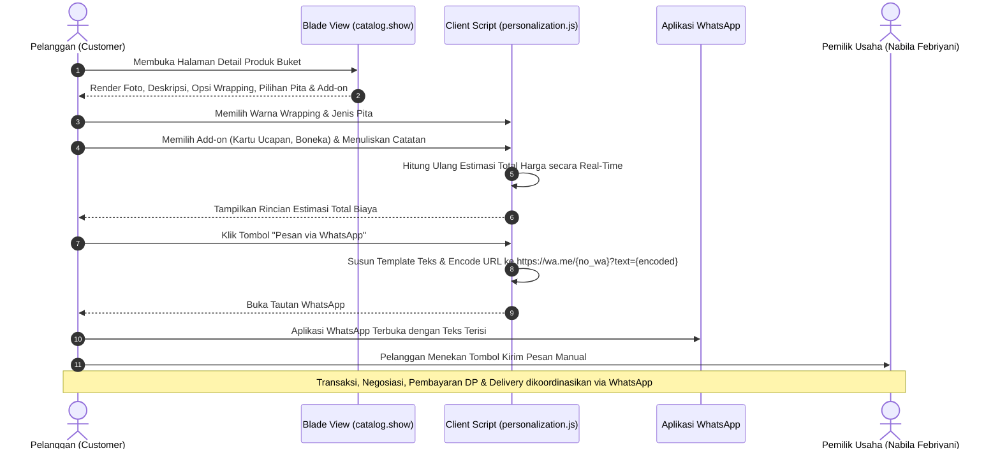
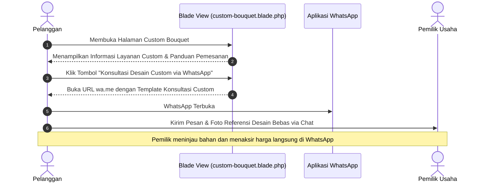
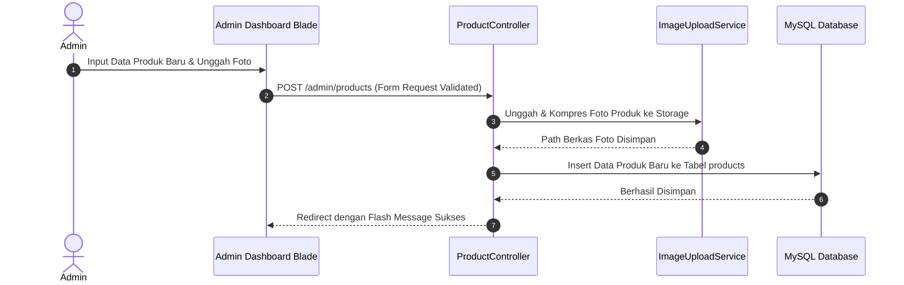
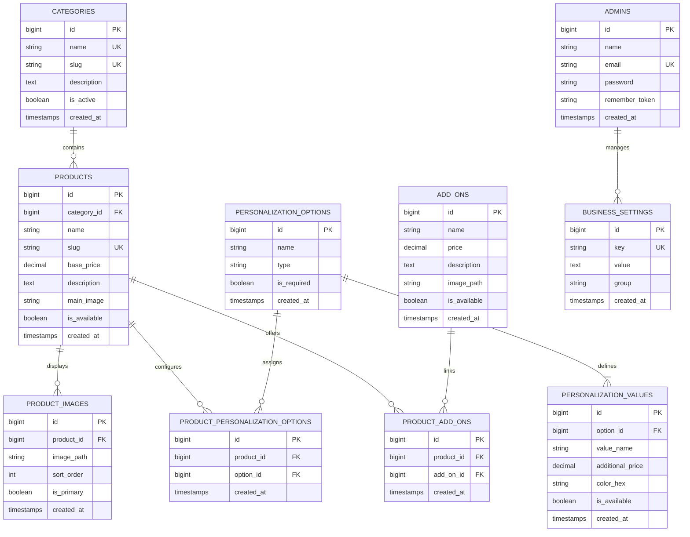

# SYSTEM ARCHITECTURE DOCUMENT (SAD) (v1.1)
# BLOOMÉ — Flowers & Stories

## 1. Document Information

- **Nama Dokumen:** System Architecture Document (SAD)
- **Nama Produk / Sistem:** BLOOMÉ — Flowers & Stories
- **Nama Proyek:** Perancangan Sistem Informasi Pemesanan dan Personalisasi Buket Bunga Berbasis Web
- **Project Sponsor / Owner:** Nabila Febriyani (Pemilik Usaha BLOOMÉ)
- **Lokasi Usaha:** Jalan Cipto Mangunkusumo, Simpang Tiga, Loa Janan Ilir, Kota Samarinda, Kalimantan Timur
- **Lead System Architect & DBA:** Elsa Futri
- **System Analyst & Project Manager:** Jayanti Firdasari
- **Frontend Architect & UI/UX Lead:** Riya Monika
- **Versi Dokumen:** 1.1 (Refined Architecture Baseline — Interactive Catalog & Personalization with WhatsApp Ordering)
- **Tanggal Efektif:** 20 November 2026
- **Status Dokumen:** Approved Baseline

---

## 2. Architecture Overview

Dokumen **System Architecture Document (SAD) v1.1** ini menetapkan cetak biru arsitektur teknis (*technical architecture blueprint*) untuk sistem informasi **BLOOMÉ — Flowers & Stories**.

Berdasarkan kesepakatan final proses bisnis, **sistem web BLOOMÉ dirancang secara spesifik sebagai platform katalog interaktif dan media konfigurasi personalisasi buket bunga, sedangkan proses transaksi pemesanan, konfirmasi ketersediaan, pembayaran, dan koordinasi pengiriman diteruskan secara langsung melalui WhatsApp.**

Sistem dibangun menggunakan pendekatan **Monolithic Modern** berbasis framework **Laravel (PHP)** dan basis data relasional **MySQL**, dengan menerapkan pola **Three-Layer Architecture** (Presentation Layer, Application Layer, Data Layer). Dengan mengeliminasi modul penyimpanan transaksi dan modul pelacakan status pesanan di web, arsitektur sistem menjadi jauh lebih ramping, cepat, aman, dan mudah dipelihara.

---

## 3. Project Context & Stack

| Parameter Arsitektur | Ketetapan Teknis |
|---|---|
| **Metodologi Pengembangan** | Waterfall (Analisis -> Desain -> Implementasi -> Pengujian -> Deployment). |
| **Pola Arsitektur** | Three-Layer Architecture (Presentation, Application, Data Layer). |
| **Backend Framework** | Laravel 10/11 (PHP 8.2+). |
| **Frontend Stack** | Laravel Blade Templates, Tailwind CSS / Vanilla CSS, JavaScript, Vite Asset Bundler. |
| **Database Management** | MySQL 8.0+ (Storage Engine: InnoDB, Charset: `utf8mb4_unicode_ci`). |
| **Object-Relational Mapping** | Eloquent ORM & Laravel Database Migrations. |
| **File Storage** | Local Disk Storage (`storage/app/public/products`) dengan symbolic link publik. |
| **Aktor Sistem** | **Customer** (*Guest User*, tanpa login/registrasi) dan **Admin** (1 akun tunggal pemilik toko). |

---

## 4. Architecture Objectives

1. **Modularity & Clean Separation of Concerns:** Memisahkan lapisan tampilan, logika bisnis perakit pesan WhatsApp, dan akses data master produk secara bersih.
2. **Interactive Client-Side Calculation:** Memfasilitasi kalkulasi estimasi total harga dan konfigurasi variasi buket secara instan di sisi browser pelanggan.
3. **Seamless WhatsApp Integration:** Mengompilasi parameter buket pilihan menjadi URL skema WhatsApp baku (`wa.me`) tanpa ketergantungan API pihak ketiga berbayar.
4. **Zero Database Bloat:** Menghilangkan beban penyimpanan transaksi pesanan, pembayaran, dan histori status pesanan di basis data web.
5. **Robust Security & Data Integrity:** Mengamankan dashboard admin melalui enkripsi kata sandi (Bcrypt), proteksi CSRF, sanitasi input XSS, dan validasi berkas foto di sisi server.
6. **Sub-Second Page Load:** Menjamin waktu respon katalog ≤ 1-2 detik pada koneksi internet seluler standar 4G.

---

## 5. Architectural Style: Three-Layer Architecture

Arsitektur aplikasi membagi tanggung jawab komputasi ke dalam tiga lapisan terstruktur:



1. **Presentation Layer (Lapisan Presentasi):**
   - Merender halaman etalase publik dan antarmuka manajemen admin menggunakan template Blade.
   - Menyediakan antarmuka interaktif pemilihan personalisasi (swatch warna wrapping, pilihan pita) dan add-on.
   - Menghitung estimasi harga total secara *real-time* via JavaScript di browser.
   - Mengarahkan pelanggan ke WhatsApp dengan URL yang telah di-*encode*.
2. **Application Layer (Lapisan Aplikasi & Bisnis):**
   - Mengendalikan perutean HTTP (*routing*) dan proteksi akses rute admin melalui middleware otentikasi.
   - Memvalidasi seluruh formulir input admin (*Form Request Validation*).
   - Menjalankan logika bisnis penyusunan format teks pesan WhatsApp (`WhatsAppUrlBuilderService`).
   - Mengatur proses unggah, kompresi, dan sanitasi berkas foto produk (`ImageUploadService`).
3. **Data Layer (Lapisan Data):**
   - Mengelola persistensi data master etalase, kategori, opsi personalisasi, add-on, dan konfigurasi toko melalui Eloquent ORM.
   - Menjaga integritas referensial antar tabel menggunakan *foreign key constraints* InnoDB.
   - Menyimpan berkas fisik foto produk pada direktori storage lokal yang aman.

---

## 6. High-Level System Architecture Diagram



---

## 7. Application Component Diagram

Sistem terdiri dari komponen modular berikut:

```mermaid
component
    package "Public Catalog Domain" {
        [Catalog Showcase Component]
        [Product Detail View Component]
        [Personalization Selector Component]
        [Add-on Selector Component]
        [Price Estimation Engine (Client JS)]
        [WhatsApp Link Dispatcher]
    }

    package "Admin Management Domain" {
        [Admin Auth Component]
        [Category Management Component]
        [Product Management Component]
        [Gallery Upload Component]
        [Personalization Management Component]
        [Add-on Management Component]
        [Business Settings Component]
    }

    package "Shared Core Services" {
        [WhatsApp URL Builder Service]
        [Image Upload Service]
        [Database Query Service]
    }

    [Product Detail View Component] --> [Personalization Selector Component]
    [Product Detail View Component] --> [Add-on Selector Component]
    [Personalization Selector Component] --> [Price Estimation Engine (Client JS)]
    [Add-on Selector Component] --> [Price Estimation Engine (Client JS)]
    [Price Estimation Engine (Client JS)] --> [WhatsApp Link Dispatcher]
    [WhatsApp Link Dispatcher] --> [WhatsApp URL Builder Service]

    [Product Management Component] --> [Image Upload Service]
    [Product Management Component] --> [Database Query Service]
    [Gallery Upload Component] --> [Image Upload Service]
    [Business Settings Component] --> [Database Query Service]
```

---

## 8. Request & Interaction Data Flow (Sequence Diagrams)

### 8.1 Alur Pelanggan: Katalog, Personalisasi, dan Pengalihan WhatsApp


### 8.2 Alur Buket Custom via WhatsApp


### 8.3 Alur Pengelolaan Master Data oleh Admin


---

## 9. Database Architecture (10 Relational Entities)

Basis data sistem dirancang secara efisien menggunakan 10 tabel relasional yang dinormalisasi:



---

## 10. Laravel Project Directory Architecture

Struktur direktori implementasi kode Laravel disusun rapi dan modular:

```
app/
├── Http/
│   ├── Controllers/
│   │   ├── HomeController.php               # Halaman beranda publik, about, contact
│   │   ├── CatalogController.php            # Katalog publik & halaman detail buket
│   │   ├── CustomBouquetController.php      # Halaman informasi & CTA konsultasi custom
│   │   └── Admin/                           # Controller khusus panel admin
│   │       ├── Auth/LoginController.php     # Otentikasi sesi login/logout admin
│   │       ├── DashboardController.php      # Ringkasan metrik konten katalog
│   │       ├── CategoryController.php       # CRUD kategori buket
│   │       ├── ProductController.php        # CRUD produk & toggle ketersediaan
│   │       ├── ProductGalleryController.php # Manajemen galeri multi-foto buket
│   │       ├── PersonalizationController.php# CRUD opsi & variasi personalisasi
│   │       ├── AddOnController.php          # CRUD item tambahan & penetapan harga
│   │       └── BusinessSettingController.php# Kelola nomor WhatsApp & info toko
│   │
│   ├── Middleware/
│   │   ├── AdminAuthenticate.php            # Proteksi akses rute admin
│   │   └── VerifyCsrfToken.php              # Proteksi token CSRF formulir
│   │
│   └── Requests/                            # Validasi request terisolasi
│       ├── AdminLoginRequest.php
│       ├── StoreProductRequest.php
│       ├── UpdateProductRequest.php
│       ├── StoreCategoryRequest.php
│       ├── StorePersonalizationRequest.php
│       ├── StoreAddOnRequest.php
│       └── UpdateBusinessSettingRequest.php
│
├── Models/                                  # Eloquent ORM Models
│   ├── Admin.php
│   ├── Category.php
│   ├── Product.php
│   ├── ProductImage.php
│   ├── PersonalizationOption.php
│   ├── PersonalizationValue.php
│   ├── ProductPersonalizationOption.php
│   ├── AddOn.php
│   ├── ProductAddOn.php
│   └── BusinessSetting.php
│
└── Services/                                # Reusable Domain Business Services
    ├── WhatsAppUrlBuilderService.php        # Logika pembentukan teks draf pesan & URL wa.me
    └── ImageUploadService.php               # Validasi MIME-type, hashing UUID, & resize gambar
```

---

## 11. Routing Architecture

Rute aplikasi pada file `routes/web.php` dibagi ke dalam rute publik dan rute admin terproteksi:

```php
// =========================================================================
// 1. PUBLIC ROUTES (Dapat Diakses Seluruh Pengunjung Tanpa Login)
// =========================================================================
Route::get('/', [HomeController::class, 'index'])->name('home');
Route::get('/catalog', [CatalogController::class, 'index'])->name('catalog.index');
Route::get('/catalog/{slug}', [CatalogController::class, 'show'])->name('catalog.show');
Route::get('/custom-bouquet', [CustomBouquetController::class, 'index'])->name('custom.index');
Route::get('/about', [HomeController::class, 'about'])->name('about');
Route::get('/contact', [HomeController::class, 'contact'])->name('contact');

// =========================================================================
// 2. ADMIN AUTHENTICATION ROUTES
// =========================================================================
Route::prefix('admin')->name('admin.')->group(function () {
    Route::get('/login', [LoginController::class, 'showLoginForm'])->name('login');
    Route::post('/login', [LoginController::class, 'login'])->name('login.submit');
    Route::post('/logout', [LoginController::class, 'logout'])->name('logout');

    // =====================================================================
    // 3. PROTECTED ADMIN ROUTES (auth:admin)
    // =====================================================================
    Route::middleware(['auth:admin'])->group(function () {
        Route::get('/dashboard', [DashboardController::class, 'index'])->name('dashboard');
        
        // Master Kategori & Produk
        Route::resource('categories', CategoryController::class);
        Route::resource('products', ProductController::class);
        Route::patch('/products/{id}/availability', [ProductController::class, 'toggleAvailability'])
            ->name('products.availability');
        
        // Galeri Foto Produk
        Route::get('/products/{id}/gallery', [ProductGalleryController::class, 'index'])->name('products.gallery');
        Route::post('/products/{id}/gallery', [ProductGalleryController::class, 'store'])->name('products.gallery.store');
        Route::delete('/gallery/{id}', [ProductGalleryController::class, 'destroy'])->name('gallery.destroy');
        
        // Variasi Personalisasi & Add-on
        Route::resource('personalizations', PersonalizationController::class);
        Route::resource('add-ons', AddOnController::class);
        
        // Pengaturan WhatsApp & Informasi Bisnis
        Route::get('/settings', [BusinessSettingController::class, 'index'])->name('settings.index');
        Route::post('/settings', [BusinessSettingController::class, 'update'])->name('settings.update');
    });
});
```

---

## 12. File Storage Architecture

Penyimpanan berkas foto produk dikelola menggunakan local storage Laravel yang terisolasi:

- **Direktori Berkas:** `storage/app/public/products/`
- **Akses Publik:** Melalui symbolic link bawaan `public/storage/products/` (`php artisan storage:link`).
- **Keamanan Unggahan Berkas (Upload Security):**
  1. Validasi server-side ketat: format hanya boleh `jpg`, `jpeg`, `png`, `webp`.
  2. Batas ukuran berkas foto maksimal **[Perlu Konfirmasi Owner]** (standar: 2-5 MB).
  3. Sanitasi nama berkas: Nama file asli dibuang dan diganti dengan UUID acak (`Str::uuid() . '.' . $extension`).
  4. Non-Executable Storage: Direktori storage dikonfigurasikan agar tidak mengeksekusi script PHP.

---

## 13. Security Architecture

1. **Autentikasi & Hashing:** Otentikasi admin dilindungi enkripsi kata sandi Bcrypt bawaan Laravel.
2. **Session Security:** Regenerasi ID sesi secara otomatis setelah login sukses untuk mencegah serangan *Session Fixation*.
3. **Proteksi CSRF:** Seluruh form HTTP (POST, PATCH, DELETE) wajib menyertakan direktif `@csrf`.
4. **Pencegahan SQL Injection:** Seluruh manipulasi data menggunakan Eloquent ORM atau parameterized query binding.
5. **Pencegahan XSS:** Output data dinamis di-escape otomatis menggunakan sintaks kurung kurawal ganda Blade `{{ $variable }}`.

---

## 14. Architectural Decisions & Trade-Offs (ADR)

| Keputusan Arsitektur | Pilihan yang Diambil | Alternatif yang Ditolak | Justifikasi & Trade-Off |
|---|---|---|---|
| **ADR-01: Alur Pemesanan** | WhatsApp Direct Hand-off | Web Transaction & Checkout DB | Menghilangkan beban integrasi payment gateway, pencatatan transaksi yang rentan tumpang-tindih, dan cocok dengan kebiasaan pelanggan florist boutique di Samarinda yang menghendaki konsultasi ramah via WA. |
| **ADR-02: Gaya Arsitektur** | Monolithic Laravel Modular | Microservices Architecture | Monolitik sangat ideal untuk tim 3 orang dengan tenggat waktu 30 November 2026; meminimalkan latensi dan kerumitan deployment. |
| **ADR-03: Rendering Engine** | Blade Templates (SSR) + JS Interactivity | Single Page Application (Vue/React) | Server-side rendering Blade memberikan kecepatan muat pertama yang optimal, SEO friendly untuk katalog bunga, dan interaktivitas personalisasi tetap mulus dengan JavaScript ringan. |
| **ADR-04: Kalkulasi Estimasi** | Client-Side Real-Time Estimation | AJAX Server-Side Re-calculation | Menghitung estimasi harga di browser membuat antarmuka terasa sangat responsif (*zero latency*) saat pelanggan mencentang opsi variasi dan add-on. |

---

## 15. Parameter Menunggu Konfirmasi (`[Perlu Konfirmasi Owner]`)

1. Nomor WhatsApp bisnis resmi untuk penerimaan pesanan.
2. Batas ukuran maksimal file foto upload produk admin.
3. Rencana domain dan web hosting production.
4. Frekuensi dan prosedur backup database di hosting.

---

## 16. Architectural Validation & Sign-Off

Arsitektur sistem BLOOMÉ v1.1 ini telah divalidasi memenuhi seluruh kebutuhan fungsional dan teknis, selaras dengan `requirement.md`, `prd.md`, dan `database-design.md`.

**Disahkan Oleh:**  
**Elsa Futri** (Backend Developer & Lead System Architect)  
**Jayanti Firdasari** (Project Manager & System Analyst)  
**Riya Monika** (UI/UX Designer & Frontend Developer)  
Tanggal: 20 November 2026
