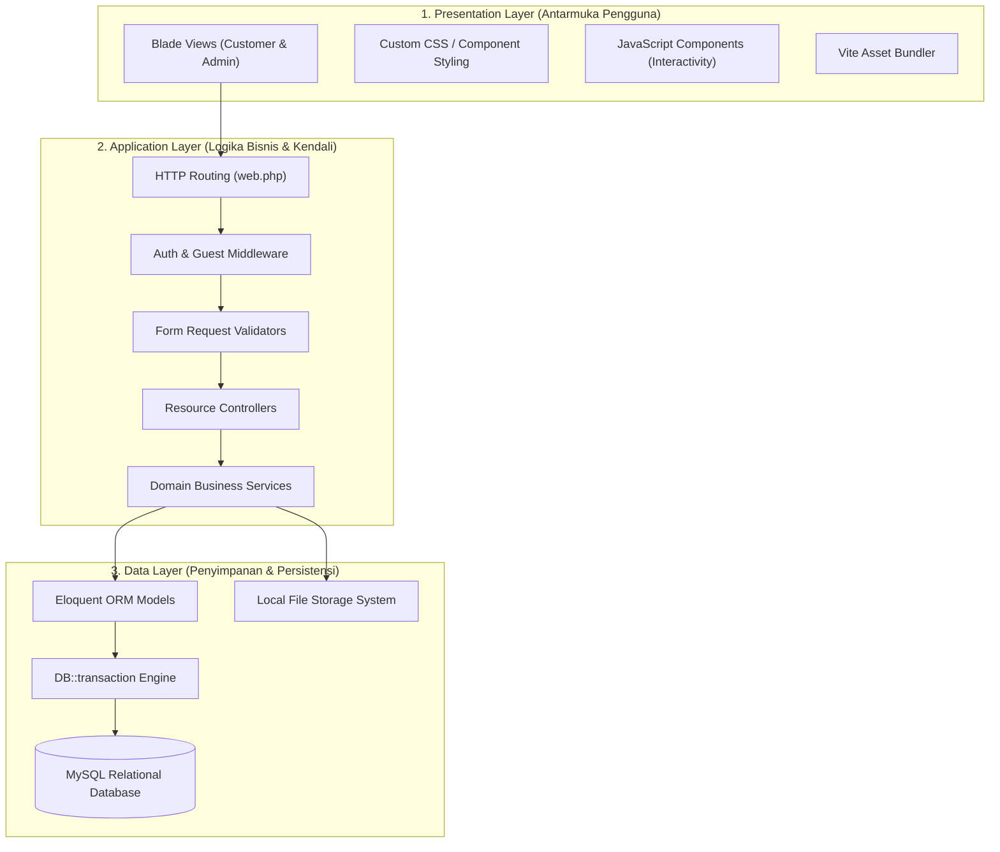
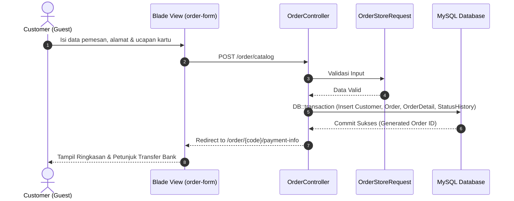
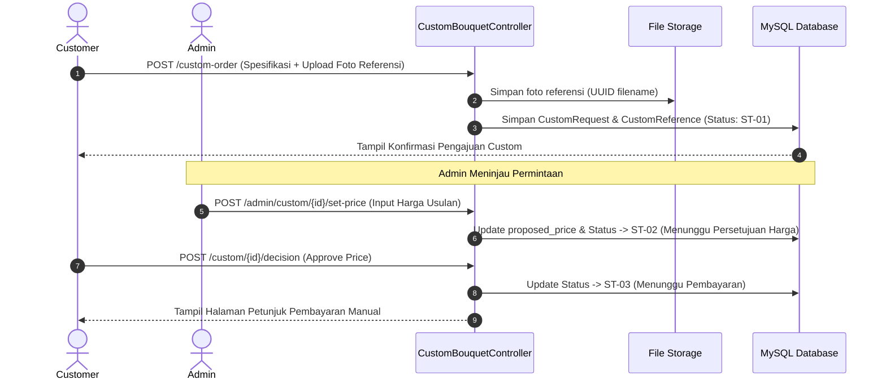
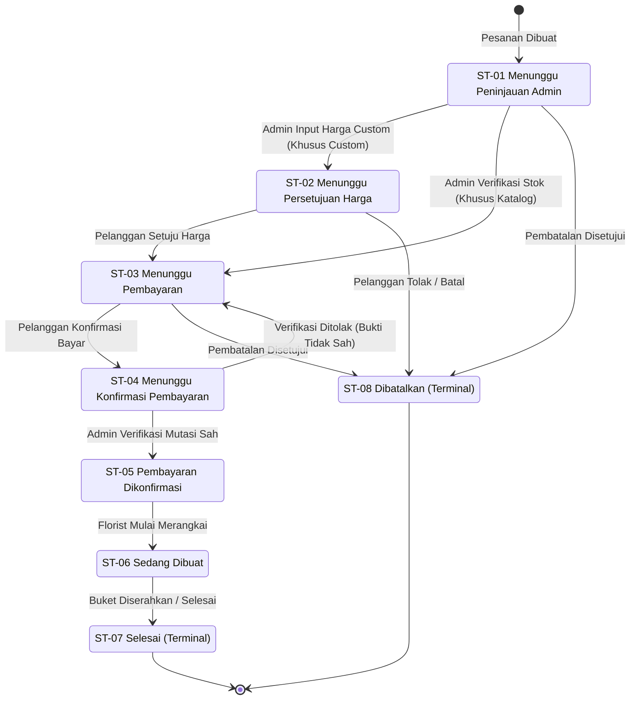
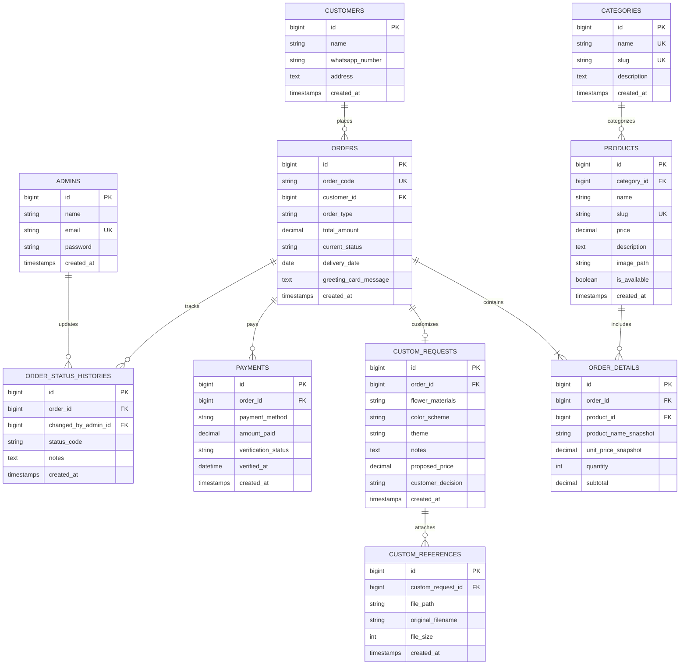
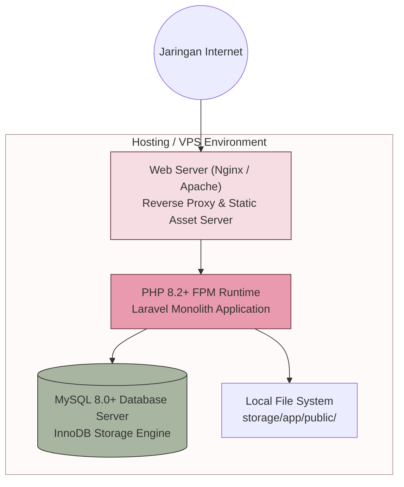

# SYSTEM ARCHITECTURE DOCUMENT (SAD)
# BLOOMÉ — Flowers & Stories

## 1. Document Information

- **Nama Dokumen:** System Architecture Document (SAD)
- **Nama Produk / Sistem:** BLOOMÉ — Flowers & Stories
- **Nama Proyek:** Perancangan Sistem Informasi Pemesanan dan Personalisasi Buket Bunga Berbasis Web
- **Project Sponsor:** Nabila Febriyani (Pemilik Usaha BLOOMÉ)
- **Lokasi Usaha:** Jalan Cipto Mangunkusumo, Simpang Tiga, Loa Janan Ilir, Kota Samarinda
- **Lead System Architect & DBA:** Elsa Futri
- **System Analyst & Project Manager:** Jayanti Firdasari
- **Frontend Architect & UI/UX Lead:** Riya Monika
- **Versi Dokumen:** 1.0 (Official Technical Architecture Baseline)
- **Tanggal Efektif:** 13 November 2026
- **Status Dokumen:** Approved Baseline

---

## 2. Architecture Overview

Dokumen **System Architecture Document (SAD)** ini menetapkan cetak biru teknis (*technical blueprint*) untuk perancangan, pengembangan, integrasi, dan penggelaran sistem informasi **BLOOMÉ — Flowers & Stories**.

Sistem ini dibangun dengan pendekatan **Monolithic Modern** berbasis framework **Laravel (PHP)** dan basis data relasional **MySQL**, menerapkan pola arsitektur **Three-Layer Architecture** (Presentation Layer, Application Layer, Data Layer). Pendekatan ini dipilih secara terukur untuk meminimalkan kompleksitas infrastruktur, memaksimalkan kecepatan pengembangan (*time-to-market* sesuai tenggat 30 November 2026), serta menjamin keandalan transaksi pemesanan buket katalog dan personalisasi buket custom.

---

## 3. Project Context

| Parameter Proyek | Ketetapan Arsitektur |
|---|---|
| **Metodologi Pengembangan** | Waterfall (Pengembangan sekuensial dengan *Quality Gate* antar fase). |
| **Backend Framework** | Laravel 10/11 (PHP 8.2+). |
| **Frontend Stack** | Laravel Blade Templates, Vanilla CSS, JavaScript, Vite Asset Bundler. |
| **Database Management** | MySQL 8.0+ dengan Laravel Eloquent ORM & Database Migrations. |
| **File Storage** | Local Disk Storage terproteksi (`storage/app/public`) dengan symbolic link publik. |
| **Aktor Sistem** | **Customer** (*Guest User*, tanpa registrasi/login) dan **Admin** (1 akun tunggal pemilik usaha). |

---

## 4. Architecture Objectives

1. **Modularity & Separation of Concerns:** Memisahkan lapisan presentasi, logika bisnis, dan data untuk menjaga kode tetap bersih, mudah diuji, dan mudah dipelihara.
2. **Data Integrity & Consistency (ACID):** Menjamin seluruh operasi pembuatan pesanan, pembayaran, dan perubahan status tersimpan secara konsisten tanpa ada data menggantung (*zero orphaned records*).
3. **Robust Security:** Melindungi akses panel admin melalui enkripsi kata sandi modern (Bcrypt/Argon2), proteksi serangan CSRF, mitigasi SQL Injection, sanitasi XSS, serta pengamanan ketat berkas unggahan.
4. **Performance & Scalability:** Menjamin waktu muat halaman (*load time*) ≤ 2 detik pada koneksi internet seluler standar (4G) melalui optimasi kueri basis data dan *asset minification*.
5. **Operational Simplicity:** Menghindari beban pengelolaan infrastruktur mikro yang berlebihan (*over-engineering*); arsitektur dirancang agar dapat dijalankan secara efisien pada shared hosting atau VPS standar.

---

## 5. Architectural Principles

1. **KISS (Keep It Simple, Stupid):** Menggunakan fitur bawaan (*native features*) Laravel standar (Blade, Eloquent, Form Requests, Middleware) tanpa abstraksi pustaka pihak ketiga yang tidak esensial.
2. **Defense in Depth:** Menerapkan validasi data berlapis (validasi antarmuka HTML5 di sisi klien dan Form Request Validation di sisi server).
3. **Database Single Source of Truth:** Semua status transaksi, referensi kustom, dan audit perubahan status pesanan dicatat langsung pada tabel basis data MySQL yang dinormalisasi.
4. **Zero Script Execution in Uploads:** Seluruh berkas gambar yang diunggah pelanggan disimpan sebagai berkas statis berekstensi valid tanpa izin eksekusi script PHP di direktori penyimpanan.

---

## 6. Architecture Style and Pattern: Three-Layer Architecture

Aplikasi membagi tanggung jawab komputasi secara tegas ke dalam tiga lapisan:



1. **Presentation Layer:** Bertanggung jawab merender antarmuka pengguna, menangani input interaksi, dan menyajikan data menggunakan Laravel Blade templates yang terkompilasi server-side.
2. **Application Layer:** Bertanggung jawab mengatur alur request HTTP, memvalidasi aturan bisnis (*business rules*), menjalankan alur verifikasi transaksi, dan mengkoordinasikan eksekusi antar modul.
3. **Data Layer:** Bertanggung jawab atas persistensi data relasional, pemeliharaan integritas *foreign key*, transaksi ACID, dan manajemen berkas fisik gambar di media penyimpanan.

---

## 7. High-Level System Architecture Diagram

```mermaid
flowchart LR
    ClientPublic["Customer Browser<br>(Desktop / Mobile)"]
    ClientAdmin["Admin Browser<br>(Laptop / Mobile)"]

    subgraph WebServer ["Web Server Environment (Nginx / Apache / PHP-FPM)"]
        Router["HTTP Routing & Middleware"]
        
        subgraph AppCore ["Laravel Core Application"]
            CatalogMod["Catalog Module"]
            CustomMod["Custom Bouquet Module"]
            OrderMod["Order Engine"]
            PaymentMod["Payment Module"]
            AdminMod["Admin Operations Module"]
        end
        
        FileDisk["Local Storage Disk<br>(storage/app/public)"]
    end

    subgraph DatabaseServer ["Relational Database"]
        MySQL[("MySQL Database<br>InnoDB Engine")]
    end

    ClientPublic -->|HTTP/HTTPS| Router
    ClientAdmin -->|HTTP/HTTPS (auth:admin)| Router
    
    Router --> AppCore
    AppCore --> MySQL
    CustomMod -->|Save Reference Images| FileDisk
    AdminMod -->|Save Product Images| FileDisk
```

---

## 8. Application Module Architecture (Component Diagram)

Sistem terdiri dari 6 modul fungsional utama yang saling berinteraksi:

```mermaid
component
    package "Public Domain" {
        [Catalog Browsing Component]
        [Custom Request Component]
        [Checkout Component]
    }

    package "Administrative Domain" {
        [Admin Authentication Component]
        [Product & Category Manager]
        [Order Lifecycle Manager]
        [Payment Verification Manager]
    }

    package "Shared Core Services" {
        [File Storage Service]
        [Order Status History Logger]
        [Pricing Service]
    }

    [Catalog Browsing Component] --> [Checkout Component]
    [Custom Request Component] --> [File Storage Service]
    [Custom Request Component] --> [Checkout Component]
    [Checkout Component] --> [Order Lifecycle Manager]
    
    [Order Lifecycle Manager] --> [Order Status History Logger]
    [Admin Authentication Component] ..> [Order Lifecycle Manager] : Guards
    [Product & Category Manager] --> [File Storage Service]
    [Payment Verification Manager] --> [Order Status History Logger]
```

1. **Catalog Browsing Component:** Menangani penampilan produk, penapisan (*filtering*) kategori, dan pratinjau detail produk.
2. **Custom Request Component:** Menangani form personalisasi buket, validasi berkas gambar referensi, dan penyimpanan tiket custom.
3. **Checkout Component:** Menangani pengumpulan identitas pemesan, pembuatan pesanan (*order creation*), dan tampilan petunjuk transfer.
4. **Product & Category Manager:** Fasilitas administratif untuk operasi CRUD produk dan kategori.
5. **Order Lifecycle Manager:** Mengendalikan transisi 8 siklus status pesanan dan peninjauan pengajuan pembatalan.
6. **Payment Verification Manager:** Fasilitas admin untuk memeriksa catatan transfer dan memverifikasi pelunasan secara manual.

---

## 9. Request and Data Flow (Sequence Diagrams)

### 9.1 Alur Pemesanan Katalog (Catalog Ordering Flow)


### 9.2 Alur Pengajuan Personalisasi Buket Custom (Custom Bouquet Flow)


---

## 10. Order Status Architecture (State Machine Diagram)

Arsitektur status pesanan diatur oleh mesin status yang kaku guna mencegah perubahan status ilegal:



---

## 11. Database Architecture & Entity Relationship Diagram (ERD)

Arsitektur data dirancang menggunakan 10 entitas relasional terstruktur pada engine InnoDB MySQL:



---

## 12. Laravel Project Architecture

Struktur direktori Laravel disusun modular dan mematuhi konvensi framework resmi:

```
app/
├── Http/
│   ├── Controllers/
│   │   ├── HomeController.php               # Halaman beranda publik
│   │   ├── CatalogController.php            # Katalog & detail buket
│   │   ├── OrderController.php              # Checkout pesanan katalog
│   │   ├── CustomBouquetController.php      # Form & alur buket custom
│   │   ├── PaymentController.php            # Instruksi bayar & konfirmasi
│   │   └── Admin/                           # Controller panel admin
│   │       ├── Auth/LoginController.php     # Autentikasi admin
│   │       ├── DashboardController.php      # Statistik operasional
│   │       ├── ProductController.php        # CRUD buket
│   │       ├── CategoryController.php       # CRUD kategori
│   │       ├── OrderController.php          # Antrean pesanan & detail
│   │       ├── CustomRequestController.php  # Review custom & harga
│   │       ├── PaymentController.php        # Verifikasi bayar manual
│   │       └── CancellationController.php   # Manajemen pembatalan
│   │
│   ├── Middleware/
│   │   ├── AdminAuthenticate.php            # Proteksi akses rute admin
│   │   └── PreventRequestsDuringMaintenance.php
│   │
│   └── Requests/                            # Validasi request terisolasi
│       ├── CatalogOrderRequest.php
│       ├── CustomBouquetRequest.php
│       ├── AdminLoginRequest.php
│       ├── StoreProductRequest.php
│       └── CustomPriceProposeRequest.php
│
├── Models/                                  # Eloquent ORM Models
│   ├── Admin.php
│   ├── Category.php
│   ├── Product.php
│   ├── Customer.php
│   ├── Order.php
│   ├── OrderDetail.php
│   ├── CustomRequest.php
│   ├── CustomReference.php
│   ├── Payment.php
│   └── OrderStatusHistory.php
│
└── Services/                                # Reusable Business Logic
    ├── OrderCodeGenerator.php               # Generator kode pesanan unik (e.g. BLM-202611-001)
    ├── FileUploadService.php                # Validasi & penyimpanan berkas
    └── OrderStatusService.php               # Transisi status & pencatatan audit
```

---

## 13. Routing Architecture

Rute aplikasi dikelompokkan ke dalam 3 namespace logis pada `routes/web.php`:

```php
// 1. PUBLIC ROUTES (Akses Umum Tanpa Login)
Route::get('/', [HomeController::class, 'index'])->name('home');
Route::get('/catalog', [CatalogController::class, 'index'])->name('catalog.index');
Route::get('/catalog/{slug}', [CatalogController::class, 'show'])->name('catalog.show');
Route::get('/about', [HomeController::class, 'about'])->name('about');
Route::get('/contact', [HomeController::class, 'contact'])->name('contact');

// 2. TRANSACTIONAL ROUTES (Guest Checkout)
Route::post('/order/catalog', [OrderController::class, 'store'])->name('order.catalog.store');
Route::get('/custom-bouquet', [CustomBouquetController::class, 'create'])->name('custom.create');
Route::post('/custom-bouquet', [CustomBouquetController::class, 'store'])->name('custom.store');
Route::get('/custom-bouquet/{code}/review', [CustomBouquetController::class, 'review'])->name('custom.review');
Route::post('/custom-bouquet/{code}/decision', [CustomBouquetController::class, 'decision'])->name('custom.decision');
Route::get('/order/{code}/payment', [PaymentController::class, 'show'])->name('payment.show');
Route::post('/order/{code}/payment/confirm', [PaymentController::class, 'confirm'])->name('payment.confirm');
Route::post('/order/{code}/cancel', [OrderController::class, 'requestCancellation'])->name('order.cancel');

// 3. ADMIN AUTHENTICATION
Route::prefix('admin')->name('admin.')->group(function () {
    Route::get('/login', [LoginController::class, 'showLoginForm'])->name('login');
    Route::post('/login', [LoginController::class, 'login'])->name('login.submit');
    Route::post('/logout', [LoginController::class, 'logout'])->name('logout');

    // 4. PROTECTED ADMIN ROUTES (auth:admin)
    Route::middleware(['auth:admin'])->group(function () {
        Route::get('/dashboard', [DashboardController::class, 'index'])->name('dashboard');
        Route::resource('categories', CategoryController::class);
        Route::resource('products', ProductController::class);
        Route::resource('orders', AdminOrderController::class);
        Route::get('/custom-requests', [CustomRequestController::class, 'index'])->name('custom.index');
        Route::get('/custom-requests/{id}', [CustomRequestController::class, 'show'])->name('custom.show');
        Route::post('/custom-requests/{id}/price', [CustomRequestController::class, 'proposePrice'])->name('custom.price');
        Route::get('/payments', [AdminPaymentController::class, 'index'])->name('payments.index');
        Route::post('/payments/{id}/verify', [AdminPaymentController::class, 'verify'])->name('payments.verify');
        Route::post('/orders/{id}/status', [AdminOrderController::class, 'updateStatus'])->name('orders.status');
        Route::post('/orders/{id}/cancellation', [CancellationController::class, 'decide'])->name('cancellations.decide');
    });
});
```

---

## 14. File Storage Architecture

Penyimpanan berkas gambar produk dan foto referensi kustom diisolasi pada disk lokal dengan arsitektur aman:

- **Root Direktori Berkas:** `storage/app/public/`
  - Produk Katalog: `storage/app/public/products/`
  - Foto Referensi Kustom: `storage/app/public/custom_references/`
- **Tautan Publik:** Diekspos melalui symbolic link standar Laravel: `php artisan storage:link` (`public/storage/`).
- **Prosedur Sanitasi Berkas (Upload Security):**
  1. Validasi MIME Type: Wajib `image/jpeg` atau `image/png`.
  2. Batas Ukuran: Maksimum 5.120 KB (5 MB).
  3. Pengacakan Nama Berkas: Nama berkas asli dibuang dan diganti dengan UUID acak (`Str::uuid() . '.' . $extension`) untuk mencegah eksploitasi penimpaan berkas (*file overwrite attack*).
  4. Larangan Eksekusi: Konfigurasi web server melarang eksekusi script PHP di dalam folder storage.

---

## 15. Security Architecture

1. **Autentikasi & Penyimpanan Kata Sandi:** Menggunakan algoritma hash Bcrypt dengan faktor beban adaptif bawaan Laravel.
2. **Proteksi Sesi:** Regenerasi Session ID saat admin login sukses guna memitigasi serangan *Session Fixation*. Batas *lifetime* sesi admin disetel 120 menit dengan *auto-logout*.
3. **Pencegahan CSRF:** Token `@csrf` disertakan pada seluruh formulir POST/PUT/DELETE; divalidasi oleh middleware `VerifyCsrfToken`.
4. **Pencegahan SQL Injection:** 100% kueri database dieksekusi menggunakan Eloquent ORM atau Query Builder berparameter (*PDO prepared statements*). Penggunaan raw SQL tanpa sanitasi dilarang mutlak.
5. **Mitigasi Cross-Site Scripting (XSS):** Semua data teks dari pengguna otomatis di-escape menggunakan sintaks kurung kurawal ganda Blade `{{ $variable }}`.

---

## 16. Error Handling and Logging Architecture

1. **Penanganan Error Terpusat:** Menggunakan `app/Exceptions/Handler.php`. Pada lingkungan production (`APP_DEBUG=false`), sistem tidak akan pernah membocorkan *stack trace* kode.
2. **Halaman Error Kustom Bernuansa Floral:**
   - `resources/views/errors/404.blade.php` : Halaman halaman tidak ditemukan yang ramah.
   - `resources/views/errors/403.blade.php` : Peringatan akses terlarang.
   - `resources/views/errors/500.blade.php` : Pesan permintaan maaf sistem dengan kontak darurat butik.
3. **Audit Log:** Seluruh pengecualian fatal (*exceptions*) dan log transisi status otomatis ditulis ke `storage/logs/laravel.log` dengan format terstruktur.

---

## 17. Non-Functional Architecture Attributes

| Atribut Kualitas | Pendekatan Arsitektur |
|---|---|
| **Performa & Waktu Muat** | Menggunakan Eager Loading `with()` untuk mencegah masalah N+1 Query; kompresi aset melalui Vite; browser caching berkas statis. |
| **Responsivitas Layar** | Grid sistem adaptif berbasis CSS Flexbox/Grid untuk 3 breakpoint (Mobile ≤ 576px, Tablet 768-992px, Desktop ≥ 1024px). |
| **Keandalan & Integritas** | Transaksi atomik `DB::transaction()` pada setiap pembentukan pesanan multi-tabel; foreign key cascade/restrict yang teruji. |
| **Kemudahan Pemeliharaan** | Standar kode PSR-12, pemisahan logika bisnis dari controller ke Service Classes, dan dokumentasi API kontrak yang jelas. |

---

## 18. Deployment Architecture (Diagram)



- **Konfigurasi Awal:** Pengembangan dan pengujian lokal menggunakan lingkungan PHP/MySQL terstandarisasi.
- **Konfigurasi Produksi:** Aplikasi dirancang siap dipasang (*deployable*) pada Web Hosting / VPS Linux dengan PHP 8.2, modul PHP ekstras (PDO, OpenSSL, Mbstring, Tokenizer, XML, GD), dan basis data MySQL.

---

## 19. Architectural Decisions and Trade-Offs (ADR)

| Keputusan Arsitektur | Pilihan yang Diambil | Alternatif yang Ditolak | Justifikasi & Trade-Off |
|---|---|---|---|
| **ADR-01: Gaya Arsitektur** | Monolithic Laravel Modular | Microservices Architecture | Monolitik dipilih karena ukuran tim (3 orang) dan jadwal ketat (7 minggu). Microservices akan menimbulkan kompleksitas jaringan dan biaya operasional yang tidak perlu. |
| **ADR-02: Frontend Rendering** | Server-Side Rendering (Blade) | Single Page App (Vue / React) | Blade terintegrasi langsung dengan ekosistem Laravel tanpa latensi API ekstra, mempermudah SEO katalog buket, dan mempercepat kolaborasi UI/UX. |
| **ADR-03: Media Storage** | Local Disk Symbolic Link | Cloud Object Storage (AWS S3) | Local disk tidak membutuhkan biaya langganan API cloud tambahan pada tahap awal; arsitektur abstraksi disk Laravel memungkinkan migrasi mulus ke S3 di masa depan jika volume gambar melonjak. |
| **ADR-04: Metode Pembayaran** | Manual Transfer Verification | Automated Payment Gateway | Menghindari biaya integrasi merchant gateway dan potongan transaksi per pesanan; pemilik usaha menginginkan verifikasi manual yang terkontrol. |

---

## 20. Architectural Constraints & Compliance

1. Sistem wajib mematuhi seluruh batasan Three-Layer Architecture: Controller dilarang menulis raw SQL langsung atau memanggil request eksternal tanpa validasi.
2. Tidak diizinkan menambah dependensi paket Laravel pihak ketiga (*third-party packages*) tanpa evaluasi keamanan dan persetujuan Technical Lead.
3. Seluruh tabel wajib dibuat menggunakan migration resmi Laravel dan relasi antar model Eloquent wajib diverifikasi integritasnya.

---

## 21. Open Questions and Assumptions (`[PERLU KONFIRMASI]`)

Arsitektur sistem menandai parameter infrastruktur berikut sebagai menunggu konfirmasi resmi dari Sponsor:
1. Pemilihan penyedia layanan hosting production dan nama domain resmi.
2. Jadwal prosedur otomasi backup basis data di tingkat server hosting (*cron backup schedule*).
3. Batasan jumlah maksimum unggahan gambar referensi per transaksi (arsitektur menyiapkan dukungan hingga 5 gambar referensi per pesanan).

---

## 22. Architectural Validation & Sign-Off

Arsitektur sistem BLOOMÉ telah ditinjau dan dinyatakan memenuhi seluruh kebutuhan fungsional (`requirement.md`), kebutuhan produk (`prd.md`), serta standar tata kelola teknis perangkat lunak.

**Disusun dan Disahkan Oleh:**  
**Elsa Futri** (Backend Developer & Lead System Architect)  
**Jayanti Firdasari** (Project Manager & System Analyst)  
**Riya Monika** (UI/UX Designer & Frontend Developer)  
Tanggal: 13 November 2026
