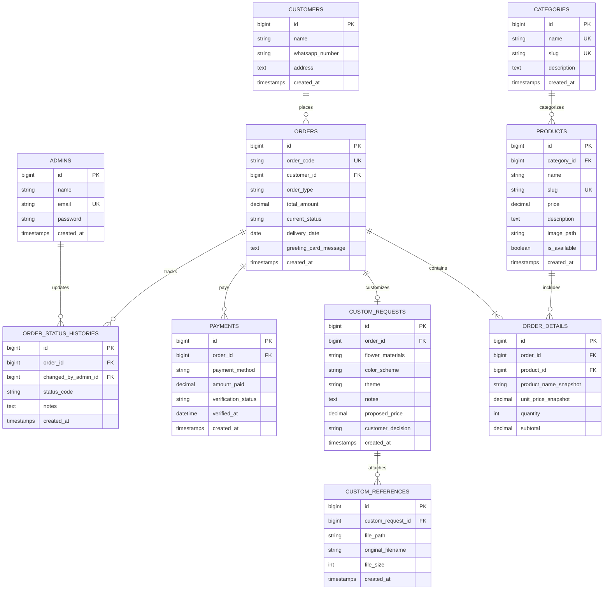

# DATABASE DESIGN SPECIFICATION & DATA DICTIONARY
# BLOOMÉ — Flowers & Stories

## 1. Document Information

- **Nama Dokumen:** Database Design Specification & Data Dictionary
- **Nama Sistem:** BLOOMÉ — Flowers & Stories
- **Nama Proyek:** Perancangan Sistem Informasi Pemesanan dan Personalisasi Buket Bunga Berbasis Web
- **Lead Database Administrator & Backend Architect:** Elsa Futri
- **Lead System Analyst & Project Manager:** Jayanti Firdasari
- **Frontend Developer & UI/UX Designer:** Riya Monika
- **Project Sponsor:** Nabila Febriyani
- **Database Engine:** MySQL 8.0+ (Storage Engine: InnoDB)
- **Character Set / Collation:** `utf8mb4` / `utf8mb4_unicode_ci`
- **Versi Dokumen:** 1.0 (Official Database Baseline)
- **Tanggal Efektif:** 13 November 2026
- **Status Dokumen:** Approved Baseline

---

## 2. Database Overview & Design Principles

Rancangan basis data **BLOOMÉ — Flowers & Stories** disusun untuk mendukung dua alur bisnis inti secara bersamaan: **pemesanan produk katalog siap pesan** dan **pengajuan personalisasi buket custom (beserta penetapan harga manual dan verifikasi transfer manual)**.

### 2.1 Prinsip Perancangan Basis Data
1. **Normalisasi Hingga Bentuk Ketiga (3NF):** Struktur tabel dinormalisasi untuk mengeliminasi redundansi data tanpa mengorbankan performa kueri transaksi.
2. **Perlindungan Data Historis (*Historical Snapshot / Audit Protection - BR-020*):** Tabel rincian pesanan (`order_details`) menyimpan salinan nama dan harga satuan produk pada saat transaksi dibuat, sehingga perubahan harga atau penghapusan produk di masa depan tidak merusak laporan transaksi masa lalu.
3. **Integritas Relasional Penuh (*Referential Integrity*):** Memanfaatkan *Foreign Key Constraints* mesin InnoDB dengan aturan penghapusan ketat (*Restrict*) untuk mencegah hilangnya data operasional penting.
4. **Keamanan Transaksional ACID:** Seluruh operasi multi-tabel (pembuatan pesanan katalog maupun tiket custom) wajib dibungkus dalam transaksi basis data (`DB::transaction`).

---

## 3. Entity Relationship Diagram (ERD)

Struktur relasional mencakup **10 Entitas Terpadu**:

---

## 4. Kamus Data Lengkap (Detailed Data Dictionary)

### 4.1 Tabel: `admins`
Menyimpan kredensial otentikasi administrator (pemilik usaha).
| Nama Kolom | Tipe Data | Nullable | Kunci | Default | Deskripsi & Aturan Bisnis |
|---|---|:---:|:---:|:---:|---|
| `id` | BIGINT UNSIGNED | NO | PK | Auto-inc | Primary key akun admin. |
| `name` | VARCHAR(100) | NO | - | - | Nama lengkap admin (Nabila Febriyani). |
| `email` | VARCHAR(150) | NO | UK | - | Email login resmi (unik). |
| `password` | VARCHAR(255) | NO | - | - | Kata sandi terenkripsi hash Bcrypt / Argon2. |
| `remember_token`| VARCHAR(100) | YES | - | NULL | Token sesi login persisten bawaan Laravel. |
| `created_at` | TIMESTAMP | YES | - | NULL | Waktu pembuatan akun. |
| `updated_at` | TIMESTAMP | YES | - | NULL | Waktu pembaruan akun. |

---

### 4.2 Tabel: `categories`
Menyimpan kategori produk buket bunga (Buket Bunga, Buket Uang, Buket Snack, dll.).
| Nama Kolom | Tipe Data | Nullable | Kunci | Default | Deskripsi & Aturan Bisnis |
|---|---|:---:|:---:|:---:|---|
| `id` | BIGINT UNSIGNED | NO | PK | Auto-inc | Primary key kategori. |
| `name` | VARCHAR(100) | NO | UK | - | Nama kategori (unik, misal: *Buket Bunga Segar*). |
| `slug` | VARCHAR(120) | NO | UK | - | Slug URL ramah SEO (unik, misal: *buket-bunga-segar*). |
| `description` | TEXT | YES | - | NULL | Deskripsi singkat jenis buket pada kategori. |
| `created_at` | TIMESTAMP | YES | - | NULL | Waktu pembuatan. |
| `updated_at` | TIMESTAMP | YES | - | NULL | Waktu pembaruan. |

---

### 4.3 Tabel: `products`
Menyimpan etalase produk buket katalog siap pesan.
| Nama Kolom | Tipe Data | Nullable | Kunci | Default | Deskripsi & Aturan Bisnis |
|---|---|:---:|:---:|:---:|---|
| `id` | BIGINT UNSIGNED | NO | PK | Auto-inc | Primary key produk buket. |
| `category_id` | BIGINT UNSIGNED | NO | FK | - | Relasi ke `categories.id` (`ON DELETE RESTRICT`). |
| `name` | VARCHAR(150) | NO | - | - | Nama buket katalog (misal: *Blush Rose Dream*). |
| `slug` | VARCHAR(180) | NO | UK | - | Slug URL produk unik. |
| `price` | DECIMAL(12,2) | NO | - | - | Harga jual buket dalam Rupiah (tanpa desimal sen). |
| `description` | TEXT | NO | - | - | Rincian jenis bunga, pita, kertas wrapping, dan ukuran. |
| `image_path` | VARCHAR(255) | YES | - | NULL | Path berkas foto produk di storage lokal. |
| `is_available` | BOOLEAN | NO | INDEX | 1 | Status stok ketersediaan (1 = Tersedia, 0 = Habis). |
| `created_at` | TIMESTAMP | YES | - | NULL | Waktu produk ditambahkan. |
| `updated_at` | TIMESTAMP | YES | - | NULL | Waktu produk diubah. |

---

### 4.4 Tabel: `customers`
Menyimpan identitas pelanggan tamu (*guest customer*) yang bertransaksi.
| Nama Kolom | Tipe Data | Nullable | Kunci | Default | Deskripsi & Aturan Bisnis |
|---|---|:---:|:---:|:---:|---|
| `id` | BIGINT UNSIGNED | NO | PK | Auto-inc | Primary key pelanggan. |
| `name` | VARCHAR(120) | NO | - | - | Nama lengkap pemesan. |
| `whatsapp_number`| VARCHAR(25) | NO | INDEX | - | Nomor kontak WhatsApp aktif untuk konfirmasi. |
| `address` | TEXT | NO | - | - | Alamat pengiriman lengkap penerima di Samarinda. |
| `created_at` | TIMESTAMP | YES | - | NULL | Waktu data pemesan pertama kali disimpan. |
| `updated_at` | TIMESTAMP | YES | - | NULL | Waktu pembaruan data pemesan. |

---

### 4.5 Tabel: `orders`
Menyimpan master data transaksi pemesanan katalog maupun buket custom.
| Nama Kolom | Tipe Data | Nullable | Kunci | Default | Deskripsi & Aturan Bisnis |
|---|---|:---:|:---:|:---:|---|
| `id` | BIGINT UNSIGNED | NO | PK | Auto-inc | Primary key pesanan. |
| `order_code` | VARCHAR(30) | NO | UK | - | Kode unik transaksi resmi (e.g. `BLM-202611-0001`). |
| `customer_id` | BIGINT UNSIGNED | NO | FK | - | Relasi ke `customers.id` (`ON DELETE RESTRICT`). |
| `order_type` | ENUM('catalog', 'custom') | NO | INDEX | 'catalog' | Jenis transaksi pemesanan. |
| `total_amount` | DECIMAL(12,2) | NO | - | 0.00 | Total tagihan pesanan dalam IDR. |
| `current_status`| VARCHAR(50) | NO | INDEX | 'ST-01' | Status aktif saat ini (mengacu pada kode ST-01 s/d ST-08). |
| `delivery_date`| DATE | NO | INDEX | - | Tanggal kebutuhan / jadwal pengiriman buket. |
| `greeting_card_message` | TEXT | YES | - | NULL | Pesan kartu ucapan yang dirangkai pada buket. |
| `created_at` | TIMESTAMP | YES | INDEX | NULL | Waktu transaksi dibuat. |
| `updated_at` | TIMESTAMP | YES | - | NULL | Waktu transaksi terakhir diperbarui. |

---

### 4.6 Tabel: `order_details`
Menyimpan rincian item produk katalog yang dipesan (lengkap dengan data snapshot historis).
| Nama Kolom | Tipe Data | Nullable | Kunci | Default | Deskripsi & Aturan Bisnis |
|---|---|:---:|:---:|:---:|---|
| `id` | BIGINT UNSIGNED | NO | PK | Auto-inc | Primary key baris rincian pesanan. |
| `order_id` | BIGINT UNSIGNED | NO | FK | - | Relasi ke `orders.id` (`ON DELETE CASCADE`). |
| `product_id` | BIGINT UNSIGNED | YES | FK | NULL | Relasi ke `products.id` (`ON DELETE SET NULL`). |
| `product_name_snapshot` | VARCHAR(150) | NO | - | - | **Snapshot:** Nama produk saat pesanan dibuat (BR-020). |
| `unit_price_snapshot` | DECIMAL(12,2) | NO | - | - | **Snapshot:** Harga satuan produk saat dipesan (BR-020). |
| `quantity` | INT UNSIGNED | NO | - | 1 | Jumlah buket yang dipesan. |
| `subtotal` | DECIMAL(12,2) | NO | - | - | Hasil kali quantity × unit_price_snapshot. |

---

### 4.7 Tabel: `custom_requests`
Menyimpan spesifikasi pesanan personalisasi buket custom.
| Nama Kolom | Tipe Data | Nullable | Kunci | Default | Deskripsi & Aturan Bisnis |
|---|---|:---:|:---:|:---:|---|
| `id` | BIGINT UNSIGNED | NO | PK | Auto-inc | Primary key permintaan kustom. |
| `order_id` | BIGINT UNSIGNED | NO | FK/UK | - | Relasi 1-to-1 ke `orders.id` (`ON DELETE CASCADE`). |
| `flower_materials`| VARCHAR(255) | NO | - | - | Preferensi jenis bunga (mawar, tulip, artificial, dll.). |
| `color_scheme` | VARCHAR(150) | NO | - | - | Skema kombinasi warna buket (e.g. *Pastel Pink & White*). |
| `theme` | VARCHAR(150) | YES | - | NULL | Tema acara (Wisuda, Anniversary, Ulang Tahun, dll.). |
| `notes` | TEXT | YES | - | NULL | Catatan khusus permintaan personal pelanggan. |
| `proposed_price` | DECIMAL(12,2) | YES | - | NULL | Nominal harga yang diusulkan manual oleh admin. |
| `customer_decision`| ENUM('pending', 'approved', 'rejected') | NO | - | 'pending' | Respon pelanggan atas nominal harga usulan. |
| `created_at` | TIMESTAMP | YES | - | NULL | Waktu pengajuan custom dibuat. |
| `updated_at` | TIMESTAMP | YES | - | NULL | Waktu penentuan harga / respon keputusan. |

---

### 4.8 Tabel: `custom_references`
Menyimpan berkas foto referensi yang diunggah pemesan untuk buket custom.
| Nama Kolom | Tipe Data | Nullable | Kunci | Default | Deskripsi & Aturan Bisnis |
|---|---|:---:|:---:|:---:|---|
| `id` | BIGINT UNSIGNED | NO | PK | Auto-inc | Primary key berkas referensi. |
| `custom_request_id` | BIGINT UNSIGNED | NO | FK | - | Relasi ke `custom_requests.id` (`ON DELETE CASCADE`). |
| `file_path` | VARCHAR(255) | NO | - | - | Path berkas foto tersanitasi di disk lokal storage. |
| `original_filename` | VARCHAR(255) | NO | - | - | Nama berkas asli saat diunggah pemesan. |
| `file_size` | INT UNSIGNED | NO | - | - | Ukuran berkas dalam bytes (validasi ≤ 5.242.880 bytes). |
| `created_at` | TIMESTAMP | YES | - | NULL | Waktu berkas diunggah. |

---

### 4.9 Tabel: `payments`
Menyimpan catatan transaksi pembayaran manual transfer bank atau e-wallet.
| Nama Kolom | Tipe Data | Nullable | Kunci | Default | Deskripsi & Aturan Bisnis |
|---|---|:---:|:---:|:---:|---|
| `id` | BIGINT UNSIGNED | NO | PK | Auto-inc | Primary key pembayaran. |
| `order_id` | BIGINT UNSIGNED | NO | FK | - | Relasi ke `orders.id` (`ON DELETE RESTRICT`). |
| `payment_method`| VARCHAR(50) | NO | - | - | Metode bayar (*BCA Transfer, BRI Transfer, DANA, GoPay*). |
| `amount_paid` | DECIMAL(12,2) | NO | - | - | Nominal dana yang ditransfer sesuai tagihan. |
| `verification_status`| ENUM('pending', 'verified', 'rejected') | NO | INDEX | 'pending' | Status verifikasi manual mutasi oleh admin. |
| `verified_at` | DATETIME | YES | - | NULL | Waktu admin mengonfirmasi dana masuk di mutasi. |
| `created_at` | TIMESTAMP | YES | - | NULL | Waktu pemesan mengonfirmasi pembayaran. |
| `updated_at` | TIMESTAMP | YES | - | NULL | Waktu status verifikasi diubah admin. |

---

### 4.10 Tabel: `order_status_histories`
Menyimpan jejak kronologis audit perubahan status setiap pesanan.
| Nama Kolom | Tipe Data | Nullable | Kunci | Default | Deskripsi & Aturan Bisnis |
|---|---|:---:|:---:|:---:|---|
| `id` | BIGINT UNSIGNED | NO | PK | Auto-inc | Primary key riwayat status. |
| `order_id` | BIGINT UNSIGNED | NO | FK | - | Relasi ke `orders.id` (`ON DELETE CASCADE`). |
| `changed_by_admin_id`| BIGINT UNSIGNED | YES | FK | NULL | Relasi ke `admins.id` jika diubah admin (`ON DELETE SET NULL`). |
| `status_code` | VARCHAR(50) | NO | INDEX | - | Kode status baru (ST-01 s/d ST-08). |
| `notes` | TEXT | YES | - | NULL | Catatan alasan perubahan status atau pembatalan. |
| `created_at` | TIMESTAMP | YES | INDEX | NULL | Waktu persis status diperbarui sistem/admin. |

---

## 5. Strategi Indexing & Optimasi Kueri

Untuk menjamin waktu respon halaman ≤ 2 detik:
1. **Primary Key Clustered Index:** Seluruh tabel menggunakan auto-incrementing `id` sebagai clustered index bawaan InnoDB.
2. **Unique Indexes:**
   - `admins(email)`
   - `categories(slug)`
   - `products(slug)`
   - `orders(order_code)`
3. **Foreign Key Indexes:** Seluruh kolom foreign key (`category_id`, `customer_id`, `order_id`, dll.) otomatis diindeks untuk mempercepat operasi JOIN.
4. **Performance Composite / Filter Indexes:**
   - `orders(current_status, delivery_date)` : Mempercepat filter antrean harian admin.
   - `products(is_available, category_id)` : Mempercepat pemanggilan katalog publik.

---

## 6. Urutan Eksekusi Migrasi Tabel (*Migration Execution Order*)

Migrasi Laravel wajib dijalankan berurutan mematuhi dependensi foreign key:
1. `2026_11_13_000001_create_admins_table.php`
2. `2026_11_13_000002_create_categories_table.php`
3. `2026_11_13_000003_create_products_table.php`
4. `2026_11_13_000004_create_customers_table.php`
5. `2026_11_13_000005_create_orders_table.php`
6. `2026_11_13_000006_create_order_details_table.php`
7. `2026_11_13_000007_create_custom_requests_table.php`
8. `2026_11_13_000008_create_custom_references_table.php`
9. `2026_11_13_000009_create_payments_table.php`
10. `2026_11_13_000010_create_order_status_histories_table.php`

---

## 7. Rencana Database Seeder Awal (*Seeders Plan*)

1. **`AdminSeeder`:** Menginisialisasi akun login pemilik usaha resmi BLOOMÉ:
   - Email: `admin@bloome.com` (atau email resmi Nabila Febriyani).
   - Password: Hash Bcrypt aman.
2. **`CategorySeeder`:** Menginisialisasi kategori buket awal:
   - *Buket Bunga Segar* (`buket-bunga-segar`)
   - *Buket Bunga Artificial* (`buket-bunga-artificial`)
   - *Buket Uang* (`buket-uang`)
   - *Buket Snack & Cokelat* (`buket-snack-cokelat`)
   - *Buket Wisuda & Boneka* (`buket-wisuda-boneka`)

---

## 8. Kesimpulan & Pengesahan

Spesifikasi desain basis data dan kamus data ini telah ditinjau dan dinyatakan memenuhi seluruh kebutuhan sistem serta kaidah normalisasi dan integritas relasional data.

**Disahkan Oleh:**  
**Elsa Futri** (Backend Developer & Database Administrator)  
**Jayanti Firdasari** (Project Manager & System Analyst)  
Tanggal: 13 November 2026
