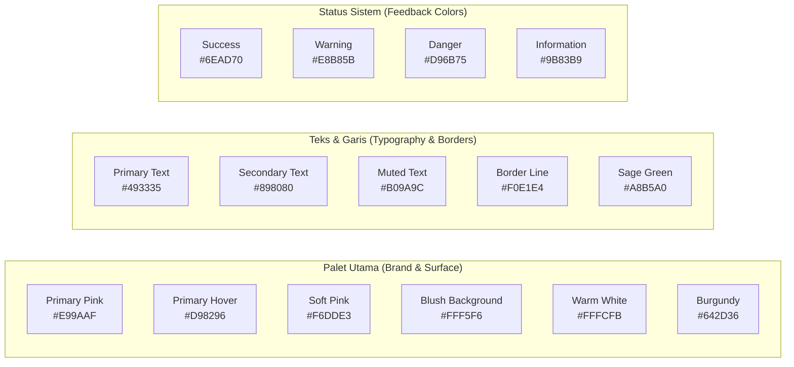
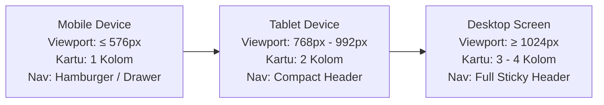

# DESIGN SYSTEM & UI COMPONENT SPECIFICATIONS
# BLOOMÉ — Flowers & Stories

## 1. Document Information

- **Nama Dokumen:** Design System & UI Component Specifications
- **Nama Produk:** BLOOMÉ — Flowers & Stories
- **Nama Proyek:** Perancangan Sistem Informasi Pemesanan dan Personalisasi Buket Bunga Berbasis Web
- **Lead UI/UX Designer & Frontend Developer:** Riya Monika
- **Lead System Analyst & Project Manager:** Jayanti Firdasari
- **Backend Developer & Database Administrator:** Elsa Futri
- **Project Sponsor:** Nabila Febriyani
- **Tema Desain:** *Elegant Floral Boutique*
- **Versi Dokumen:** 1.0 (Official UI/UX Design System Baseline)
- **Tanggal Efektif:** 13 November 2026
- **Status Dokumen:** Approved Baseline

---

## 2. Design Philosophy & Visual Concept

### 2.1 Filosofi Visual: *Flowers & Stories*
Desain antarmuka **BLOOMÉ** diciptakan untuk memancarkan keanggunan, kehangatan emosional, dan ketenangan layaknya melangkah masuk ke dalam butik bunga artisan di Kota Samarinda.
- **Elegan & Feminin Lembut:** Memadukan palet warna mawar pastel (*blush pink*), latar belakang krem hangat (*warm white*), serta aksen hijau botani (*sage green*).
- **Tipografi Bertutur:** Mengkombinasikan keanggunan klasik *Playfair Display* (serif) untuk judul-judul yang membangkitkan rasa perayaan dan kemewahan, dengan ketajaman fungsional *Poppins* (sans-serif) untuk keterbacaan teks transaksi yang tinggi.
- **Ruang & Napas (*Spacious & Clean*):** Menghindari tata letak yang padat; memberikan ruang negatif (*white space*) yang lapang agar produk buket menjadi fokus visual utama (*hero focus*).
- **Bentuk Organik Lembut:** Menggunakan sudut-sudut membulat (*rounded cards & buttons*) untuk memberikan kesan ramah dan menyenangkan bagi pembeli.

---

## 3. Token Warna Baku (Locked Color Tokens)

Seluruh komponen antarmuka publik dan dashboard admin wajib menggunakan token warna terstandarisasi berikut:

### 3.1 Spesifikasi Nilai Hex & Peran Warna
| Token Name | Hex Code | Peran Penggunaan dalam Antarmuka |
|---|---|---|
| **`color-primary`** | `#E99AAF` | Warna aksen utama merek, tombol Call-to-Action utama, tautan aktif. |
| **`color-primary-hover`**| `#D98296` | Warna saat kursor mengarah (*hover/active*) pada tombol utama. |
| **`color-primary-soft`** | `#F6DDE3` | Latar belakang elemen sekunder, badge status lembut, container sorotan. |
| **`color-bg-body`** | `#FFF5F6` | Latar belakang kanvas utama seluruh halaman website (Blush White). |
| **`color-bg-surface`** | `#FFFCFB` | Latar belakang putih hangat untuk kartu produk, container form, dan modal. |
| **`color-burgundy`** | `#642D36` | Warna teks judul utama (Heading H1/H2) dan logo aksen eksklusif. |
| **`color-text-main`** | `#493335` | Warna teks utama untuk paragraf, label form, dan tabel (*high contrast*). |
| **`color-text-sub`** | `#898080` | Warna teks sekunder, subjudul kartu, metadata tanggal, dan keterangan. |
| **`color-text-muted`** | `#B09A9C` | Warna placeholder form input, teks nonaktif (*disabled*), dan breadcrumbs. |
| **`color-botanical`** | `#A8B5A0` | Warna aksen dedaunan botani (*sage green*), penanda kategori bunga segar. |
| **`color-border`** | `#F0E1E4` | Garis tepi (*border*) tipis untuk kartu, pemisah baris tabel, dan input form. |
| **`color-success`** | `#6EAD70` | Status lunas, pembayaran dikonfirmasi, pesanan selesai, stok tersedia. |
| **`color-warning`** | `#E8B85B` | Menunggu verifikasi pembayaran, pesanan sedang dirangkai, peringatan form. |
| **`color-danger`** | `#D96B75` | Status dibatalkan, harga custom ditolak, error validasi, stok habis. |
| **`color-info`** | `#9B83B9` | Menunggu peninjauan admin, menunggu persetujuan harga, instruksi panduan. |

---

## 4. Tipografi Sistem (Typography Scale)

### 4.1 Pemilihan Font
1. **Heading Font (Display):** `Playfair Display`, serif modern, anggun, memberikan sentuhan butik premium.
2. **Body & UI Font (Interface):** `Poppins`, sans-serif geometris, modern, sangat nyaman dibaca di layar smartphone.

### 4.2 Skala Hirarki Tipografi
| Tingkat | Font Family | Ukuran / Line Height | Font Weight | Contoh Penggunaan |
|---|---|---|:---:|---|
| **Display H1** | Playfair Display | 36px / 44px (Mobile: 28px/36px) | 700 (Bold) | Hero Title Beranda, Judul Besar Page |
| **Heading H2** | Playfair Display | 28px / 36px (Mobile: 24px/32px) | 600 (SemiBold) | Judul Bagian Katalog, Judul Section |
| **Heading H3** | Poppins | 22px / 28px (Mobile: 18px/24px) | 600 (SemiBold) | Nama Produk di Detail, Judul Form |
| **Heading H4** | Poppins | 18px / 24px | 600 (SemiBold) | Nama Produk di Kartu Katalog, Sub-panel |
| **Body Large** | Poppins | 16px / 24px | 400 (Regular) / 500 (Medium) | Paragraf Pengantar, Teks Tombol Utama |
| **Body Text** | Poppins | 14px / 22px | 400 (Regular) | Teks Paragraf Umum, Label Form Input |
| **Caption/Small**| Poppins | 12px / 16px | 400 (Regular) / 500 (Medium) | Status Badge, Hint Form, Footer Copyright |

---

## 5. Sistem Jarak, Grid, & Elevasi (Spacing, Grid, & Shadows)

### 5.1 Skala Spacing (Sistem Kelipatan 4/8pt)
- `space-1` : 4px (Jarak mikro, padding badge kecil).
- `space-2` : 8px (Jarak antar ikon dan teks).
- `space-3` : 12px (Padding tombol reguler, jarak form field kecil).
- `space-4` : 16px (Padding kartu standar, margin antar paragraf).
- `space-6` : 24px (Padding kartu besar, jarak antar section kecil).
- `space-8` : 32px (Margin antar bagian formulir).
- `space-12`: 48px (Jarak vertikal antar section beranda).
- `space-16`: 64px (Pemisah section utama halaman besar).

### 5.2 Sudut Lengkung Komponen (Border Radius Tokens)
- **Large Card & Modal:** `18px` (`border-radius: 18px;`)
- **Medium Card (Product Card):** `16px` (`border-radius: 16px;`)
- **Small Container & Table Row:** `12px` (`border-radius: 12px;`)
- **Button (Semua Tombol):** `12px` (`border-radius: 12px;`)
- **Input Field & Select:** `10px` (`border-radius: 10px;`)
- **Badges / Status Pills:** `9999px` (`border-radius: 9999px;`)

### 5.3 Sistem Elevasi & Bayangan (Shadows)
- **Elevation 1 (Kartu Default):** `box-shadow: 0 4px 20px rgba(73, 51, 53, 0.05);`
- **Elevation 2 (Kartu Hover / Dropdown):** `box-shadow: 0 8px 30px rgba(73, 51, 53, 0.08);`
- **Elevation 3 (Modal Dialog / Sticky Header):** `box-shadow: 0 12px 40px rgba(73, 51, 53, 0.12);`

---

## 6. Spesifikasi Komponen Antarmuka (UI Components Library)

### 6.1 Tombol (Button Components)
1. **Primary Button:** Latar belakang `#E99AAF`, teks putih `#FFFFFF`, padding `12px 24px`, radius `12px`, font Poppins Medium (14px). Saat hover bertransisi mulus ke `#D98296`.
2. **Secondary Button:** Latar belakang transparan, border `1.5px solid #E99AAF`, teks `#E99AAF`, radius `12px`. Saat hover latar berubah menjadi `#F6DDE3`.
3. **Danger Button:** Latar belakang `#D96B75`, teks putih, untuk aksi penolakan (*Reject*) atau pembatalan pesanan.
4. **Disabled Button:** Latar belakang `#F0E1E4`, teks `#B09A9C`, kursor `not-allowed`.

### 6.2 Formulir & Input (Form Components)
1. **Text Input & Number:** Latar belakang `#FFFFFF`, border `1.5px solid #F0E1E4`, radius `10px`, padding `12px 16px`, warna teks `#493335`. Saat fokus (*focus state*), border berubah menjadi `#E99AAF` dengan *box-shadow: 0 0 0 3px rgba(233, 154, 175, 0.2)*.
2. **Greeting Card Textarea:** Didesain khusus menyerupai kartu pos buket dengan tinggi minimum 120px, font handwriting/poppins, dilengkapi penghitung karakter (*character counter*) di pojok kanan bawah.
3. **File Upload Dropzone:** Area bergaris putus-putus (`border: 2px dashed #E99AAF; background: #FFF5F6;`), radius `14px`, padding `32px 16px`, dilengkapi ikon unggah bunga, teks panduan format berkas (JPG/PNG maks 5MB), dan area pratinjau foto (*thumbnail preview*) jika berkas telah dipilih.

### 6.3 Kartu Produk (Product Card Component)
- Ukuran kartu simetris dengan radius `16px`, latar belakang `#FFFCFB`, border `1px solid #F0E1E4`, elevasi 1.
- Rasio foto buket persegi `1:1` atau `4:5` dengan *object-fit: cover* dan efek zoom halus `scale(1.03)` saat kartu di-hover.
- Penempatan badge kategori di pojok kiri atas foto buket.
- Penempatan nama produk (H4), harga buket (IDR tebal), dan tombol "Pesan" atau "Lihat Detail" di bagian bawah.

### 6.4 Status Badges (Pill Component)
Badge berbentuk kapsul (*full rounded 9999px*) dengan teks tebal 12px dan kontras ramah:
- `ST-01 Menunggu Peninjauan:` Background `#F3EDF8`, Teks `#9B83B9`.
- `ST-02 Menunggu Persetujuan Harga:` Background `#F6EDD9`, Teks `#B8882B`.
- `ST-03 Menunggu Pembayaran:` Background `#F6DDE3`, Teks `#C45A75`.
- `ST-04 Menunggu Konfirmasi:` Background `#FBF0DA`, Teks `#D49520`.
- `ST-05 Pembayaran Dikonfirmasi:` Background `#E5F4E7`, Teks `#4E8E50`.
- `ST-06 Sedang Dibuat:` Background `#EBF1FE`, Teks `#3E68B8`.
- `ST-07 Selesai:` Background `#E5F4E7`, Teks `#3B7E3E`.
- `ST-08 Dibatalkan:` Background `#FCE8E9`, Teks `#C94A55`.

### 6.5 Navigasi (Navigation Components)
1. **Customer Navbar:** Desain mengambang (*sticky floating header*), latar belakang putih transparan dengan efek kaca (*backdrop-filter: blur(10px); background: rgba(255, 252, 251, 0.95);*), logo teks BLOOMÉ Burgundy, menu tautan (Beranda, Katalog, Custom Bouquet, Tentang Kami, Kontak).
2. **Customer Footer:** Nuansa lembut `#642D36` (Burgundy mewah) atau `#F6DDE3` (Soft Pink), menampilkan jam operasional butik Samarinda, alamat Jalan Cipto Mangunkusumo, nomor kontak WhatsApp resmi, dan tautan sosial media.
3. **Admin Layout:** Sidebar tetap di sisi kiri dengan latar belakang `#F6DDE3` (Soft Pink), teks dan ikon aktif `#642D36`, container konten putih `#FFFCFB`, dan header ringkas yang memuat profil Nabila Febriyani serta tombol logout aman.

---

## 7. Penanganan Kondisi UI Multi-State (UI States)

1. **Empty State:**
   - Tampilan jika katalog kosong atau tidak ada pesanan di dashboard: Ilustrasi vas bunga kosong bergaris lembut dengan teks ramah: *"Belum ada buket di kategori ini. Jelajahi kategori lainnya atau ajukan buket custom impianmu!"*
2. **Loading State:**
   - Tombol submit berubah menjadi kondisi *loading spinner* dan teks *"Memproses pesanan..."* untuk mencegah klik ganda (*double submit*).
   - Card katalog menggunakan animasi *shimmer skeleton* bernuansa pink saat memuat data.
3. **Error State:**
   - Banner alert merah lembut (`#FCE8E9` border `#D96B75`) di atas formulir dengan ikon peringatan dan pesan berbahasa Indonesia yang jelas.
4. **Success State:**
   - Banner hijau lembut (`#E5F4E7` border `#6EAD70`) atau modal konfirmasi ramah dengan confetti floral saat pesanan berhasil tersimpan.

---

## 8. Panduan Desain Responsif (Responsive Breakpoints)

- **Mobile View (≤ 576px):**
  - Padding sisi layar 16px.
  - Kartu produk buket ditampilkan 1 kolom penuh (lebar 100%) untuk foto yang jelas.
  - Target sentuh tombol minimum 44px × 44px agar ramah jempol.
  - Tabel admin dapat di-scroll secara horizontal tanpa merusak layout.
- **Tablet View (768px – 992px):**
  - Padding sisi layar 24px.
  - Kartu buket ditampilkan 2 kolom simetris.
- **Desktop View (≥ 1024px):**
  - Lebar container konten maksimum 1200px terpusat (*margin: 0 auto;*).
  - Kartu katalog ditampilkan 3 atau 4 kolom.
  - Panel admin memiliki sidebar tetap di sisi kiri selebar 260px.

---

## 9. Kesimpulan & Pengesahan

Panduan Desain Sistem ini telah ditinjau dan dinyatakan memenuhi seluruh kebutuhan estetika merek, ramah pengguna, mudah diimplementasikan ke dalam komponen CSS/Blade, serta konsisten di seluruh halaman pelanggan dan admin.

**Disahkan Oleh:**  
**Riya Monika** (UI/UX Designer & Frontend Developer)  
**Jayanti Firdasari** (Project Manager & System Analyst)  
Tanggal: 13 November 2026
