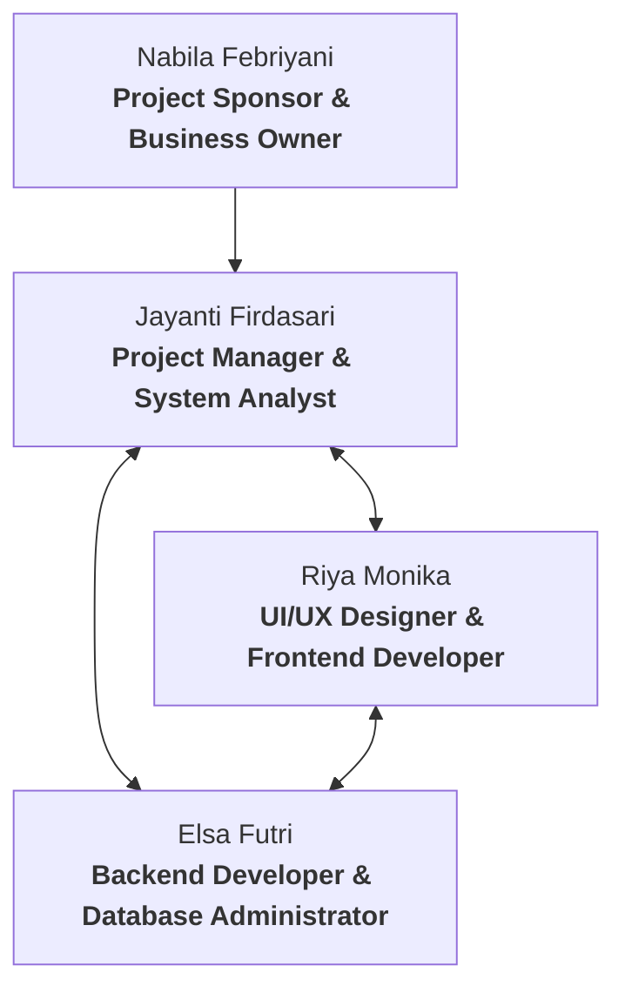

# LAPORAN PEMERIKSAAN PEMBAGIAN TUGAS TIM (TEAM ASSIGNMENT REVIEW)
## BLOOMÉ — Flowers & Stories
**Task ID:** DOC-003  
**Fase:** Phase 1 — Project Initiation and Documentation  
**Penanggung Jawab:** Jayanti Firdasari (Project Manager & System Analyst)  
**Tanggal Pemeriksaan:** 13 November 2026  
**Status Task:** Completed (`[x]`)  
**Dependensi:** DOC-002 — Memeriksa ruang lingkup proyek (Selesai)  

---

## 1. Ringkasan Eksekutif

Pemeriksaan Pembagian Tugas Tim (Task DOC-003) dilakukan untuk menetapkan dan memvalidasi struktur organisasi proyek, pembagian peran teknis, serta matriks akuntabilitas bagi seluruh anggota tim pengembangan **BLOOMÉ — Flowers & Stories**.

Dengan tenggat waktu proyek yang ketat (13 Oktober – 30 November 2026), kejelasan peran (*role clarity*) dan batasan tanggung jawab menjadi faktor penentu agar tidak terjadi tumpang-tindih pekerjaan (*role collision*), hambatan koordinasi (*bottlenecks*), maupun area pekerjaan yang terabaikan (*unassigned work*).

---

## 2. Struktur Tim & Profil Peran Utama

Struktur tim terdiri dari 3 personil inti teknis dan 1 penanggung jawab bisnis:

### 2.1 Jayanti Firdasari — Project Manager & System Analyst
- **Tanggung Jawab Utama:**
  - Perencanaan proyek, penjadwalan (*milestones*), dan pemantauan kepatuhan terhadap timeline.
  - Analisis kebutuhan fungsional & nonfungsional serta penyusunan spesifikasi sistem (`requirement.md`, `prd.md`).
  - Pemodelan analisis sistem (Use Case Diagram, Use Case Description, Activity Diagrams, Sequence Diagrams).
  - Koordinasi komunikasi antar anggota tim serta fasilitasi komunikasi dengan Sponsor.
  - Pengawasan implementasi metodologi Waterfall dan pemenuhan *Cross-Phase Quality Gates*.
  - Koordinasi pengujian penerimaan pengguna (*User Acceptance Testing* / UAT) dan penyusunan laporan akhir proyek.

### 2.2 Riya Monika — UI/UX Designer & Frontend Developer
- **Tanggung Jawab Utama:**
  - Perancangan fondasi desain visual (`design-system.md`): color tokens, tipografi, grid/spacing, dan aset floral.
  - Perancangan antarmuka pengguna: Wireframe, High-Fidelity Mockup, dan prototipe interaktif untuk antarmuka publik dan dashboard admin.
  - Implementasi frontend berbasis Blade template, CSS modular, dan JavaScript murni / komponen interaktif.
  - Penjaminan responsivitas antarmuka pada 3 viewport utama (Desktop, Tablet, dan Mobile).
  - Pengujian UI/UX: konsistensi komponen visual, kemudahan pengisian form, dan *user feedback states* (loading, error, success).

### 2.3 Elsa Futri — Backend Developer & Database Administrator
- **Tanggung Jawab Utama:**
  - Perancangan arsitektur teknis aplikasi (`architecture.md`) dengan Three-Layer Architecture.
  - Perancangan skema basis data konseptual, logikal, dan fisik (`database-design.md`, ERD, normalisasi, indexing).
  - Penyiapan proyek Laravel, konfigurasi `.env`, pembuatan seluruh database migrations, Eloquent models, dan seeders.
  - Pengembangan business logic Laravel: controllers, form validation requests, services, dan security middleware.
  - Implementasi modul autentikasi admin, penanganan upload berkas foto (produk & referensi custom), transaksi data pesanan, dan histori status.
  - Backend integration, functional testing, dan security audit (CSRF, SQL Injection, XSS, upload security).

### 2.4 Nabila Febriyani — Project Sponsor & Pemilik Usaha (Stakeholder Eksternal)
- **Tanggung Jawab:**
  - Menyediakan arahan visi bisnis, kebijakan harga, dan aturan operasional buket.
  - Memberikan konfirmasi tertulis terhadap hal-hal yang berstatus `[PERLU KONFIRMASI]`.
  - Berpartisipasi aktif dalam sesi review desain dan pengujian akhir sistem (*Final User Acceptance*).

---

## 3. Matriks Penugasan per Fase Proyek (Phase-by-Phase Assignment)

| Fase Proyek | Aktivitas Kunci | Lead (Penanggung Jawab Utama) | Contributor (Pendukung) |
|---|---|---|---|
| **Phase 1 — Inisiasi & Dokumen Dasar** | Charter review, scope analysis, requirement, PRD, architecture baseline | **Jayanti Firdasari** | Elsa Futri, Riya Monika |
| **Phase 2 — Analisis & Desain Sistem** | UML Modeling (Use Case, Activity, Sequence) | **Jayanti Firdasari** | Elsa Futri (Architecture input) |
| **Phase 3 — UI/UX Design** | Design System, Wireframes, Mockups, Prototype | **Riya Monika** | Jayanti Firdasari (Flow review) |
| **Phase 4 — Database Design & Migrations** | ERD, Skema Database, Laravel Migrations, Models | **Elsa Futri** | Jayanti Firdasari (Entity validation) |
| **Phase 5 — Laravel Foundation** | Setup Laravel, routing groups, middleware, config | **Elsa Futri** | Riya Monika (Vite setup) |
| **Phase 6 — Backend Development** | Controllers, business logic, file storage, auth | **Elsa Futri** | Jayanti Firdasari |
| **Phase 7 — Frontend Development** | Blade templates, CSS styling, components, responsive | **Riya Monika** | Elsa Futri (Data binding contract) |
| **Phase 8 — Integrasi Sistem** | Menghubungkan View dengan Controller & Database | **Elsa Futri & Riya Monika** | Jayanti Firdasari (Workflow test) |
| **Phase 9 — Security & QA / Testing** | Unit/Feature test, responsive check, security review, UAT | **Jayanti Firdasari** | Elsa Futri, Riya Monika |
| **Phase 10 — Deployment & Handover** | Deployment, user guide, admin guide, final handover | **Jayanti Firdasari** | Elsa Futri, Riya Monika |

---

## 4. Matriks RACI (Responsible, Accountable, Consulted, Informed)

- **R (Responsible):** Pihak yang mengerjakan tugas secara teknis.
- **A (Accountable):** Pihak yang memiliki keputusan akhir dan memastikan pekerjaan selesai sesuai standar.
- **C (Consulted):** Pihak yang dimintai masukan atau konsultasi teknis dua arah.
- **I (Informed):** Pihak yang diberi pembaruan progres satu arah.

| Deliverable / Modul Pekerjaan | Nabila (Sponsor) | Jayanti (PM/SA) | Riya (UI/UX & FE) | Elsa (BE & DBA) |
|---|:---:|:---:|:---:|:---:|
| Project Charter & Scope Baseline | A | R | C | C |
| SRS (`requirement.md`) & PRD (`prd.md`) | C | A / R | C | C |
| UML Diagrams (Use Case, Activity, Sequence) | I | A / R | C | C |
| System Architecture (`architecture.md`) | I | C | C | A / R |
| Design System & Visual Assets | C | C | A / R | I |
| Wireframes & Mockups (Customer & Admin) | C | C | A / R | C |
| Skema Basis Data & ERD (`database-design.md`) | I | C | I | A / R |
| Laravel Foundation & Migrations | I | I | C | A / R |
| Logika Bisnis & Backend Modules | I | C | C | A / R |
| Antarmuka Blade & Desain Responsif | I | C | A / R | C |
| Integrasi Frontend-Backend | I | C | R | R (Lead) |
| Audit Keamanan & Proteksi Data | I | C | I | A / R |
| Functional & Cross-Browser Testing | I | A / R | R | R |
| User Acceptance Testing (UAT) | A | R | C | C |
| User Guide & Admin Guide Manual | C | A / R | C | C |
| Final Project Approval & Sign-Off | A | R | I | I |

---

## 5. Tanggung Jawab Bersama (*Shared Responsibilities*)

Seluruh anggota tim (Jayanti, Riya, Elsa) memiliki komitmen tanggung jawab bersama (*shared ownership*) untuk:
1. **Peer Review Dokumen:** Meninjau silang setiap deliverable sebelum diajukan ke Quality Gate.
2. **Defect & Bug Resolution:** Berkolaborasi langsung saat ditemukan *bug* pada fase integrasi tanpa saling menyalahkan ranah backend vs frontend.
3. **Penyelarasan Data Contract:** Memastikan kesepakatan nama variabel, format form input, dan response controller antara Blade template dan controller Laravel berjalan mulus.
4. **Kepatuhan Terhadap Definition of Done (DoD):** Menolak menandai task selesai (`[x]`) apabila deliverable atau kriteria pengujian belum diverifikasi secara nyata.

---

## 6. Protokol Komunikasi & Resolusi Masalah

1. **Sinkronisasi Berkala:** Melakukan *daily standup* singkat untuk memeriksa progres task yang sedang aktif, hambatan (*blockers*), dan rencana kerja hari berikutnya.
2. **Resolusi Perbedaan Pendapat:** Apabila terjadi silang pendapat mengenai alur teknis (misal antara UX dan efisiensi backend), PM (Jayanti) bertindak sebagai penengah dengan merujuk pada `requirement.md` dan `prd.md`.
3. **Eskalasi ke Sponsor:** Jika tim memerlukan keputusan kebijakan bisnis mendasar (seperti salah satu dari 12 item `[PERLU KONFIRMASI]`), PM adalah perwakilan tunggal yang berkomunikasi secara resmi dengan Nabila Febriyani.

---

## 7. Kesimpulan & Rekomendasi

### 7.1 Status Task DOC-003
Task **DOC-003 (Memeriksa pembagian tugas tim)** telah selesai dilaksanakan dengan hasil:
- Tanggung jawab dan batasan tugas untuk ketiga personil tim terdefinisi secara jelas dan seimbang.
- Matriks RACI telah ditetapkan untuk mencegah ambiguitas tugas dari awal hingga serah terima proyek.
- Protokol kerja sama dan koordinasi siap diimplementasikan.
- Kriteria penyelesaian terpenuhi.

### 7.2 Rekomendasi Langkah Berikutnya
Melanjutkan ke task berikutnya pada sub-fase 4.1 Project Foundation:
- **`DOC-004 — Memastikan jadwal proyek.`**

