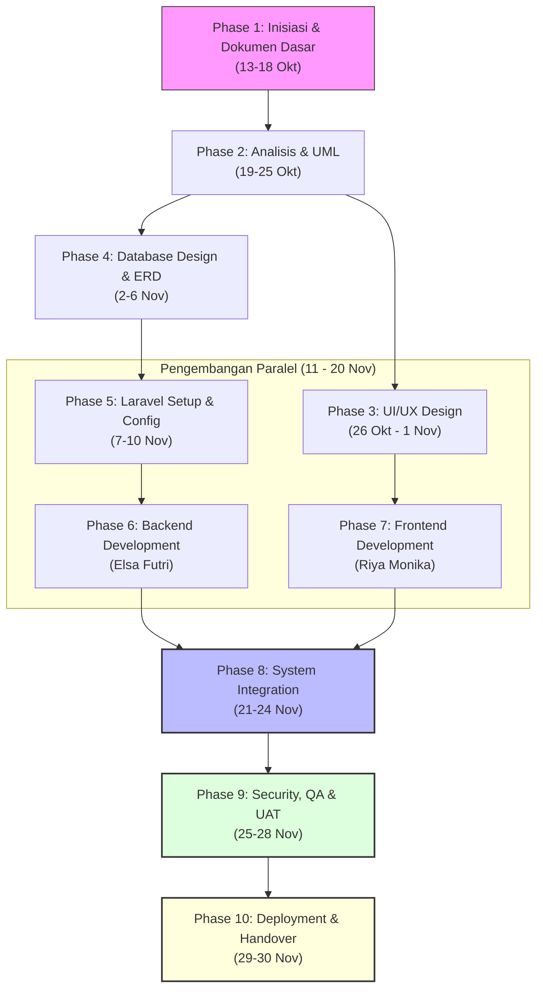

# LAPORAN PEMASTIAN JADWAL PROYEK (PROJECT SCHEDULE VERIFICATION)
## BLOOMÉ — Flowers & Stories
**Task ID:** DOC-004  
**Fase:** Phase 1 — Project Initiation and Documentation  
**Penanggung Jawab:** Jayanti Firdasari (Project Manager & System Analyst)  
**Tanggal Verifikasi:** 13 November 2026  
**Status Task:** Completed (`[x]`)  
**Dependensi:** DOC-003 — Memeriksa pembagian tugas tim (Selesai)  

---

## 1. Ringkasan Eksekutif

Pemeriksaan dan Pemastian Jadwal Proyek (Task DOC-004) dilakukan untuk memvalidasi kelayakan kerangka waktu (*timeframe feasibility*) pengembangan sistem informasi **BLOOMÉ — Flowers & Stories**. Periode proyek yang ditetapkan dalam Project Charter adalah **13 Oktober 2026 hingga 30 November 2026** (total durasi 49 hari kalender / 7 minggu kerja).

Dokumen ini menyusun jadwal kerja terperinci (*Work Breakdown Schedule*), memetakan jalur kritis (*Critical Path*), serta menetapkan pekerjaan sekuensial dan paralel dengan metodologi Waterfall guna memastikan sistem selesai dan diserahterimakan tepat waktu tanpa mengorbankan mutu.

---

## 2. Rincian Jadwal Fase Proyek `[PROPOSED SCHEDULE BASELINE]`

Kerangka waktu 7 minggu dibagi ke dalam 10 fase terstruktur dengan alokasi hari kerja sebagai berikut:

| No | Fase Proyek | Tanggal Mulai (Planned Start) | Tanggal Selesai (Planned End) | Estimasi Durasi | Penanggung Jawab |
|---|---|---|---|---|---|
| **1** | **Phase 1 — Project Initiation & Documentation** | 13 Oktober 2026 | 18 Oktober 2026 | 6 hari | Jayanti Firdasari |
| **2** | **Phase 2 — System Analysis & Design (UML)** | 19 Oktober 2026 | 25 Oktober 2026 | 7 hari | Jayanti Firdasari |
| **3** | **Phase 3 — UI/UX Design (System, Mockup, Proto)** | 26 Oktober 2026 | 01 November 2026 | 7 hari | Riya Monika |
| **4** | **Phase 4 — Database Design & Migrations** | 02 November 2026 | 06 November 2026 | 5 hari | Elsa Futri |
| **5** | **Phase 5 — Laravel Project Foundation** | 07 November 2026 | 10 November 2026 | 4 hari | Elsa Futri |
| **6** | **Phase 6 — Backend Development (Core Logic)** | 11 November 2026 | 20 November 2026 | 10 hari | Elsa Futri |
| **7** | **Phase 7 — Frontend Development (Blade & CSS)** | 11 November 2026 | 20 November 2026 | 10 hari | Riya Monika |
| **8** | **Phase 8 — System Integration** | 21 November 2026 | 24 November 2026 | 4 hari | Elsa & Riya |
| **9** | **Phase 9 — Security, QA & User Acceptance (UAT)** | 25 November 2026 | 28 November 2026 | 4 hari | Jayanti Firdasari |
| **10**| **Phase 10 — Deployment, Finalization & Handover** | 29 November 2026 | 30 November 2026 | 2 hari | Seluruh Tim |

> **Catatan:** Tanggal aktual pelaksanaan per task akan dicatat secara transparan pada laporan progres mingguan.

---

## 3. Analisis Ketergantungan & Jalur Kritis (Critical Path Method)

Metodologi Waterfall mengharuskan fase fondasi diselesaikan secara sekuensial sebelum pengembangan teknis. Namun, efisiensi waktu dicapai dengan menjalankan Fase 6 (Backend) dan Fase 7 (Frontend) secara paralel setelah basis data dan desain terkunci.

### 3.1 Critical Path (Rantai Aktivitas Kritis)
Jalur kritis proyek yang memiliki *zero float* (penundaan pada jalur ini langsung menunda rilis 30 November):
1. **Penyelesaian SRS & PRD** (Gate 1: 18 Okt)
2. **UML Modeling & Validasi Alur Bisnis** (25 Okt)
3. **Database Schema & Migrations** (6 Nov)
4. **Laravel Foundation & Auth Middleware** (10 Nov)
5. **Backend Core Modules (Orders, Custom, Payments)** (20 Nov)
6. **System Integration (Blade terhubung ke Controller & Database)** (24 Nov)
7. **Security Review, Functional Testing & Bug Fixing** (28 Nov)
8. **Final Sign-off Sponsor & Handover** (30 Nov)

### 3.2 Pekerjaan Paralel (*Parallel Workstreams*)
- **Fase 6 & Fase 7 (11 – 20 Nov):**
  - Riya Monika membangun antarmuka Blade, CSS, dan micro-interaction berbasis wireframe/mockup yang sudah disetujui di Fase 3.
  - Elsa Futri mengimplementasikan Controller, Form Requests, Service logic, dan Database Transaction secara independen menggunakan *dummy data / JSON responses*.
  - Kedua stream bertemu secara formal pada tanggal 21 November (Fase 8: Integrasi).

---

## 4. Quality Gate Milestones (Titik Pemeriksaan Wajib)

Untuk menjaga kualitas sebelum melangkah ke fase berikutnya, ditetapkan 6 Quality Gate:

| Gate | Nama Milestone | Syarat Kelulusan Gate | Batas Tanggal |
|---|---|---|---|
| **Gate 1** | *Requirements Approved* | `requirement.md`, `prd.md`, dan scope baseline disetujui. | 18 Okt 2026 |
| **Gate 2** | *Design & Modeling Approved* | UML selesai, ERD valid, dan mockup UI/UX disetujui. | 01 Nov 2026 |
| **Gate 3** | *Development Ready* | Struktur Laravel, konfigurasi `.env`, dan migrasi tabel siap. | 10 Nov 2026 |
| **Gate 4** | *Integration Complete* | Seluruh form publik dan admin terhubung ke basis data tanpa error fatal. | 24 Nov 2026 |
| **Gate 5** | *Testing & UAT Approved* | Pengujian fungsional 100% lolos, tidak ada bug kritis, sponsor menyetujui hasil UAT. | 28 Nov 2026 |
| **Gate 6** | *Project Handover Completed*| Deployment selesai, dokumentasi lengkap, berita acara serah terima ditandatangani. | 30 Nov 2026 |

---

## 5. Manajemen Risiko Jadwal (*Schedule Risk Management*)

| Potensi Risiko Keterlambatan | Dampak | Strategi Mitigasi / Kontinjensi |
|---|---|---|
| **Keterlambatan Konfirmasi Sponsor (`[PERLU KONFIRMASI]`)** | Tertundanya detail formulir atau pembayaran | Menggunakan *fallback defaults* sementara yang modular sehingga mudah disesuaikan ketika konfirmasi masuk tanpa merusak arsitektur data. |
| **Kesulitan Integrasi Frontend-Backend** | Molornya Fase 8 | Kontrak variabel input-output disepakati di awal (saat Phase 5) dalam dokumen teknis sebelum coding dimulai. |
| **Ditemukan Defect Kritis saat QA** | Mengancam rilis 30 Nov | Mengalokasikan 4 hari khusus (25-28 Nov) untuk QA/bug fixing dan menjaga ruang lingkup tetap terkendali (*strict scope control*). |

---

## 6. Kesimpulan & Rekomendasi

### 6.1 Status Task DOC-004
Task **DOC-004 (Memastikan jadwal proyek)** telah selesai dilaksanakan:
- Jadwal dasar (*baseline schedule*) 13 Oktober – 30 November 2026 terbukti realistis dan terstruktur.
- Pemetaan jalur kritis (*critical path*) dan pekerjaan paralel telah jelas.
- 6 titik Quality Gate siap diterapkan.
- Kriteria penyelesaian terpenuhi.

### 6.2 Rekomendasi Langkah Berikutnya:
Melanjutkan ke task penutup sub-fase 4.1 Project Foundation:
- **`DOC-005 — Menentukan struktur direktori dokumentasi.`**

