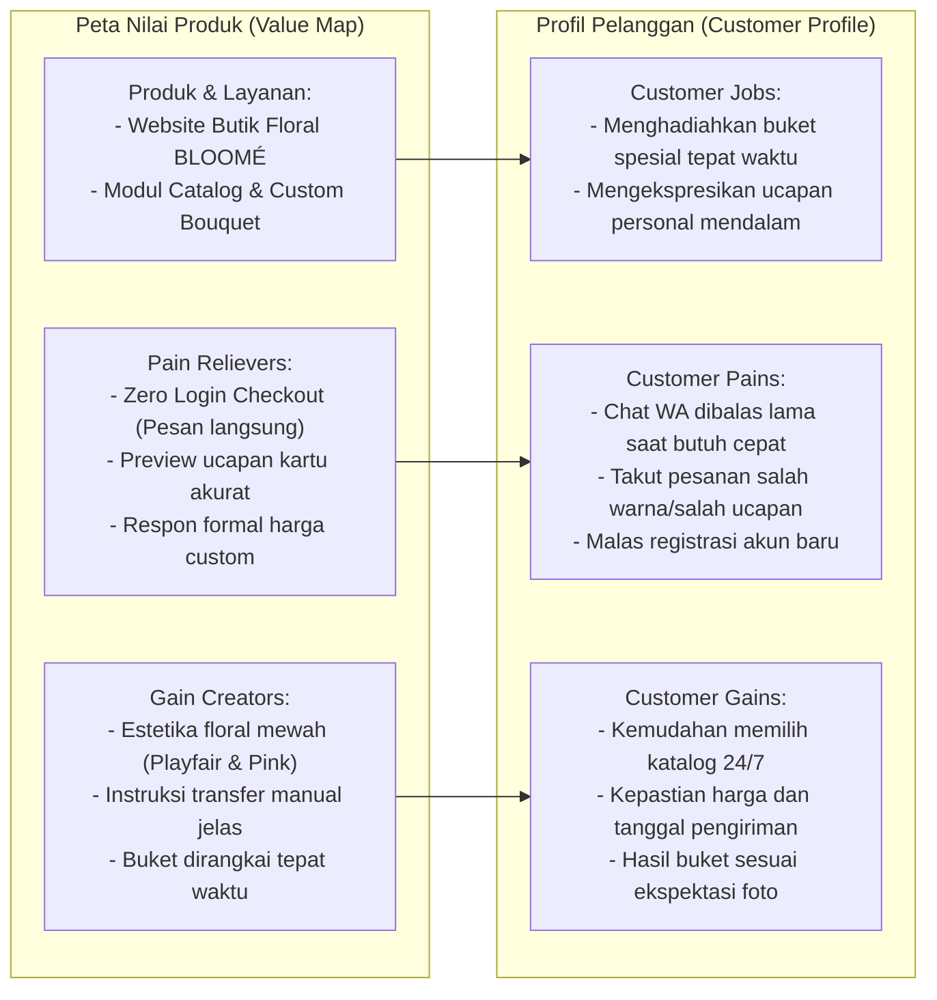

# LAPORAN PENINJAUAN VISI PRODUK (PRODUCT VISION & VALUE PROPOSITION REVIEW)
## BLOOMÉ — Flowers & Stories
**Task ID:** DOC-012  
**Fase:** Phase 1 — Project Initiation and Documentation (Sub-fase 4.3 Product Documentation)  
**Penanggung Jawab:** Jayanti Firdasari (Project Manager & System Analyst)  
**Tanggal Peninjauan:** 13 November 2026  
**Status Task:** Completed (`[x]`)  
**Dependensi:** DOC-011 — Menyusun `prd.md` (Selesai)  

---

## 1. Ringkasan Eksekutif

Peninjauan Visi Produk (Task DOC-012) dilakukan untuk mengevaluasi ketajaman arah strategis, filosofi nilai (*brand essence*), proposisi nilai (*value proposition*), serta penyelarasan visi produk **BLOOMÉ — Flowers & Stories** terhadap kebutuhan bisnis nyata pemilik usaha (Sponsor Nabila Febriyani) dan preferensi pelanggan di Kota Samarinda.

Hasil peninjauan mengonfirmasi bahwa visi produk telah **KOKOH, KONSISTEN, dan RELEVAN**, memposisikan website BLOOMÉ bukan hanya sekadar sistem formulir transaksi, melainkan butik floral digital yang menghubungkan emosi pelanggan dengan karya seni buket (*Flowers & Stories*).

---

## 2. Dekomposisi Visi Produk & Filosofi Merek

### 2.1 Inti Filosofi Merek: *Flowers & Stories*
Buket bunga pada hakikatnya adalah instrumen emosional. Setiap pemesanan selalu membawa sebuah "cerita" personal—baik ungkapan selamat wisuda, perayaan hari jadi, permohonan maaf, apresiasi rekan kerja, hingga tanda belasungkawa.
- **Tantangan Lama:** Komunikasi obrolan chat manual seringkali mereduksi sentuhan personal ini menjadi transaksi yang kaku dan rawan salah paham.
- **Pendekatan Produk BLOOMÉ:** Platform web dirancang dengan nuansa lembut (*soft floral aesthetic*) yang menempatkan kartu ucapan (*greeting card*) dan detail personalisasi kustom sebagai elemen kelas satu (*first-class citizens*), bukan sekadar catatan sampingan.

### 2.2 Pernyataan Visi Produk Resmi
> *"Menjadi butik buket bunga digital terdepan di Samarinda yang memberikan pengalaman pemesanan yang hangat, estetis, transparan, dan terpercaya bagi pelanggan, sekaligus memberdayakan pemilik usaha dengan efisiensi operasional terpadu dalam merangkai setiap cerita personal di balik indahnya bunga."*

---

## 3. Posisi Pasar & Keunggulan Kompetitif (Market Positioning)

Di pasar lokal Samarinda dan sekitarnya, mayoritas usaha perangkai buket bunga masih beroperasi sepenuhnya melalui media sosial Instagram dan chat WhatsApp. Peninjauan memetakan keunggulan komparatif BLOOMÉ:

| Aspek Operasional | Toko Bunga Konvensional (Status Quo) | BLOOMÉ — Flowers & Stories (Web-Based) |
|---|---|---|
| **Katalog Produk** | Tercecer dalam feed / highlights IG; harga sering disembunyikan (*"cek DM"*). | Terpusat di etalase web 24/7; harga jelas, kategori rapi, status stok tertera transparan. |
| **Pemesanan Katalog** | Pelanggan harus mengetik ulang format teks manual via chat WhatsApp. | Formulir terstruktur instan (*guest checkout*) tanpa perlu membuat akun atau login. |
| **Pesanan Kustomisasi** | Pelanggan kirim foto acak; negosiasi panjang tanpa batasan spesifikasi. | Form kustom terarah (pilihan bahan, warna, tema, unggah referensi JPG/PNG ≤ 5MB). |
| **Penetapan Harga Custom** | Fluktuatif dan sering kali berubah di tengah chat tanpa rekaman resmi. | Admin menginput penawaran resmi di web; pelanggan menyetujui formal sebelum bayar. |
| **Verifikasi Pembayaran** | Kirim screenshot transfer di chat yang rentan tenggelam oleh pesan lain. | Terintegrasi dengan kode pesanan; admin memverifikasi mutasi bank/e-wallet langsung di dashboard. |
| **Pelacakan Status** | Pelanggan bertanya berulang kali *"apakah buket saya sudah jadi?"*. | 8 Status terdefinisi jelas dari *Pending*, *Sedang Dibuat*, hingga *Selesai*. |

---

## 4. Value Proposition Canvas (VPC) Deep Dive

---

## 5. Penyelarasan Strategis Visi terhadap Arsitektur & Aturan Bisnis

Peninjauan memvalidasi bahwa visi produk diharmonisasikan secara sempurna dengan batasan teknis yang disepakati:

1. **Visi *Ease of Access* ↔ Aturan BR-001 (No Customer Login):**
   - Visi kemudahan berbelanja diwujudkan secara konkret dengan meniadakan pendaftaran akun atau password, sehingga pelanggan dapat langsung menyelesaikan pesanan dalam hitungan menit.
2. **Visi *Artisan Personalization* ↔ Aturan BR-006 (Manual Custom Pricing):**
   - Visi perangkaian bunga personal dihormati dengan menolak kalkulasi otomatis robotik. Pemilik usaha (florist) tetap memegang kendali penuh dalam menaksir kerumitan desain dan stok bunga segar riil sebelum mengajukan harga.
3. **Visi *Trust & Transparency* ↔ Siklus 8 Status (ST-01 s/d ST-08):**
   - Transparansi alur pengerjaan diwujudkan melalui tahapan status yang terstruktur dan terverifikasi secara formal pada setiap tahap transaksi.

---

## 6. Kesimpulan & Rekomendasi

### 6.1 Status Task DOC-012
Task **DOC-012 (Meninjau product vision)** telah selesai dilaksanakan:
- Visi produk, positioning, dan proposisi nilai (*Value Proposition Canvas*) telah ditinjau mendalam dan selaras 100% dengan kebutuhan pasar serta batasan Project Charter.
- Kriteria penyelesaian terpenuhi.

### 6.2 Rekomendasi Langkah Berikutnya:
Melanjutkan ke task peninjauan berikutnya pada sub-fase 4.3:
- **`DOC-013 — Meninjau user personas.`**

