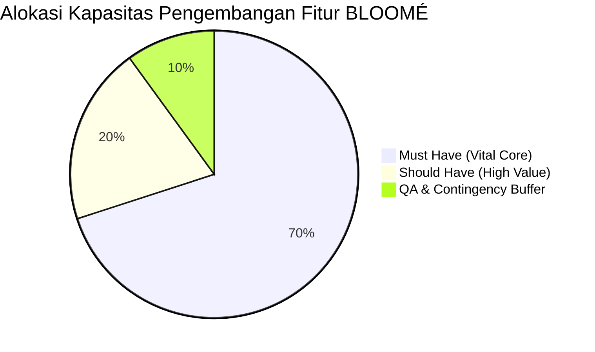

# LAPORAN PENINJAUAN PRIORITAS PRODUK (PRODUCT PRIORITIZATION REVIEW — MoSCoW)
## BLOOMÉ — Flowers & Stories
**Task ID:** DOC-015  
**Fase:** Phase 1 — Project Initiation and Documentation (Sub-fase 4.3 Product Documentation)  
**Penanggung Jawab:** Jayanti Firdasari (Project Manager & System Analyst)  
**Tanggal Peninjauan:** 13 November 2026  
**Status Task:** Completed (`[x]`)  
**Dependensi:** DOC-011 s/d DOC-014 (Selesai)  

---

## 1. Ringkasan Eksekutif

Peninjauan Prioritas Produk (Task DOC-015) merupakan aktivitas penutup pada sub-fase **4.3 Product Documentation**. Evaluasi ini menerapkan kerangka kerja **MoSCoW Prioritization** (*Must Have, Should Have, Could Have, Won't Have*) terhadap seluruh fitur yang tercantum dalam `prd.md` dan `requirement.md`.

Penetapan prioritas mutlak ini bertujuan mengunci batasan pengerjaan teknis bagi Elsa Futri (Backend) dan Riya Monika (Frontend), mencegah terjadinya perluasan ruang lingkup liar (*scope creep*), serta menjamin penyelesaian produk siap rilis (*Minimum Viable Product* / MVP) tepat waktu sebelum batas akhir proyek pada **30 November 2026**.

---

## 2. Matriks Prioritisasi Produk (MoSCoW Framework)

---

### 2.1 MUST HAVE (Prioritas P0 — Non-Negotiable Core)
Fitur pada kelompok ini adalah prasyarat mutlak berjalannya sistem. Tanpa fitur-fitur ini, transaksi florist tidak dapat berlangsung:

| ID Fitur | Nama Fitur | Justifikasi Bisnis & Nilai Kritis |
|---|---|---|
| **F-001** | Beranda Publik (Homepage) | Titik masuk utama pelanggan; menampilkan identitas merek BLOOMÉ dan navigasi. |
| **F-002** | Katalog Produk & Kategori | Menampilkan etalase buket aktif beserta penanda kategori bunga/uang/snack. |
| **F-003** | Detail Produk | Menyediakan rincian komposisi rangkaian bunga, harga pas, dan ketersediaan stok. |
| **F-005** | Form Pemesanan Katalog | Menampung identitas pemesan, alamat, ucapan kartu, dan tanggal kebutuhan tanpa login (*guest checkout*). |
| **F-008** | Form Personalisasi Custom | Menampung spesifikasi bahan, palet warna, tema, dan catatan pesanan buket khusus. |
| **F-009** | Upload Gambar Referensi | Mengunggah berkas foto acuan (JPG/PNG ≤ 5MB) dengan validasi server ketat. |
| **F-011** | Penentuan Harga Custom | Fasilitas bagi admin untuk menginput harga penawaran buket kustom secara manual. |
| **F-012** | Keputusan Harga Custom | Mekanisme bagi pemesan untuk menyetujui (*Approve*) atau menolak (*Reject*) usulan harga. |
| **F-013** | Mesin Transaksi Pesanan | Penyimpanan data pelanggan, pesanan, dan item secara atomik (*DB Transaction*). |
| **F-019** | Instruksi Pembayaran | Menampilkan nomor rekening bank dan e-wallet resmi untuk transfer manual. |
| **F-020** | Konfirmasi Pembayaran | Fitur pelanggan menyatakan telah transfer dana; memicu status verifikasi. |
| **F-021** | Verifikasi Pembayaran Manual | Aksi admin memvalidasi mutasi rekening dan mengubah status menjadi *Paid*. |
| **F-017** | Manajemen 8 Status Pesanan | Transisi status pengerjaan bertahap dari *Pending* hingga *Selesai*. |
| **F-018** | Manajemen Pembatalan | Peninjauan alasan permohonan pembatalan dengan aksi *Approve* atau *Reject*. |
| **F-022** | Autentikasi Admin | Login panel admin yang aman dengan hashing sandi dan proteksi token CSRF. |
| **F-024** | Manajemen Produk (CRUD) | Fasilitas admin menambah, mengedit, menghapus buket, serta toggle ketersediaan. |
| **F-025** | Manajemen Kategori (CRUD) | Fasilitas admin mengelola kategori buket dengan validasi nama unik. |

---

### 2.2 SHOULD HAVE (Prioritas P1 — Highly Recommended / Fast Follow)
Fitur yang sangat penting untuk efisiensi operasional dan kenyamanan visual, namun sistem masih dapat berjalan secara darurat jika fitur ini ditunda sementara:

| ID Fitur | Nama Fitur | Justifikasi Bisnis & Dampak Operasional |
|---|---|---|
| **F-023** | Dashboard Overview Metrics | Kartu metrik ringkasan antrean pesanan harian dan pesanan menunggu bayar. |
| **F-029** | Audit Trail Status Histori | Pencatatan kronologis waktu dan admin yang mengubah status di `order_status_histories`. |
| **F-014** | Ringkasan Pesanan Interaktif | Tampilan pratinjau kartu ucapan dan kalkulasi subtotal instan di sisi antarmuka. |
| **NFR-UI**| Visual Multi-State Feedback | Ilustrasi ramah saat katalog kosong (*empty*), indikator memuat (*loading*), dan alert. |
| **NFR-RES**| Layout Responsif Mobile/Tablet | Adaptasi sempurna tata letak antarmuka pada viewport layar smartphone (≤ 576px). |

---

### 2.3 COULD HAVE (Prioritas P2 — Nice to Have / If Time Permits)
Fitur pelengkap yang hanya dikerjakan apabila seluruh fitur Must Have dan Should Have telah selesai dan teruji, serta masih memiliki sisa waktu sebelum *freeze code*:

| Fitur Pelengkap | Deskripsi | Batasan Pengerjaan |
|---|---|---|
| **Quick Duplicate Product** | Tombol duplikasi data produk katalog lama untuk mempercepat penambahan varian buket serupa. | Hanya dikembangkan jika Fase 6 selesai lebih cepat dari jadwal. |
| **Printable Order Receipt** | Format tampilan cetak sederhana (*CSS print-friendly view*) untuk nota fisik butik. | Fitur opsional non-blocking. |

---

### 2.4 WON'T HAVE (Prioritas P3 — Strictly Excluded in v1.0)
Fitur yang secara formal **DITOLAK** dan dilarang dikembangkan pada rilis v1.0 untuk menjaga integritas jadwal 30 November 2026:

| Fitur Dikecualikan | Alasan Penolakan Tegas |
|---|---|
| **Registrasi / Login Pelanggan** | Membebani pembeli kasual; bertentangan dengan prinsip *frictionless guest checkout*. |
| **Payment Gateway Otomatis** | Memerlukan verifikasi legal merchant API berbayar; operasional BLOOMÉ memilih transfer manual. |
| **WhatsApp Bot Notification API** | Mengharuskan biaya langganan API pihak ketiga; komunikasi langsung manual dinilai lebih personal. |
| **Live Tracking GPS Kurir Ekspedisi** | Di luar kebutuhan toko florist lokal Samarinda pada tahap awal. |
| **Kalkulator Harga Custom Otomatis** | Florist menolak kalkulasi robotik karena harga bunga segar dan pita fluktuatif. |
| **Sistem Multi-Role Admin** | Sistem hanya diperuntukkan bagi 1 akun admin utama (pemilik usaha). |

---

## 3. Strategi Alokasi Waktu & Manajemen Kapasitas Tim

Berdasarkan jadwal proyek (DOC-004), dialokasikan 10 hari kerja intensif (11 – 20 November 2026) untuk Fase Pengembangan teknis:
- **70% Waktu (Hari 1 s/d 7):** Fokus 100% menyelesaikan seluruh modul **Must Have (P0)**.
- **20% Waktu (Hari 8 s/d 9):** Integrasi dan penyempurnaan fitur **Should Have (P1)**.
- **10% Waktu (Hari 10):** *Buffer freeze*, verifikasi akhir data contract, dan persiapan Fase 8 Integrasi.
- **Aturan Kontinjensi:** Apabila terjadi kendala tak terduga, fitur Should Have dapat diturunkan tingkat kelengkapannya tanpa boleh mengurangi satupun fitur Must Have.

---

## 4. Kesimpulan & Rekomendasi

### 4.1 Status Task DOC-015
Task **DOC-015 (Meninjau product priorities)** telah selesai dilaksanakan:
- Klasifikasi MoSCoW telah ditetapkan secara tegas dan disepakati oleh seluruh tim.
- Alokasi kapasitas pengembangan dan aturan kontinjensi terkunci.
- Seluruh sub-fase **4.3 Product Documentation (DOC-011 s/d DOC-015) resmi SELESAI 100%**.
- Kriteria penyelesaian terpenuhi.

### 4.2 Rekomendasi Langkah Berikutnya:
Beralih ke sub-fase berikutnya yaitu **4.4 Technical Documentation**:
- **`DOC-016 — Menyusun architecture.md.`**

