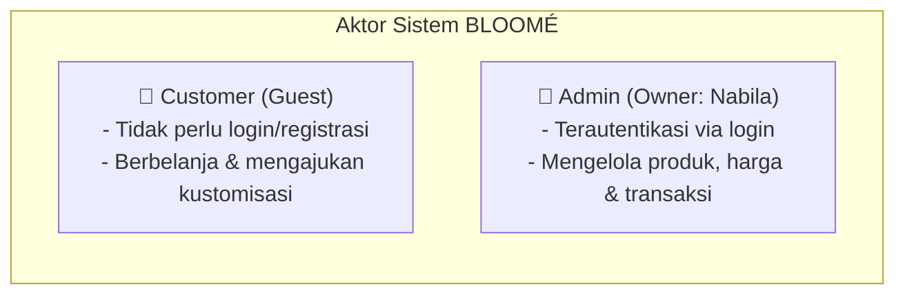
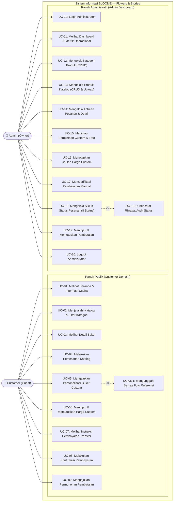

# USE CASE DIAGRAM & SYSTEM INTERACTION SPECIFICATION
## BLOOMÉ — Flowers & Stories
**Task ID:** ANA-001  
**Fase:** Phase 2 — System Analysis and Design (Sub-fase 5.2 System Modeling)  
**Penanggung Jawab:** Jayanti Firdasari (Lead System Analyst & Project Manager)  
**Tanggal Penyusunan:** 13 November 2026  
**Status Task:** Completed (`[x]`)  
**Dependensi:** Seluruh Phase 1 (DOC-001 s/d DOC-021) Selesai  

---

## 1. Ringkasan Eksekutif

Pemodelan Diagram Use Case (Task ANA-001) mengawali **Phase 2 — System Analysis and Design**. Dokumen ini menetapkan batas sistem (*system boundary*), mendefinisikan aktor pengguna, serta memetakan seluruh kapabilitas fungsional yang dapat dieksekusi oleh pengguna pada website **BLOOMÉ — Flowers & Stories**.

Diagram use case ini memodelkan interaksi antara dua aktor utama:
1. **Customer (Pelanggan):** Aktor publik tanpa login (*guest*) yang berinteraksi untuk menelusuri katalog, memesan buket siap pesan, mengajukan personalisasi buket custom, menyetujui harga, serta mengonfirmasi pembayaran transfer manual.
2. **Admin (Pemilik Usaha):** Aktor terautentikasi tunggal (Nabila Febriyani) yang mengendalikan seluruh operasional bisnis di dashboard, mengelola produk/kategori, menetapkan harga custom, memverifikasi mutasi pembayaran manual, mengelola 8 siklus status pesanan, serta menangani pembatalan.

---

## 2. Aktor Sistem (System Actors)

| Nama Aktor | Tipe Aktor | Deskripsi Peran & Batasan Hak Akses |
|---|---|---|
| **Customer** | Primer (*Human User*) | Pengguna umum/pelanggan yang mengakses website secara bebas tanpa otentikasi. Berhak melihat katalog, memesan buket katalog, mengajukan buket kustom (beserta foto referensi), menyetujui harga custom, melihat rekening bank, dan mengonfirmasi pembayaran. Tidak dapat mengakses panel admin. |
| **Admin** | Primer (*Human User*) | Pemilik usaha BLOOMÉ yang memiliki akses administratif penuh melalui otentikasi sandi terenkripsi. Berhak mengelola master data produk/kategori, meninjau permintaan custom, menetapkan harga manual, memverifikasi mutasi bank/e-wallet, memperbarui status pengerjaan buket, dan memutuskan pembatalan pesanan. |

---

## 3. Diagram Use Case Sistem Lengkap (Mermaid Use Case Diagram)

---

## 4. Rincian Paket Use Case Sistem

### 4.1 Paket 1: Eksplorasi & Transaksi Publik (Customer Domain)
1. **UC-01: Melihat Beranda & Informasi Usaha:** Mengakses informasi profil butik BLOOMÉ Samarinda, buket unggulan, banner promosi kustomisasi, dan alamat butik.
2. **UC-02: Menjelajahi Katalog & Filter Kategori:** Menampilkan kartu buket aktif dan menyaring produk berdasarkan kategori bunga segar, artificial, uang, atau snack.
3. **UC-03: Melihat Detail Buket:** Menampilkan komposisi rangkaian buket, galeri foto, harga pasti, dan status ketersediaan stok.
4. **UC-04: Melakukan Pemesanan Katalog:** Mengisi formulir data pemesan, alamat penerima, pesan kartu ucapan khusus, dan memilih tanggal kebutuhan buket.
5. **UC-05: Mengajukan Personalisasi Buket Custom:** Memilih preferensi bahan, kombinasi warna, tema perayaan, catatan khusus, dan `<<include>>` mengunggah foto acuan (JPG/PNG ≤ 5MB).
6. **UC-06: Meninjau & Memutuskan Harga Custom:** Meninjau nominal harga yang diusulkan oleh florist dan menekan tombol *Setujui* (*Approve*) untuk lanjut bayar atau *Tolak* (*Reject*) untuk membatalkan pengajuan.
7. **UC-07: Melihat Instruksi Pembayaran Transfer:** Menampilkan nomor rekening bank dan e-wallet resmi beserta tagihan nominal transfer.
8. **UC-08: Melakukan Konfirmasi Pembayaran:** Menekan tombol konfirmasi bahwa dana telah ditransfer guna menggeser status ke antrean verifikasi mutasi admin.
9. **UC-09: Mengajukan Permohonan Pembatalan:** Memasukkan alasan pembatalan untuk ditinjau oleh admin sebelum bunga dirangkai fisik.

### 4.2 Paket 2: Pengelolaan Operasional Butik (Admin Domain)
1. **UC-10: Login Administrator:** Memasukkan email dan password terenkripsi untuk mendapatkan token sesi akses dashboard.
2. **UC-11: Melihat Dashboard & Metrik Operasional:** Menampilkan statistik harian (total pesanan baru, pesanan belum bayar, custom baru, dan grafik aktivitas).
3. **UC-12: Mengelola Kategori Produk (CRUD):** Menambah, mengubah nama/slug, dan menghapus kategori buket dengan proteksi integritas produk aktif.
4. **UC-13: Mengelola Produk Katalog (CRUD & Upload):** Menambah buket baru lengkap dengan unggah foto ke storage, mengubah harga, dan toggle status ketersediaan (*In Stock* / *Out of Stock*).
5. **UC-14: Mengelola Antrean Pesanan & Detail:** Menampilkan seluruh pesanan terurut jadwal pengiriman, memfilter status, dan memeriksa rincian kartu ucapan.
6. **UC-15: Meninjau Permintaan Custom & Foto:** Memeriksa spesifikasi bahan dan foto acuan yang diunggah pemesan.
7. **UC-16: Menetapkan Usulan Harga Custom:** Memasukkan nominal penawaran harga custom buket secara manual berdasarkan stok bahan.
8. **UC-17: Memverifikasi Pembayaran Manual:** Memeriksa mutasi fisik m-banking dan memverifikasi keabsahan transfer untuk mengubah status menjadi *Paid*.
9. **UC-18: Mengelola Siklus Status Pesanan:** Memperbarui status sesuai progres fisik (*ST-01 s/d ST-07*) dan `<<include>>` mencatat waktu serta admin yang mengubah ke tabel riwayat audit.
10. **UC-19: Meninjau & Memutuskan Pembatalan:** Meninjau alasan pembatalan pelanggan dan memilih aksi *Approve* (status ST-08) atau *Reject* (status aktif bertahan).
11. **UC-20: Logout Administrator:** Menghapus sesi otentikasi admin secara aman.

---

## 5. Matriks Ketertelusuran Kebutuhan Fungsional ke Use Case (Traceability Matrix)

| Kebutuhan Fungsional (SRS) | ID Use Case | Deskripsi Use Case Terkait |
|---|---|---|
| **FR-001 (Homepage)** | `UC-01` | Melihat Beranda & Informasi Usaha |
| **FR-002 (Product Catalog)** | `UC-02` | Menjelajahi Katalog & Filter Kategori |
| **FR-003 (Product Detail)** | `UC-03` | Melihat Detail Buket |
| **FR-004 (Category Display)** | `UC-02` | Menjelajahi Katalog & Filter Kategori |
| **FR-005 (Catalog Ordering)** | `UC-04` | Melakukan Pemesanan Katalog |
| **FR-006 (Custom Request)** | `UC-05` | Mengajukan Personalisasi Buket Custom |
| **FR-007 (Custom Price Decision)**| `UC-06` | Meninjau & Memutuskan Harga Custom |
| **FR-008 (Payment & Confirmation)**| `UC-07`, `UC-08` | Melihat Petunjuk Bayar & Konfirmasi Transfer |
| **FR-009 (Admin Authentication)** | `UC-10`, `UC-20` | Login & Logout Administrator |
| **FR-010 (Admin Dashboard)** | `UC-11` | Melihat Dashboard & Metrik Operasional |
| **FR-011 (Category Management)** | `UC-12` | Mengelola Kategori Produk (CRUD) |
| **FR-012 (Product Management)** | `UC-13` | Mengelola Produk Katalog (CRUD & Upload) |
| **FR-013 (Order Management)** | `UC-14` | Mengelola Antrean Pesanan & Detail |
| **FR-014 (Custom Management)** | `UC-15`, `UC-16` | Meninjau Custom & Menetapkan Harga |
| **FR-015 (Payment Verification)** | `UC-17` | Memverifikasi Pembayaran Manual |
| **FR-016 (Order Status)** | `UC-18` | Mengelola Siklus Status Pesanan (8 Status) |
| **FR-017 (Cancellation)** | `UC-09`, `UC-19` | Pengajuan & Penanganan Pembatalan |

---

## 6. Kesimpulan & Rekomendasi

### 6.1 Status Task ANA-001
Task **ANA-001 (Use Case Diagram)** telah selesai dilaksanakan:
- Diagram Use Case lengkap dan terstruktur telah disusun menggunakan format visual Mermaid.
- 20 Use Case telah terpetakan secara presisi menghubungkan aktor *Customer (Guest)* dan *Admin* ke seluruh kebutuhan fungsional (FR-001 s/d FR-017).
- Kriteria penyelesaian (*Definition of Done*) terpenuhi.

### 6.2 Rekomendasi Langkah Berikutnya:
Melanjutkan ke task pemodelan berikutnya pada sub-fase 5.2:
- **`ANA-002 — Use Case Description.`**

