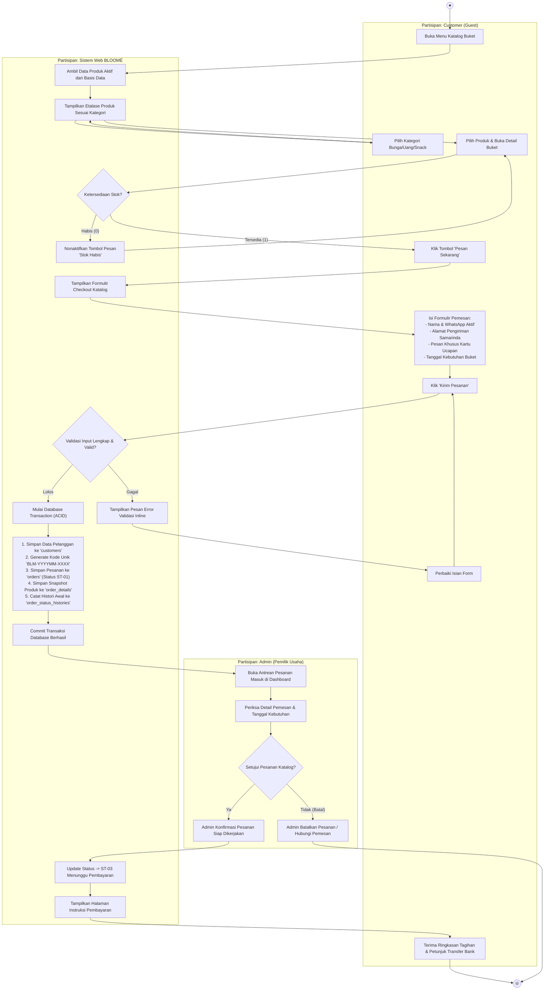

# ACTIVITY DIAGRAM PEMESANAN KATALOG (CATALOG ORDERING WORKFLOW)
## BLOOMÉ — Flowers & Stories
**Task ID:** ANA-003  
**Fase:** Phase 2 — System Analysis and Design (Sub-fase 5.2 System Modeling)  
**Penanggung Jawab:** Jayanti Firdasari (Lead System Analyst & Project Manager)  
**Tanggal Penyusunan:** 13 November 2026  
**Status Task:** Completed (`[x]`)  
**Dependensi:** ANA-002 — Use Case Description (Selesai)  

---

## 1. Ringkasan Eksekutif

Pemodelan Diagram Aktivitas Pemesanan Katalog (Task ANA-003) dilakukan untuk menggambarkan aliran kerja dinamis (*dynamic workflow*), percabangan keputusan (*decision points*), serta pembagian peran (*swimlanes*) dalam proses pemesanan produk buket katalog pada website **BLOOMÉ — Flowers & Stories**.

Diagram ini memetakan koordinasi aktivitas antara tiga partisipan:
1. **Customer (Pelanggan):** Berbelanja langsung sebagai tamu (*guest checkout*) tanpa registrasi.
2. **Sistem Web BLOOMÉ:** Menangani validasi input, penyaringan produk, transaksi basis data atomik, dan perenderan antarmuka Blade.
3. **Admin (Pemilik Usaha / Nabila):** Meninjau antrean pesanan masuk dan mengonfirmasi ketersediaan pengerjaan buket.

---

## 2. Diagram Aktivitas Pemesanan Katalog (Swimlane Activity Diagram)

---

## 3. Analisis Jalur Aktivitas (*Path Analysis*)

### 3.1 Jalur Utama (*Happy Path*)
1. Pelanggan membuka katalog buket bunga dan memfilter kategori yang diminati.
2. Sistem menyajikan produk aktif. Pelanggan membuka halaman detail produk.
3. Sistem memeriksa ketersediaan stok produk (`is_available == 1`). Tombol pemesanan aktif.
4. Pelanggan mengklik "Pesan Sekarang" dan melengkapi formulir checkout (identitas pemesan, alamat Samarinda, pesan kartu ucapan pos, tanggal kebutuhan).
5. Sistem memvalidasi seluruh isian form request di sisi server.
6. Sistem menjalankan transaksi atomik `DB::transaction()`:
   - Data pemesan tersimpan di tabel `customers`.
   - Kode transaksi unik diterbitkan (misal: `BLM-202611-0001`).
   - Master pesanan tersimpan di `orders` dengan status awal `ST-01 Menunggu Peninjauan Admin`.
   - Rincian produk dan harga satuan disalin sebagai snapshot permanen di `order_details` (BR-020).
   - Jejak audit kronologis status dicatat di `order_status_histories`.
7. Admin meninjau antrean di dashboard dan menyetujui pesanan katalog.
8. Status pesanan diperbarui menjadi `ST-03 Menunggu Pembayaran`.
9. Pelanggan menerima ringkasan tagihan beserta nomor rekening bank resmi untuk transfer manual.

### 3.2 Jalur Percabangan & Penanganan Eksepsi (*Exception Paths*)
- **Jalur E1: Stok Produk Habis:**
  - Jika ketersediaan produk bernilai 0, sistem mengubah tampilan tombol pesan menjadi tombol abu-abu nonaktif bertuliskan *"Stok Habis"*, mencegah pelanggan mengakses form checkout.
- **Jalur E2: Form Input Tidak Lengkap:**
  - Jika nomor WhatsApp atau alamat pengiriman dikosongkan, validasi server Laravel melempar kembali error inline tanpa menghilangkan isian yang sudah diketik (*flashed old input*).
- **Jalur E3: Kegagalan Transaksi Basis Data:**
  - Jika terjadi gangguan jaringan pada saat commit data pesanan, mekanisme `DB::transaction()` otomatis melakukan *rollback* total sehingga tidak ada record parsial yang tertinggal.

---

## 4. Kepatuhan Terhadap Aturan Bisnis Proyek

Alur aktivitas pemesanan katalog ini mematuhi aturan bisnis secara ketat:
- **BR-001 (Guest Checkout):** Tidak ada langkah registrasi akun, verifikasi email, atau login kata sandi bagi pelanggan.
- **BR-003 (Identitas Pemesan Lengkap):** Sistem memvalidasi nama, nomor WhatsApp aktif, dan alamat pengiriman sebelum pesanan dibuat.
- **BR-005 (Harga Katalog Tetap):** Nominal total tagihan dihitung dari harga jual tetap yang tertera pada katalog produk.
- **BR-020 (Historical Snapshot):** Tabel `order_details` mencatat kolom `product_name_snapshot` dan `unit_price_snapshot` secara independen dari tabel produk.

---

## 5. Kesimpulan & Rekomendasi

### 5.1 Status Task ANA-003
Task **ANA-003 (Activity Diagram pemesanan katalog)** telah selesai dilaksanakan:
- Diagram aktivitas pemesanan katalog berbasis swimlane (Customer, Sistem, Admin) telah dimodelkan menggunakan format visual Mermaid.
- Alur utama, percabangan keputusan, validasi form, dan transaksi atomik database terpetakan lengkap.
- Kriteria penyelesaian (*Definition of Done*) terpenuhi.

### 5.2 Rekomendasi Langkah Berikutnya:
Melanjutkan ke task pemodelan diagram aktivitas berikutnya pada sub-fase 5.2:
- **`ANA-004 — Activity Diagram pemesanan custom.`**

