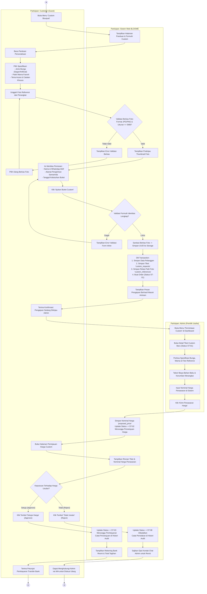

# ACTIVITY DIAGRAM PEMESANAN BUKET CUSTOM (CUSTOM BOUQUET WORKFLOW)
## BLOOMÉ — Flowers & Stories
**Task ID:** ANA-004  
**Fase:** Phase 2 — System Analysis and Design (Sub-fase 5.2 System Modeling)  
**Penanggung Jawab:** Jayanti Firdasari (Lead System Analyst & Project Manager)  
**Tanggal Penyusunan:** 13 November 2026  
**Status Task:** Completed (`[x]`)  
**Dependensi:** ANA-003 — Activity Diagram pemesanan katalog (Selesai)  

---

## 1. Ringkasan Eksekutif

Pemodelan Diagram Aktivitas Pemesanan Buket Custom (Task ANA-004) dilakukan untuk memetakan alur kolaborasi dinamis (*collaborative workflow*) antara pembeli dan pemilik usaha dalam layanan personalisasi buket bunga pada website **BLOOMÉ — Flowers & Stories**.

Berbeda dengan alur katalog yang berharga tetap, alur pesanan custom melibatkan siklus peninjauan foto referensi, penentuan harga penawaran secara manual oleh pemilik usaha (Nabila Febriyani), serta gerbang persetujuan harga (*Price Approval Gate*) oleh pelanggan sebelum transaksi dapat berlanjut ke pembayaran.

---

## 2. Diagram Aktivitas Pemesanan Buket Custom (Swimlane Activity Diagram)

---

## 3. Analisis Jalur Aktivitas (*Path Analysis*)

### 3.1 Jalur Utama (*Happy Path: Selesai Disetujui*)
1. Pelanggan membuka form buket custom, memilih preferensi bunga/warna, mengunggah foto referensi (JPG/PNG ≤ 5MB), mengisi identitas dan tanggal kebutuhan buket.
2. Sistem memvalidasi berkas dan formulir, mengacak nama berkas dengan UUID unik di storage lokal, dan menyimpan tiket pesanan dengan status `ST-01 Menunggu Peninjauan Admin`.
3. Admin (Nabila) membuka detail tiket custom di dashboard, memeriksa foto referensi, dan menaksir biaya bahan baku.
4. Admin menginput nominal harga penawaran (misal: Rp285.000) dan menekan "Kirim Penawaran Harga".
5. Sistem memperbarui status transaksi menjadi `ST-02 Menunggu Persetujuan Harga`.
6. Pelanggan membuka halaman peninjauan harga, membaca nominal usulan, dan mengklik tombol "Setujui Harga".
7. Sistem memperbarui status menjadi `ST-03 Menunggu Pembayaran` dan mencatat audit persetujuan di tabel histori.
8. Pelanggan menerima rincian rekening bank resmi untuk transfer manual.

### 3.2 Jalur Penolakan Harga & Revisi (*Alternative Flow: Price Rejection*)
1. Jika pelanggan merasa harga usulan melebihi bujet yang dimiliki, pelanggan menekan tombol "Tolak Usulan".
2. Sistem mencatat keputusan `customer_decision = 'rejected'` dan menggeser status menjadi `ST-08 Dibatalkan`.
3. Sistem menyajikan informasi kontak chat WhatsApp pemilik usaha apabila pelanggan ingin berkonsultasi untuk mengurangi kuantitas bunga atau menyederhanakan jenis pembungkus (*wrapping*) agar bujet sesuai.

### 3.3 Jalur Penolakan Berkas Unggahan (*Exception Flow: Invalid File*)
1. Jika pelanggan mengunggah berkas melebihi 5 MB atau berekstensi ilegal (misal `.pdf` atau `.exe`), sistem menolak berkas di sisi klien dan server.
2. Sistem menampilkan pesan galat: *"Berkas gagal diunggah. Pastikan format berupa JPG, JPEG, atau PNG dan ukuran maksimal 5 MB."*
3. Pelanggan memilih ulang berkas yang sesuai ketentuan.

---

## 4. Kepatuhan Terhadap Aturan Bisnis Proyek

Alur aktivitas ini menjamin penerapan aturan bisnis secara mutlak:
- **BR-006 (Penetapan Harga Manual):** Tidak ada algoritma otomatis; nominal harga 100% ditentukan oleh florist pemilik usaha.
- **BR-007 (Persetujuan Harga Pelanggan):** Transaksi diblokir dari tahap pembayaran sebelum pemesan menekan tombol *Setujui Harga*.
- **BR-008 (Penanganan Penolakan Harga):** Penolakan harga tercatat secara formal dan pesanan dialihkan ke opsi revisi kontak/batal.
- **BR-017 & BR-018 (Keamanan Unggah Berkas):** Ekstensi berkas dibatasi pada format gambar murni dan ukuran maksimal dibatasi 5 MB per berkas.

---

## 5. Kesimpulan & Rekomendasi

### 5.1 Status Task ANA-004
Task **ANA-004 (Activity Diagram pemesanan custom)** telah selesai dilaksanakan:
- Diagram aktivitas pemesanan buket custom berbasis swimlane (Customer, Sistem, Admin) telah dimodelkan menggunakan format visual Mermaid.
- Alur pengajuan, validasi upload foto referensi, penentuan harga usulan florist, serta gerbang persetujuan pelanggan terpetakan lengkap.
- Kriteria penyelesaian (*Definition of Done*) terpenuhi.

### 5.2 Rekomendasi Langkah Berikutnya:
Melanjutkan ke task pemodelan diagram aktivitas berikutnya pada sub-fase 5.2:
- **`ANA-005 — Activity Diagram pembayaran.`**

