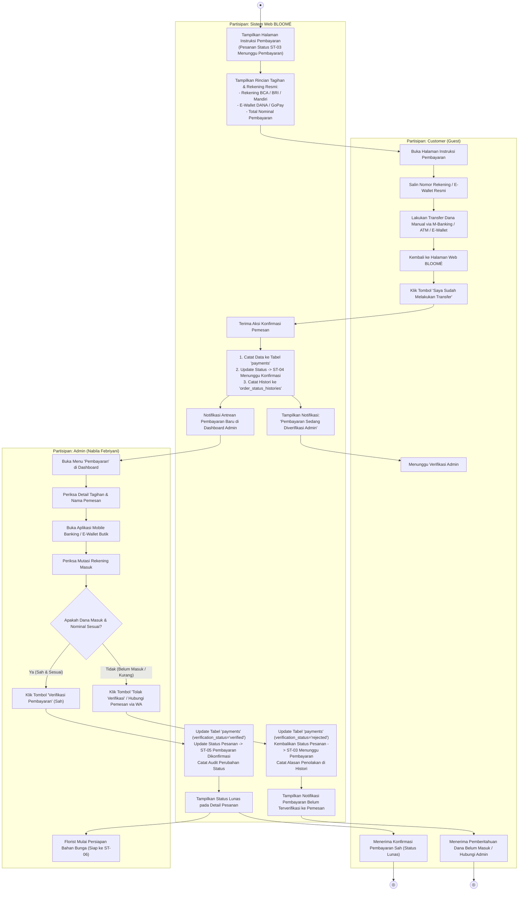

# ACTIVITY DIAGRAM ALUR PEMBAYARAN & VERIFIKASI (PAYMENT VERIFICATION WORKFLOW)
## BLOOMÉ — Flowers & Stories
**Task ID:** ANA-005  
**Fase:** Phase 2 — System Analysis and Design (Sub-fase 5.2 System Modeling)  
**Penanggung Jawab:** Jayanti Firdasari (Lead System Analyst & Project Manager)  
**Tanggal Penyusunan:** 13 November 2026  
**Status Task:** Completed (`[x]`)  
**Dependensi:** ANA-003 & ANA-004 (Selesai)  

---

## 1. Ringkasan Eksekutif

Pemodelan Diagram Aktivitas Pembayaran (Task ANA-005) dilakukan untuk memetakan alur kerja transaksi pembayaran manual, mekanisme konfirmasi pelanggan, serta proses audit verifikasi mutasi dana oleh pemilik usaha pada website **BLOOMÉ — Flowers & Stories**.

Sesuai dengan keputusan arsitektur (ADR-04) dan aturan bisnis (BR-010 & BR-011), sistem tidak menggunakan payment gateway otomatis, melainkan mengandalkan **pembayaran transfer manual (Bank Transfer & E-Wallet)** dengan **verifikasi mutasi fisik oleh admin di dashboard**. Diagram ini memastikan titik temu yang jelas antara aksi pembeli, pembaruan status sistem, dan validasi dana oleh florist sebelum proses perangkaian bunga dimulai.

---

## 2. Diagram Aktivitas Pembayaran & Verifikasi Manual (Swimlane Activity Diagram)

---

## 3. Analisis Jalur Aktivitas (*Path Analysis*)

### 3.1 Jalur Utama (*Happy Path: Pembayaran Sah & Dikonfirmasi*)
1. Pesanan berada dalam status `ST-03 Menunggu Pembayaran` (setelah checkout katalog disetujui atau harga buket custom disepakati).
2. Pelanggan membuka halaman petunjuk bayar, menyalin nomor rekening bank resmi (BCA/BRI/Mandiri) atau nomor e-wallet (DANA/GoPay) atas nama pemilik usaha.
3. Pelanggan melakukan transfer fisik melalui aplikasi perbankan peranti seluler (*mobile banking*) atau dompet digital.
4. Pelanggan kembali ke halaman web dan menekan tombol *"Saya Sudah Melakukan Transfer"*.
5. Sistem memperbarui status pesanan menjadi `ST-04 Menunggu Konfirmasi Pembayaran`, mencatat timestamp konfirmasi di tabel `payments`, dan mencatat riwayat audit di `order_status_histories`.
6. Admin membuka menu *Manajemen Pembayaran* di dashboard, mencocokkan data tagihan dengan mutasi rekening m-banking resmi butik.
7. Dana terbukti masuk dengan nominal yang cocok. Admin mengklik tombol *"Verifikasi Pembayaran"*.
8. Sistem memperbarui status transaksi menjadi `ST-05 Pembayaran Dikonfirmasi` dan mengunci pencatatan audit verifikasi.
9. Buket siap masuk ke tahap pengerjaan fisik oleh florist (`ST-06 Sedang Dibuat`).

### 3.2 Jalur Alternatif: Penolakan Verifikasi (*Alternative Flow: Payment Rejection*)
1. Admin memeriksa mutasi rekening, namun dana belum ditemukan masuk atau nominal transfer kurang dari total tagihan.
2. Admin mengklik tombol *"Tolak Verifikasi"* dan dapat menyertakan catatan penjelasan (misal: *"Dana belum masuk mutasi bank, silakan periksa kembali bukti transfer"*).
3. Sistem mengembalikan status pesanan ke `ST-03 Menunggu Pembayaran` agar pemesan dapat mengonfirmasi ulang.
4. Admin dapat menghubungi nomor WhatsApp pemesan untuk konfirmasi personal secara persuasif.

---

## 4. Kepatuhan Terhadap Aturan Bisnis & Arsitektur

Alur aktivitas ini menjamin penerapan aturan bisnis secara mutlak:
- **BR-010 (Dukungan Metode Pembayaran):** Sistem membatasi opsi metode pembayaran pada transfer bank dan e-wallet resmi.
- **BR-011 (Verifikasi Manual):** Penentuan keabsahan pembayaran murni wewenang admin; sistem tidak mengandalkan webhook otomatis payment gateway pihak ketiga.
- **BR-012 (Ketentuan Pembayaran):** Admin memiliki fleksibilitas operasional dalam memvalidasi pelunasan penuh sebelum bunga segar dipotong.
- **Integritas Relasional:** Setiap pencatatan pembayaran terikat kuat (*foreign key*) pada tabel `orders` dan perubahan status selalu menghasilkan entri riwayat kronologis di `order_status_histories`.

---

## 5. Kesimpulan & Rekomendasi

### 5.1 Status Task ANA-005
Task **ANA-005 (Activity Diagram pembayaran)** telah selesai dilaksanakan:
- Diagram aktivitas alur pembayaran manual dan verifikasi mutasi berbasis swimlane (Customer, Sistem, Admin) telah dimodelkan menggunakan format visual Mermaid.
- Penanganan alur utama verifikasi sah, penolakan mutasi tidak ditemukan, dan transisi status `ST-03 -> ST-04 -> ST-05` terpetakan lengkap.
- Kriteria penyelesaian (*Definition of Done*) terpenuhi.

### 5.2 Rekomendasi Langkah Berikutnya:
Melanjutkan ke task pemodelan diagram aktivitas berikutnya pada sub-fase 5.2:
- **`ANA-006 — Activity Diagram pembatalan.`**

