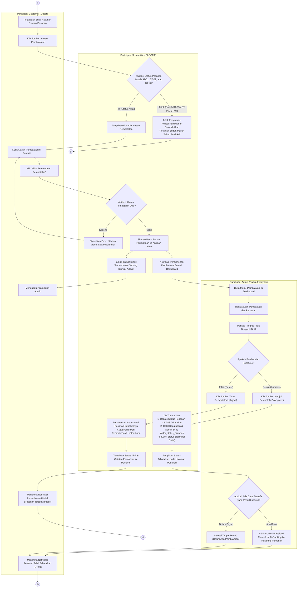

# ACTIVITY DIAGRAM ALUR PENGAJUAN & PENANGANAN PEMBATALAN
## BLOOMÉ — Flowers & Stories
**Task ID:** ANA-006  
**Fase:** Phase 2 — System Analysis and Design (Sub-fase 5.2 System Modeling)  
**Penanggung Jawab:** Jayanti Firdasari (Lead System Analyst & Project Manager)  
**Tanggal Penyusunan:** 13 November 2026  
**Status Task:** Completed (`[x]`)  
**Dependensi:** ANA-005 — Activity Diagram pembayaran (Selesai)  

---

## 1. Ringkasan Eksekutif

Pemodelan Diagram Aktivitas Pembatalan (Task ANA-006) dilakukan untuk memetakan alur kerja pengajuan permohonan pembatalan pesanan oleh pelanggan serta proses evaluasi dan keputusan persetujuan oleh pemilik usaha pada website **BLOOMÉ — Flowers & Stories**.

Sesuai aturan bisnis **BR-013** (*Pembatalan hanya dapat diajukan sebelum pesanan diproses*) dan **BR-014** (*Pembatalan wajib memerlukan persetujuan admin*), sistem menerapkan aturan pembatas (*guard conditions*) ketat agar pembeli tidak dapat membatalkan pesanan secara sepihak setelah bunga segar dipotong atau dirangkai fisik di butik.

---

## 2. Diagram Aktivitas Pembatalan Pesanan (Swimlane Activity Diagram)

---

## 3. Analisis Jalur Aktivitas (*Path Analysis*)

### 3.1 Jalur Utama: Pembatalan Disetujui (*Approved Cancellation*)
1. Pelanggan membuka rincian pesanan dan mengklik "Ajukan Pembatalan".
2. Sistem memeriksa status pesanan saat ini. Karena pesanan masih berada pada status awal (`ST-01`, `ST-02`, atau `ST-03`), sistem mengizinkan pembatalan dan membuka formulir alasan.
3. Pelanggan mengetikkan alasan (misal: *"Acara wisuda diundur bulan depan"*) dan mengirimkan permohonan.
4. Sistem mencatat permohonan ke antrean admin dan menampilkan notifikasi *"Permohonan pembatalan Anda sedang ditinjau"*.
5. Admin (Nabila) membuka menu Pembatalan di dashboard, membaca alasan, dan memeriksa bahwa bahan bunga belum dirangkai.
6. Admin mengklik tombol *"Setujui Pembatalan"*.
7. Sistem memperbarui status pesanan menjadi `ST-08 Dibatalkan` (*Terminal State*), mencatat riwayat audit, dan mengunci transaksi dari perubahan lanjutan.
8. Jika pemesan sempat mentransfer dana (status sebelumnya `ST-04` atau `ST-05`), admin melakukan pengembalian dana (*refund*) secara manual melalui transfer bank ke rekening pemesan.
9. Pelanggan menerima pembaruan bahwa pesanan resmi dibatalkan.

### 3.2 Jalur Alternatif: Pembatalan Ditolak (*Rejected Cancellation*)
1. Admin memeriksa permohonan pembatalan, namun mendapati bahwa bunga segar khusus pesanan custom tersebut telah dipotong atau dirangkai sebagian.
2. Admin mengklik tombol *"Tolak Pembatalan"* dan menginput catatan alasan penolakan (misal: *"Mohon maaf, bunga pesanan custom Anda telah dipotong dan sedang dalam tahap perangkaian"*).
3. Sistem mempertahankan status aktif pesanan sebelumnya (misal tetap `ST-03` atau status relevan) dan mencatat jejak penolakan di audit trail.
4. Pelanggan menerima notifikasi bahwa permohonan ditolak dan pesanan buket tetap akan diselesaikan sesuai jadwal.

### 3.3 Jalur Pemblokiran Sistem (*Guard Condition Blocked*)
1. Jika pelanggan mencoba membatalkan pesanan yang telah mencapai status `ST-06 Sedang Dibuat` atau `ST-07 Selesai`, sistem secara otomatis menyembunyikan tombol pembatalan.
2. Jika endpoint diakses langsung via URL, controller backend melempar respon HTTP 403 (*Action Forbidden*) dengan penjelasan bahwa pesanan yang telah diproduksi tidak dapat dibatalkan.

---

## 4. Kepatuhan Terhadap Aturan Bisnis Proyek

Alur aktivitas pembatalan ini menjamin penerapan aturan bisnis secara mutlak:
- **BR-013 (Batas Waktu Pengajuan):** Pengajuan dibatasi ketat sebelum pesanan masuk tahap perangkaian fisik florist.
- **BR-014 (Kewenangan Pembatalan):** Pelanggan tidak memiliki wewenang membatalkan transaksi secara mandiri; keputusan final murni hak prerogatif admin pemilik usaha.
- **Terminal State Guard:** Pesanan yang berstatus `ST-08 Dibatalkan` tidak dapat diaktifkan kembali secara sepihak untuk mencegah kekacauan data inventaris dan keuangan.

---

## 5. Kesimpulan & Rekomendasi

### 5.1 Status Task ANA-006
Task **ANA-006 (Activity Diagram pembatalan)** telah selesai dilaksanakan:
- Diagram aktivitas alur pengajuan pembatalan, peninjauan admin, eksekusi persetujuan/penolakan, serta penanganan refund manual telah dimodelkan menggunakan format visual Mermaid.
- Aturan pembatas (*guard condition*) dan pencatatan audit histori terpetakan lengkap.
- Kriteria penyelesaian (*Definition of Done*) terpenuhi.

### 5.2 Rekomendasi Langkah Berikutnya:
Melanjutkan ke task pemodelan diagram sekuensial berikutnya pada sub-fase 5.2:
- **`ANA-007 — Sequence Diagram pemesanan.`**

