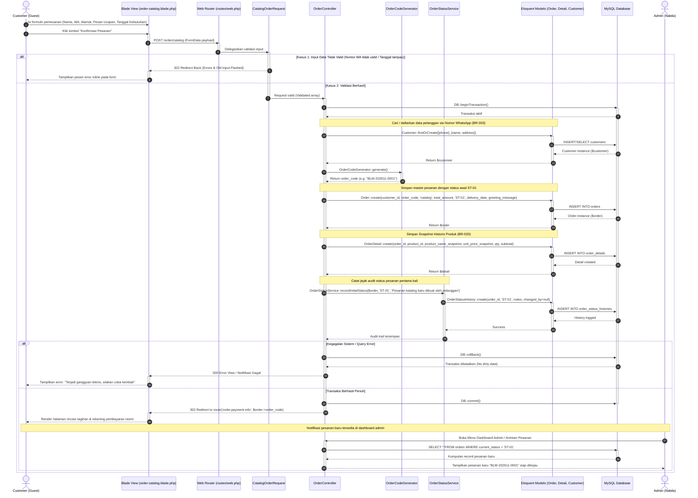
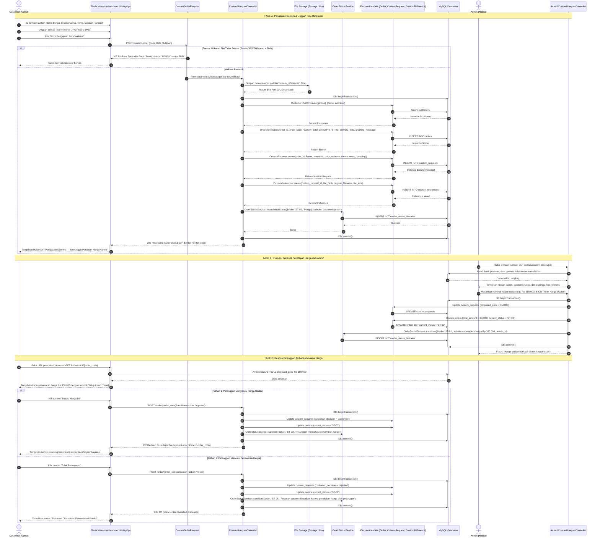

# SEQUENCE DIAGRAM ALUR PEMESANAN (ORDERING SEQUENCE DIAGRAM)
## BLOOMÉ — Flowers & Stories
**Task ID:** ANA-007  
**Fase:** Phase 2 — System Analysis and Design (Sub-fase 5.2 System Modeling)  
**Penanggung Jawab:** Jayanti Firdasari (Lead System Analyst & Project Manager)  
**Tanggal Penyusunan:** 13 November 2026  
**Status Task:** Completed (`[x]`)  
**Dependensi:** ANA-003 — Activity Diagram Pemesanan Katalog, ANA-004 — Activity Diagram Pemesanan Custom, ARC-001 — Three-Layer Architecture, ARC-005 — Routing Architecture  

---

## 1. Ringkasan Eksekutif & Tujuan Pemodelan

Pemodelan Sequence Diagram Alur Pemesanan (Task ANA-007) disusun untuk memetakan interaksi temporal antar-objek (*message exchange lifecycle*) secara runut dan presisi pada sistem pemesanan website **BLOOMÉ — Flowers & Stories**. Pemodelan ini menerapkan pendekatan *Object-Oriented Analysis and Design* (OOAD) yang disinkronkan dengan arsitektur tiga lapis (*Three-Layer Architecture*: Presentation, Application, dan Data Layer) berbasis framework Laravel.

Diagram urutan ini mencakup 2 (dua) skenario utama pemesanan sesuai *business logic* proyek:
1. **Pemesanan Produk Katalog (*Catalog Bouquet Order* — UC-04):** Alur checkout cepat bagi tamu (*guest checkout*) untuk produk jadi dengan harga tetap, verifikasi ketersediaan, pemotretan snapshot historis harga/nama produk, serta pencatatan otomatis riwayat status awal.
2. **Pengajuan & Penetapan Harga Personalisasi Buket Custom (*Custom Bouquet Request & Pricing Negotiation* — UC-05, UC-05.1, UC-06):** Alur pemesanan khusus dengan unggah berkas foto referensi, penaksiran harga manual oleh pemilik usaha (Admin), serta persetujuan akhir oleh pelanggan.

---

## 2. Identifikasi Partisipan & Lifeline Objek

| Partisipan / Lifeline | Layer Arsitektur | Tipe Komponen | Peran & Tanggung Jawab Utama |
|---|---|---|---|
| **Customer (Guest)** | Aktor Eksternal | Pengguna | Mengisi formulir, memilih tanggal pengiriman, mengunggah foto, dan menyetujui harga buket custom tanpa harus registrasi akun (BR-001). |
| **Admin (Nabila Febriyani)** | Aktor Internal | Pemilik Usaha | Meninjau antrean pesanan masuk, memvalidasi kelayakan permintaan custom, dan menetapkan harga usulan (*proposed price*). |
| **Blade Views (`resources/views/`)** | Presentation Layer | UI / View | Menampilkan formulir pemesanan, merender pesan kesalahan validasi secara *inline*, menampilkan status pesanan, serta instruksi transfer bank. |
| **Web Router (`routes/web.php`)** | Application Layer | HTTP Routing | Menerima request HTTP (POST/GET), memetakan endpoint ke controller yang tepat, serta mengalokasikan middleware keamanan. |
| **Form Requests (`App\Http\Requests\`)** | Application Layer | Request Validator | Memvalidasi integritas data isian formulir (nomor WhatsApp, alamat Samarinda, tanggal kebutuhan, format foto referensi ≤ 5MB) sebelum mencapai controller. |
| **Controllers (`App\Http\Controllers\`)** | Application Layer | Application Controller | Mengorkestrasi logika bisnis pemesanan, memanggil service generator, mengelola unggah file, serta mengendalikan transaksi database. |
| **File Storage Subsystem (`Storage::disk`)** | Application Layer | File Storage | Menyimpan berkas foto referensi ke dalam folder aman `storage/app/public/custom_references/` dengan penamaan berbasis UUID acak. |
| **Order Services (`App\Services\`)** | Application Layer | Domain Service | Menyediakan logika khusus: `OrderCodeGenerator` untuk penerbitan kode unik pesanan dan `OrderStatusService` untuk transisi serta pencatatan histori status. |
| **Eloquent Models (`App\Models\`)** | Data Layer | ORM Entities | Objek representasi tabel relasional (`Customer`, `Order`, `OrderDetail`, `CustomRequest`, `CustomReference`, `OrderStatusHistory`). |
| **MySQL Database Engine** | Data Layer | RDBMS | Menjamin integritas transaksional ACID (*Atomicity, Consistency, Isolation, Durability*) melalui blok `DB::transaction()`. |

---

## 3. Sequence Diagram Pemesanan Katalog (Catalog Ordering Flow)

Diagram di bawah ini menggambarkan alur lengkap saat pelanggan memesan buket bunga siap beli dari katalog produk:



---

## 4. Sequence Diagram Pemesanan & Personalisasi Custom Bouquet (Custom Order & Negotiation Flow)

Diagram ini menggambarkan interaksi 3 fase: (A) Pengajuan spesifikasi buket dan unggah foto referensi oleh pelanggan, (B) Peninjauan dan pengajuan harga oleh Admin, dan (C) Persetujuan atau penolakan harga oleh pelanggan:



---

## 5. Rincian Teknis Komponen & Spesifikasi Pesan (Message Specifications)

### 5.1 Penanganan Input & Validasi Server (`CatalogOrderRequest` & `CustomOrderRequest`)
- **Aturan Validasi Katalog:**
  ```php
  public function rules(): array
  {
      return [
          'product_id'       => ['required', 'exists:products,id,is_available,1'],
          'customer_name'    => ['required', 'string', 'max:100'],
          'customer_phone'   => ['required', 'string', 'regex:/^(\+62|62|0)8[1-9][0-9]{6,10}$/'],
          'delivery_address' => ['required', 'string', 'max:500'],
          'delivery_date'    => ['required', 'date', 'after_or_equal:today'],
          'greeting_message' => ['nullable', 'string', 'max:300'],
      ];
  }
  ```
- **Aturan Validasi Custom:**
  ```php
  public function rules(): array
  {
      return [
          'flower_materials' => ['required', 'string', 'max:255'],
          'color_scheme'     => ['required', 'string', 'max:150'],
          'theme'            => ['nullable', 'string', 'max:150'],
          'notes'            => ['nullable', 'string', 'max:1000'],
          'reference_photo'  => ['required', 'file', 'image', 'mimes:jpeg,jpg,png', 'max:5120'], // Max 5MB
          'delivery_date'    => ['required', 'date', 'after_or_equal:today'],
          'customer_name'    => ['required', 'string', 'max:100'],
          'customer_phone'   => ['required', 'string', 'regex:/^(\+62|62|0)8[1-9][0-9]{6,10}$/'],
          'delivery_address' => ['required', 'string', 'max:500'],
      ];
  }
  ```

### 5.2 Mekanisme Snapshot Historis Transaksi (Audit & Price Protection — BR-020)
Pada diagram pemesanan katalog pesan nomor 15–18, sistem tidak mengandalkan harga langsung dari relasi `products.price` melainkan melakukan penyalinan nilai (*snapshot copy*):
1. Mengambil harga satuan saat ini dari tabel `products`.
2. Menyimpan string nama produk ke kolom `order_details.product_name_snapshot`.
3. Menyimpan nominal desimal harga ke kolom `order_details.unit_price_snapshot`.
4. Menghitung `subtotal = unit_price_snapshot * quantity`.
Hal ini menjamin bahwa jika admin merubah harga atau menonaktifkan buket di masa depan, laporan keuangan dan riwayat transaksi masa lalu tidak berubah.

### 5.3 Keamanan Penyimpanan Berkas Referensi Foto (`CustomReference`)
1. Berkas tidak disimpan menggunakan nama aslinya untuk menghindari serangan *file overwrite* atau *directory traversal*.
2. Sistem men-generate nama berkas berbasis UUID unik v4 (contoh: `d3b07384-d113-4f44-9344-9721a97d9134.jpg`).
3. Direktori target berada di `storage/app/public/custom_references/` yang hanya dapat diakses melalui symbolic link terkontrol (`php artisan storage:link`).
4. Metadata nama asli (`original_filename`) dan ukuran berkas (`file_size`) disimpan dalam database sebagai bukti otentik pengajuan pelanggan.

---

## 6. Matriks Kepatuhan Terhadap Persyaratan & Aturan Bisnis

| Kode Aturan | Persyaratan Terkait | Implementasi pada Sequence Diagram | Kepatuhan |
|---|---|---|:---:|
| **BR-001** | Guest Checkout | Tidak ada proses autentikasi (`Auth::attempt`) atau pengecekan session akun pada alur Customer. Pesanan diproses langsung menggunakan data form. | **Sesuai Penuh** |
| **BR-003** | Identitas Pemesan Lengkap | Validasi server memeriksa kelengkapan nama, nomor WhatsApp (format regex Indonesia), dan alamat pengiriman sebelum `Customer::firstOrCreate` dieksekusi. | **Sesuai Penuh** |
| **BR-004** | Tanggal Kebutuhan Wajib Diisi | Kolom `delivery_date` divalidasi tidak boleh kosong dan harus tanggal masa depan atau hari ini (`after_or_equal:today`). | **Sesuai Penuh** |
| **BR-005** | Harga Katalog Tetap | Total tagihan dihitung dari harga katalog yang tercatat aktif pada database saat checkout. | **Sesuai Penuh** |
| **BR-008** | Unggah Foto Referensi Custom | Validasi berkas foto referensi mewajibkan format berkas JPG/PNG dengan batas ukuran maksimal 5MB (5.120 KB). | **Sesuai Penuh** |
| **BR-009** | Usulan Harga Pesanan Custom | Pesanan custom dimulai dengan `total_amount = 0` dan berstatus `ST-01`. Admin mengusulkan harga via dashboard yang mengubah status ke `ST-02`. | **Sesuai Penuh** |
| **BR-010** | Keputusan Harga Custom | Pelanggan memiliki hak mutlak untuk menyetujui (lanjut ke `ST-03`) atau menolak penawaran (status menjadi `ST-08 Dibatalkan`). | **Sesuai Penuh** |
| **BR-020** | Snapshot Historis Produk | Penulisan record ke `order_details` memuat kolom `product_name_snapshot` dan `unit_price_snapshot`. | **Sesuai Penuh** |

---

## 7. Kesimpulan & Rekomendasi

### 7.1 Status Penyelesaian Task ANA-007
Task **ANA-007 (Sequence Diagram pemesanan)** telah selesai dikerjakan secara tuntas dan komprehensif:
- Diagram urutan pesan (*Sequence Diagram*) telah dimodelkan dengan standar visual Mermaid untuk alur katalog maupun buket custom.
- Interaksi antar-komponen di ketiga layer arsitektur (Presentation, Application, Data Layer) terdefinisi secara granular.
- Proteksi integritas data berbasis transaksi database ACID serta mitigasi kesalahan (*error handling*) telah dimodelkan.
- Seluruh aturan bisnis (*business rules*) dan kebutuhan fungsional terkait pemesanan terpenuhi dengan konsisten.

### 7.2 Rekomendasi Langkah Berikutnya:
Melanjutkan pekerjaan ke task pemodelan sequence diagram selanjutnya pada sub-fase 5.2:
- **`ANA-008 — Sequence Diagram pembayaran.`**

