# SEQUENCE DIAGRAM ALUR PEMBAYARAN & VERIFIKASI (PAYMENT VERIFICATION SEQUENCE DIAGRAM)
## BLOOMÉ — Flowers & Stories
**Task ID:** ANA-008  
**Fase:** Phase 2 — System Analysis and Design (Sub-fase 5.2 System Modeling)  
**Penanggung Jawab:** Jayanti Firdasari (Lead System Analyst & Project Manager)  
**Tanggal Penyusunan:** 13 November 2026  
**Status Task:** Completed (`[x]`)  
**Dependensi:** ANA-005 — Activity Diagram Pembayaran, ANA-007 — Sequence Diagram Pemesanan, ARC-001 — Three-Layer Architecture  

---

## 1. Ringkasan Eksekutif & Tujuan Pemodelan

Pemodelan Sequence Diagram Alur Pembayaran (Task ANA-008) disusun untuk memetakan secara presisi pertukaran pesan dinamis (*dynamic message sequence*) antar-objek dalam siklus pembayaran dan konfirmasi transaksi pada website **BLOOMÉ — Flowers & Stories**.

Sesuai dengan keputusan arsitektur (ADR-04) dan aturan bisnis (**BR-010 & BR-011**), sistem BLOOMÉ menerapkan model **pembayaran transfer manual (Bank Transfer & E-Wallet)** dengan **verifikasi mutasi fisik manual oleh pemilik usaha (Admin)** tanpa ketergantungan pihak ketiga (*payment gateway gateway-less*). Sequence diagram ini memodelkan dua interaksi krusial:
1. **Konfirmasi Pembayaran oleh Pelanggan (*Customer Payment Submission* — UC-08):** Pelanggan yang telah menerima kode tagihan dan instruksi rekening mentransfer dana secara manual, lalu mengirimkan konfirmasi pembayaran ke sistem.
2. **Audit & Verifikasi Mutasi oleh Admin (*Admin Payment Verification & Settlement* — UC-17):** Admin meninjau data pembayaran masuk di dashboard, mencocokkan mutasi riil perbankan/e-wallet, dan memutuskan apakah dana sah (*verified*) atau ditolak (*rejected*).

---

## 2. Identifikasi Partisipan & Lifeline Objek

| Partisipan / Lifeline | Layer Arsitektur | Tipe Komponen | Peran & Tanggung Jawab Utama |
|---|---|---|---|
| **Customer (Guest)** | Aktor Eksternal | Pengguna | Mengakses halaman instruksi bayar, mentransfer dana via m-banking/ATM, dan mengirim konfirmasi transfer. |
| **Admin (Nabila Febriyani)** | Aktor Internal | Pemilik Usaha | Memeriksa mutasi rekening pada aplikasi mobile banking butik dan memverifikasi keabsahan pembayaran pada dashboard admin. |
| **Blade Views (`resources/views/`)** | Presentation Layer | UI / View | Menampilkan rincian tagihan (`order.payment-info`), formulir konfirmasi (`order.payment-confirm`), dan panel verifikasi admin (`admin.payments.show`). |
| **Web Router (`routes/web.php`)** | Application Layer | HTTP Routing | Menerima rute HTTP GET/POST pembayaran dan mengarahkan ke controller bersangkutan. |
| **Form Requests (`App\Http\Requests\`)** | Application Layer | Request Validator | Memvalidasi input konfirmasi pembayaran (`PaymentConfirmRequest`) dan input keputusan verifikasi (`PaymentVerifyRequest`). |
| **Payment Controllers** | Application Layer | Controllers | Mengendalikan orkestrasi pembayaran: `PaymentController` (sisi pelanggan) dan `Admin\PaymentController` (sisi admin). |
| **OrderStatusService (`App\Services\`)** | Application Layer | Domain Service | Mengatur transisi status pesanan dari ST-03 ke ST-04, lalu ke ST-05 atau kembali ke ST-03, serta mencatat jejak audit. |
| **Eloquent Models (`App\Models\`)** | Data Layer | ORM Entities | Model entitas `Order`, `Payment`, `OrderStatusHistory`, dan `Admin`. |
| **MySQL Database Engine** | Data Layer | RDBMS | Mengelola integritas data transaksional melalui mekanisme `DB::transaction()` ACID. |

---

## 3. Sequence Diagram Alur Pembayaran & Verifikasi Manual

```mermaid
sequenceDiagram
    autonumber
    actor C as Customer (Guest)
    participant V as Blade View (payment-info / confirm)
    participant R as Web Router (routes/web.php)
    participant Val as PaymentConfirmRequest
    participant Ctrl as PaymentController
    participant Svc as OrderStatusService
    participant Mod as Eloquent Models (Order, Payment)
    participant DB as MySQL Database
    actor A as Admin (Nabila)
    participant AdminV as Blade View (admin/payments)
    participant AdminCtrl as Admin\PaymentController
    participant AdminVal as PaymentVerifyRequest

    %% ========================================================
    %% BAGIAN 1: Akses Instruksi & Konfirmasi Transfer Pelanggan
    %% ========================================================
    Note over C,AdminCtrl: BAGIAN 1: Pelanggan Melihat Instruksi & Konfirmasi Pembayaran
    C->>V: Buka Halaman Instruksi Pembayaran (/order/{order_code}/payment)
    activate V
    V->>R: GET /order/{order_code}/payment
    deactivate V
    activate R
    R->>Ctrl: show($order_code)
    deactivate R
    activate Ctrl

    Ctrl->>Mod: Order::where('order_code', $order_code)->firstOrFail()
    activate Mod
    Mod->>DB: SELECT * FROM orders WHERE order_code = ?
    activate DB
    DB-->>Mod: Record Order
    deactivate DB
    Mod-->>Ctrl: Instance $order (Status: ST-03 Menunggu Pembayaran)
    deactivate Mod

    Ctrl-->>V: Render View payment-info (Rincian Tagihan & No Rekening BCA/BRI/DANA)
    deactivate Ctrl
    activate V
    V-->>C: Tampilkan total tagihan (e.g. Rp 250.000) & instruksi transfer
    deactivate V

    Note over C: Pelanggan melakukan transfer manual di luar aplikasi via M-Banking / ATM

    C->>V: Klik tombol "Saya Sudah Melakukan Transfer" (Input Metode Bayar & Nominal)
    activate V
    V->>R: POST /order/{order_code}/payment/confirm (payment_method, amount_paid)
    deactivate V
    activate R
    R->>Val: Validasi input data konfirmasi
    deactivate R
    activate Val

    alt Kasus 1.A: Validasi Gagal (Nominal kosong / metode tidak valid)
        Val-->>V: 302 Redirect Back (Error Validation)
        activate V
        V-->>C: Tampilkan pesan kesalahan form
        deactivate V
    else Kasus 1.B: Validasi Sukses
        Val->>Ctrl: confirm(PaymentConfirmRequest $request, $order_code)
        deactivate Val
        activate Ctrl

        Ctrl->>DB: DB::beginTransaction()
        activate DB

        Note over Ctrl,Mod: Simpan record pembayaran baru berstatus pending
        Ctrl->>Mod: Payment::create(order_id, payment_method, amount_paid, verification_status='pending')
        activate Mod
        Mod->>DB: INSERT INTO payments
        DB-->>Mod: Payment created
        Mod-->>Ctrl: Instance $payment
        deactivate Mod

        Note over Ctrl,Mod: Transisi status pesanan ST-03 -> ST-04 (Menunggu Konfirmasi Pembayaran)
        Ctrl->>Mod: Order::update(['current_status' => 'ST-04'])
        activate Mod
        Mod->>DB: UPDATE orders SET current_status = 'ST-04'
        Mod-->>Ctrl: Order updated
        deactivate Mod

        Ctrl->>Svc: OrderStatusService::transition($order, 'ST-04', 'Pelanggan telah mengirimkan konfirmasi transfer', null)
        activate Svc
        Svc->>DB: INSERT INTO order_status_histories (order_id, status_code='ST-04', notes, created_at)
        Svc-->>Ctrl: Audit log tersimpan
        deactivate Svc

        Ctrl->>DB: DB::commit()
        deactivate DB

        Ctrl-->>V: 302 Redirect to route('order.track', $order_code)
        deactivate Ctrl
        activate V
        V-->>C: Tampilkan status pesanan: "ST-04: Pembayaran Sedang Diverifikasi Admin"
        deactivate V
    end

    %% ========================================================
    %% BAGIAN 2: Verifikasi Mutasi Oleh Pemilik Usaha (Admin)
    %% ========================================================
    Note over C,AdminCtrl: BAGIAN 2: Peninjauan Mutasi & Verifikasi Manual oleh Admin
    A->>AdminV: Buka menu Verifikasi Pembayaran (/admin/payments)
    activate AdminV
    AdminV->>AdminCtrl: index()
    deactivate AdminV
    activate AdminCtrl

    AdminCtrl->>DB: SELECT * FROM payments JOIN orders WHERE verification_status = 'pending'
    activate DB
    DB-->>AdminCtrl: Kumpulan antrean pembayaran pending
    deactivate DB
    AdminCtrl-->>AdminV: Render view antrean pembayaran
    activate AdminV
    AdminV-->>A: Tampilkan daftar transaksi menunggu verifikasi
    deactivate AdminV
    deactivate AdminCtrl

    A->>AdminV: Klik tombol "Periksa Detail" pada pesanan
    activate AdminV
    AdminV->>AdminCtrl: show($payment_id)
    deactivate AdminV
    activate AdminCtrl
    AdminCtrl-->>AdminV: Render rincian nominal tagihan, nama pemesan, dan waktu konfirmasi
    activate AdminV
    AdminV-->>A: Tampilkan formulir keputusan verifikasi
    deactivate AdminV
    deactivate AdminCtrl

    Note over A: Admin membuka m-banking / mutasi rekening butik untuk validasi dana riil

    alt Keputusan A: Pembayaran Sah & Mutasi Sesuai (Approve / Verified)
        A->>AdminV: Klik tombol "Verifikasi Pembayaran (Sah)"
        activate AdminV
        AdminV->>AdminCtrl: POST /admin/payments/{id}/verify (decision: 'verified')
        deactivate AdminV
        activate AdminCtrl
        AdminCtrl->>AdminVal: Validasi input verifikasi
        activate AdminVal
        AdminVal-->>AdminCtrl: Valid
        deactivate AdminVal

        AdminCtrl->>DB: DB::beginTransaction()
        activate DB

        AdminCtrl->>Mod: Payment::update(['verification_status' => 'verified', 'verified_at' => now()])
        activate Mod
        Mod->>DB: UPDATE payments SET verification_status = 'verified', verified_at = NOW()
        deactivate Mod

        AdminCtrl->>Mod: Order::update(['current_status' => 'ST-05'])
        activate Mod
        Mod->>DB: UPDATE orders SET current_status = 'ST-05'
        deactivate Mod

        AdminCtrl->>Svc: OrderStatusService::transition($order, 'ST-05', 'Pembayaran sah dan telah diverifikasi admin', $admin->id)
        activate Svc
        Svc->>DB: INSERT INTO order_status_histories (order_id, status_code='ST-05', changed_by_admin_id, notes)
        Svc-->>AdminCtrl: Audit status tercatat
        deactivate Svc

        AdminCtrl->>DB: DB::commit()
        deactivate DB

        AdminCtrl-->>AdminV: Flash message: "Pembayaran berhasil diverifikasi. Pesanan masuk status ST-05."
        activate AdminV
        AdminV-->>A: Tampilkan tanda lunas & tombol "Mulai Rangkai Bunga"
        deactivate AdminV
        deactivate AdminCtrl

        Note over C,V: Pelanggan memeriksa kembali status pesanan
        C->>V: Refresh Halaman Status (/order/track/{order_code})
        activate V
        V->>DB: SELECT current_status FROM orders
        activate DB
        DB-->>V: 'ST-05 Pembayaran Dikonfirmasi'
        deactivate DB
        V-->>C: Tampilkan status hijau: "Pembayaran Dikonfirmasi — Pesanan Siap Dirangkai"
        deactivate V

    else Keputusan B: Dana Belum Masuk / Kurang (Reject / Unverified)
        A->>AdminV: Masukkan catatan alasan & klik "Tolak Verifikasi"
        activate AdminV
        AdminV->>AdminCtrl: POST /admin/payments/{id}/verify (decision: 'rejected', rejection_notes: 'Dana tidak ditemukan pada mutasi')
        deactivate AdminV
        activate AdminCtrl

        AdminCtrl->>DB: DB::beginTransaction()
        activate DB

        AdminCtrl->>Mod: Payment::update(['verification_status' => 'rejected'])
        activate Mod
        Mod->>DB: UPDATE payments SET verification_status = 'rejected'
        deactivate Mod

        AdminCtrl->>Mod: Order::update(['current_status' => 'ST-03'])
        activate Mod
        Mod->>DB: UPDATE orders SET current_status = 'ST-03'
        deactivate Mod

        AdminCtrl->>Svc: OrderStatusService::transition($order, 'ST-03', 'Verifikasi ditolak: Dana tidak ditemukan pada mutasi', $admin->id)
        activate Svc
        Svc->>DB: INSERT INTO order_status_histories (order_id, status_code='ST-03', changed_by_admin_id, notes)
        Svc-->>AdminCtrl: Audit status tercatat
        deactivate Svc

        AdminCtrl->>DB: DB::commit()
        deactivate DB

        AdminCtrl-->>AdminV: Flash message: "Verifikasi pembayaran ditolak. Status dikembalikan ke ST-03."
        activate AdminV
        AdminV-->>A: Tampilkan opsi hubungi pemesan via WhatsApp
        deactivate AdminV
        deactivate AdminCtrl

        C->>V: Refresh Halaman Status (/order/track/{order_code})
        activate V
        V->>DB: SELECT current_status FROM orders
        activate DB
        DB-->>V: 'ST-03 Menunggu Pembayaran'
        deactivate DB
        V-->>C: Tampilkan peringatan: "Pembayaran belum terverifikasi. Silakan transfer ulang atau konfirmasi via WhatsApp."
        deactivate V
    end
```



---

## 4. Spesifikasi Teknis Antarmuka & Logika Transaksi

### 4.1 Validasi Konfirmasi Pembayaran (`PaymentConfirmRequest`)
```php
namespace App\Http\Requests;

use Illuminate\Foundation\Http\FormRequest;

class PaymentConfirmRequest extends FormRequest
{
    public function authorize(): bool
    {
        return true; // Guest checkout diizinkan
    }

    public function rules(): array
    {
        return [
            'payment_method' => ['required', 'string', 'in:BCA Transfer,BRI Transfer,Mandiri Transfer,DANA,GoPay'],
            'amount_paid'    => ['required', 'numeric', 'min:10000'],
            'sender_name'    => ['nullable', 'string', 'max:100'],
            'notes'          => ['nullable', 'string', 'max:500'],
        ];
    }
}
```

### 4.2 Validasi Keputusan Verifikasi Admin (`PaymentVerifyRequest`)
```php
namespace App\Http\Requests\Admin;

use Illuminate\Foundation\Http\FormRequest;

class PaymentVerifyRequest extends FormRequest
{
    public function authorize(): bool
    {
        return auth()->guard('admin')->check();
    }

    public function rules(): array
    {
        return [
            'decision'        => ['required', 'string', 'in:verified,rejected'],
            'rejection_notes' => ['required_if:decision,rejected', 'nullable', 'string', 'max:500'],
        ];
    }
}
```

### 4.3 Logika Atomik Eksekusi Verifikasi (`Admin\PaymentController@verify`)
```php
public function verify(PaymentVerifyRequest $request, int $id)
{
    $payment = Payment::with('order')->findOrFail($id);
    $order = $payment->order;

    DB::transaction(function () use ($request, $payment, $order) {
        if ($request->decision === 'verified') {
            $payment->update([
                'verification_status' => 'verified',
                'verified_at'         => now(),
            ]);

            $order->update(['current_status' => 'ST-05']);

            app(OrderStatusService::class)->transition(
                $order,
                'ST-05',
                'Pembayaran diverifikasi sah melalui mutasi rekening.',
                auth('admin')->id()
            );
        } else {
            $payment->update([
                'verification_status' => 'rejected',
            ]);

            $order->update(['current_status' => 'ST-03']);

            app(OrderStatusService::class)->transition(
                $order,
                'ST-03',
                'Verifikasi ditolak: ' . $request->rejection_notes,
                auth('admin')->id()
            );
        }
    });

    return redirect()->route('admin.payments.index')
        ->with('success', 'Status verifikasi pembayaran berhasil diperbarui.');
}
```

---

## 5. Matriks Kepatuhan Aturan Bisnis (Traceability Matrix)

| Aturan Bisnis | Deskripsi Kepatuhan | Evaluasi Teknis |
|---|---|:---:|
| **BR-010** | Metode Pembayaran Manual: Pembayaran hanya dilakukan secara manual melalui transfer bank (BCA/BRI/Mandiri) atau e-wallet (DANA/GoPay). | **Terpenuhi Penuh** |
| **BR-011** | Verifikasi Manual oleh Pemilik: Pembayaran diverifikasi oleh admin dengan memeriksa mutasi rekening sebelum pesanan beralih ke status pemrosesan buket (ST-05). | **Terpenuhi Penuh** |
| **BR-012** | Batas Waktu & Penolakan Mutasi: Jika transfer ditolak atau mutasi tidak cocok, status dikembalikan ke ST-03 dan alasan penolakan dicatat lengkap pada histori. | **Terpenuhi Penuh** |
| **BR-018** | Audit Trail Lengkap: Setiap perubahan status akibat pembayaran wajib mencatat identitas admin yang memverifikasi (`changed_by_admin_id`). | **Terpenuhi Penuh** |

---

## 6. Kesimpulan & Rekomendasi

### 6.1 Status Task ANA-008
Task **ANA-008 (Sequence Diagram pembayaran)** telah selesai dilaksanakan:
- Diagram urutan pesan (*Sequence Diagram*) pembayaran manual dan verifikasi mutasi admin berhasil dimodelkan secara komprehensif menggunakan format Mermaid.
- Alur percabangan (*verified* vs *rejected*) dan penanganan kegagalan database telah terpetakan dengan transaksi ACID.
- Kriteria penyelesaian (*Definition of Done*) terpenuhi.

