# SEQUENCE DIAGRAM PENGELOLAAN PESANAN & SIKLUS STATUS (ORDER MANAGEMENT & LIFECYCLE SEQUENCE DIAGRAM)
## BLOOMÉ — Flowers & Stories
**Task ID:** ANA-009  
**Fase:** Phase 2 — System Analysis and Design (Sub-fase 5.2 System Modeling)  
**Penanggung Jawab:** Jayanti Firdasari (Lead System Analyst & Project Manager)  
**Tanggal Penyusunan:** 13 November 2026  
**Status Task:** Completed (`[x]`)  
**Dependensi:** ANA-006 — Activity Diagram Pembatalan, ANA-007 — Sequence Diagram Pemesanan, ANA-008 — Sequence Diagram Pembayaran, ARC-001 — Three-Layer Architecture  

---

## 1. Ringkasan Eksekutif & Tujuan Pemodelan

Pemodelan Sequence Diagram Pengelolaan Pesanan dan Siklus Status (Task ANA-009) disusun untuk menggambarkan interaksi temporal antar-objek dalam pengelolaan siklus hidup pesanan (*order lifecycle*), transisi status berbasis *Finite State Machine* (FSM), serta mekanisme penanganan permohonan pembatalan oleh pemilik usaha pada website **BLOOMÉ — Flowers & Stories**.

Sesuai spesifikasi arsitektur proyek (Section 10 `architecture.md`) dan kebutuhan fungsional admin (**UC-14, UC-18, UC-19**), diagram ini memodelkan:
1. **Siklus Pemrosesan & Pengiriman (*Production & Delivery Lifecycle*):** Transisi status saat admin memulai perangkaian bunga segar di butik (`ST-05 Pembayaran Dikonfirmasi` $\rightarrow$ `ST-06 Pesanan Diproses`) hingga pesanan siap dikirim atau dijemput (`ST-06` $\rightarrow$ `ST-07 Pesanan Dikirim / Siap Diambil`).
2. **Evaluasi & Penanganan Pembatalan (*Cancellation Evaluation & Decision Lifecycle*):** Proses audit saat pelanggan mengajukan pembatalan sebelum bunga dirangkai fisik, peninjauan alasan oleh admin, pengambilan keputusan persetujuan (*approval*) atau penolakan (*rejection*), serta pencatatan jejak audit kronologis yang permanen.

---

## 2. Identifikasi Partisipan & Lifeline Objek

| Partisipan / Lifeline | Layer Arsitektur | Tipe Komponen | Peran & Tanggung Jawab Utama |
|---|---|---|---|
| **Admin (Nabila Febriyani)** | Aktor Internal | Pemilik Usaha / Florist | Memantau antrean pesanan harian, mengubah status tahapan pengerjaan bunga, dan mengambil keputusan pembatalan. |
| **Customer (Guest)** | Aktor Eksternal | Pelanggan | Memantau perubahan progres pesanan secara *real-time* melalui halaman pelacakan (*order tracking*) atau mengajukan pembatalan. |
| **Blade Views (`resources/views/`)** | Presentation Layer | UI / View | Menampilkan tabel antrean pesanan (`admin.orders.index`), lembar kerja pesanan (`admin.orders.show`), modal status, dan halaman lacak pelanggan (`order.track`). |
| **Web Router (`routes/web.php`)** | Application Layer | HTTP Routing | Menerima request HTTP dengan proteksi middleware otentikasi `auth:admin` untuk area dashboard. |
| **Form Requests (`App\Http\Requests\Admin\`)** | Application Layer | Request Validator | Memvalidasi parameter masukan transisi status (`OrderStatusUpdateRequest`) dan keputusan pembatalan (`CancellationDecisionRequest`). |
| **Admin Order Controllers** | Application Layer | Controllers | Mengendalikan orkestrasi perubahan status: `Admin\OrderController` dan `Admin\CancellationController`. |
| **OrderStatusService (`App\Services\`)** | Application Layer | Domain Service | Memvalidasi aturan *State Machine* (apakah transisi status diizinkan) dan mencatat jejak audit ke tabel riwayat. |
| **Eloquent Models (`App\Models\`)** | Data Layer | ORM Entities | Model `Order`, `OrderStatusHistory`, `Admin`, `Customer`, dan `CustomRequest`. |
| **MySQL Database Engine** | Data Layer | RDBMS | Menjamin konsistensi status melalui transaksi atomik dan penguncian baris (*pessimistic/optimistic locking*). |

---

## 3. Sequence Diagram Siklus Produksi & Pengiriman Buket (Production & Delivery Lifecycle)

Diagram ini menggambarkan interaksi ketika pemilik usaha (Florist) mengelola pesanan yang telah lunas mulai dari tahap perangkaian hingga pesanan siap diserahkan:

```mermaid
sequenceDiagram
    autonumber
    actor A as Admin (Florist)
    participant V as Blade View (admin/orders)
    participant R as Web Router (routes/web.php)
    participant Val as OrderStatusUpdateRequest
    participant Ctrl as Admin\OrderController
    participant Svc as OrderStatusService
    participant Mod as Eloquent Models (Order, StatusHistory)
    participant DB as MySQL Database
    actor C as Customer (Guest)
    participant TrackV as Blade View (order/track)

    %% ==========================================
    %% TAHAP 1: Memulai Perangkaian Bunga (ST-06)
    %% ==========================================
    Note over A,TrackV: TAHAP 1: Transisi Status ST-05 -> ST-06 (Pesanan Mulai Dirangkai)
    A->>V: Buka Daftar Pesanan Lunas (Filter: ST-05 Pembayaran Dikonfirmasi)
    activate V
    V->>Ctrl: GET /admin/orders?status=ST-05
    activate Ctrl
    Ctrl->>DB: SELECT * FROM orders WHERE current_status = 'ST-05' ORDER BY delivery_date ASC
    activate DB
    DB-->>Ctrl: Daftar pesanan siap diproduksi
    deactivate DB
    Ctrl-->>V: Render antrean pesanan siap rangkai
    deactivate Ctrl
    V-->>A: Tampilkan pesanan (e.g. Buket "Autumn Romance" - BLM-202611-0001)
    deactivate V

    A->>V: Klik tombol "Mulai Rangkai Bunga" & Masukkan catatan pengerjaan
    activate V
    V->>R: POST /admin/orders/{id}/status (status: 'ST-06', notes: 'Bunga segar mulai dirangkai oleh florist')
    deactivate V
    activate R
    R->>Val: Validasi request transisi status
    deactivate R
    activate Val
    Val-->>Ctrl: Data valid (Validated array)
    deactivate Val
    activate Ctrl

    Ctrl->>Svc: canTransition($order->current_status, 'ST-06')
    activate Svc
    Svc-->>Ctrl: Transisi legal (True: ST-05 -> ST-06 diperbolehkan)
    deactivate Svc

    Ctrl->>DB: DB::beginTransaction()
    activate DB

    Ctrl->>Mod: Order::where('id', $id)->update(['current_status' => 'ST-06'])
    activate Mod
    Mod->>DB: UPDATE orders SET current_status = 'ST-06' WHERE id = ?
    deactivate Mod

    Ctrl->>Svc: recordTransition($order, 'ST-06', 'Bunga segar mulai dirangkai oleh florist', $admin->id)
    activate Svc
    Svc->>Mod: OrderStatusHistory::create(order_id, status_code='ST-06', changed_by_admin_id, notes)
    activate Mod
    Mod->>DB: INSERT INTO order_status_histories
    deactivate Mod
    Svc-->>Ctrl: Audit trail tersimpan
    deactivate Svc

    Ctrl->>DB: DB::commit()
    deactivate DB

    Ctrl-->>V: 302 Redirect with Flash Message: "Status berhasil diubah ke: Pesanan Diproses"
    deactivate Ctrl
    activate V
    V-->>A: Tampilkan badge status oranye [ST-06 Pesanan Diproses]
    deactivate V

    Note over C,TrackV: Pelanggan memantau status pesanan di website
    C->>TrackV: Buka Halaman Pelacakan (/order/track/BLM-202611-0001)
    activate TrackV
    TrackV->>DB: SELECT current_status, delivery_date FROM orders WHERE order_code = ?
    activate DB
    DB-->>TrackV: Status aktif 'ST-06'
    deactivate DB
    TrackV-->>C: Tampilkan ikon bunga mekar: "Buket Bunga Anda Sedang Dirangkai oleh Florist Kami"
    deactivate TrackV

    %% ==========================================
    %% TAHAP 2: Penyelesaian & Pengiriman (ST-07)
    %% ==========================================
    Note over A,TrackV: TAHAP 2: Transisi Status ST-06 -> ST-07 (Buket Siap Diambil / Sedang Dikirim)
    Note over A: Florist selesai merangkai buket dan menyiapkan paket di butik / menyerahkan ke kurir

    A->>V: Klik tombol "Pesanan Selesai / Siap Dikirim"
    activate V
    V->>R: POST /admin/orders/{id}/status (status: 'ST-07', notes: 'Buket selesai dirangkai, siap diambil di butik / diantar kurir')
    deactivate V
    activate R
    R->>Val: Validasi request
    deactivate R
    activate Val
    Val-->>Ctrl: Valid
    deactivate Val
    activate Ctrl

    Ctrl->>Svc: canTransition('ST-06', 'ST-07')
    activate Svc
    Svc-->>Ctrl: Transisi legal (True: ST-06 -> ST-07 diperbolehkan)
    deactivate Svc

    Ctrl->>DB: DB::beginTransaction()
    activate DB

    Ctrl->>Mod: Order::where('id', $id)->update(['current_status' => 'ST-07'])
    activate Mod
    Mod->>DB: UPDATE orders SET current_status = 'ST-07' WHERE id = ?
    deactivate Mod

    Ctrl->>Svc: recordTransition($order, 'ST-07', 'Buket selesai dirangkai, siap diambil/diantar', $admin->id)
    activate Svc
    Svc->>Mod: OrderStatusHistory::create(order_id, status_code='ST-07', changed_by_admin_id, notes)
    activate Mod
    Mod->>DB: INSERT INTO order_status_histories
    deactivate Mod
    Svc-->>Ctrl: Audit trail tersimpan
    deactivate Svc

    Ctrl->>DB: DB::commit()
    deactivate DB

    Ctrl-->>V: 302 Redirect with Success: "Pesanan siap dikirim / diserahkan."
    deactivate Ctrl
    activate V
    V-->>A: Tampilkan badge status hijau [ST-07 Pesanan Dikirim / Siap Diambil]
    deactivate V

    C->>TrackV: Refresh Halaman Pelacakan
    activate TrackV
    TrackV->>DB: SELECT current_status FROM orders
    activate DB
    DB-->>TrackV: Status aktif 'ST-07'
    deactivate DB
    TrackV-->>C: Tampilkan ikon kurir/toko: "Pesanan Anda Siap Diambil di Butik atau Sedang Dalam Perjalanan Kurir"
    deactivate TrackV
```

---

## 4. Sequence Diagram Penanganan Permohonan Pembatalan (Cancellation Handling Lifecycle)

Diagram ini memodelkan interaksi saat pelanggan mengajukan pembatalan dan pemilik usaha mengevaluasi permohonan tersebut sesuai aturan bisnis **BR-013 & BR-014**:

```mermaid
sequenceDiagram
    autonumber
    actor C as Customer (Guest)
    participant TrackV as Blade View (order/track)
    participant CancelCtrl as CancellationController
    participant Svc as OrderStatusService
    participant Mod as Eloquent Models (Order, StatusHistory)
    participant DB as MySQL Database
    actor A as Admin (Nabila)
    participant AdminV as Blade View (admin/cancellations)
    participant AdminCancelCtrl as Admin\CancellationController
    participant Val as CancellationDecisionRequest

    %% ==========================================
    %% FASE 1: Pengajuan Pembatalan Oleh Pemesan
    %% ==========================================
    Note over C,AdminCancelCtrl: FASE 1: Pengajuan Pembatalan oleh Pelanggan
    C->>TrackV: Buka Rincian Pesanan (/order/track/{order_code})
    activate TrackV
    TrackV->>DB: Periksa status saat ini (e.g. ST-03 Menunggu Pembayaran)
    activate DB
    DB-->>TrackV: Status aktif ST-03
    deactivate DB
    TrackV-->>C: Tampilkan tombol aktif: [Ajukan Pembatalan]
    deactivate TrackV

    C->>TrackV: Klik "Ajukan Pembatalan" & Isi alasan: "Acara keluarga dibatalkan mendadak"
    activate TrackV
    TrackV->>CancelCtrl: POST /order/{order_code}/cancel (reason: 'Acara keluarga dibatalkan')
    deactivate TrackV
    activate CancelCtrl

    CancelCtrl->>Svc: canRequestCancellation($order->current_status)
    activate Svc
    Note over Svc: Pembatalan hanya boleh jika status BELUM masuk ST-06 (BR-013)
    Svc-->>CancelCtrl: Diizinkan (Status ST-01 / ST-02 / ST-03 / ST-04)
    deactivate Svc

    CancelCtrl->>DB: DB::beginTransaction()
    activate DB
    CancelCtrl->>Mod: Simpan permohonan pembatalan ke log / flag catatan pesanan
    CancelCtrl->>Svc: recordTransition($order, $order->current_status, 'Pelanggan mengajukan permohonan pembatalan: Acara keluarga dibatalkan', null)
    activate Svc
    Svc->>DB: INSERT INTO order_status_histories
    deactivate Svc
    CancelCtrl->>DB: DB::commit()
    deactivate DB

    CancelCtrl-->>TrackV: 302 Redirect with Info: "Permohonan pembatalan Anda telah dikirim dan sedang ditinjau admin."
    deactivate CancelCtrl
    activate TrackV
    TrackV-->>C: Tampilkan notifikasi: "Menunggu Keputusan Pembatalan Admin"
    deactivate TrackV

    %% ==========================================
    %% FASE 2: Peninjauan & Keputusan Admin
    %% ==========================================
    Note over C,AdminCancelCtrl: FASE 2: Peninjauan & Keputusan Pembatalan oleh Admin
    A->>AdminV: Buka Menu Evaluasi Pembatalan (/admin/cancellations)
    activate AdminV
    AdminV->>AdminCancelCtrl: index()
    deactivate AdminV
    activate AdminCancelCtrl
    AdminCancelCtrl->>DB: Query pesanan dengan permohonan pembatalan pending
    activate DB
    DB-->>AdminCancelCtrl: Data pesanan & alasan pembatalan
    deactivate DB
    AdminCancelCtrl-->>AdminV: Render daftar permohonan
    activate AdminV
    AdminV-->>A: Tampilkan alasan pemesan & status fisik bahan bunga di butik
    deactivate AdminV
    deactivate AdminCancelCtrl

    Note over A: Admin memeriksa apakah bunga sudah dipotong/dirangkai

    alt Keputusan A: Pembatalan Disetujui (Approve Cancellation)
        A->>AdminV: Klik tombol "Setujui Pembatalan"
        activate AdminV
        AdminV->>AdminCancelCtrl: POST /admin/orders/{id}/cancellation (decision: 'approve', notes: 'Disetujui: bahan bunga belum diproses')
        deactivate AdminV
        activate AdminCancelCtrl
        AdminCancelCtrl->>Val: Validasi input keputusan
        activate Val
        Val-->>AdminCancelCtrl: Valid
        deactivate Val

        AdminCancelCtrl->>DB: DB::beginTransaction()
        activate DB

        AdminCancelCtrl->>Mod: Order::update(['current_status' => 'ST-08'])
        activate Mod
        Mod->>DB: UPDATE orders SET current_status = 'ST-08' WHERE id = ?
        deactivate Mod

        AdminCancelCtrl->>Svc: recordTransition($order, 'ST-08', 'Pembatalan disetujui admin: bahan belum diproses', $admin->id)
        activate Svc
        Svc->>DB: INSERT INTO order_status_histories (order_id, status_code='ST-08', changed_by_admin_id, notes)
        deactivate Svc

        AdminCancelCtrl->>DB: DB::commit()
        deactivate DB

        AdminCancelCtrl-->>AdminV: Flash message: "Pesanan resmi dibatalkan (ST-08)."
        activate AdminV
        AdminV-->>A: Tampilkan status [ST-08 Dibatalkan] & info refund manual jika ada dana
        deactivate AdminV
        deactivate AdminCancelCtrl

        C->>TrackV: Buka kembali halaman pelacakan
        activate TrackV
        TrackV->>DB: SELECT current_status FROM orders
        activate DB
        DB-->>TrackV: 'ST-08'
        deactivate DB
        TrackV-->>C: Tampilkan status merah: "Pesanan Dibatalkan. Permohonan pembatalan Anda telah disetujui."
        deactivate TrackV

    else Keputusan B: Pembatalan Ditolak (Reject Cancellation)
        A->>AdminV: Masukkan alasan penolakan & Klik "Tolak Pembatalan"
        activate AdminV
        AdminV->>AdminCancelCtrl: POST /admin/orders/{id}/cancellation (decision: 'reject', notes: 'Ditolak: Bunga segar impor khusus sudah disiapkan')
        deactivate AdminV
        activate AdminCancelCtrl

        AdminCancelCtrl->>DB: DB::beginTransaction()
        activate DB
        AdminCancelCtrl->>Svc: recordTransition($order, $order->current_status, 'Permohonan pembatalan ditolak: Bunga impor sudah disiapkan', $admin->id)
        activate Svc
        Svc->>DB: INSERT INTO order_status_histories
        deactivate Svc
        AdminCancelCtrl->>DB: DB::commit()
        deactivate DB

        AdminCancelCtrl-->>AdminV: Flash message: "Permohonan pembatalan ditolak. Pesanan tetap berjalan."
        activate AdminV
        AdminV-->>A: Tampilkan pesanan tetap pada antrean aktif
        deactivate AdminV
        deactivate AdminCancelCtrl

        C->>TrackV: Refresh halaman pelacakan
        activate TrackV
        TrackV->>DB: Ambil catatan penolakan pembatalan dari order_status_histories
        activate DB
        DB-->>TrackV: Riwayat penolakan
        deactivate DB
        TrackV-->>C: Tampilkan pesan: "Permohonan pembatalan ditolak: Bunga telah disiapkan. Pesanan tetap diproses."
        deactivate TrackV
    end
```

---

## 5. Spesifikasi State Machine & Guard Conditions Transisi Status

Mesin status pesanan diatur secara ketat oleh `OrderStatusService`. Transisi yang melanggar urutan logis otomatis ditolak sistem dengan melempar eksepsi `InvalidStateTransitionException`.

| Status Awal (*From*) | Status Tujuan (*To*) | Syarat / *Guard Condition* | Aktor Pengubah |
|---|---|---|---|
| **ST-01** (Menunggu Peninjauan) | **ST-02** (Menunggu Persetujuan Harga) | Khusus pesanan tipe `custom` setelah admin mengusulkan harga. | Admin |
| **ST-01** (Menunggu Peninjauan) | **ST-03** (Menunggu Pembayaran) | Pesanan tipe `catalog` disetujui untuk lanjut pembayaran. | Sistem / Admin |
| **ST-01** (Menunggu Peninjauan) | **ST-08** (Dibatalkan) | Permintaan ditolak admin atau dibatalkan pemesan. | Admin / Pelanggan |
| **ST-02** (Menunggu Persetujuan Harga) | **ST-03** (Menunggu Pembayaran) | Pelanggan menyetujui nominal harga yang diusulkan. | Pelanggan |
| **ST-02** (Menunggu Persetujuan Harga) | **ST-08** (Dibatalkan) | Pelanggan menolak harga usulan admin. | Pelanggan |
| **ST-03** (Menunggu Pembayaran) | **ST-04** (Menunggu Konfirmasi) | Pelanggan mengklik konfirmasi transfer manual. | Pelanggan |
| **ST-03** (Menunggu Pembayaran) | **ST-08** (Dibatalkan) | Pelanggan mengajukan pembatalan sebelum transfer. | Pelanggan / Admin |
| **ST-04** (Menunggu Konfirmasi) | **ST-05** (Pembayaran Dikonfirmasi) | Admin memverifikasi mutasi bank riil sah. | Admin |
| **ST-04** (Menunggu Konfirmasi) | **ST-03** (Menunggu Pembayaran) | Admin menolak verifikasi karena dana belum masuk / kurang. | Admin |
| **ST-05** (Pembayaran Dikonfirmasi) | **ST-06** (Pesanan Diproses) | Florist mulai merangkai fisik bunga di butik. | Admin |
| **ST-06** (Pesanan Diproses) | **ST-07** (Pesanan Dikirim / Siap Diambil) | Rangkaian bunga selesai dan diserahkan ke kurir/butik. | Admin |
| **ST-05 / ST-06** | **ST-08** (Dibatalkan) | **Dilarang untuk ST-06** (BR-013). Untuk ST-05 hanya jika disetujui langsung oleh admin. | Admin |
| **ST-07 / ST-08** | *Tidak Ada (Terminal State)* | Status akhir permanen; tidak dapat diubah kembali. | - |

---

## 6. Matriks Kepatuhan Aturan Bisnis Proyek

| Kode Aturan | Ketentuan Aturan Bisnis | Implementasi pada Sequence Diagram | Status |
|---|---|---|:---:|
| **BR-013** | Pembatasan Pengajuan Pembatalan: Pembatalan hanya dapat diajukan sebelum pesanan diproses (maksimal status ST-05). Jika sudah masuk ST-06 (bunga dirangkai), tombol pembatalan dinonaktifkan. | Divalidasi via `canRequestCancellation()` pada pesan 8 di sequence diagram pembatalan. | **Sesuai Penuh** |
| **BR-014** | Persetujuan Pembatalan Wajib Admin: Pelanggan tidak dapat membatalkan pesanan secara sepihak. Setiap pembatalan wajib melalui evaluasi dan persetujuan admin. | Dimodelkan pada pesan 16–29 di alur pembatalan; status ST-08 hanya ditetapkan setelah admin menekan tombol setuju. | **Sesuai Penuh** |
| **BR-015** | Transisi Siklus Status Terurut: Sistem melarang loncatan status ilegal (misal langsung dari ST-03 ke ST-06 tanpa pembayaran). | `OrderStatusService` memverifikasi tabel transisi FSM sebelum setiap update status dilakukan. | **Sesuai Penuh** |
| **BR-018** | Audit Trail Kronologis: Seluruh perubahan status mencatat timestamp, kode status, identitas admin, dan catatan alasan secara permanen di tabel `order_status_histories`. | Dimodelkan pada pesan 11 & 24 di alur produksi dan pesan 23 di alur pembatalan. | **Sesuai Penuh** |

---

## 7. Kesimpulan & Rekomendasi

### 7.1 Status Penyelesaian Task ANA-009
Task **ANA-009 (Sequence Diagram pengelolaan pesanan)** telah selesai dikerjakan secara tuntas:
- Siklus hidup pesanan (*Order Lifecycle*) mulai dari transisi produksi (ST-05 $\rightarrow$ ST-06 $\rightarrow$ ST-07) hingga evaluasi pembatalan (ST-08) telah dimodelkan dengan Sequence Diagram berbasis Mermaid.
- Mekanisme validasi FSM (*Finite State Machine*) dan penegakan aturan bisnis pembatalan (**BR-013 & BR-014**) dimodelkan secara komprehensif.
- Kriteria penyelesaian (*Definition of Done*) terpenuhi.

### 7.2 Rekomendasi Langkah Berikutnya:
Melanjutkan ke task penutup pada sub-fase 5.2 System Modeling:
- **`ANA-010 — Validasi seluruh diagram.`**

