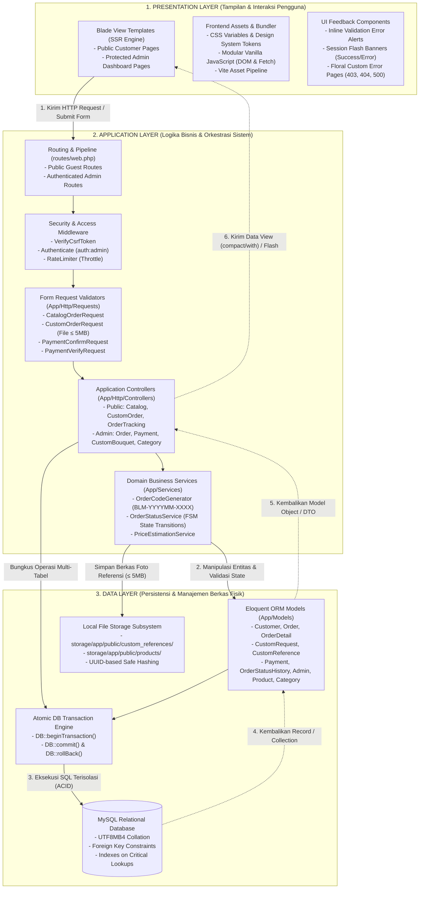

# PENETAPAN THREE-LAYER ARCHITECTURE (THREE-LAYER ARCHITECTURE SPECIFICATION)
## BLOOMÉ — Flowers & Stories
**Task ID:** ARC-001  
**Fase:** Phase 2 — System Analysis and Design (Sub-fase 5.3 System Architecture)  
**Penanggung Jawab:** Elsa Futri (Lead Software Architect & Backend Developer) & Jayanti Firdasari (Project Manager & System Analyst)  
**Tanggal Penyusunan:** 13 November 2026  
**Status Task:** Completed (`[x]`)  
**Dependensi:** ANA-010 — Validasi seluruh diagram (Selesai), DOC-016 — Arsitektur Sistem (Selesai)  

---

## 1. Ringkasan Eksekutif & Landasan Filosofis

Penetapan Three-Layer Architecture (Task ARC-001) dilakukan untuk merumuskan secara tegas dan mengikat pembagian batas tanggung jawab komputasi (*Separation of Concerns - SoC*) dalam pengembangan website **BLOOMÉ — Flowers & Stories**. 

Penerapan pola arsitektur tiga lapis (*Three-Layer Architecture Pattern*) pada ekosistem **Laravel (PHP)** dan **MySQL** bertujuan untuk:
1. **Memaksimalkan Kohesi (*High Cohesion*) & Meminimalkan Keterikatan (*Loose Coupling*):** Memastikan setiap komponen perangkat lunak hanya fokus pada satu tanggung jawab spesifik (*Single Responsibility Principle*).
2. **Mencegah Kebocoran Logika (*Zero Cross-Layer Leaks*):** Meniadakan eksekusi query langsung di antarmuka tampilan (Blade) atau logika presentasi di dalam model basis data.
3. **Memudahkan Pengujian & Pemeliharaan (*Testability & Maintainability*):** Logika bisnis dapat diuji secara terisolasi tanpa harus bergantung pada rendering antarmuka pengguna.
4. **Menjamin Integritas Data & Keamanan (*Data Integrity & Defense in Depth*):** Seluruh input dari luar divalidasi ketat di Application Layer sebelum berinteraksi dengan Data Layer.

---

## 2. Diagram Spesifikasi Three-Layer Architecture

Arsitektur aplikasi membagi sistem menjadi tiga tingkatan logis dengan arah ketergantungan searah (*unidirectional dependency flow*):



---

## 3. Spesifikasi Mendalam Setiap Lapisan

### 3.1 Lapisan 1: Presentation Layer (Antarmuka Pengguna)
- **Tanggung Jawab Utama:**
  1. Merender antarmuka pengguna berbasis Server-Side Rendering (SSR) menggunakan mesin template Laravel Blade.
  2. Mengonsumsi data yang dikirimkan oleh controller dan menyajikannya secara estetis sesuai panduan visual `design-system.md`.
  3. Mengelola interaktivitas formulir (validasi sisi klien ringan, preview unggah foto) menggunakan Vanilla JavaScript murni tanpa ketergantungan framework berat.
  4. Menampilkan umpan balik visual (*inline error messages*, flash notifications status transaksi, modal konfirmasi keputusan).
- **Komponen Teknis:**
  - `resources/views/layouts/`: Kerangka layout induk publik (`app.blade.php`) dan layout induk admin (`admin.blade.php`).
  - `resources/views/components/`: Komponen Blade reusable (kartu produk, badge status, tombol, input formulir).
  - `resources/views/pages/`: Halaman individual publik (beranda, katalog, checkout, pelacakan) dan admin (dashboard antrean, verifikasi pembayaran, review pembatalan).
  - `resources/css/` & `resources/js/`: Aset frontend yang dikompilasi oleh Vite.
- **Batasan & Larangan Keras (*Constraints*):**
  - **DILARANG** melakukan pemanggilan query database langsung dari file Blade (misal: dilarang menulis `App\Models\Product::all()` di dalam template Blade).
  - **DILARANG** memuat logika bisnis perhitungan harga custom atau pemotongan nominal diskon di dalam tampilan. Seluruh data angka tagihan harus matang dari Application Layer.

---

### 3.2 Lapisan 2: Application Layer (Logika Bisnis & Orkestrasi Sistem)
- **Tanggung Jawab Utama:**
  1. Mengarahkan rute HTTP yang masuk ke middleware otentikasi/keamanan dan controller yang relevan.
  2. Melakukan verifikasi keamanan data (*input sanitization & validation*) melalui kelas Form Request sebelum data disentuh oleh logika bisnis.
  3. Mengendalikan orkestrasi alur kerja (*use case execution*) dan transisi siklus hidup pesanan (*State Machine*).
  4. Menerapkan aturan bisnis (*business rules*) seperti validasi guest checkout, batasan ukuran berkas unggahan gambar (JPG/PNG $\le$ 5MB), dan batas izin pengajuan pembatalan (sebelum status ST-06).
  5. Menghasilkan respon HTTP yang sesuai (Redirect 302 dengan flash message, Render View 200 OK, atau JSON Response).
- **Komponen Teknis:**
  - `routes/web.php`: Definisi rute deklaratif terpisah antara area publik dan admin (`prefix('admin')`).
  - `App\Http\Middleware\`: Penjaga sesi admin (`auth:admin`), proteksi CSRF, dan pembatas frekuensi request (*rate limiting*).
  - `App\Http\Requests\`: Kelas validasi masukan (`CatalogOrderRequest`, `CustomOrderRequest`, `PaymentConfirmRequest`, `PaymentVerifyRequest`, dll.).
  - `App\Http\Controllers\`: Resource controllers untuk penanganan request (`OrderController`, `PaymentController`, `Admin\OrderController`, dll.).
  - `App\Services\`: Domain business services terisolasi:
    - `OrderCodeGenerator`: Bertanggung jawab atas algoritma format kode transaksi unik (`BLM-YYYYMM-XXXX`).
    - `OrderStatusService`: Bertanggung jawab memvalidasi matriks transisi status legal dan mencatat riwayat kronologis status.
- **Batasan & Larangan Keras (*Constraints*):**
  - **DILARANG** menuliskan *fat controller* dengan logika bercabang ratusan baris. Logika transaksional dan state machine wajib didelegasikan ke Domain Services.
  - **DILARANG** menangkap input mentah (`$_POST` atau `request()->all()`) tanpa melalui validasi Form Request.

---

### 3.3 Lapisan 3: Data Layer (Persistensi & Manajemen Berkas Fisik)
- **Tanggung Jawab Utama:**
  1. Mengelola skema dan relasi basis data relasional melalui definisi Eloquent ORM.
  2. Menjamin transaksi basis data bersifat atomik (ACID) melalui pembungkus `DB::transaction()`.
  3. Melakukan eksekusi snapshot historis (menyimpan nama dan harga satuan produk pada `order_details` saat transaksi terjadi untuk melindungi integritas laporan masa lalu sesuai BR-020).
  4. Mengelola persistensi fisik berkas unggahan gambar pada media penyimpanan lokal (`storage/app/public/`) dengan penamaan hash acak (UUID v4) guna mencegah eksekusi kode berbahaya.
- **Komponen Teknis:**
  - `App\Models\`: Kelas entitas Eloquent (`Customer`, `Order`, `OrderDetail`, `CustomRequest`, `CustomReference`, `Payment`, `OrderStatusHistory`, `Product`, `Category`, `Admin`).
  - `database/migrations/`: Skema DDL tabel relasional dengan indeks, primary key, dan foreign key constraints.
  - `database/seeders/`: Data inisialisasi awal (akun admin default, kategori buket, katalog bunga default).
  - `Illuminate\Support\Facades\Storage`: Driver penyimpanan lokal disk untuk foto produk dan berkas foto referensi custom.
- **Batasan & Larangan Keras (*Constraints*):**
  - Model **DILARANG** bergantung pada request HTTP, session pengguna, atau komponen Presentation Layer.
  - Model **DILARANG** menghasilkan output tampilan (HTML tags).

---

## 4. Aturan Penegakan Batas Antar-Lapisan (*Boundary Enforcement Rules*)

Untuk menjaga kesucian arsitektur monolitik modern ini, tim pengembang menetapkan matriks aksesibilitas antar-lapisan sebagai berikut:

| Lapisan Asal | Lapisan yang Boleh Diakses | Lapisan yang DILARANG Diakses | Mekanisme Komunikasi yang Diizinkan |
|---|---|---|---|
| **Presentation Layer** | Application Layer (via HTTP Route & Form Action) | Data Layer (Dilarang panggil Model / Database langsung) | Mengirim Form POST/GET, menerima variabel terkompilasi dari Controller. |
| **Application Layer** | Presentation Layer (Kirim data view) & Data Layer (Panggil Model & Service) | - | Meneruskan data via `view('nama.view', $data)` atau `redirect()`. Memanggil method Model & Service. |
| **Data Layer** | RDBMS MySQL & Local Disk Storage | Presentation Layer & HTTP Routing | Model hanya mengembalikan data murni (Object/Array/Collection) ke Application Layer. |

---

## 5. Pemetaan Struktur Direktori Proyek Laravel (Architectural Mapping)

Implementasi Three-Layer Architecture ini dipetakan secara presisi ke dalam struktur direktori Laravel:

```text
buketbunga/
├── app/
│   ├── Http/                           # === APPLICATION LAYER ===
│   │   ├── Controllers/                # Orkestrasi Request & Response
│   │   │   ├── Customer/               # Controller Publik & Tamu
│   │   │   │   ├── CatalogController.php
│   │   │   │   ├── OrderController.php
│   │   │   │   ├── CustomBouquetController.php
│   │   │   │   ├── PaymentController.php
│   │   │   │   └── OrderTrackingController.php
│   │   │   └── Admin/                  # Controller Dashboard Terproteksi
│   │   │       ├── AuthController.php
│   │   │       ├── DashboardController.php
│   │   │       ├── OrderController.php
│   │   │       ├── PaymentController.php
│   │   │       ├── CancellationController.php
│   │   │       ├── ProductController.php
│   │   │       └── CategoryController.php
│   │   ├── Middleware/                 # Filter Akses & CSRF Guard
│   │   └── Requests/                   # Validasi Form Input
│   │       ├── CatalogOrderRequest.php
│   │       ├── CustomOrderRequest.php
│   │       ├── PaymentConfirmRequest.php
│   │       └── Admin/
│   ├── Models/                         # === DATA LAYER ===
│   │   ├── Admin.php
│   │   ├── Category.php
│   │   ├── Product.php
│   │   ├── Customer.php
│   │   ├── Order.php
│   │   ├── OrderDetail.php
│   │   ├── CustomRequest.php
│   │   ├── CustomReference.php
│   │   ├── Payment.php
│   │   └── OrderStatusHistory.php
│   └── Services/                       # === APPLICATION / DOMAIN SERVICES ===
│       ├── OrderCodeGenerator.php
│       └── OrderStatusService.php
├── database/                           # === DATA LAYER MIGRATIONS & SEEDS ===
│   ├── migrations/
│   └── seeders/
├── resources/                          # === PRESENTATION LAYER ===
│   ├── css/
│   ├── js/
│   └── views/
│       ├── layouts/
│       │   ├── app.blade.php
│       │   └── admin.blade.php
│       ├── components/
│       ├── pages/
│       │   ├── public/
│       │   └── admin/
│       └── errors/
│           ├── 403.blade.php
│           ├── 404.blade.php
│           └── 500.blade.php
├── routes/                             # === APPLICATION LAYER ROUTING ===
│   └── web.php
└── storage/                            # === DATA LAYER PHYSICAL STORAGE ===
    └── app/public/
        ├── products/
        └── custom_references/
```

---

## 6. Kesimpulan & Rekomendasi

### 6.1 Status Penyelesaian Task ARC-001
Task **ARC-001 (Menentukan Three-Layer Architecture)** telah tuntas diselesaikan:
- Batas tanggung jawab (*boundaries*), aturan ketergantungan searah (*unidirectional dependencies*), dan protokol komunikasi Presentation, Application, dan Data Layer telah ditetapkan secara formal.
- Larangan *layer-bypassing* dan penegakan isolasi logika bisnis telah terdokumentasi.
- Struktur direktori Laravel telah diselaraskan dengan arsitektur tiga lapis.
- Kriteria penyelesaian (*Definition of Done*) terpenuhi secara menyeluruh.

### 6.2 Rekomendasi Langkah Berikutnya:
Melanjutkan pekerjaan ke task pemodelan arsitektur visual berikutnya pada sub-fase 5.3:
- **`ARC-002 — Membuat High-Level Architecture Diagram.`**

