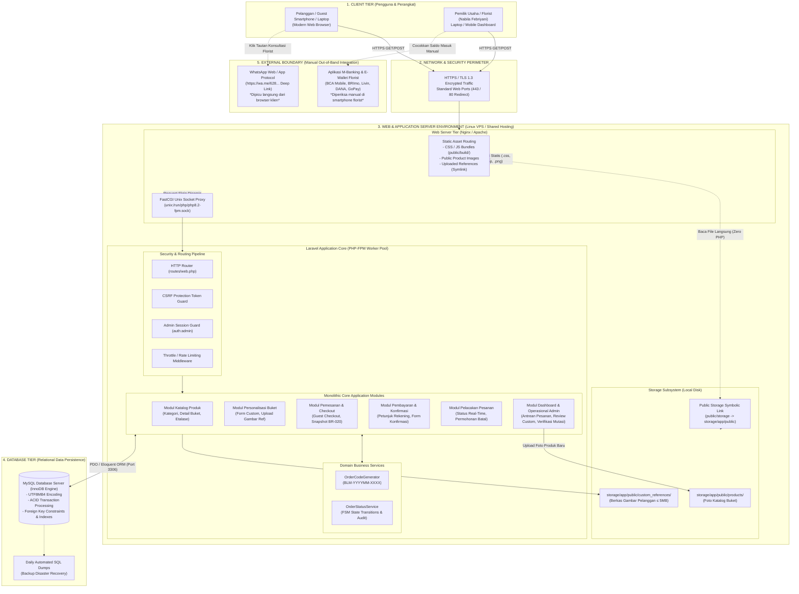

# HIGH-LEVEL ARCHITECTURE DIAGRAM SPECIFICATION
## BLOOMÉ — Flowers & Stories
**Task ID:** ARC-002  
**Fase:** Phase 2 — System Analysis and Design (Sub-fase 5.3 System Architecture)  
**Penanggung Jawab:** Elsa Futri (Lead Software Architect & Backend Developer) & Jayanti Firdasari (Project Manager & System Analyst)  
**Tanggal Penyusunan:** 13 November 2026  
**Status Task:** Completed (`[x]`)  
**Dependensi:** ARC-001 — Three-Layer Architecture (Selesai), DOC-016 — Arsitektur Sistem (Selesai)  

---

## 1. Ringkasan Eksekutif & Tujuan Perancangan

Perancangan High-Level Architecture Diagram (Task ARC-002) bertujuan untuk memberikan pandangan makro menyeluruh (*bird's-eye view*) mengenai topologi sistem, interkoneksi komponen fisik dan logis, serta batas-batas komunikasi antar-lingkungan pada website **BLOOMÉ — Flowers & Stories**.

Diagram arsitektur tingkat tinggi ini memetakan integrasi end-to-end antara:
1. **Client Tier:** Interaksi pengguna eksternal (Customer/Tamu) dan internal (Admin/Florist) melalui beragam perangkat (Smartphone, Tablet, Desktop).
2. **Network & Perimeter Tier:** Pengamanan jalur komunikasi jaringan melalui enkripsi HTTPS (TLS 1.3) dan port standar web.
3. **Web Server & Runtime Tier:** Peran web server (Nginx/Apache) sebagai reverse proxy dan pelayan aset statis berkecepatan tinggi, serta runtime PHP-FPM untuk eksekusi aplikasi Laravel.
4. **Application Core Tier:** Ekosistem monolitik modern Laravel yang menampung modul publik, modul admin, pipeline middleware, dan layanan domain.
5. **Data & Storage Tier:** Persistensi relasional transaksional pada MySQL Database (InnoDB Engine) dan penyimpanan berkas lokal terisolasi (*Local Storage Disk*).
6. **External Integration Boundary:** Penegasan model tanpa pihak ketiga otomatis (*gateway-less & bot-less*), dengan integrasi manual WhatsApp via *universal link scheme* langsung dari peramban klien.

---

## 2. High-Level System Architecture Diagram

---

## 3. Rincian Arsitektur & Tanggung Jawab Sub-Sistem

### 3.1 Client Tier (Perangkat Pengguna)
- **Pelanggan Publik (Guest):** Mengakses sistem tanpa login (*guest checkout*) melalui peramban web modern (Google Chrome, Safari, Mozilla Firefox, Microsoft Edge) pada perangkat telepon seluler (mayoritas trafik) atau komputer meja. Peramban mengeksekusi HTML5, CSS3 kustom yang responsif, dan Vanilla JavaScript ringan.
- **Admin (Nabila Febriyani):** Mengakses area manajemen terproteksi (`/admin`) melalui peramban komputer/laptop atau ponsel untuk memantau pesanan yang masuk, memeriksa stok, dan memperbarui status pengerjaan bunga.

---

### 3.2 Network & Security Perimeter Tier
- Seluruh komunikasi data antara peramban klien dan server dienkripsi menggunakan protokol **HTTPS (TLS 1.3 / TLS 1.2)** dengan sertifikat SSL (misal: Let's Encrypt).
- Port 80 (HTTP) secara otomatis dialihkan (*301 Permanent Redirect*) ke Port 443 (HTTPS) untuk mencegah intersepsi data atau serangan *man-in-the-middle* (MITM).
- Firewall tingkat sistem operasi (`ufw` atau setara) membatasi akses terbuka hanya pada port web publik (80 dan 443) serta port SSH aman yang terbatasi. Port database MySQL (3306) **TIDAK** dibuka ke publik dan hanya dapat diakses melalui antarmuka *loopback* lokal (`127.0.0.1` atau *unix domain socket*).

---

### 3.3 Web Server & Runtime Tier
- **Nginx / Apache HTTP Server:**
  - Bertindak sebagai gerbang terdepan (*reverse proxy*).
  - Melayani aset statis secara langsung dari direktori `public/build/` dan berkas gambar dari direktori tautan simbolik `public/storage/` tanpa membebani interpreter PHP (*zero CPU overhead* untuk aset statis).
  - Mengarahkan seluruh lalu lintas berkas dinamis yang menuju `index.php` ke runtime PHP-FPM melalui UNIX socket berperforma tinggi.
- **PHP-FPM (FastCGI Process Manager):**
  - Menjalankan *worker pool* PHP 8.2+ untuk mengeksekusi kernel Laravel.
  - Mengisolasi memori eksekusi per-request dan memastikan alokasi proses yang efisien saat terjadi lonjakan kunjungan musiman (misal: momen wisuda atau hari valentine).

---

### 3.4 Application Core Tier (Monolithic Laravel Application)
Arsitektur aplikasi dibangun di atas struktur monolitik modular (*modular modern monolith*) yang terbagi menjadi:
1. **Pipeline Middleware & Keamanan:**
   - Proteksi otomatis token CSRF (`VerifyCsrfToken`) pada setiap form POST.
   - Guard sesi terisolasi (`auth:admin`) untuk melindungi antarmuka back-office.
   - Pembatas laju request (*Rate Limiter*) untuk mencegah serangan *brute force* login dan *denial-of-service*.
2. **Modul Aplikasi Inti:**
   - **Catalog Module:** Manajemen kategori, etalase buket bunga, penyaringan berbasis kriteria, dan pratinjau produk detail.
   - **Custom Bouquet Module:** Formulir pengajuan buket custom dengan validasi berkas gambar (JPG/PNG $\le$ 5MB), pencatatan spesifikasi bahan bunga, dan alur negosiasi harga.
   - **Checkout Module:** Formulir pemesanan tamu cepat, validasi alamat Samarinda dan nomor WhatsApp, serta perekaman snapshot harga historis (BR-020).
   - **Payment Module:** Penyajian instruksi nomor rekening bank dan e-wallet resmi, formulir konfirmasi transfer mandiri pelanggan, dan pencatatan record pembayaran.
   - **Order Tracking Module:** Halaman pelacakan publik berbasis kode transaksi unik (`BLM-YYYYMM-XXXX`) yang menyajikan status pengerjaan fisik bunga secara *real-time* serta fitur permohonan pembatalan.
   - **Admin Operations Desk:** Antrean pesanan harian, lembar evaluasi buket custom, meja verifikasi mutasi pembayaran, pengubah status produksi, dan manajemen katalog produk.
3. **Domain Business Services:**
   - `OrderCodeGenerator`: Memproduksi kode alfanumerik transaksi yang unik dan mudah dibaca manusia.
   - `OrderStatusService`: Mengontrol mesin status (*Finite State Machine*) 8 tahap, memblokir transisi ilegal, dan mencatat riwayat kronologis audit.

---

### 3.5 Data & Storage Tier
- **MySQL Database Server (InnoDB Engine):**
  - Menggunakan engine InnoDB yang mendukung penuh transaksi ACID, penguncian baris (*row-level locking*), dan integritas relasional kunci asing (*foreign keys*).
  - Pengkodean karakter menggunakan `utf8mb4_unicode_ci` untuk mendukung penyimpanan teks pesan kartu ucapan yang beragam.
  - Dilengkapi skrip pencadangan otomatis harian (*daily automated database dump*) untuk mitigasi bencana data.
- **Local File Storage Subsystem:**
  - Terletak pada direktori aman `storage/app/public/`.
  - Terbagi menjadi dua ruang direktori:
    - `products/`: Menampung foto resmi katalog buket yang diunggah oleh admin.
    - `custom_references/`: Menampung berkas foto contoh/referensi buket yang diunggah pelanggan dengan penamaan hash UUID acak (anti-tampering).
  - Diakses publik secara aman melalui symbolic link `public/storage` yang dihasilkan perintah `php artisan storage:link`.

---

### 3.6 External Boundary & Model Integrasi Out-of-Band
Arsitektur BLOOMÉ secara sengaja mengadopsi model *Zero Third-Party Dependency* pada alur pembayaran dan perpesanan guna memangkas biaya langganan API dan menghilangkan kerentanan terhadap gangguan pihak ketiga:
1. **Model Pembayaran Tanpa Payment Gateway (*Gateway-Less*):**
   - Tidak ada integrasi webhook atau SDK payment gateway otomatis (seperti Midtrans/Xendit).
   - Pelanggan mentransfer dana via m-banking pribadi; pemilik usaha memeriksa mutasi riil pada aplikasi perbankan fisiknya.
2. **Model Komunikasi WhatsApp Tanpa Bot (*Bot-Less*):**
   - Tidak ada integrasi WhatsApp Business API berbayar atau webhook *third-party gateway*.
   - Tombol "Konsultasi via WhatsApp" atau "Hubungi Florist" menggunakan protokol URL standar universal: `https://wa.me/628XXXXXXXXXX?text=...` yang dieksekusi langsung oleh peramban pelanggan menuju aplikasi WhatsApp asli di perangkat pengguna.

---

## 4. Karakteristik & Kualitas Arsitektur (*Architectural Quality Attributes*)

| Atribut Kualitas | Strategi Desain Arsitektur | Target Terukur |
|---|---|:---:|
| **Kinerja (*Performance*)** | Pemanfaatan caching Nginx untuk aset statis (CSS/JS/Gambar), optimasi query Eloquent menggunakan *eager loading* (`with()`), dan perenderan SSR Blade. | Waktu respon halaman (*Response Time*) $\le$ 2,0 detik pada jaringan 4G standar. |
| **Keamanan (*Security*)** | Enkripsi HTTPS wajib, isolasi folder inti di luar `public_html`, sanitasi penamaan file UUID v4, pencegahan SQL Injection via PDO parameter binding, dan hashing kata sandi Bcrypt. | Zero vulnerability terhadap OWASP Top 10 risiko umum. |
| **Ketersediaan (*Availability*)** | Arsitektur monolitik tanpa ketergantungan API pihak ketiga memastikan website tetap dapat beroperasi penuh 100% meskipun layanan perbankan pihak ketiga mengalami gangguan teknis. | Sistem siap operasional 24/7. |
| **Kemudahan Pemeliharaan (*Maintainability*)** | Penerapan Three-Layer Architecture memisahkan tanggung jawab secara tegas sehingga perubahan antarmuka atau logika kalkulasi harga tidak saling merusak (*loose coupling*). | Waktu pemecahan bug dan penambahan fitur baru lebih singkat dan terukur. |

---

## 5. Kesimpulan & Rekomendasi

### 5.1 Status Penyelesaian Task ARC-002
Task **ARC-002 (Membuat High-Level Architecture Diagram)** telah selesai dilaksanakan:
- Diagram arsitektur sistem tingkat tinggi (*High-Level Architecture Diagram*) telah dimodelkan secara komprehensif menggunakan diagram visual Mermaid.
- Pemetaan menyeluruh dari Client Tier, Network Perimeter, Web Server, Runtime PHP-FPM, Application Core, Local File Storage, hingga Database MySQL InnoDB telah terdokumentasi lengkap.
- Karakteristik kualitas arsitektur (kinerja, keamanan, ketersediaan, dan *out-of-band integration*) terdefinisi jelas.
- Kriteria penyelesaian (*Definition of Done*) terpenuhi.

### 5.2 Rekomendasi Langkah Berikutnya:
Melanjutkan pekerjaan ke task arsitektur berikutnya pada sub-fase 5.3:
- **`ARC-003 — Membuat Component Diagram.`**

