```mermaid
flowchart TB
    %% ==========================================
    %% PACKAGE: PUBLIC CUSTOMER DOMAIN
    %% ==========================================
    subgraph PkgPublic ["Paket: Public Customer Domain (Tamu / Pelanggan)"]
        direction TB
        CompCatalog["«component»<br><b>Catalog Browsing</b><br>(Katalog, Kategori, Detail)"]
        CompCustom["«component»<br><b>Custom Bouquet Request</b><br>(Formulir & Upload Ref)"]
        CompCheckout["«component»<br><b>Checkout & Order Creation</b><br>(Guest Checkout & Snapshot)"]
        CompPaymentPub["«component»<br><b>Payment Instruction & Confirm</b><br>(Tagihan & Konfirmasi Transfer)"]
        CompTracking["«component»<br><b>Order Tracking & Cancel</b><br>(Lacak Real-Time & Ajukan Batal)"]
    end

    %% ==========================================
    %% PACKAGE: ADMINISTRATIVE DOMAIN
    %% ==========================================
    subgraph PkgAdmin ["Paket: Administrative Domain (Back-Office Florist)"]
        direction TB
        CompAuth["«component»<br><b>Admin Auth Guard</b><br>(Login, Session, Middleware)"]
        CompCatProdMgr["«component»<br><b>Product & Category Manager</b><br>(CRUD Produk & Stok)"]
        CompCustomDesk["«component»<br><b>Custom Pricing Workbench</b><br>(Review Foto & Usulan Harga)"]
        CompOrderLifecycle["«component»<br><b>Order Lifecycle Manager</b><br>(Antrean & Transisi Status)"]
        CompPayVerify["«component»<br><b>Payment Verification Desk</b><br>(Audit Mutasi Sah/Tolak)"]
        CompCancelDecision["«component»<br><b>Cancellation Evaluator</b><br>(Persetujuan/Penolakan Batal)"]
    end

    %% ==========================================
    %% PACKAGE: SHARED CORE SERVICES
    %% ==========================================
    subgraph PkgShared ["Paket: Shared Domain & Core Services"]
        direction TB
        SvcOrderCode["«service»<br><b>OrderCodeGenerator</b><br>(BLM-YYYYMM-XXXX)"]
        SvcOrderStatus["«service»<br><b>OrderStatusService</b><br>(FSM State Engine)"]
        SvcStorage["«service»<br><b>Secure Storage Manager</b><br>(UUID Hashing & Public Link)"]
        SvcAudit["«service»<br><b>Audit Trail Logger</b><br>(Status History Logger)"]
    end

    %% ==========================================
    %% PACKAGE: DATA PERSISTENCE
    %% ==========================================
    subgraph PkgData ["Paket: Data Persistence Subsystem"]
        direction TB
        CompTxEngine["«component»<br><b>Atomic Transaction Engine</b><br>(DB::transaction ACID)"]
        CompORM["«component»<br><b>Eloquent ORM Entities</b><br>(Order, Customer, Payment, dll)"]
        DBStore[("MySQL Relational Database")]
        DiskStore[("Local Disk Filesystem")]
    end

    %% ==========================================
    %% DEPENDENCIES & INVOCATIONS
    %% ==========================================
    
    %% Public Flow
    CompCatalog -->|"Pilih Buket & Checkout"| CompCheckout
    CompCustom -->|"Validasi Berkas Foto"| SvcStorage
    CompCustom -->|"Buat Tiket Custom"| CompCheckout
    CompCheckout -->|"Terbitkan Kode Transaksi"| SvcOrderCode
    CompCheckout -->|"Inisialisasi Status ST-01"| SvcOrderStatus
    CompCheckout -->|"Persistensi Snapshot BR-020"| CompTxEngine
    CompPaymentPub -->|"Submit Konfirmasi Bayar"| SvcOrderStatus
    CompTracking -->|"Cek Status Terkini"| CompORM
    CompTracking -->|"Ajukan Pembatalan (BR-013)"| SvcOrderStatus

    %% Admin Guard
    CompAuth -.->|"Guards Access"| CompCatProdMgr
    CompAuth -.->|"Guards Access"| CompCustomDesk
    CompAuth -.->|"Guards Access"| CompOrderLifecycle
    CompAuth -.->|"Guards Access"| CompPayVerify
    CompAuth -.->|"Guards Access"| CompCancelDecision

    %% Admin Operations Flow
    CompCatProdMgr -->|"Upload Foto Produk"| SvcStorage
    CompCatProdMgr -->|"Update Katalog/Kategori"| CompORM
    CompCustomDesk -->|"Ambil Berkas Referensi"| SvcStorage
    CompCustomDesk -->|"Kirim Harga Usulan (ST-02)"| SvcOrderStatus
    CompOrderLifecycle -->|"Ubah Status Produksi (ST-06/07)"| SvcOrderStatus
    CompPayVerify -->|"Verifikasi Mutasi (ST-05/03)"| SvcOrderStatus
    CompCancelDecision -->|"Keputusan Batal (ST-08)"| SvcOrderStatus

    %% Core Services Connections
    SvcOrderStatus -->|"Catat Perubahan Kronologis"| SvcAudit
    SvcAudit -->|"Simpan Jejak Audit"| CompORM
    SvcStorage -->|"Simpan Berkas Fisik"| DiskStore
    SvcOrderStatus -->|"Validasi & Mutasi Status"| CompTxEngine

    %% Persistence
    CompTxEngine --> CompORM
    CompORM --> DBStore
```

# DIAGRAM KOMPONEN APLIKASI (APPLICATION COMPONENT DIAGRAM SPECIFICATION)
## BLOOMÉ — Flowers & Stories
**Task ID:** ARC-003  
**Fase:** Phase 2 — System Analysis and Design (Sub-fase 5.3 System Architecture)  
**Penanggung Jawab:** Elsa Futri (Lead Software Architect & Backend Developer) & Jayanti Firdasari (Project Manager & System Analyst)  
**Tanggal Penyusunan:** 13 November 2026  
**Status Task:** Completed (`[x]`)  
**Dependensi:** ARC-001 — Three-Layer Architecture (Selesai), ARC-002 — High-Level Architecture Diagram (Selesai), DOC-016 — Arsitektur Sistem (Selesai)  

---

## 1. Ringkasan Eksekutif & Tujuan Perancangan

Perancangan Diagram Komponen Aplikasi (Task ARC-003) disusun untuk mendefinisikan dekomposisi struktural modular dari sistem perangkat lunak **BLOOMÉ — Flowers & Stories**. Diagram ini memetakan komponen-komponen fungsional independen, antarmuka kontrak (*provided & required interfaces*), serta relasi ketergantungan (*dependencies*) antar-subsistem.

Dengan mendefinisikan komponen secara granular:
1. **Memastikan Prinsip Ketergantungan Asiklis (*Acyclic Dependencies Principle - ADP*):** Struktur paket dirancang bersih tanpa adanya siklus ketergantungan tertutup (*circular dependencies*).
2. **Memperjelas Kontrak Antarmuka (*Interface Contracts*):** Setiap modul mengetahui secara eksplisit input, output, dan pengecualian (*exceptions*) yang dihasilkan saat berkolaborasi dengan modul lain.
3. **Mendukung Pengembangan Paralel Tim:** Riya Monika (Frontend Lead) dan Elsa Futri (Backend Lead) dapat mengimplementasikan komponen tampilan dan logika aplikasi secara independen dengan mengacu pada kontrak antarmuka yang telah disepakati.

---

## 2. Diagram Komponen Sistem (Component Diagram)

Diagram berikut memodelkan pembagian komponen perangkat lunak ke dalam 3 paket domain utama (*Public Customer Domain*, *Administrative Domain*, dan *Shared Core & Infrastructure Services*):

```mermaid
classDiagram
    %% Note: Mermaid flowchart / class-diagram hybrid for component visualization
```



---

## 3. Spesifikasi Komponen & Kontrak Antarmuka (Component Specifications)

### 3.1 Komponen Domain Publik (*Public Customer Domain*)

#### 1. Catalog Browsing Component
- **Fungsi:** Menyajikan daftar katalog buket bunga dengan filter kategori, pagination, dan pratinjau detail produk.
- **Provided Interfaces:**
  - `GET /catalog` $\rightarrow$ Menampilkan etalase produk aktif (`is_available = 1`).
  - `GET /catalog/{slug}` $\rightarrow$ Menampilkan detail buket, deskripsi bunga, dan harga tetap.
- **Required Interfaces:** `Product`, `Category` (Eloquent ORM).
- **Artefak Terkait:** `CatalogController.php`, `catalog/index.blade.php`, `catalog/show.blade.php`.

#### 2. Custom Bouquet Request Component
- **Fungsi:** Menampung spesifikasi buket pesanan khusus pelanggan, memvalidasi berkas referensi foto ($\le$ 5MB), dan meneruskannya ke mesin checkout.
- **Provided Interfaces:**
  - `GET /custom-order` $\rightarrow$ Menampilkan formulir input spesifikasi custom.
  - `POST /custom-order` $\rightarrow$ Menerima payload multipart `CustomOrderRequest`.
- **Required Interfaces:** `Secure Storage Manager`, `Checkout & Order Creation Component`.
- **Artefak Terkait:** `CustomBouquetController.php`, `CustomOrderRequest.php`, `custom-order.blade.php`.

#### 3. Checkout & Order Creation Component
- **Fungsi:** Menghimpun identitas tamu pemesan (nama, WA, alamat Samarinda, ucapan), mengunci snapshot harga historis (BR-020), dan menghasilkan record pesanan resmi.
- **Provided Interfaces:**
  - `POST /order/catalog` $\rightarrow$ Menerima pesanan produk katalog.
  - `POST /order/custom` $\rightarrow$ Menerima pesanan buket custom.
- **Required Interfaces:** `OrderCodeGenerator`, `OrderStatusService`, `Atomic Transaction Engine`.
- **Artefak Terkait:** `OrderController.php`, `CatalogOrderRequest.php`, `Order.php`, `OrderDetail.php`.

#### 4. Payment Instruction & Confirmation Component
- **Fungsi:** Menampilkan informasi rekening resmi bank butik dan menampung konfirmasi transfer mandiri pelanggan.
- **Provided Interfaces:**
  - `GET /order/{code}/payment` $\rightarrow$ Menampilkan nomor rekening & rincian nominal tagihan.
  - `POST /order/{code}/payment/confirm` $\rightarrow$ Merekam konfirmasi transfer & transisi ke status ST-04.
- **Required Interfaces:** `OrderStatusService`, `Payment` (Eloquent Model).
- **Artefak Terkait:** `PaymentController.php`, `PaymentConfirmRequest.php`, `order/payment-info.blade.php`.

#### 5. Order Tracking & Cancellation Component
- **Fungsi:** Menyajikan linimasa status pesanan real-time berdasarkan kode pesanan dan menyediakan form pengajuan pembatalan sebelum bunga dirangkai fisik (BR-013).
- **Provided Interfaces:**
  - `GET /order/track/{code}` $\rightarrow$ Menampilkan status terkini dan jejak histori.
  - `POST /order/{code}/cancel` $\rightarrow$ Mengajukan permohonan pembatalan beserta alasan.
- **Required Interfaces:** `OrderStatusService`, `Order` (Eloquent Model).
- **Artefak Terkait:** `OrderTrackingController.php`, `order/track.blade.php`.

---

### 3.2 Komponen Domain Administratif (*Administrative Domain*)

#### 1. Admin Auth Guard Component
- **Fungsi:** Melindungi area back-office melalui otentikasi sesi berbasis guard khusus (`admin`), proteksi brute-force login, dan CSRF guard.
- **Provided Interfaces:**
  - `POST /admin/login` $\rightarrow$ Verifikasi kredensial admin (Bcrypt hash).
  - `POST /admin/logout` $\rightarrow$ Invalidation sesi admin.
  - `Middleware auth:admin` $\rightarrow$ Guarding seluruh rute berawalan `/admin/*`.
- **Artefak Terkait:** `Admin\AuthController.php`, `Admin.php`.

#### 2. Product & Category Manager
- **Fungsi:** Operasi CRUD kategori produk dan katalog buket bunga, termasuk pengelolaan status ketersediaan (*is_available*) dan unggah foto produk resmi.
- **Provided Interfaces:**
  - Resource routes: `/admin/products` dan `/admin/categories`.
- **Required Interfaces:** `Secure Storage Manager`, `Product`, `Category`.
- **Artefak Terkait:** `Admin\ProductController.php`, `Admin\CategoryController.php`.

#### 3. Custom Pricing Workbench Component
- **Fungsi:** Fasilitas bagi pemilik usaha untuk meninjau detail permintaan kustom, menganalisis foto referensi, dan menetapkan harga usulan (*proposed price*).
- **Provided Interfaces:**
  - `GET /admin/custom-orders/{id}` $\rightarrow$ Menampilkan rincian kustom & pratinjau gambar.
  - `POST /admin/custom-orders/{id}/set-price` $\rightarrow$ Submit harga usulan & update status ke ST-02.
- **Required Interfaces:** `OrderStatusService`, `Secure Storage Manager`.
- **Artefak Terkait:** `Admin\CustomBouquetController.php`.

#### 4. Order Lifecycle Manager Component
- **Fungsi:** Mengendalikan antrean pesanan harian berdasarkan tanggal pengiriman (*delivery_date*) dan memutakhirkan tahapan pengerjaan fisik (ST-05 $\rightarrow$ ST-06 $\rightarrow$ ST-07).
- **Provided Interfaces:**
  - `GET /admin/orders` $\rightarrow$ Filter antrean pesanan berdasarkan status dan tanggal.
  - `POST /admin/orders/{id}/status` $\rightarrow$ Memperbarui status pemrosesan/pengiriman buket.
- **Required Interfaces:** `OrderStatusService`, `Atomic Transaction Engine`.
- **Artefak Terkait:** `Admin\OrderController.php`, `OrderStatusUpdateRequest.php`.

#### 5. Payment Verification Desk Component
- **Fungsi:** Memeriksa antrean pembayaran pending (ST-04) dan memvalidasi keabsahan dana berdasarkan mutasi rekening manual.
- **Provided Interfaces:**
  - `GET /admin/payments` $\rightarrow$ Antrean konfirmasi pembayaran.
  - `POST /admin/payments/{id}/verify` $\rightarrow$ Keputusan verifikasi (Sah $\rightarrow$ ST-05 / Ditolak $\rightarrow$ ST-03).
- **Required Interfaces:** `OrderStatusService`, `Payment` (Eloquent Model).
- **Artefak Terkait:** `Admin\PaymentController.php`, `PaymentVerifyRequest.php`.

#### 6. Cancellation Evaluator Component
- **Fungsi:** Meninjau alasan permohonan pembatalan dari pemesan dan memberikan keputusan persetujuan (ST-08) atau penolakan pembatalan (BR-014).
- **Provided Interfaces:**
  - `GET /admin/cancellations` $\rightarrow$ Daftar antrean permohonan pembatalan.
  - `POST /admin/orders/{id}/cancellation` $\rightarrow$ Eksekusi keputusan pembatalan.
- **Required Interfaces:** `OrderStatusService`, `Order` (Eloquent Model).
- **Artefak Terkait:** `Admin\CancellationController.php`.

---

### 3.3 Komponen Layanan Inti Terbagi (*Shared Core Services*)

| Komponen Layanan | Kelas Implementasi | Tanggung Jawab Utama | Konsumen Layanan |
|---|---|---|---|
| **OrderCodeGenerator** | `App\Services\OrderCodeGenerator` | Memproduksi format kode unik `BLM-YYYYMM-XXXX` berurut per bulan dengan proteksi duplikasi. | `Checkout & Order Creation Component` |
| **OrderStatusService** | `App\Services\OrderStatusService` | Menegakkan aturan mesin status FSM, memvalidasi legalitas transisi status, dan mencatat histori. | Seluruh modul transaksi & admin |
| **Secure Storage Manager** | `Illuminate\Support\Facades\Storage` | Mengamankan unggahan gambar via hashing nama UUID v4 di folder `storage/app/public/`. | `Custom Component`, `Product Manager` |
| **Audit Trail Logger** | Terintegrasi di `OrderStatusService` | Menyimpan log kronologis `order_status_histories` lengkap dengan ID admin pengubah. | `OrderStatusService` |
| **Atomic Transaction Engine** | `Illuminate\Support\Facades\DB` | Membungkus eksekusi operasi multi-tabel dalam blok atomik ACID (`DB::transaction`). | Controllers & Services |

---

## 4. Matriks Dependensi & Keterikatan (*Coupling Analysis*)

Analisis ketergantungan memastikan kepatuhan terhadap prinsip arsitektur berorientasi komponen:

```text
[Public Domain] --------+
                        |---> [Shared Core Services] ---> [Data Persistence Subsystem]
[Administrative Domain] -+
```

1. **Bebas Ketergantungan Siklis (*No Circular Dependencies*):**
   - Komponen Publik tidak bergantung pada Komponen Admin.
   - Komponen Admin tidak memanggil balik antarmuka Komponen Publik.
   - Layanan Inti (*Shared Services*) tidak memiliki ketergantungan ke lapisan atas (Controllers/Views).
2. **Keterikatan Rendah (*Low Coupling*):**
   - Komponen saling berinteraksi melalui *Data Transfer Objects* (DTOs), Form Request terikat, atau model data Eloquent.
3. **Kohesi Tinggi (*High Cohesion*):**
   - Setiap komponen membatasi cakupan pekerjaannya hanya pada domain bisnis yang relevan (misal: verifikasi pembayaran terisolasi dari perangkaian status fisik buket).

---

## 5. Kesimpulan & Rekomendasi

### 5.1 Status Penyelesaian Task ARC-003
Task **ARC-003 (Membuat Component Diagram)** telah selesai dilaksanakan secara komprehensif:
- Seluruh 11 komponen utama dan 5 layanan inti terbagi (*shared core services*) telah didekomposisi dan dimodelkan dengan diagram visual Mermaid.
- Kontrak antarmuka (*provided & required interfaces*) terpetakan secara presisi ke dalam struktur controller, form request, service, dan view Laravel.
- Analisis ketergantungan asiklis (*acyclic dependencies*) telah tervalidasi.
- Kriteria penyelesaian (*Definition of Done*) terpenuhi.

### 5.2 Rekomendasi Langkah Berikutnya:
Melanjutkan pekerjaan ke task analisis arsitektur berikutnya pada sub-fase 5.3:
- **`ARC-004 — Menentukan Application Modules.`**

