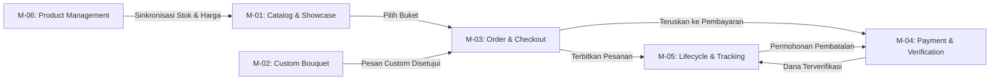

# PENETAPAN MODUL APLIKASI (APPLICATION MODULES SPECIFICATION)
## BLOOMÉ — Flowers & Stories
**Task ID:** ARC-004  
**Fase:** Phase 2 — System Analysis and Design (Sub-fase 5.3 System Architecture)  
**Penanggung Jawab:** Elsa Futri (Lead Software Architect & Backend Developer) & Jayanti Firdasari (Project Manager & System Analyst)  
**Tanggal Penyusunan:** 13 November 2026  
**Status Task:** Completed (`[x]`)  
**Dependensi:** ARC-001 — Three-Layer Architecture, ARC-003 — Component Diagram  

---

## 1. Ringkasan Eksekutif & Tujuan Perancangan Modul

Penetapan Modul Aplikasi (Task ARC-004) bertujuan untuk membagi sistem monolitik **BLOOMÉ — Flowers & Stories** ke dalam modul-modul fungsional terpadu (*Modular Monolith*). Pendekatan ini memastikan bahwa meskipun aplikasi berjalan dalam satu basis kode Laravel, batas-batas logika (*logical boundaries*) setiap modul tetap terisolasi dengan rapi, memudahkan pemeliharaan, dan meminimalkan keterikatan antar-modul (*low coupling*).

---

## 2. Dekomposisi 6 Modul Aplikasi Utama

Sistem BLOOMÉ didekomposisi menjadi 6 modul fungsional inti:

| No | Modul Aplikasi | Ranah (*Domain*) | Tanggung Jawab Utama | Aktor Pengguna |
|---|---|---|---|---|
| **M-01** | **Catalog & Showcase Module** | Public Domain | Mengelola katalog buket, penapisan (*filtering*) kategori, dan pratinjau detail buket bunga. | Customer (Guest) |
| **M-02** | **Custom Bouquet Request Module** | Public & Admin | Menangani formulir kustom, unggahan berkas foto referensi (≤ 5MB), dan alur negosiasi harga. | Customer & Admin |
| **M-03** | **Order & Checkout Module** | Public Domain | Mengelola alur checkout tamu (*guest checkout*), validasi identitas, dan perekaman snapshot harga (BR-020). | Customer (Guest) |
| **M-04** | **Payment & Verification Module** | Public & Admin | Menyajikan rekening bank butik, menampung konfirmasi bayar, dan audit verifikasi mutasi manual. | Customer & Admin |
| **M-05** | **Order Lifecycle & Tracking Module** | Public & Admin | Mengelola antrean harian, pembaruan status fisik (ST-05 $\rightarrow$ ST-07), dan evaluasi pembatalan (ST-08). | Customer & Admin |
| **M-06** | **Product & Inventory Management** | Admin Domain | Operasi CRUD master kategori, produk katalog, kontrol stok (*is_available*), dan unggah foto produk. | Admin (Nabila) |

---

## 3. Matriks Interaksi & Komunikasi Antar-Modul

---

## 4. Kesimpulan & Rekomendasi
Task **ARC-004 (Menentukan Application Modules)** telah selesai. Seluruh 6 modul aplikasi inti telah didefinisikan dengan batas ranah dan protokol komunikasi yang bersih.

