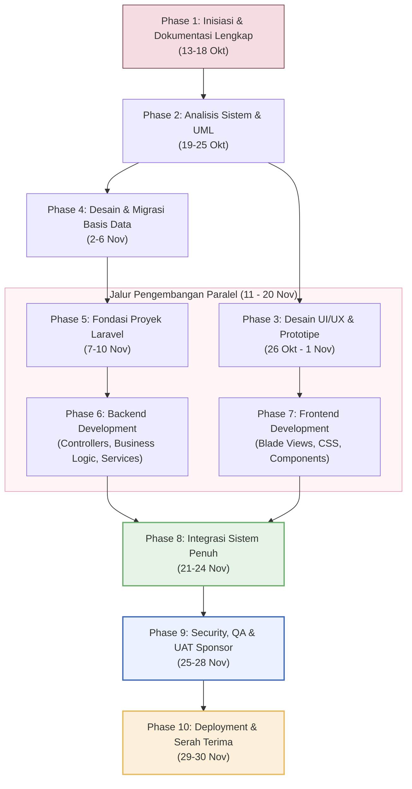

# TECHNICAL IMPLEMENTATION PLAN & EXECUTION ROADMAP
# BLOOMÉ — Flowers & Stories

## 1. Document Information

- **Nama Dokumen:** Technical Implementation Plan & Execution Roadmap
- **Nama Sistem:** BLOOMÉ — Flowers & Stories
- **Nama Proyek:** Perancangan Sistem Informasi Pemesanan dan Personalisasi Buket Bunga Berbasis Web
- **Lead Technical Project Manager & System Analyst:** Jayanti Firdasari
- **Backend Developer & Lead Architect:** Elsa Futri
- **Frontend Developer & UI/UX Designer:** Riya Monika
- **Project Sponsor & Owner:** Nabila Febriyani
- **Periode Pelaksanaan:** 13 Oktober 2026 – 30 November 2026 (7 Minggu)
- **Versi Dokumen:** 1.0 (Official Implementation Baseline)
- **Tanggal Efektif:** 13 November 2026
- **Status Dokumen:** Approved Baseline

---

## 2. Executive Summary & Implementation Objectives

Dokumen **Technical Implementation Plan** ini menetapkan panduan eksekusi teknis langkah-demi-langkah (*step-by-step engineering roadmap*) bagi seluruh tim pengembang website **BLOOMÉ — Flowers & Stories**.

Rencana implementasi ini dirancang untuk:
1. **Menghubungkan Perancangan ke Eksekusi Nyata:** Menerjemahkan spesifikasi arsitektur (`architecture.md`), skema basis data (`database-design.md`), desain sistem (`design-system.md`), dan alur pengguna (`user-flow.md`) menjadi urutan tugas teknis yang terukur.
2. **Menjaga Disiplin Waktu:** Mengatur sinkronisasi kerja antara tim backend (Elsa Futri) dan frontend (Riya Monika) di bawah supervisi manajemen proyek (Jayanti Firdasari) guna menjamin rilis tepat waktu sebelum batas akhir **30 November 2026**.
3. **Menerapkan Standar Kualitas Ketat:** Menetapkan kriteria penyelesaian (*Definition of Done*) dan uji *Quality Gate* pada setiap fase implementasi.

---

## 3. Lingkungan Pengembangan & Standar Tooling (Environment & Tooling)

| Komponen Lingkungan | Spesifikasi Standar yang Digunakan |
|---|---|
| **Sistem Operasi Pengembangan** | Windows 10/11 / Linux Environment |
| **Bahasa Pemrograman Backend** | PHP 8.2+ (Ekstensi: `pdo_mysql`, `mbstring`, `openssl`, `tokenizer`, `xml`, `gd`, `fileinfo`) |
| **Dependency Manager** | Composer 2.6+ |
| **Framework Backend** | Laravel 10.x / 11.x |
| **Basis Data Relasional** | MySQL 8.0+ (InnoDB Storage Engine, Charset `utf8mb4`) |
| **Frontend Tooling** | Node.js v18+ / v20+, NPM, Vite Asset Bundler |
| **Arsitektur Rendering** | Server-Side Rendering via Laravel Blade Templates |
| **Version Control System** | Git (Branching Model: `main`, `develop`, `feature/*`) |

---

## 4. Rencana Kerja Fase-demi-Fase (Phase-by-Phase Roadmap)

---

### 4.1 Phase 2 — System Analysis and Design (19 – 25 Oktober 2026)
- **Tujuan:** Menghasilkan pemodelan visual UML lengkap yang memvalidasi seluruh alur bisnis sistem.
- **Aktivitas Utama:**
  - Menyusun Use Case Diagram dan deskripsi skenario aktor Customer & Admin (`ANA-001`, `ANA-002`).
  - Menyusun Activity Diagram untuk alur katalog, buket custom, pembayaran, dan pembatalan (`ANA-003` s/d `ANA-006`).
  - Menyusun Sequence Diagram untuk alur pemesanan, pembayaran, dan pengelolaan pesanan (`ANA-007` s/d `ANA-009`).
  - Meninjau keselarasan seluruh diagram terhadap aturan bisnis (`ANA-010`).
- **Penanggung Jawab:** Jayanti Firdasari (Lead).

---

### 4.2 Phase 3 — UI/UX Design & Prototyping (26 Oktober – 01 November 2026)
- **Tujuan:** Menyusun wireframe, high-fidelity mockup, dan prototipe interaktif seluruh halaman web.
- **Aktivitas Utama:**
  - Menyusun wireframe halaman publik (Beranda, Katalog, Detail, Form Pesan, Form Custom, Info Bayar, Konfirmasi) (`UX-014` s/d `UX-024`).
  - Menyusun wireframe panel admin (Login, Dashboard, Produk, Kategori, Antrean Pesanan, Detail Custom, Pembayaran, Pembatalan) (`UX-025` s/d `UX-039`).
  - Memverifikasi tampilan responsif pada 3 breakpoint (Mobile 360px, Tablet 768px, Desktop 1280px) (`UX-040`).
  - Membangun prototipe interaktif untuk validasi alur checkout dan approval harga (`UX-041`).
- **Penanggung Jawab:** Riya Monika (Lead).

---

### 4.3 Phase 4 — Database Implementation & Models (02 – 06 November 2026)
- **Tujuan:** Menerjemahkan kamus data menjadi berkas migrasi fisik Laravel dan model Eloquent.
- **Aktivitas Utama:**
  - Menulis 10 berkas migrasi tabel (`DB-011` s/d `DB-020`): `admins`, `categories`, `products`, `customers`, `orders`, `order_details`, `custom_requests`, `custom_references`, `payments`, `order_status_histories`.
  - Mengeksekusi migrasi ke basis data MySQL lokal dan memvalidasi foreign keys (`DB-021`, `DB-022`).
  - Membuat 10 Eloquent Models lengkap dengan relasi (`hasMany`, `belongsTo`, `hasOne`) dan atribut `$fillable` / `$casts`.
  - Menyiapkan seeder awal: `AdminSeeder` (akun Nabila) dan `CategorySeeder` (5 kategori dasar).
- **Penanggung Jawab:** Elsa Futri (Lead).

---

### 4.4 Phase 5 — Laravel Project Foundation (07 – 10 November 2026)
- **Tujuan:** Menyiapkan fondasi scaffolding aplikasi Laravel yang siap menerima logika dan antarmuka.
- **Aktivitas Utama:**
  - Inisialisasi proyek Laravel dan konfigurasi berkas `.env` (koneksi MySQL, app key, storage).
  - Mengonfigurasi guard otentikasi admin (`config/auth.php`) dan middleware `auth:admin`.
  - Menyiapkan struktur direktori Controllers, Form Requests, dan Services classes.
  - Mengonfigurasi symbolic link berkas storage: `php artisan storage:link`.
  - Menyiapkan penanganan error terpusat dan halaman kustom floral (404, 403, 500).
- **Penanggung Jawab:** Elsa Futri (Lead) & Riya Monika (Vite setup).

---

### 4.5 Phase 6 & Phase 7 — Parallel Engineering Sprint (11 – 20 November 2026)
Pengembangan teknis dibagi menjadi dua jalur paralel yang terkoordinasi:

#### Jalur Backend (Elsa Futri):
1. **Autentikasi Admin (`BE-014` s/d `BE-018`):** Login form handler, Bcrypt hash check, session management, logout, dan route protection.
2. **Manajemen Kategori & Produk (`BE-019` s/d `BE-034`):** Controller CRUD kategori dan produk, unggah foto produk ke storage, validasi slug unik, toggle ketersediaan stok.
3. **Mesin Pemesanan Katalog (`BE-039` s/d `BE-046`):** Validasi stok produk, penyimpanan data pelanggan, eksekusi transaksi atomik `DB::transaction()` pada tabel orders dan order_details (snapshot harga).
4. **Mesin Personalisasi Buket Custom (`BE-047` s/d `BE-060`):** Penanganan upload berkas foto referensi (validasi JPG/PNG ≤ 5MB dan hashing UUID), penyimpanan tiket custom, formulir input harga usulan admin, dan endpoint persetujuan/penolakan pemesan.
5. **Manajemen Pembayaran & Status (`BE-061` s/d `BE-080`):** Pencatatan konfirmasi bayar pemesan, aksi verifikasi mutasi manual admin, eksekusi transisi mesin 8 status pesanan beserta pencatatan histori audit, serta alur pembatalan.

#### Jalur Frontend (Riya Monika):
1. **Fondasi UI & Blade Layouts (`FE-001` s/d `FE-007`):** Konfigurasi CSS kustom, import font Playfair Display & Poppins, utilitas spacing, dan layout master publik (`app.blade.php`) serta admin (`admin.blade.php`).
2. **Pustaka Komponen UI (`FE-008` s/d `FE-018`):** Komponen navbar mengambang, footer, kartu produk, input form, textarea kartu ucapan, dropzone upload referensi, status badges, modal, dan alert multi-state.
3. **Antarmuka Publik Pelanggan (`FE-019` s/d `FE-029`):** Halaman beranda, etalase katalog & filter kategori, detail buket, checkout pemesanan katalog, pengajuan custom bouquet, peninjauan harga usulan, petunjuk pembayaran transfer, konfirmasi sukses, about, dan kontak.
4. **Antarmuka Panel Admin (`FE-030` s/d `FE-047`):** Form login admin, dashboard metrik statistik, antrean pesanan harian terurut tanggal kebutuhan, detail custom & pratinjau referensi, form penentuan harga, tabel verifikasi pembayaran, dan modul pembatalan.
5. **Audit Responsivitas Layar (`FE-048` s/d `FE-053`):** Penyesuaian presisi pada mobile (≤ 576px), tablet, dan desktop.

---

### 4.6 Phase 8 — System Integration (21 – 24 November 2026)
- **Tujuan:** Menyatukan seluruh antarmuka Blade dengan backend Controller dan basis data MySQL.
- **Aktivitas Utama:**
  - Menghubungkan seluruh formulir publik (checkout katalog, pengajuan custom, persetujuan harga) ke Controller dengan token CSRF (`INT-001` s/d `INT-008`).
  - Menghubungkan seluruh modul admin ke backend dan basis data (`INT-009` s/d `INT-018`).
  - Verifikasi keutuhan transaksi database dan penyimpanan berkas media fisik (`INT-019` s/d `INT-023`).
- **Penanggung Jawab:** Elsa Futri & Riya Monika.

---

### 4.7 Phase 9 — Security, QA & User Acceptance Testing (25 – 28 November 2026)
- **Tujuan:** Memastikan sistem aman dari kerentanan siber, bebas dari bug kritis, dan disetujui resmi oleh sponsor.
- **Aktivitas Utama:**
  - Audit Keamanan Siber (`SEC-001` s/d `SEC-011`): Uji bypass rute admin, uji CSRF, sanitasi XSS, pencegahan SQL Injection, dan pengujian upload berkas terlarang (.php/.exe).
  - Pengujian Fungsional Ujung-ke-Ujung (`QA-001` s/d `QA-015`): Uji seluruh skenario checkout katalog, siklus custom buket, verifikasi transfer manual, dan pembatalan.
  - Pengujian UI/UX & Cross-Browser (`QA-022` s/d `QA-031`): Uji konsistensi desain sistem dan uji kelancaran di Chrome, Firefox, Safari, Edge.
  - Sesi User Acceptance Testing (UAT) bersama Sponsor Nabila Febriyani (`QA-032` s/d `QA-037`).
- **Penanggung Jawab:** Jayanti Firdasari (Lead).

---

### 4.8 Phase 10 — Deployment, Finalization & Handover (29 – 30 November 2026)
- **Tujuan:** Melakukan deployment aplikasi ke lingkungan produksi dan menyerahkan seluruh dokumentasi serta manual operasional.
- **Aktivitas Utama:**
  - Persiapan lingkungan produksi web hosting / VPS (`DEP-001` s/d `DEP-008`).
  - Eksekusi deployment, migrasi database produksi, dan symlink storage (`DEP-009` s/d `DEP-013`).
  - Pembuatan akun admin resmi Nabila Febriyani secara aman (`DEP-011`).
  - Verifikasi keamanan akhir (`APP_DEBUG=false`, HTTPS aktif) (`DEP-016`).
  - Penyerahan User Guide pelanggan, Manual Admin, Laporan Pengujian, dan Berita Acara Serah Terima (`FIN-001` s/d `FIN-013`).
- **Penanggung Jawab:** Seluruh Anggota Tim.

---

## 5. Rencana Manajemen Risiko Teknis & Kontinjensi

| Potensi Risiko Teknis | Dampak | Strategi Kontinjensi & Mitigasi |
|---|---|---|
| **Keterlambatan Slicing UI Frontend** | Menghambat integrasi Fase 8 | Backend menyediakan endpoint controller dengan respon view dummy sederhana di awal agar alur logic dapat diuji sebelum CSS final selesai. |
| **Unggahan Gambar Lambat pada Koneksi Seluler** | Pengalaman pengguna terganggu | Menerapkan kompresi gambar di sisi klien sebelum unggah atau pembatasan ketat resolusi; lazy loading pada katalog. |
| **Kendala Deployment Hosting Shared** | Symlink storage atau rewrite URL bermasalah | Menyiapkan script helper artisan atau konfigurasi `.htaccess` khusus Laravel untuk shared hosting cPanel. |

---

## 6. Kesimpulan & Pengesahan

Rencana Implementasi Teknis ini telah diverifikasi memenuhi seluruh batasan metodologi Waterfall, selaras dengan jadwal Project Charter (13 Oktober – 30 November 2026), serta membagi tanggung jawab kerja secara seimbang antara Project Manager, Backend Developer, dan Frontend Developer.

**Disahkan Oleh:**  
**Jayanti Firdasari** (Project Manager & System Analyst)  
**Elsa Futri** (Backend Developer & Technical Lead)  
**Riya Monika** (UI/UX Designer & Frontend Developer)  
Tanggal: 13 November 2026

