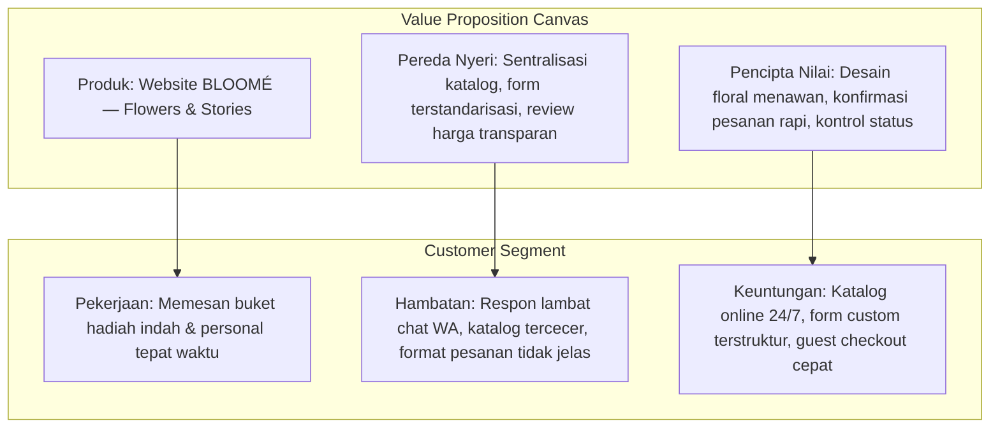
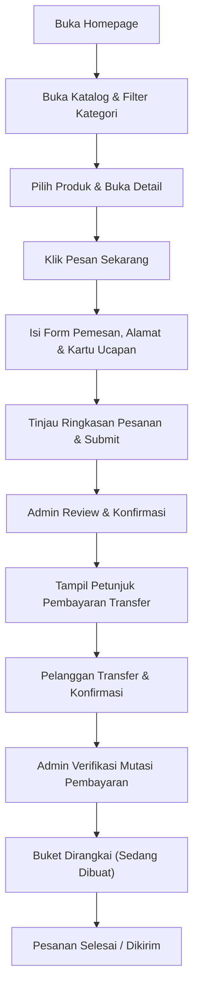
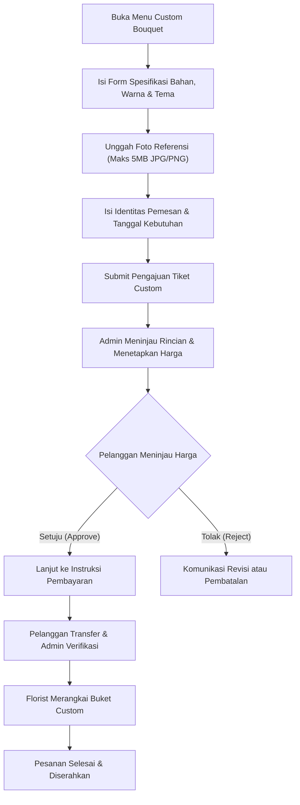

# PRODUCT REQUIREMENTS DOCUMENT (PRD)
# BLOOMÉ — Flowers & Stories

## Document Information

- **Nama Dokumen:** Product Requirements Document (PRD)
- **Nama Produk:** BLOOMÉ — Flowers & Stories
- **Nama Proyek:** Perancangan Sistem Informasi Pemesanan dan Personalisasi Buket Bunga Berbasis Web
- **Project Sponsor:** Nabila Febriyani (Pemilik Usaha BLOOMÉ)
- **Lokasi Usaha:** Jalan Cipto Mangunkusumo, Simpang Tiga, Loa Janan Ilir, Kota Samarinda
- **Product Manager & System Analyst:** Jayanti Firdasari
- **UI/UX Designer & Frontend Developer:** Riya Monika
- **Backend Developer & Database Administrator:** Elsa Futri
- **Versi Dokumen:** 1.0 (Final Product Baseline)
- **Tanggal Efektif:** 13 November 2026
- **Status Dokumen:** Approved Baseline

---

# 1. Product Overview

**BLOOMÉ — Flowers & Stories** adalah platform sistem informasi pemesanan dan personalisasi buket bunga berbasis web yang dirancang khusus untuk mendigitalisasi dan menyentralisasi seluruh proses operasional usaha *florist* BLOOMÉ di Kota Samarinda.

Sistem ini mentransformasikan alur transaksi yang sebelumnya berjalan manual melalui obrolan pesan WhatsApp menjadi sistem terintegrasi yang mencakup:
1. **Layanan Pemesanan Katalog (Catalog Ordering):** Menampilkan etalase buket siap pesan dengan navigasi kategori, detail spesifikasi, ketersediaan stok, dan checkout instan tanpa login.
2. **Layanan Personalisasi Buket (Custom Bouquet Ordering):** Memfasilitasi pelanggan mengajukan pesanan buket khusus dengan memilih bahan bunga, skema warna, tema buket, catatan pribadi, serta mengunggah berkas foto referensi.
3. **Pusat Kendali Pengelola (Admin Dashboard):** Memberikan antarmuka tunggal bagi pemilik usaha untuk mengelola produk, meninjau permintaan custom, menetapkan harga manual, memverifikasi pembayaran transfer manual, memperbarui siklus 8 status pesanan, serta menangani pembatalan.

---

# 2. Product Vision & Positioning

### 2.1 Visi Produk
Menjadi platform digital butik bunga terdepan di Samarinda yang menghadirkan pengalaman pemesanan buket yang hangat, estetis, transparan, dan terpercaya bagi pelanggan, sekaligus memberikan efisiensi operasional terstruktur bagi pemilik usaha dalam merangkai setiap cerita di balik bunga (*Flowers & Stories*).

### 2.2 Positioning Produk
BLOOMÉ memposisikan diri sebagai butik buket bunga personal (*boutique floral studio*) yang menjembatani kenyamanan pemesanan modern berbasis web dengan sentuhan keahlian personalisasi tangan (*handcrafted customization*), tanpa kerumitan registrasi akun yang membebani pembeli.

### 2.3 Nilai Tambah Produk (Value Proposition)
- **Bagi Pelanggan:**
  - *Seamless Guest Checkout:* Memesan buket indah tanpa hambatan registrasi atau lupa kata sandi.
  - *Creative Personalization:* Kebebasan menuangkan ide buket custom dengan panduan spesifikasi dan upload referensi foto.
  - *Transparent Pricing:* Kepastian nominal harga custom melalui mekanisme review dan persetujuan formal sebelum membayar.
- **Bagi Pemilik Usaha (Admin):**
  - *Zero Scattered Orders:* Seluruh data pemesan dan foto referensi tersimpan rapi dalam satu basis data terpusat.
  - *Full Pricing Control:* Penentuan harga custom tetap 100% berada di tangan pemilik usaha sesuai stok bahan riil.
  - *Organized Workflow:* Siklus pengerjaan buket terpetakan jelas melalui 8 tahapan status yang terstruktur.

---

# 3. Business Problem and Opportunity

### 3.1 Masalah Bisnis yang Dihadapi (Problem Statement)
Sebelum adanya sistem web BLOOMÉ, operasional bisnis bertumpu pada obrolan pesan WhatsApp dengan kendala kritis:
1. **Katalog Tidak Terpusat:** Foto buket tersebar di galeri ponsel dan feed media sosial tanpa informasi harga atau ketersediaan terkini.
2. **Komunikasi Berulang:** Pelanggan berulang kali menanyakan harga, jenis bunga, dan waktu pengerjaan, menyita waktu admin.
3. **Pencatatan Rawan Tercecer:** Data pemesan, kartu ucapan, dan tanggal pengiriman dicatat di buku manual, rentan terselip saat volume pesanan tinggi (hari wisuda/Valentine).
4. **Alur Custom Tidak Standar:** Pembeli mengirimkan foto referensi tanpa rincian budget atau preferensi warna yang jelas, memicu negosiasi panjang.
5. **Verifikasi Pembayaran Terfragmentasi:** Pengecekan bukti mutasi transfer bank/e-wallet dilakukan tanpa tautan langsung ke nomor pesanan.
6. **Beban Ganda Pemilik Usaha:** Pemilik usaha memiliki kesibukan usaha lain sehingga membutuhkan sistem otomasi pencatatan yang rapi.

### 3.2 Peluang Produk (Product Opportunity)
Digitalisasi web menyediakan solusi langsung untuk:
- Mengubah obrolan chat yang tidak terstruktur menjadi formulir digital terstandarisasi.
- Mengurangi waktu administratif penanganan pesanan hingga lebih dari 60%.
- Menghilangkan risiko kesalahan penulisan kartu ucapan dan salah kirim tanggal pengiriman.

---

# 4. Product Goals and Objectives

| Kategori Tujuan | Sasaran Strategis Produk | Indikator Keberhasilan Fungsional |
|---|---|---|
| **Customer Experience** | Menghadirkan pengalaman belanja buket yang cepat, indah, dan mudah dipahami. | Alur checkout katalog selesai dalam ≤ 3 menit; 100% responsif pada smartphone. |
| **Custom Experience** | Memfasilitasi personalisasi buket yang transparan dan kolaboratif. | Pengajuan kustomisasi menampung detail preferensi bunga, warna, dan foto referensi. |
| **Operational Efficiency** | Mengeliminasi pencatatan manual di kertas atau catatan terpisah. | Seluruh pesanan masuk langsung tercatat di dashboard admin dengan kode unik. |
| **Payment Integrity** | Menjamin keabsahan pembayaran sebelum perangkaian buket fisik dimulai. | Verifikasi manual mutasi transfer bank/e-wallet tercatat formal sebelum status beralih ke produksi. |
| **Lifecycle Transparency** | Menyediakan kejelasan progres pesanan dari masuk hingga selesai. | Penerapan konsisten 8 siklus status pesanan dengan riwayat histori audit lengkap. |

---

# 5. Target Users & User Personas

Sistem memiliki dua aktor pengguna utama:

### 5.1 Persona 1: Customer (Guest User)
- **Nama Representatif:** Dinda Kirana (22 Tahun, Mahasiswi / Pekerja Muda Samarinda).
- **Karakteristik:** Sibuk, menyukai visual estetis, terbiasa berbelanja via ponsel, menginginkan kado buket wisuda/ulang tahun personal untuk sahabat.
- **Tujuan (Goals):**
  - Melihat katalog buket dengan harga pasti dan foto jelas tanpa harus bertanya di chat.
  - Memesan buket custom sesuai bujet dan foto referensi yang ditemukan di Pinterest/Instagram.
  - Memesan dengan cepat tanpa ribet membuat akun atau mengingat kata sandi baru.
- **Pain Points:**
  - Menunggu balasan chat admin yang lambat saat jam sibuk.
  - Bingung menentukan kombinasi warna bunga jika tidak ada panduan pilihan.
  - Takut harga custom membengkak tanpa persetujuan awal.

### 5.2 Persona 2: Administrator / Business Owner
- **Nama Representatif:** Nabila Febriyani (Pemilik Usaha BLOOMÉ).
- **Karakteristik:** Teliti, memiliki jiwa seni merangkai bunga, mengelola banyak aspek usaha secara mandiri (*solopreneur*).
- **Tujuan (Goals):**
  - Melihat antrean pesanan yang masuk secara rapi berdasarkan tanggal pengiriman/kebutuhan.
  - Meninjau spesifikasi buket custom dan foto referensi dari layar komputer/ponsel untuk menaksir harga secara akurat.
  - Memastikan dana pembayaran pelanggan telah masuk ke rekening sebelum bunga dipotong dan dirangkai.
  - Mengubah status pengerjaan buket secara sistematis.
- **Pain Points:**
  - Obrolan WhatsApp menumpuk dan chat pesanan tenggelam oleh pesan promosi/pribadi.
  - Sering lupa detail ucapan kartu atau detail request warna pelanggan.
  - Kesulitan merekap total transaksi bulanan secara manual.

---

# 6. Product Value Proposition (Canvas)

---

# 7. Product Scope: In-Scope vs Out-of-Scope

### 7.1 In-Scope (Rilis v1.0)
- **Antarmuka Publik Pelanggan:**
  - Halaman Beranda (Hero, Cerita Usaha, Produk Unggulan, Kategori, Banner Custom, Kontak, Footer).
  - Katalog Produk & Navigasi Kategori (Buket Bunga, Uang, Snack, dll.).
  - Halaman Detail Produk & Informasi Ketersediaan Stok.
  - Formulir Pemesanan Katalog (Data identitas, alamat, ucapan kartu, tanggal kebutuhan).
  - Formulir Pengajuan Buket Custom (Bahan, warna, tema, catatan, unggah foto referensi JPG/PNG ≤ 5MB).
  - Halaman Peninjauan & Keputusan Harga Custom (Approve / Reject oleh pemesan).
  - Ringkasan Tagihan & Instruksi Pembayaran Manual (Rekening Bank & E-Wallet).
  - Halaman Konfirmasi Penerimaan Pesanan.
  - Halaman Profil Usaha (*About Us*) dan Kontak Resmi.
- **Antarmuka Dashboard Admin:**
  - Autentikasi Admin tunggal dengan hashing sandi dan session guard.
  - Dashboard Ringkasan Aktivitas & Metrik Operasional.
  - Modul Manajemen Kategori (CRUD).
  - Modul Manajemen Produk Katalog (CRUD, unggah foto produk, toggle ketersediaan).
  - Modul Antrean Pesanan Masuk & Detail Pesanan.
  - Modul Peninjauan Permintaan Custom & Form Input Penetapan Harga Manual.
  - Modul Manajemen Pembayaran & Verifikasi Manual Bukti Transfer.
  - Pengelolaan Transisi 8 Status Siklus Pesanan beserta Pencatatan Histori Audit.
  - Modul Peninjauan dan Persetujuan/Penolakan Pembatalan Pesanan.

### 7.2 Out-of-Scope (Dikecualikan Secara Tegas)
- Pendaftaran akun, login, dan dashboard profil pelanggan.
- Integrasi payment gateway otomatis (Midtrans, Xendit, DOKU, dll.).
- Integrasi API notifikasi WhatsApp bot otomatis (Fonnte, Wablas, Twilio).
- Sistem kalkulator harga custom otomatis.
- Portal pelacakan live GPS kurir atau integrasi API ekspedisi pihak ketiga.
- Sistem otorisasi multi-role admin (hanya satu akun admin pemilik usaha).
- Sistem akuntansi finansial otomatis neraca laba-rugi.

---

# 8. Functional Product Features (F-001 s/d F-029)

Seluruh fitur produk diidentifikasi dengan kode unik dan spesifikasi lengkap:

| Feature ID | Nama Fitur | Peran Pengguna | Deskripsi Singkat & Kriteria Perilaku | Prioritas |
|---|---|---|---|:---:|
| **F-001** | Homepage | Customer | Menampilkan identitas butik, hero banner, showcase produk favorit, kategori, dan kontak. | Must Have |
| **F-002** | Product Catalog | Customer | Menampilkan galeri buket dengan filter kategori dan penanda stok. | Must Have |
| **F-003** | Product Detail | Customer | Halaman rincian foto, komposisi buket, harga, dan tombol pesan langsung. | Must Have |
| **F-004** | Category Browsing | Customer | Navigasi interaktif untuk menyaring buket berdasarkan kategori spesifik. | Must Have |
| **F-005** | Catalog Ordering | Customer | Formulir pemesanan buket katalog dengan validasi isian lengkap tanpa login. | Must Have |
| **F-006** | Customer Identity Collection | Customer | Menampung nama pemesan, nomor WhatsApp, dan alamat penerima. | Must Have |
| **F-007** | Custom Bouquet Page | Customer | Halaman pengantar layanan buket kustom dan panduan pemesanan personal. | Must Have |
| **F-008** | Custom Specification Form | Customer | Formulir input pilihan bahan, palet warna, tema buket, dan catatan khusus. | Must Have |
| **F-009** | Reference Image Upload | Customer | Modul unggah foto referensi (JPG/PNG ≤ 5MB) dengan validasi server. | Must Have |
| **F-010** | Custom Request Submission | Customer | Menyimpan tiket permintaan custom ke basis data dan memberikan kode referensi. | Must Have |
| **F-011** | Custom Price Determination | Admin | Formulir bagi admin untuk memasukkan nominal penawaran harga custom. | Must Have |
| **F-012** | Customer Price Decision | Customer | Fitur aksi bagi pemesan untuk menyetujui (*Approve*) atau menolak (*Reject*) harga. | Must Have |
| **F-013** | Order Submission Engine | System | Engine transaksi penyimpanan pesanan katalog dan custom secara atomik (ACID). | Must Have |
| **F-014** | Order Summary Display | Customer | Menampilkan rincian pesanan, total biaya, dan tanggal kebutuhan buket. | Must Have |
| **F-015** | Order Confirmation | Customer | Halaman konfirmasi sukses pengajuan pesanan dengan instruksi tindak lanjut. | Must Have |
| **F-016** | Admin Order List | Admin | Tabel antrean seluruh pesanan masuk dengan filter status dan pencarian. | Must Have |
| **F-017** | Order Status Management | Admin | Fitur pembaruan siklus status pesanan (ST-01 s/d ST-07) sesuai progres fisik. | Must Have |
| **F-018** | Cancellation Management | Admin | Fitur peninjauan dan persetujuan/penolakan pengajuan pembatalan pemesan. | Must Have |
| **F-019** | Payment Method Information | Customer | Menampilkan petunjuk nomor rekening bank transfer dan akun e-wallet resmi. | Must Have |
| **F-020** | Payment Confirmation Notice | Customer | Halaman notifikasi bagi pelanggan setelah mentransfer dana ke rekening. | Must Have |
| **F-021** | Manual Payment Verification | Admin | Aksi verifikasi keabsahan dana masuk untuk menandai pesanan telah lunas. | Must Have |
| **F-022** | Admin Authentication | Admin | Form login aman dengan hashing password Bcrypt dan token CSRF. | Must Have |
| **F-023** | Dashboard Overview | Admin | Ringkasan metrik statistik operasional dan kartu ringkasan antrean pesanan. | Should Have |
| **F-024** | Product Management | Admin | Operasi CRUD data buket katalog dan pengunggahan foto produk ke storage. | Must Have |
| **F-025** | Category Management | Admin | Operasi CRUD kategori buket bunga dengan validasi nama unik. | Must Have |
| **F-026** | Custom Request Management | Admin | Modul peninjauan galeri gambar referensi dan rincian spesifikasi custom. | Must Have |
| **F-027** | Payment Management | Admin | Daftar riwayat transaksi pembayaran dan status verifikasi mutasi. | Must Have |
| **F-028** | Cancellation Review | Admin | Daftar permohonan pembatalan yang diajukan oleh pemesan beserta alasannya. | Must Have |
| **F-029** | Order Status Audit Trail | Admin | Riwayat kronologis setiap perubahan status pesanan (*order_status_histories*). | Should Have |

---

# 9. User Stories & Acceptance Scenarios

### 9.1 Kisah Pengguna Pelanggan (Customer Stories)
- **US-01 (Katalog):** *Sebagai pelanggan, saya ingin melihat katalog buket beserta foto dan harganya, agar saya dapat memilih buket yang sesuai selera dan bujet tanpa harus chat admin terlebih dahulu.*
  - *Acceptance:* Halaman katalog menampilkan kartu produk aktif dengan harga dan badge ketersediaan.
- **US-02 (Pemesanan Katalog):** *Sebagai pelanggan, saya ingin memesan buket katalog langsung dengan mengisi form ucapan dan alamat, agar pesanan saya tercatat rapi tanpa ribet registrasi akun.*
  - *Acceptance:* Form pemesanan dapat dikirim tanpa sesi login; menghasilkan kode pesanan unik.
- **US-03 (Buket Custom):** *Sebagai pelanggan, saya ingin mengajukan personalisasi buket lengkap dengan foto referensi dari Pinterest, agar florist dapat merangkai buket persis sesuai impian saya.*
  - *Acceptance:* Sistem menerima spesifikasi warna/bahan dan berkas gambar (JPG/PNG ≤ 5MB).
- **US-04 (Persetujuan Harga):** *Sebagai pelanggan, saya ingin mengetahui harga usulan buket custom dan menyetujuinya sebelum membayar, agar tidak ada biaya tersembunyi yang merugikan saya.*
  - *Acceptance:* Tersedia tombol *Setujui Harga* untuk lanjut bayar atau *Tolak Harga* untuk membatalkan.
- **US-05 (Instruksi Bayar):** *Sebagai pelanggan, saya ingin melihat nomor rekening bank dan e-wallet resmi, agar saya dapat mentransfer pembayaran dengan aman dan tepat.*
  - *Acceptance:* Rincian rekening dan jumlah transfer tampil jelas di halaman instruksi pembayaran.

### 9.2 Kisah Pengguna Administrator (Admin Stories)
- **US-06 (Login Aman):** *Sebagai admin, saya ingin login menggunakan kredensial email dan password yang terenkripsi, agar data bisnis dan pesanan terlindungi dari akses ilegal.*
  - *Acceptance:* Halaman login menolak password salah; route admin terlindungi middleware otentikasi.
- **US-07 (Review Custom & Harga):** *Sebagai admin, saya ingin melihat rincian kustomisasi dan foto referensi pelanggan di dashboard, agar saya dapat menaksir harga bahan dan menginput nominal penawaran.*
  - *Acceptance:* Halaman detail custom menampilkan pratinjau gambar dan field input harga penawaran.
- **US-08 (Verifikasi Bayar):** *Sebagai admin, saya ingin memverifikasi transfer pembayaran secara manual, agar saya memastikan dana benar-benar masuk sebelum bunga segar dirangkai.*
  - *Acceptance:* Admin dapat mengklik tombol *Verifikasi Pembayaran* untuk menggeser status ke *Pembayaran Dikonfirmasi*.
- **US-09 (Update Status):** *Sebagai admin, saya ingin memperbarui status pengerjaan pesanan secara bertahap, agar riwayat pengerjaan buket tercatat rapi dan mudah dilacak.*
  - *Acceptance:* Pembaruan status mematuhi alur transisi sah dan tercatat di tabel histori status.

---

# 10. User Journeys & Product Flows

### 10.1 Alur Pengguna: Pemesanan Katalog (Catalog Journey)

### 10.2 Alur Pengguna: Personalisasi Buket Custom (Custom Journey)

### 10.3 Alur Pengajuan Pembatalan (Cancellation Journey)
1. Pelanggan menghubungi admin / mengajukan pembatalan melalui sistem sebelum buket masuk tahap pengerjaan fisik (*Sedang Dibuat*).
2. Sistem mencatat permohonan pembatalan beserta alasan pelanggan.
3. Admin meninjau permohonan di dashboard:
   - Jika disetujui: Status pesanan berubah menjadi `Dibatalkan` (*Terminal State*).
   - Jika ditolak (misal bunga sudah dipotong/dirangkai): Status pesanan tetap pada status aktif sebelumnya.

---

# 11. Order Lifecycle & Status Machine

Sistem mengunci **8 Status Baku Transaksi (ST-01 s/d ST-08)**:

| Kode | Label Status Resmi | Penjelasan Siklus Hidup |
|---|---|---|
| **ST-01** | `Menunggu Peninjauan Admin` | Pesanan baru masuk ke database dan menunggu review ketersediaan oleh admin. |
| **ST-02** | `Menunggu Persetujuan Harga` | Admin telah menginput usulan harga custom; menunggu respon persetujuan pemesan. |
| **ST-03** | `Menunggu Pembayaran` | Pesanan siap dibayar (katalog lolos review / harga custom telah disetujui). |
| **ST-04** | `Menunggu Konfirmasi Pembayaran` | Pemesan menyatakan sudah transfer; admin belum mengecek mutasi fisik. |
| **ST-05** | `Pembayaran Dikonfirmasi` | Admin telah memverifikasi mutasi dana rekening secara manual (*Lunas / Sah*). |
| **ST-06** | `Sedang Dibuat` | Florist BLOOMÉ sedang merangkai buket fisik di butik. |
| **ST-07** | `Selesai` | Rangkaian buket telah selesai dan diterima oleh penerima (*Terminal Completed*). |
| **ST-08** | `Dibatalkan` | Pesanan dibatalkan melalui persetujuan admin (*Terminal Cancelled*). |

---

# 12. UI/UX Product Requirements & Design System Specifications

### 12.1 Konsep Visual
- **Tema Desain:** *Elegant Floral Boutique*.
- **Nuansa Emosional:** Hangat, feminin, menenangkan, bersih, dan profesional.
- **Aksen Ilustrasi:** Cat air floral (*watercolor floral elements*) lembut tanpa distraksi visual berlebihan.

### 12.2 Palet Warna Terkunci (Locked Color Tokens)
- **Primary Pink:** `#E99AAF` (Warna utama identitas merek, tombol CTA utama).
- **Primary Hover:** `#D98296` (Warna interaksi hover tombol utama).
- **Soft Pink:** `#F6DDE3` (Warna latar belakang elemen sekunder, kartu sorotan).
- **Blush Background:** `#FFF5F6` (Warna latar belakang utama halaman web).
- **Warm White:** `#FFFCFB` (Warna latar belakang kartu konten dan container putih).
- **Burgundy:** `#642D36` (Warna teks heading utama dan aksen eksklusif).
- **Primary Text:** `#493335` (Warna teks paragraf dan body text).
- **Secondary Text:** `#898080` (Warna teks sub-label dan deskripsi sekunder).
- **Muted Text:** `#B09A9C` (Warna placeholder dan teks non-aktif).
- **Sage Green:** `#A8B5A0` (Warna aksen dedaunan botani dan status natural).
- **Border Line:** `#F0E1E4` (Warna garis batas kartu dan input field).
- **State Colors:** Success (`#6EAD70`), Warning (`#E8B85B`), Danger (`#D96B75`), Info (`#9B83B9`).

### 12.3 Tipografi & Radius Komponen
- **Font Heading Utama:** *Playfair Display* (elegan, serif modern).
- **Font Body & Interface:** *Poppins* (bersih, keterbacaan tinggi di layar kecil).
- **Border Radius:** Tombol (12px), Input Field (10px), Kartu Kecil (12px), Kartu Sedang (16px), Kartu Besar (18px), Badge Status (*Full Rounded / Pill*).

---

# 13. Product Prioritization (MoSCoW Framework)

### 13.1 Must Have (Wajib Ada pada Rilis v1.0)
- Beranda publik lengkap dengan identitas merek BLOOMÉ.
- Katalog buket interaktif dengan filter kategori.
- Halaman detail produk dan informasi ketersediaan.
- Alur checkout pemesanan katalog tanpa login pelanggan.
- Formulir buket custom dengan unggah foto referensi (JPG/PNG ≤ 5MB).
- Peninjauan rincian custom dan penentuan harga manual oleh pemilik usaha.
- Alur persetujuan / penolakan harga usulan oleh pelanggan.
- Tampilan instruksi pembayaran transfer bank dan e-wallet.
- Dashboard admin lengkap dengan login terproteksi.
- CRUD produk dan CRUD kategori buket.
- Verifikasi pembayaran manual dan pembaruan 8 siklus status pesanan.
- Alur peninjauan dan persetujuan pengajuan pembatalan.

### 13.2 Should Have (Sangat Dianjurkan)
- Kartu metrik ringkasan performa di dashboard admin.
- Audit trail riwayat kronologis status pesanan (*order status histories*).
- Indikator feedback visual multi-state (*loading skeleton, empty illustration, error alerts*).

### 13.3 Could Have (Fitur Pelengkap Masa Depan)
- Fitur duplikasi produk katalog lama untuk mempercepat input produk baru.
- Ekspor ringkasan pesanan ke format PDF sederhana untuk nota fisik butik.

### 13.4 Won't Have (Ditolak pada Fase v1.0)
- Sistem login, registrasi, dan lupa sandi pelanggan.
- Payment gateway otomatis pihak ketiga (Midtrans/Xendit).
- Integrasi bot WhatsApp API otomatis.
- Tracking live GPS kurir ekspedisi.
- Kalkulasi otomatis harga custom.
- Manajemen hak akses multi-admin.

---

# 14. Success Metrics & Product KPIs

| Indikator Sukses | Deskripsi Metrik | Metode Pengukuran | Target Keberimaan Produk |
|---|---|---|---|
| **Katalog Checkout Success** | Kemampuan pelanggan menyelesaikan pesanan katalog. | Uji transaksi end-to-end dari katalog ke database. | 100% data pesanan & alamat tersimpan utuh. |
| **Custom Submission Success**| Pengajuan buket custom beserta foto referensi. | Uji pengunggahan berkas JPG/PNG ukuran 1-5MB. | 100% berkas tersimpan aman di local storage. |
| **Price Approval Flow** | Pelanggan merespon harga usulan admin. | Simulasi klik Approve dan Reject. | Status berpindah akurat ke ST-03 atau ST-08. |
| **Payment Verification** | Admin memvalidasi mutasi manual di dashboard. | Verifikasi manual pada pesanan dummy. | Status berubah menjadi *Pembayaran Dikonfirmasi*. |
| **Multi-Device Adaptability** | Tampilan web pada berbagai ukuran layar. | Audit responsif pada resolusi 360px, 768px, 1280px. | Skor usability 100% tanpa elemen tumpang-tindih. |
| **Page Speed Performance** | Kecepatan render antarmuka pengguna. | Browser DevTools Network tab. | Initial Page Load ≤ 2,0 detik pada jaringan 4G. |

---

# 15. Product Risks and Mitigation Strategies

1. **Risiko Unggahan Berkas Gambar Tidak Sah:**
   - *Dampak:* Potensi ancaman keamanan web (*malicious script injection*).
   - *Mitigasi:* Validasi MIME-type di server Laravel (`image/jpeg,image/png`), batasan ukuran ketat 5MB, hashing nama berkas dengan UUID acak, dan penyimpanan di luar root publik tanpa izin eksekusi kode.
2. **Risiko Kesalahan Pencatatan Alamat / Kontak Pelanggan:**
   - *Dampak:* Buket gagal dikirimkan atau salah waktu pengantaran.
   - *Mitigasi:* Validasi form input wajib diisi (*required*), format nomor WhatsApp valid, dan penyediaan ringkasan pesanan sebelum final submit.
3. **Risiko Penolakan Harga Custom oleh Pelanggan:**
   - *Dampak:* Permintaan kustom menggantung di sistem.
   - *Mitigasi:* Sistem menyediakan alur penolakan tegas (*Reject*) yang otomatis memperbarui status tiket sehingga admin dapat segera melakukan kontak revisi atau pembatalan.

---

# 16. Log Asumsi & Daftar Terbuka (`[PERLU KONFIRMASI]`)

Berikut adalah parameter operasional yang belum diputuskan secara final dan menunggu arahan tertulis dari Sponsor Nabila Febriyani:
1. Batas maksimal jumlah gambar referensi per pesanan custom (asumsi teknis sementara: maksimal 3 gambar).
2. Kewajiban unggah file bukti transfer di website vs konfirmasi manual lewat kontak.
3. Rincian field data pemesan (misal apakah diperlukan akun Instagram / telepon alternatif).
4. Nomor rekening bank resmi dan nomor e-wallet resmi usaha BLOOMÉ.
5. Kebijakan operasional pengambilan mandiri (*self pick-up*) vs pengantaran (*delivery*) di Samarinda.
6. Pemilihan nama domain dan penyedia hosting production.
7. Durasi masa garansi purnajual (*post-launch SLA*).

> **Peringatan Tim:** Seluruh parameter di atas dilarang diubah statusnya menjadi keputusan final tanpa persetujuan tertulis resmi dari sponsor.

---

# 17. Product Constraints

1. **Kendala Waktu:** Seluruh siklus perancangan, penulisan kode, pengujian, dan serah terima wajib selesai paling lambat **30 November 2026**.
2. **Kendala Teknologi:** Sistem wajib dikembangkan menggunakan **Laravel, PHP, MySQL, HTML, CSS, dan JavaScript murni / Blade**, dengan arsitektur **Three-Layer Architecture**.
3. **Kendala Infrastruktur Awal:** Pengembangan dan pengujian sistem dilakukan pada lingkungan lokal (*local development environment* / XAMPP / PHP server) sebelum deployment hosting disetujui sponsor.

---

# 18. Product Glossary

- **Catalog Ordering:** Alur pemesanan produk buket yang sudah ada dalam etalase katalog dengan spesifikasi dan harga yang telah ditentukan secara baku.
- **Custom Bouquet Ordering:** Alur pemesanan buket yang dirangkai secara unik berdasarkan preferensi bahan, kombinasi warna, dan foto referensi pembeli.
- **Guest Checkout:** Mekanisme pemesanan produk tanpa mengharuskan pelanggan melakukan pendaftaran akun atau proses login.
- **Proposed Price:** Harga penawaran buket custom yang ditentukan secara manual oleh admin setelah meninjau spesifikasi dan ketersediaan bahan.
- **Terminal State:** Status akhir dalam siklus hidup pesanan (*Completed* atau *Cancelled*) yang tidak dapat diubah lagi ke status lainnya.
- **Three-Layer Architecture:** Pola arsitektur perangkat lunak yang memisahkan aplikasi ke dalam 3 lapisan: Presentation Layer (UI/Blade), Application Layer (Controller/Service), dan Data Layer (Database/Model).

---

# 19. Final Sign-Off & Verification

Dokumen Product Requirements Document (PRD) ini telah diverifikasi memenuhi standar produk, selaras dengan `requirement.md`, dan disetujui sebagai **Official Product Baseline** untuk memandu pembuatan arsitektur sistem, desain UI/UX, dan implementasi kode Laravel.

**Disusun dan Diverifikasi Oleh:**  
**Jayanti Firdasari** (Project Manager & System Analyst)  
Tanggal: 13 November 2026
