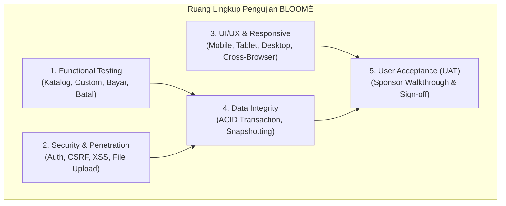

# MASTER SOFTWARE TESTING PLAN & QUALITY ASSURANCE STRATEGY
# BLOOMÉ — Flowers & Stories

## 1. Document Information

- **Nama Dokumen:** Master Software Testing Plan & Quality Assurance Strategy
- **Nama Sistem:** BLOOMÉ — Flowers & Stories
- **Nama Proyek:** Perancangan Sistem Informasi Pemesanan dan Personalisasi Buket Bunga Berbasis Web
- **Lead QA Engineer & Project Manager:** Jayanti Firdasari
- **Backend Developer & Security Tester:** Elsa Futri
- **Frontend Developer & UI/UX Tester:** Riya Monika
- **Project Sponsor & UAT Lead:** Nabila Febriyani
- **Versi Dokumen:** 1.0 (Official Testing Plan Baseline)
- **Tanggal Efektif:** 13 November 2026
- **Status Dokumen:** Approved Baseline

---

## 2. Executive Summary & Testing Objectives

Dokumen **Master Software Testing Plan** ini menetapkan strategi pengujian mutu, metodologi verifikasi, matriks kasus uji (*test cases*), serta kriteria kelulusan (*exit criteria*) sistem informasi **BLOOMÉ — Flowers & Stories**.

Tujuan utama rencana pengujian:
1. **Validasi Kepatuhan Kebutuhan:** Memastikan seluruh kebutuhan fungsional (FR-001 s/d FR-017) dan 20 aturan bisnis (BR-001 s/d BR-020) berjalan 100% tanpa celah logika.
2. **Penjaminan Keamanan Transaksi & Data:** Memverifikasi kekebalan sistem terhadap kerentanan umum web (SQL Injection, XSS, CSRF, Bypass Otentikasi, dan Upload Berkas Terlarang).
3. **Penyelarasan Desain & Responsivitas:** Menjamin kesesuaian visual dengan `design-system.md` dan kelancaran operasi pada peramban seluler (Mobile ≤ 576px), tablet, dan desktop.
4. **Kepastian Penerimaan Pengguna (*UAT Sign-off*):** Memberikan kerangka kerja terstruktur bagi pemilik usaha (Nabila Febriyani) untuk memvalidasi alur bisnis sebelum sistem diluncurkan ke publik pada 30 November 2026.

---

## 3. Ruang Lingkup Pengujian (Testing Scope)

### 3.1 Item yang Diuji (In-Scope)
- **Modul Pemesanan Katalog:** Navigasi kategori, filter, detail buket, checkout tamu tanpa login, kalkulasi harga, penyimpanan data pemesan dan ucapan kartu.
- **Modul Buket Custom:** Pengisian spesifikasi, validasi unggah berkas referensi (JPG/PNG ≤ 5MB), penerbitan tiket, penetapan harga usulan admin, dan alur respon persetujuan/penolakan pemesan.
- **Modul Pembayaran & Status:** Tampilan rekening bank/e-wallet, konfirmasi bayar pemesan, verifikasi mutasi manual admin, dan transisi 8 status pesanan beserta histori audit.
- **Modul Manajemen Admin:** Login aman admin tunggal, dashboard statistik, CRUD kategori & produk, manajemen antrean pesanan, dan peninjauan pembatalan.
- **Kualitas Nonfungsional:** Waktu muat ≤ 2 detik, kompatibilitas browser modern (Chrome, Edge, Firefox, Safari), responsivitas layar.

### 3.2 Item yang Tidak Diuji (Out-of-Scope)
- Integrasi payment gateway otomatis pihak ketiga (sistem murni transfer manual).
- Otomasi pengiriman pesan via bot WhatsApp API (komunikasi manual).
- Uji beban jutaan pengguna simultan (*stress testing*) di luar kapasitas usaha butik lokal.

---

## 4. Tingkatan & Jenis Pengujian (Testing Levels & Types)

| Tingkat Pengujian | Metode & Pendekatan | Fokus Pengujian | Penanggung Jawab |
|---|---|---|---|
| **Level 1: Unit Testing** | Otomasi PHPUnit / Pest | Fungsi pembantu: kalkulasi total, format rupiah, pembuatan kode pesanan acak `BLM-YYYYMM-XXXX`. | Elsa Futri |
| **Level 2: Feature & HTTP Testing** | Laravel Feature Test | Request-response HTTP, validasi form request, middleware redirection, operasi CRUD database. | Elsa Futri |
| **Level 3: Security Testing** | Pengujian Penetrasi Manual | Bypass rute admin tanpa sesi, manipulasi payload SQLi, token CSRF hilang, upload file `.php`. | Elsa Futri |
| **Level 4: UI/UX & Responsive** | Browser Emulation & DevTools | Keselarasan token warna, tipografi, breakpoint mobile (360px) & tablet (768px), konsistensi card. | Riya Monika |
| **Level 5: Integration Testing** | End-to-End Black Box | Menghubungkan form Blade ke controller dan memverifikasi commit database multi-tabel. | Elsa & Riya |
| **Level 6: User Acceptance (UAT)** | Skenario Nyata Terpandu | Simulasi alur penuh dari pemesanan pelanggan hingga verifikasi dan serah terima pesanan oleh sponsor. | Jayanti & Nabila |

---

## 5. Matriks Kasus Uji Utama (Master Test Scenarios Matrix)

### 5.1 Kasus Uji Fungsional Publik (Customer)
| Test ID | Skenario Pengujian | Langkah Pengujian | Hasil yang Diharapkan | Status Kelulusan Target |
|---|---|---|---|:---:|
| **TC-CUST-01** | Akses Katalog Tanpa Login | Buka URL `/catalog` di mode incognito. | Halaman katalog tampil sempurna dengan daftar buket aktif. | Wajib Lolos (P0) |
| **TC-CUST-02** | Filter Kategori Produk | Klik filter "Buket Bunga" pada navigasi. | Produk yang tampil hanya yang berelasi dengan kategori bunga. | Wajib Lolos (P0) |
| **TC-CUST-03** | Pembelian Produk Stok Habis | Buka produk dengan `is_available = 0`. | Tombol pesan dinonaktifkan dengan tulisan "Stok Habis". | Wajib Lolos (P0) |
| **TC-CUST-04** | Validasi Form Pemesanan | Kosongkan field nomor WhatsApp dan alamat, klik submit. | Form ditolak, muncul pesan error inline *"Nomor WhatsApp wajib diisi"*. | Wajib Lolos (P0) |
| **TC-CUST-05** | Checkout Katalog Lengkap | Isi data pemesan valid, ucapan kartu, dan tanggal kebutuhan. | Pesanan tersimpan di DB, status awal `ST-01`, tampil instruksi transfer. | Wajib Lolos (P0) |
| **TC-CUST-06** | Unggah Foto Referensi Custom Valid | Unggah berkas gambar `inspirasi.jpg` (ukuran 2.4 MB). | Berkas berhasil diunggah, thumbnail pratinjau muncul di form. | Wajib Lolos (P0) |
| **TC-CUST-07** | Unggah Foto Melebihi Batas (6 MB) | Unggah berkas gambar `foto_besar.png` (ukuran 6.1 MB). | Berkas ditolak sistem dengan pesan *"Ukuran berkas maksimal 5 MB"*. | Wajib Lolos (P0) |
| **TC-CUST-08** | Unggah Berkas Format Terlarang | Unggah berkas `dokumen.pdf` atau `script.php`. | Berkas ditolak sistem dengan pesan *"Format harus JPG, JPEG, atau PNG"*. | Wajib Lolos (P0) |
| **TC-CUST-09** | Persetujuan Harga Custom (*Approve*) | Buka halaman peninjauan harga custom, klik tombol "Setujui Harga". | Status bergeser ke `ST-03 Menunggu Pembayaran`, tampil rincian rekening. | Wajib Lolos (P0) |
| **TC-CUST-10** | Penolakan Harga Custom (*Reject*) | Buka halaman peninjauan harga custom, klik tombol "Tolak Usulan". | Tiket custom mencatat penolakan; pesanan bergeser ke opsi batal/revisi. | Wajib Lolos (P0) |
| **TC-CUST-11** | Konfirmasi Pembayaran Pemesan | Di halaman petunjuk bayar, klik tombol "Saya Sudah Transfer". | Status bergeser ke `ST-04 Menunggu Konfirmasi Pembayaran`. | Wajib Lolos (P0) |

---

### 5.2 Kasus Uji Fungsional Admin
| Test ID | Skenario Pengujian | Langkah Pengujian | Hasil yang Diharapkan | Status Kelulusan Target |
|---|---|---|---|:---:|
| **TC-ADM-01** | Login Kredensial Valid | Input email dan password admin yang benar. | Berhasil login dan dialihkan ke `/admin/dashboard`. | Wajib Lolos (P0) |
| **TC-ADM-02** | Login Password Salah | Input email admin dan password salah. | Ditolak, tetap di halaman login dengan notifikasi kredensial keliru. | Wajib Lolos (P0) |
| **TC-ADM-03** | Tambah Produk Baru | Isi form nama buket, harga, kategori, dan upload foto buket. | Produk baru tersimpan dan langsung muncul di katalog publik. | Wajib Lolos (P0) |
| **TC-ADM-04** | Hapus Kategori Berisi Produk | Coba hapus kategori yang masih memiliki produk aktif. | Sistem mencegah penghapusan dengan alert *"Kategori masih memiliki produk"*. | Wajib Lolos (P0) |
| **TC-ADM-05** | Penentuan Harga Custom | Buka detail tiket custom baru, ketik nominal Rp250.000, klik simpan. | Proposed price tersimpan dan status berubah menjadi `ST-02`. | Wajib Lolos (P0) |
| **TC-ADM-06** | Verifikasi Pembayaran Manual | Buka menu Pembayaran, klik tombol "Verifikasi Pembayaran". | Status transaksi berubah menjadi `ST-05 Pembayaran Dikonfirmasi`. | Wajib Lolos (P0) |
| **TC-ADM-07** | Transisi Status Pesanan Sah | Ubah status dari `ST-05` menjadi `ST-06 Sedang Dibuat`. | Status berubah, riwayat tercatat di `order_status_histories`. | Wajib Lolos (P0) |
| **TC-ADM-08** | Persetujuan Pembatalan | Buka permohonan pembatalan pemesan, klik "Setujui Pembatalan". | Status berubah menjadi `ST-08 Dibatalkan` (Terminal state). | Wajib Lolos (P0) |

---

### 5.3 Kasus Uji Keamanan (Security Penetration Tests)
| Test ID | Skenario Kerentanan | Vektor Serangan yang Diuji | Hasil yang Diharapkan |
|---|---|---|---|
| **TC-SEC-01** | Akses Ilegal Panel Admin | Navigasi URL `/admin/dashboard` tanpa login sesi. | Akses diblokir, dialihkan ke `/admin/login`. |
| **TC-SEC-02** | Uji Serangan CSRF | Kirim request POST ke `/order/catalog` tanpa token `@csrf`. | Server melempar respon HTTP 419 (*Page Expired*). |
| **TC-SEC-03** | Uji Serangan SQL Injection | Input string `' OR '1'='1` pada field pencarian atau form nama. | Data diperlakukan sebagai string murni oleh PDO parameter binding; tidak bocor data. |
| **TC-SEC-04** | Uji Serangan XSS (Cross-Site) | Input teks `` pada kolom ucapan kartu. | Tag script otomatis di-escape oleh Blade `{{ }}` menjadi teks biasa. |
| **TC-SEC-05** | Uji Eksekusi Berkas PHP | Unggah berkas `shell.php.png` yang berisi script backend. | Sistem memeriksa MIME-type riil, mengganti nama jadi UUID, dan web server menolak eksekusi. |

---

## 6. Klasifikasi Tingkat Keparahan Cacat (*Defect Severity Matrix*)

Setiap bug atau temuan galat yang tercatat selama pengujian diklasifikasikan ke dalam 4 tingkatan:

| Tingkat Keparahan | Definisi & Dampak | Batas Waktu Perbaikan | Kriteria Rilis |
|---|---|---|---|
| **P0 — Critical / Blocker** | Kerusakan fungsi inti: pesanan gagal tersimpan, pembayaran macet, celah keamanan terbuka. | Maksimal 12 jam | **0 Toleransi** (Rilis ditunda sampai selesai). |
| **P1 — Major** | Fitur penting gagal berfungsi tetapi ada solusi manual sementara (misal: filter kategori meleset). | Maksimal 24 jam | Wajib selesai sebelum UAT. |
| **P2 — Minor** | Ketidaksempurnaan kecil yang tidak mengganggu alur transaksi (misal: format tanggal kurang rapi). | 2-3 hari kerja | Dapat diperbaiki pada sprint perbaikan. |
| **P3 — Trivial / Cosmetic** | Ketidaksesuaian visual minor: jarak padding selisih sedikit, typo teks statis. | Sesuai ketersediaan waktu | Tidak menghalangi rilis v1.0. |

---

## 7. Kriteria Penyelesaian Pengujian (*Exit Criteria / Quality Gate 5*)

Pengujian sistem dinyatakan selesai dan aplikasi disetujui untuk rilis produksi apabila memenuhi syarat berikut:
1. **100% Kasus Uji Must Have (P0) Lolos Uji.**
2. **0 Temuan Cacat Kritis (*Critical*) dan Mayor (*Major*) yang belum terselesaikan.**
3. **Audit Keamanan Siber Lolos 100% tanpa celah bypass rute atau upload ilegal.**
4. **Verifikasi Responsivitas Sempurna pada Layar Smartphone (360px) dan Desktop.**
5. **Berita Acara User Acceptance Testing (UAT) Ditandatangani oleh Sponsor Nabila Febriyani.**

---

## 8. Protokol User Acceptance Testing (UAT) Bersama Sponsor

Sesi UAT dijadwalkan pada **27 – 28 November 2026** di butik BLOOMÉ Samarinda dengan skenario panduan:
1. Sponsor Nabila Febriyani berperan sebagai pelanggan: membuka website via smartphone, memilih buket wisuda di katalog, mengisi formulir pemesanan, dan memeriksa kejelasan petunjuk transfer.
2. Sponsor mencoba alur buket custom: mengunggah foto referensi bunga dari galeri ponsel dan memverifikasi kemudahan form.
3. Sponsor beralih ke peran admin di laptop: login ke dashboard, meninjau foto referensi yang baru diunggah, menginput nominal harga, memverifikasi mutasi pembayaran di m-banking, serta memperbarui status pengerjaan hingga selesai.
4. Penandatanganan formulir persetujuan serah terima sistem (*Final Sign-Off*).

---

## 9. Kesimpulan & Pengesahan

Rencana Pengujian Perangkat Lunak ini telah diverifikasi komprehensif, memenuhi seluruh standar pengujian sistem industri, dan mengunci seluruh kriteria keberhasilan proyek.

Dengan tuntasnya dokumen ini, seluruh rangkaian **Phase 1 — Project Initiation and Documentation (Task DOC-001 hingga DOC-021) resmi SELESAI 100%**.

**Disahkan Oleh:**  
**Jayanti Firdasari** (Lead QA Engineer & Project Manager)  
**Elsa Futri** (Backend Developer & Security Lead)  
**Riya Monika** (Frontend Developer & UI/UX Lead)  
**Nabila Febriyani** (Project Sponsor)  
Tanggal: 13 November 2026

