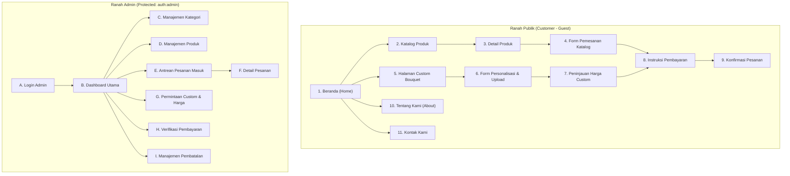
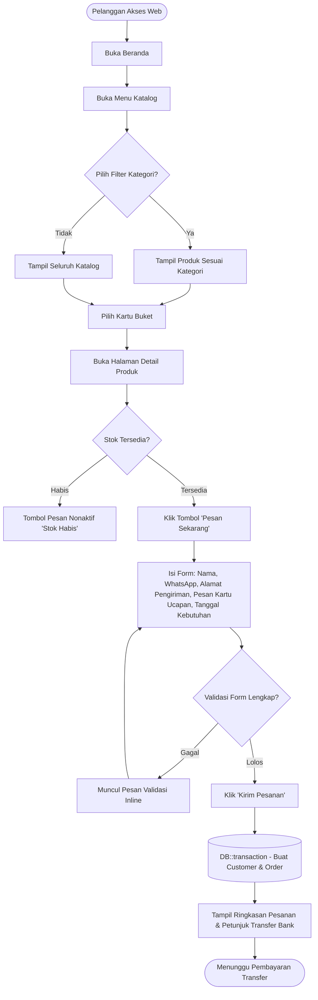
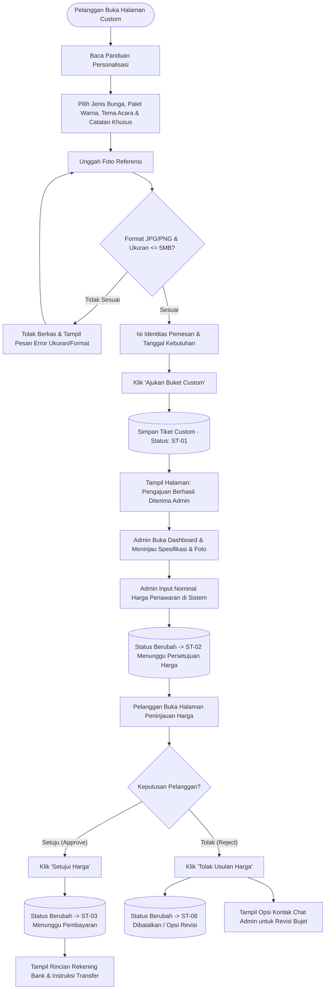
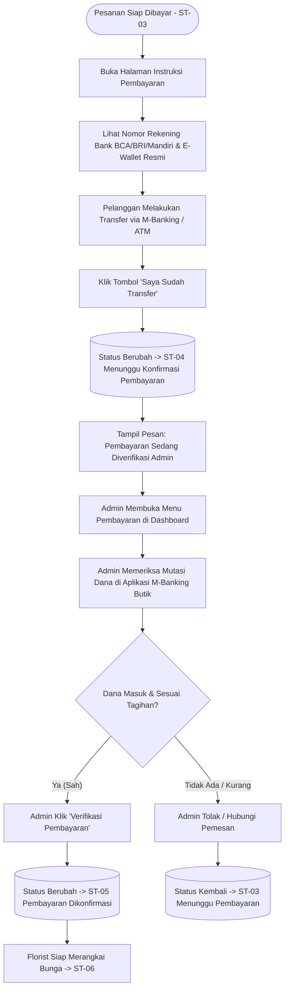
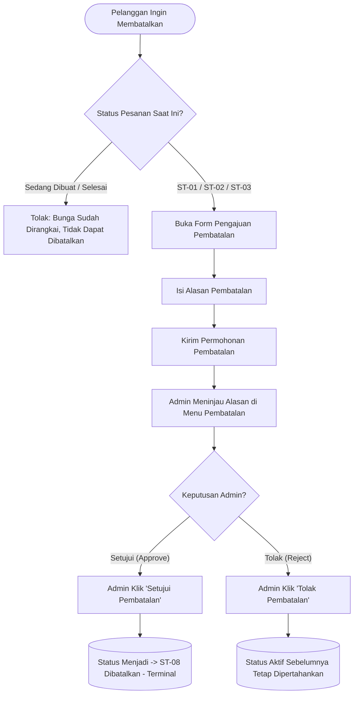
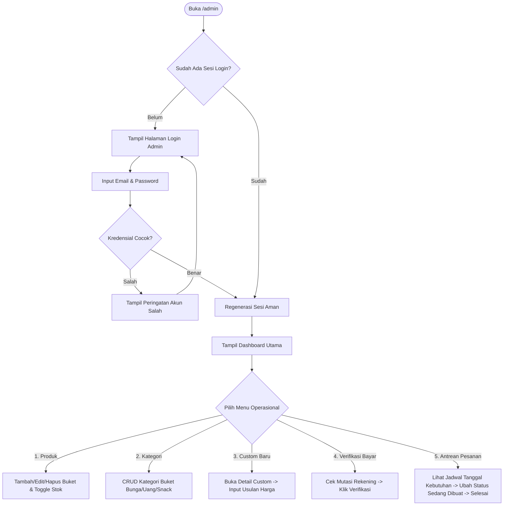

# USER FLOW & NAVIGATION ARCHITECTURE SPECIFICATION
# BLOOMÉ — Flowers & Stories

## 1. Document Information

- **Nama Dokumen:** User Flow & Navigation Architecture Specification
- **Nama Produk:** BLOOMÉ — Flowers & Stories
- **Nama Proyek:** Perancangan Sistem Informasi Pemesanan dan Personalisasi Buket Bunga Berbasis Web
- **Lead UI/UX Designer & Frontend Developer:** Riya Monika
- **Lead System Analyst & Project Manager:** Jayanti Firdasari
- **Backend Developer & Database Administrator:** Elsa Futri
- **Project Sponsor:** Nabila Febriyani
- **Versi Dokumen:** 1.0 (Official User Flow Baseline)
- **Tanggal Efektif:** 13 November 2026
- **Status Dokumen:** Approved Baseline

---

## 2. Overview & Navigation Objectives

Dokumen **User Flow & Navigation Architecture** ini mendefinisikan seluruh jalur interaksi pengguna (*user interaction pathways*), percabangan keputusan (*decision nodes*), penanganan kondisi khusus (*alternative & error flows*), serta arsitektur informasi halaman website **BLOOMÉ — Flowers & Stories**.

Tujuan utama penyusunan user flow:
1. **Frictionless Experience:** Mengeliminasi hambatan langkah belanja dengan menerapkan *guest checkout* instan tanpa registrasi.
2. **Transparent Custom Workflow:** Memetakan alur tawar-menawar harga buket custom secara visual agar pemesan dan pemilik usaha memiliki ekspektasi yang sama.
3. **Clarity for Developers:** Menjadi panduan presisi bagi Riya Monika dalam merancang wireframe/Blade views dan bagi Elsa Futri dalam mengonfigurasi rute controller Laravel.

---

## 3. Sitemap & Information Architecture

Struktur pohon halaman website BLOOMÉ terbagi ke dalam dua ranah terpisah:

---

## 4. User Flow 1: Pemesanan Produk Katalog (Catalog Ordering Flow)

Alur belanja buket siap pesan oleh pelanggan tanpa login:

### Rincian Interaksi Alur Katalog:
1. **Layar Asal:** `resources/views/catalog/index.blade.php`
2. **Kondisi Keputusan:** Jika `is_available == 0`, tombol "Pesan Sekarang" berganti menjadi badge abu-abu nonaktif.
3. **Penyimpanan:** Data nama dan WhatsApp disimpan ke tabel `customers`, pesanan dibuat di tabel `orders` dengan kode acak `BLM-YYYYMM-XXXX`, dan rincian produk disalin sebagai snapshot di `order_details`.
4. **Status Awal:** `ST-01 Menunggu Peninjauan Admin`.

---

## 5. User Flow 2: Pengajuan Personalisasi Buket Custom (Custom Bouquet Flow)

Alur pengajuan buket kustom dengan negosiasi harga terstruktur:

---

## 6. User Flow 3: Pembayaran Manual & Verifikasi Mutasi (Payment Flow)

Alur transfer dana manual oleh pembeli dan verifikasi keabsahan oleh admin:

---

## 7. User Flow 4: Pengajuan & Penanganan Pembatalan (Cancellation Flow)

Alur permohonan pembatalan oleh pelanggan dan peninjauan oleh pemilik usaha:

---

## 8. User Flow 5: Alur Kerja Administrator (Admin Operations Flow)

Rutinitas harian pemilik usaha mengelola operasional butik:

---

## 9. Penanganan Kasus Batas (*Edge Cases & Exception Flows*)

| Skenario Khusus | Jalur Alternatif & Penanganan Sistem |
|---|---|
| **Koneksi Terputus saat Submit Pesanan** | Mekanisme `DB::transaction()` otomatis membatalkan kueri parsial (*rollback*). Pengguna menerima alert ramah untuk mencoba kembali. |
| **Unggahan Berkas Gambar Rusak / Format Ilegal** | Validasi form request menolak berkas sebelum tersimpan ke disk dan memberikan notifikasi: *"Format berkas hanya boleh JPG, JPEG, atau PNG dan ukuran maksimal 5 MB."* |
| **Sesi Login Admin Kedaluwarsa (*Session Timeout*)** | Middleware `auth:admin` menangkap request, menyimpan URL tujuan (*intended URL*), dan mengarahkan kembali ke halaman login dengan pesan: *"Sesi Anda telah berakhir, silakan login kembali."* |
| **Percobaan Pembatalan pada Pesanan Selesai** | Tombol pembatalan dihilangkan dari antarmuka; jika endpoint diakses via URL langsung, controller melempar respon HTTP 403 (*Action Forbidden*). |

---

## 10. Kesimpulan & Pengesahan

Arsitektur alur pengguna (*User Flow*) ini telah diselaraskan dengan kebutuhan fungsional (`requirement.md`), rancangan produk (`prd.md`), dan panduan desain sistem (`design-system.md`). Dokumen ini siap menjadi acuan langsung penyusunan wireframe, mockup antarmuka, dan implementasi routing Laravel.

**Disahkan Oleh:**  
**Riya Monika** (UI/UX Designer & Frontend Developer)  
**Jayanti Firdasari** (Project Manager & System Analyst)  
Tanggal: 13 November 2026
