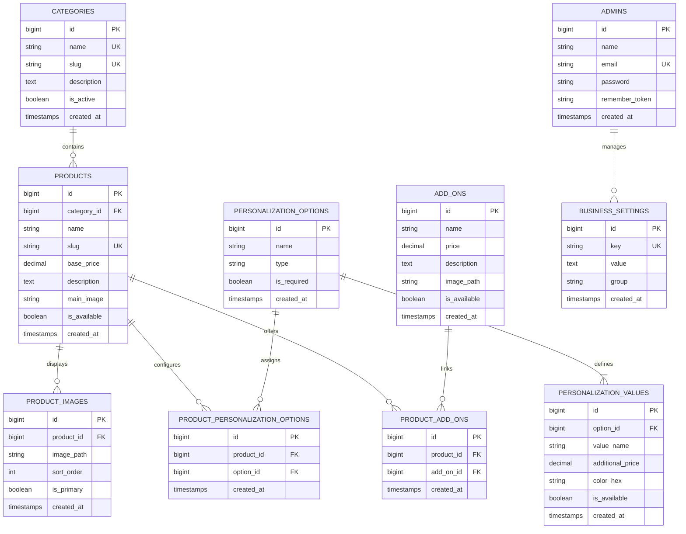

# DATABASE DESIGN SPECIFICATION & DATA DICTIONARY (v1.1)
# BLOOMÉ — Flowers & Stories

## 1. Document Information

- **Nama Dokumen:** Database Design Specification & Data Dictionary
- **Nama Sistem:** BLOOMÉ — Flowers & Stories
- **Nama Proyek:** Perancangan Sistem Informasi Pemesanan dan Personalisasi Buket Bunga Berbasis Web
- **Lead Database Administrator & Backend Architect:** Elsa Futri
- **Lead System Analyst & Project Manager:** Jayanti Firdasari
- **Frontend Developer & UI/UX Designer:** Riya Monika
- **Project Sponsor / Owner:** Nabila Febriyani
- **Lokasi Usaha:** Jl. Cipto Mangunkusumo, Simpang Tiga, Loa Janan Ilir, Samarinda
- **Database Engine:** MySQL 8.0+ (Storage Engine: InnoDB)
- **Character Set / Collation:** `utf8mb4` / `utf8mb4_unicode_ci`
- **Versi Dokumen:** 1.1 (Refined Catalog & Personalization Baseline — Pemesanan via WhatsApp)
- **Tanggal Efektif:** 20 November 2026
- **Status Dokumen:** Approved Baseline

---

## 2. Database Overview & Design Principles (Revisi v1.1)

Berdasarkan kesepakatan final proses bisnis proyek, **website BLOOMÉ berfungsi sebagai katalog interaktif dan media konfigurasi personalisasi buket bunga, sedangkan pencatatan pesanan resmi, verifikasi pembayaran, negosiasi harga, dan koordinasi pengiriman dilakukan secara langsung melalui WhatsApp.**

Dengan demikian, arsitektur basis data difokuskan sepenuhnya untuk mendukung pengelolaan konten etalase, variasi personalisasi dinamis, add-on tambahan, galeri foto, serta parameter konfigurasi toko. **Tabel transaksi, pembayaran, riwayat status pesanan, dan akun pelanggan tidak disimpan di basis data web.**

### 2.1 Prinsip Perancangan Basis Data
1. **Normalisasi Hingga Bentuk Ketiga (3NF):** Struktur tabel dinormalisasi secara ketat guna mengeliminasi redundansi data tanpa mengorbankan performa kueri katalog publik.
2. **Fleksibilitas Relasi Personalisasi & Add-on (Many-to-Many):** Pilihan personalisasi (seperti warna wrapping dan variasi pita) serta add-on (seperti kartu ucapan, topper, dan boneka) direlasikan secara modular melalui tabel pivot, sehingga admin dapat mengaitkan opsi yang relevan ke produk tertentu secara dinamis.
3. **Integritas Relasional Penuh (*Referential Integrity*):** Memanfaatkan *Foreign Key Constraints* mesin InnoDB dengan aturan penghapusan berjenjang (`CASCADE` untuk galeri/pivot dan `RESTRICT` untuk kategori utama) guna menjaga konsistensi data.
4. **Performa Tinggi & Zero-Bloat:** Karena tidak menyimpan transaksi yang terjadi di WhatsApp, basis data tetap sangat ringan, cepat diakses (*sub-second response time*), dan mudah dicadangkan (*backup & restore*).

---

## 3. Entity Relationship Diagram (ERD)

Skema relasional mencakup **10 Entitas Terpadu**:

---

## 4. Kamus Data Lengkap (Detailed Data Dictionary)

### 4.1 Tabel: `admins`
Menyimpan data otentikasi administrator tunggal (pemilik usaha / Nabila Febriyani).
| Nama Kolom | Tipe Data | Nullable | Kunci | Default | Deskripsi & Aturan Bisnis |
|---|---|:---:|:---:|:---:|---|
| `id` | BIGINT UNSIGNED | NO | PK | Auto-inc | Primary key akun admin. |
| `name` | VARCHAR(100) | NO | - | - | Nama lengkap pemilik usaha (Nabila Febriyani). |
| `email` | VARCHAR(150) | NO | UK | - | Alamat email resmi untuk login (unik). |
| `password` | VARCHAR(255) | NO | - | - | Hash kata sandi terenkripsi (Bcrypt / Argon2id). |
| `remember_token` | VARCHAR(100) | YES | - | NULL | Token sesi login persisten bawaan Laravel. |
| `created_at` | TIMESTAMP | YES | - | NULL | Waktu pembuatan akun. |
| `updated_at` | TIMESTAMP | YES | - | NULL | Waktu pembaruan akun. |

---

### 4.2 Tabel: `categories`
Menyimpan kelompok kategori produk buket bunga (contoh: Buket Bunga, Buket Uang, Buket Snack, Buket Boneka).
| Nama Kolom | Tipe Data | Nullable | Kunci | Default | Deskripsi & Aturan Bisnis |
|---|---|:---:|:---:|:---:|---|
| `id` | BIGINT UNSIGNED | NO | PK | Auto-inc | Primary key kelompok kategori. |
| `name` | VARCHAR(100) | NO | UK | - | Nama kategori unik (e.g. *Buket Bunga*, *Buket Uang*). |
| `slug` | VARCHAR(120) | NO | UK | - | URL-friendly slug unik (e.g. `buket-bunga`). |
| `description` | TEXT | YES | - | NULL | Penjelasan singkat kelompok produk kategori. |
| `is_active` | BOOLEAN | NO | INDEX | 1 | Status aktif kategori (1 = Tampil di web, 0 = Nonaktif). |
| `created_at` | TIMESTAMP | YES | - | NULL | Waktu kategori ditambahkan. |
| `updated_at` | TIMESTAMP | YES | - | NULL | Waktu kategori terakhir diubah. |

---

### 4.3 Tabel: `products`
Menyimpan katalog master produk buket yang dipublikasikan pada etalase web.
| Nama Kolom | Tipe Data | Nullable | Kunci | Default | Deskripsi & Aturan Bisnis |
|---|---|:---:|:---:|:---:|---|
| `id` | BIGINT UNSIGNED | NO | PK | Auto-inc | Primary key produk buket. |
| `category_id` | BIGINT UNSIGNED | NO | FK | - | Relasi ke `categories.id` (`ON DELETE RESTRICT`). |
| `name` | VARCHAR(150) | NO | - | - | Nama produk buket (e.g. *Rose Romance Deluxe*). |
| `slug` | VARCHAR(180) | NO | UK | - | Slug URL unik produk buket. |
| `base_price` | DECIMAL(12,2) | NO | - | - | Harga dasar produk buket dalam Rupiah **[Perlu Konfirmasi Owner]**. |
| `description` | TEXT | YES | - | NULL | Deskripsi detail bunga, bahan, dimensi, dan catatan pengerjaan. |
| `main_image` | VARCHAR(255) | YES | - | NULL | Path berkas foto utama etalase produk pada storage lokal. |
| `is_available` | BOOLEAN | NO | INDEX | 1 | Ketersediaan slot pembuatan (1 = Tersedia, 0 = Penuh/Kosong). |
| `created_at` | TIMESTAMP | YES | - | NULL | Waktu produk ditambahkan. |
| `updated_at` | TIMESTAMP | YES | - | NULL | Waktu produk terakhir diperbarui. |

---

### 4.4 Tabel: `product_images`
Menyimpan galeri foto tambahan untuk memberikan gambaran detail multi-sudut buket kepada pelanggan.
| Nama Kolom | Tipe Data | Nullable | Kunci | Default | Deskripsi & Aturan Bisnis |
|---|---|:---:|:---:|:---:|---|
| `id` | BIGINT UNSIGNED | NO | PK | Auto-inc | Primary key galeri gambar. |
| `product_id` | BIGINT UNSIGNED | NO | FK | - | Relasi ke `products.id` (`ON DELETE CASCADE`). |
| `image_path` | VARCHAR(255) | NO | - | - | Path berkas gambar tersimpan di storage lokal. |
| `sort_order` | INT UNSIGNED | NO | - | 0 | Urutan tampilan foto pada slider galeri halaman detail. |
| `is_primary` | BOOLEAN | NO | - | 0 | Penanda apakah foto berfungsi sebagai thumbnail utama. |
| `created_at` | TIMESTAMP | YES | - | NULL | Waktu gambar diunggah. |
| `updated_at` | TIMESTAMP | YES | - | NULL | Waktu gambar diperbarui. |

---

### 4.5 Tabel: `personalization_options`
Menyimpan kelompok opsi personalisasi buket (contoh: *Warna Wrapping Paper, Warna Pita Satin, Nuansa Warna Isian*).
| Nama Kolom | Tipe Data | Nullable | Kunci | Default | Deskripsi & Aturan Bisnis |
|---|---|:---:|:---:|:---:|---|
| `id` | BIGINT UNSIGNED | NO | PK | Auto-inc | Primary key kelompok opsi personalisasi. |
| `name` | VARCHAR(100) | NO | - | - | Nama opsi personalisasi (e.g. *Warna Kertas Wrapping*). |
| `type` | VARCHAR(50) | NO | - | 'select' | Tipe antarmuka UI (`select`, `radio`, `color_swatch`). |
| `is_required` | BOOLEAN | NO | - | 0 | Wajib dipilih oleh pelanggan atau opsional. |
| `created_at` | TIMESTAMP | YES | - | NULL | Waktu opsi dibuat. |
| `updated_at` | TIMESTAMP | YES | - | NULL | Waktu opsi diperbarui. |

---

### 4.6 Tabel: `personalization_values`
Menyimpan variasi nilai spesifik dari setiap kelompok opsi personalisasi.
| Nama Kolom | Tipe Data | Nullable | Kunci | Default | Deskripsi & Aturan Bisnis |
|---|---|:---:|:---:|:---:|---|
| `id` | BIGINT UNSIGNED | NO | PK | Auto-inc | Primary key nilai variasi personalisasi. |
| `option_id` | BIGINT UNSIGNED | NO | FK | - | Relasi ke `personalization_options.id` (`ON DELETE CASCADE`). |
| `value_name` | VARCHAR(100) | NO | - | - | Nama nilai variasi (e.g. *Blush Pink, Sage Green, Champagne*). |
| `additional_price` | DECIMAL(12,2) | NO | - | 0.00 | Biaya tambahan jika variasi ini dipilih **[Perlu Konfirmasi Owner]**. |
| `color_hex` | VARCHAR(20) | YES | - | NULL | Kode warna hex untuk swatch UI (e.g. `#E99AAF`, `#A8B5A0`). |
| `is_available` | BOOLEAN | NO | INDEX | 1 | Status stok variasi (1 = Tersedia, 0 = Kosong). |
| `created_at` | TIMESTAMP | YES | - | NULL | Waktu variasi dibuat. |
| `updated_at` | TIMESTAMP | YES | - | NULL | Waktu variasi diubah. |

---

### 4.7 Tabel: `product_personalization_options` (Pivot Table)
Menghubungkan opsi personalisasi mana saja yang diaktifkan untuk suatu produk buket tertentu.
| Nama Kolom | Tipe Data | Nullable | Kunci | Default | Deskripsi & Aturan Bisnis |
|---|---|:---:|:---:|:---:|---|
| `id` | BIGINT UNSIGNED | NO | PK | Auto-inc | Primary key relasi. |
| `product_id` | BIGINT UNSIGNED | NO | FK | - | Relasi ke `products.id` (`ON DELETE CASCADE`). |
| `option_id` | BIGINT UNSIGNED | NO | FK | - | Relasi ke `personalization_options.id` (`ON DELETE CASCADE`). |
| `created_at` | TIMESTAMP | YES | - | NULL | Waktu relasi dikonfigurasi. |
| `updated_at` | TIMESTAMP | YES | - | NULL | Waktu relasi diperbarui. |

---

### 4.8 Tabel: `add_ons`
Menyimpan master data item tambahan pelengkap buket (contoh: *Kartu Ucapan Custom, Topper Wisuda Akrilik, Boneka Wisuda Mini, Lampu LED String, Paper Bag Premium*).
| Nama Kolom | Tipe Data | Nullable | Kunci | Default | Deskripsi & Aturan Bisnis |
|---|---|:---:|:---:|:---:|---|
| `id` | BIGINT UNSIGNED | NO | PK | Auto-inc | Primary key add-on. |
| `name` | VARCHAR(100) | NO | - | - | Nama item add-on (e.g. *Lampu LED String Fairy Lights*). |
| `price` | DECIMAL(12,2) | NO | - | 0.00 | Harga satuan add-on dalam Rupiah **[Perlu Konfirmasi Owner]**. |
| `description` | TEXT | YES | - | NULL | Deskripsi singkat item tambahan. |
| `image_path` | VARCHAR(255) | YES | - | NULL | Path foto thumbnail item add-on. |
| `is_available` | BOOLEAN | NO | INDEX | 1 | Status ketersediaan item (1 = Tersedia, 0 = Habis). |
| `created_at` | TIMESTAMP | YES | - | NULL | Waktu add-on dibuat. |
| `updated_at` | TIMESTAMP | YES | - | NULL | Waktu add-on diperbarui. |

---

### 4.9 Tabel: `product_add_ons` (Pivot Table)
Menghubungkan item add-on yang diizinkan untuk produk buket tertentu.
| Nama Kolom | Tipe Data | Nullable | Kunci | Default | Deskripsi & Aturan Bisnis |
|---|---|:---:|:---:|:---:|---|
| `id` | BIGINT UNSIGNED | NO | PK | Auto-inc | Primary key relasi add-on produk. |
| `product_id` | BIGINT UNSIGNED | NO | FK | - | Relasi ke `products.id` (`ON DELETE CASCADE`). |
| `add_on_id` | BIGINT UNSIGNED | NO | FK | - | Relasi ke `add_ons.id` (`ON DELETE CASCADE`). |
| `created_at` | TIMESTAMP | YES | - | NULL | Waktu relasi dibuat. |
| `updated_at` | TIMESTAMP | YES | - | NULL | Waktu relasi diperbarui. |

---

### 4.10 Tabel: `business_settings`
Menyimpan parameter konfigurasi dinamis toko yang dapat diubah admin tanpa memodifikasi kode sumber.
| Nama Kolom | Tipe Data | Nullable | Kunci | Default | Deskripsi & Aturan Bisnis |
|---|---|:---:|:---:|:---:|---|
| `id` | BIGINT UNSIGNED | NO | PK | Auto-inc | Primary key pengaturan bisnis. |
| `key` | VARCHAR(100) | NO | UK | - | Kunci konfigurasi unik (e.g. `whatsapp_number`, `shop_address`). |
| `value` | TEXT | YES | - | NULL | Nilai konfigurasi toko. |
| `group` | VARCHAR(50) | NO | INDEX | 'general' | Grup pengaturan (`general`, `contact`, `social`). |
| `created_at` | TIMESTAMP | YES | - | NULL | Waktu pengaturan disimpan. |
| `updated_at` | TIMESTAMP | YES | - | NULL | Waktu pengaturan diperbarui. |

*Contoh data `business_settings`:*
- `whatsapp_number`: Nomor tujuan pemesanan WhatsApp resmi toko **[Perlu Konfirmasi Owner]**.
- `shop_address`: `Jl. Cipto Mangunkusumo, Simpang Tiga, Loa Janan Ilir, Samarinda`.
- `operational_hours`: Jam operasional layanan penerimaan pesanan dan pengiriman.
- `instagram_url` / `tiktok_url`: Tautan profil media sosial resmi toko **[Perlu Konfirmasi Owner]**.

---

## 5. Strategi Indexing & Optimasi Kueri

Untuk menjamin waktu muat halaman katalog dan detail produk ≤ 1 detik:
1. **Primary Key Clustered Index:** Seluruh tabel menggunakan auto-incrementing `BIGINT UNSIGNED id` sebagai clustered index bawaan InnoDB.
2. **Unique Indexes:**
   - `admins(email)`
   - `categories(slug)`
   - `products(slug)`
   - `business_settings(key)`
3. **Foreign Key Indexes:** Seluruh foreign key (`category_id`, `product_id`, `option_id`, `add_on_id`) diindeks untuk mempercepat operasi `JOIN` dan eager loading Eloquent.
4. **Performance Filter Indexes:**
   - `products(is_available, category_id)`: Mempercepat filter produk aktif pada katalog publik.
   - `categories(is_active)`: Mempercepat navigasi kategori aktif di beranda.
   - `personalization_values(option_id, is_available)`: Mempercepat pemanggilan variasi aktif pada antarmuka konfigurasi personalisasi.
   - `add_ons(is_available)`: Mempercepat pemanggilan daftar item add-on aktif.

---

## 6. Urutan Eksekusi Migrasi Tabel (*Migration Execution Order*)

Migrasi Laravel dijalankan berurutan mematuhi dependensi referensial foreign key:
1. `2026_11_20_000001_create_admins_table.php`
2. `2026_11_20_000002_create_categories_table.php`
3. `2026_11_20_000003_create_products_table.php`
4. `2026_11_20_000004_create_product_images_table.php`
5. `2026_11_20_000005_create_personalization_options_table.php`
6. `2026_11_20_000006_create_personalization_values_table.php`
7. `2026_11_20_000007_create_product_personalization_options_table.php`
8. `2026_11_20_000008_create_add_ons_table.php`
9. `2026_11_20_000009_create_product_add_ons_table.php`
10. `2026_11_20_000010_create_business_settings_table.php`

---

## 7. Rencana Database Seeder Awal (*Seeders Plan*)

1. **`AdminSeeder`:** Menginisialisasi akun login pemilik usaha resmi BLOOMÉ:
   - Nama: Nabila Febriyani
   - Email: `admin@bloome.com` (atau email resmi pemilik)
   - Password: Hash Bcrypt aman
2. **`CategorySeeder`:** Menginisialisasi 4 kategori buket awal yang disepakati:
   - *Buket Bunga* (`buket-bunga`)
   - *Buket Uang* (`buket-uang`)
   - *Buket Snack* (`buket-snack`)
   - *Buket Boneka* (`buket-boneka`)
3. **`PersonalizationSeeder`:** Opsi variasi dasar (misal: *Warna Kertas Wrapping*, *Warna Pita*) **[Perlu Konfirmasi Owner]**.
4. **`AddOnSeeder`:** Item pelengkap dasar (misal: *Kartu Ucapan Cetak*, *Topper Akrilik*, *Boneka Wisuda*) **[Perlu Konfirmasi Owner]**.
5. **`BusinessSettingSeeder`:** Inisialisasi nomor WhatsApp bisnis default, alamat Samarinda, dan jam layanan.

---

## 8. Kesimpulan & Pengesahan

Spesifikasi rancangan basis data v1.1 ini telah disesuaikan secara konsisten dengan konsep sistem katalog interaktif, personalisasi buket, dan pengalihan pemesanan via WhatsApp, serta mengeliminasi tabel transaksi yang tidak diperlukan di web.

**Disahkan Oleh:**  
**Elsa Futri** (Backend Developer & Database Administrator)  
**Jayanti Firdasari** (Project Manager & System Analyst)  
Tanggal: 20 November 2026
