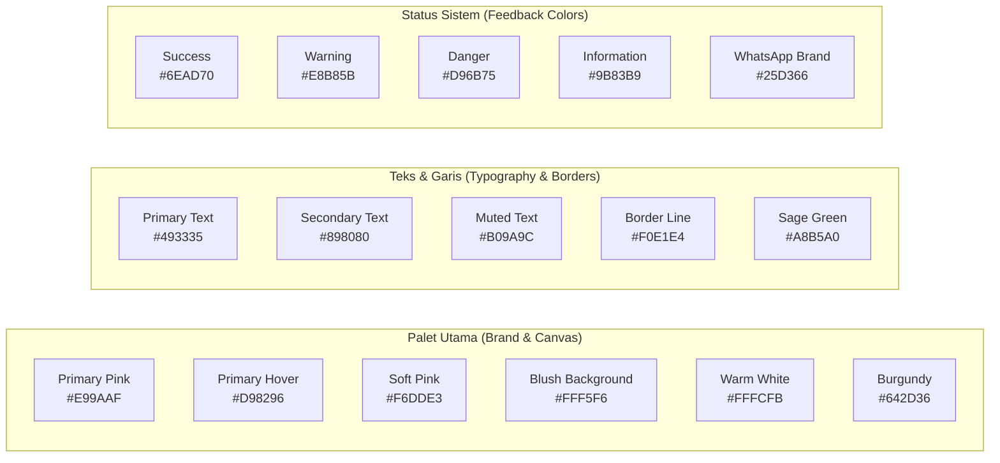

# DESIGN SYSTEM & UI COMPONENT SPECIFICATIONS (v1.1)
# BLOOMÉ — Flowers & Stories

## 1. Document Information

- **Nama Dokumen:** Design System & UI Component Specifications
- **Nama Produk:** BLOOMÉ — Flowers & Stories
- **Nama Proyek:** Perancangan Sistem Informasi Pemesanan dan Personalisasi Buket Bunga Berbasis Web
- **Lead UI/UX Designer & Frontend Developer:** Riya Monika
- **Lead System Analyst & Project Manager:** Jayanti Firdasari
- **Backend Developer & Database Administrator:** Elsa Futri
- **Project Sponsor / Owner:** Nabila Febriyani
- **Tema Desain:** *Elegant Floral Boutique (Soft Feminine, Modern, Minimalist, Premium)*
- **Versi Dokumen:** 1.1 (Refined Design System Baseline — Interactive Catalog & WhatsApp Ordering)
- **Tanggal Efektif:** 20 November 2026
- **Status Dokumen:** Approved Baseline

---

## 2. Design Philosophy & Visual Concept

### 2.1 Filosofi Visual: *Flowers & Stories*
Desain antarmuka **BLOOMÉ** diciptakan untuk memancarkan keanggunan, kehangatan emosional, dan ketenangan layaknya melangkah masuk ke dalam butik bunga artisan di Kota Samarinda:
- **Elegan & Feminin Lembut:** Memadukan palet warna mawar pastel (*blush pink*), latar belakang krem hangat (*warm white*), serta aksen hijau botani (*sage green*).
- **Tipografi Bertutur:** Mengombinasikan keanggunan klasik *Playfair Display* (serif) untuk judul-judul yang membangkitkan rasa perayaan dan kemewahan, dengan ketajaman fungsional *Poppins* (sans-serif) untuk keterbacaan teks katalog dan form yang tinggi.
- **Ruang & Napas (*Spacious & Clean*):** Memberikan ruang negatif (*white space*) yang lapang agar produk buket menjadi fokus visual utama (*hero visual focus*).
- **Bentuk Organik Lembut:** Menggunakan sudut-sudut membulat (*rounded cards & buttons*) untuk memberikan kesan ramah, menyenangkan, dan estetik bagi pembeli.

---

## 3. Token Warna Baku (Locked Color Tokens)

Seluruh komponen antarmuka publik dan dashboard admin wajib menggunakan token warna terstandarisasi berikut tanpa menyimpang:

### 3.1 Spesifikasi Nilai Hex & Peran Warna
| Token Name | Hex Code | Peran Penggunaan dalam Antarmuka |
|---|---|---|
| **`color-primary`** | `#E99AAF` | Warna aksen utama merek, tombol Call-to-Action utama, batas aktif. |
| **`color-primary-hover`**| `#D98296` | Warna saat kursor mengarah (*hover/active*) pada tombol utama. |
| **`color-primary-soft`** | `#F6DDE3` | Latar belakang elemen sekunder, badge ketersediaan lembut, container sorotan. |
| **`color-bg-body`** | `#FFF5F6` | Latar belakang kanvas utama seluruh halaman website (Blush Pink). |
| **`color-bg-surface`** | `#FFFCFB` | Latar belakang putih hangat untuk kartu produk, container form, dan modal. |
| **`color-burgundy`** | `#642D36` | Warna teks judul utama (Heading H1/H2) dan logo aksen eksklusif. |
| **`color-text-main`** | `#493335` | Warna teks utama untuk paragraf, label form, dan tabel (*high contrast*). |
| **`color-text-sub`** | `#898080` | Warna teks sekunder, subjudul kartu, rincian add-on, dan keterangan. |
| **`color-text-muted`** | `#B09A9C` | Warna placeholder form input, teks nonaktif (*disabled*), dan breadcrumbs. |
| **`color-botanical`** | `#A8B5A0` | Warna aksen dedaunan botani (*sage green*), penanda kategori buket bunga. |
| **`color-border`** | `#F0E1E4` | Garis tepi (*border*) tipis untuk kartu, pemisah baris tabel, dan input form. |
| **`color-success`** | `#6EAD70` | Lencana status *Tersedia*, notifikasi data berhasil disimpan. |
| **`color-warning`** | `#E8B85B` | Lencana slot pengerjaan hampir penuh, peringatan validasi input. |
| **`color-danger`** | `#D96B75` | Lencana status *Habis / Slot Penuh*, tombol hapus, pesan error validasi. |
| **`color-info`** | `#9B83B9` | Informasi petunjuk pemesanan, tips memilih variasi buket. |
| **`color-whatsapp`** | `#25D366` | Aksen tombol pemesanan WhatsApp dan ikon resmi chat WhatsApp. |

---

## 4. Tipografi Sistem (Typography Scale)

### 4.1 Pemilihan Font
1. **Heading Font (Display & Judul):** `Playfair Display`, serif modern, anggun, memberikan sentuhan butik floral eksklusif.
2. **Body & UI Font (Interface & Form):** `Poppins`, sans-serif geometris, modern, sangat nyaman dibaca di layar smartphone.

### 4.2 Skala Hirarki Tipografi
| Tingkat | Font Family | Ukuran / Line Height | Font Weight | Contoh Penggunaan |
|---|---|---|:---:|---|
| **Display H1** | Playfair Display | 36px / 44px (Mobile: 28px/36px) | 700 (Bold) | Hero Title Beranda, Judul Besar Page |
| **Heading H2** | Playfair Display | 28px / 36px (Mobile: 24px/32px) | 600 (SemiBold) | Judul Seksi Katalog, Judul Section |
| **Heading H3** | Poppins | 22px / 28px (Mobile: 18px/24px) | 600 (SemiBold) | Nama Produk di Halaman Detail, Judul Panel |
| **Heading H4** | Poppins | 18px / 24px | 600 (SemiBold) | Nama Produk di Kartu Katalog, Label Opsi |
| **Body Large** | Poppins | 16px / 24px | 400 (Regular) / 500 (Medium) | Paragraf Pengantar, Teks Tombol Utama |
| **Body Text** | Poppins | 14px / 22px | 400 (Regular) | Teks Deskripsi Produk, Label Form Input |
| **Caption/Small**| Poppins | 12px / 16px | 400 (Regular) / 500 (Medium) | Badge Ketersediaan, Hint Form, Footer Copyright |

---

## 5. Sistem Jarak, Radius, & Elevasi (Spacing, Radius, & Shadows)

### 5.1 Skala Spacing (Kelipatan 4/8pt)
- `space-1` : 4px (Jarak mikro, padding badge kecil).
- `space-2` : 8px (Jarak antar ikon dan teks label).
- `space-3` : 12px (Padding tombol reguler, jarak antar swatch warna).
- `space-4` : 16px (Padding kartu produk standar, margin antar elemen form).
- `space-6` : 24px (Padding kartu besar, jarak antar kolom opsi personalisasi).
- `space-8` : 32px (Margin antar bagian konfigurator detail).
- `space-12`: 48px (Jarak vertikal antar section beranda).
- `space-16`: 64px (Pemisah section utama halaman besar).

### 5.2 Sudut Lengkung Komponen (Border Radius Tokens)
- **Large Container & Modal:** `18px` (`border-radius: 18px;`)
- **Product Card & Add-on Card:** `16px` (`border-radius: 16px;`)
- **Small Container & Table Row:** `12px` (`border-radius: 12px;`)
- **Button (Semua Tombol):** `12px` (`border-radius: 12px;`)
- **Input Field & Select:** `10px` (`border-radius: 10px;`)
- **Color Swatch Selector:** `50%` (`border-radius: 50%;` bulat sempurna)
- **Badges / Lencana Ketersediaan:** `9999px` (`border-radius: 9999px;` bentuk kapsul)

### 5.3 Sistem Elevasi & Bayangan (Soft Shadows)
- **Elevation 1 (Kartu Default):** `box-shadow: 0 4px 20px rgba(100, 45, 54, 0.05);`
- **Elevation 2 (Kartu Hover / Sticky Summary):** `box-shadow: 0 8px 30px rgba(100, 45, 54, 0.08);`
- **Elevation 3 (Modal Dialog / Floating Header):** `box-shadow: 0 12px 40px rgba(100, 45, 54, 0.12);`
*(Dilarang menggunakan bayangan hitam pekat / harsh black shadow).*

---

## 6. Spesifikasi Komponen Antarmuka (UI Components Library)

### 6.1 Tombol (Button Components)
1. **WhatsApp Order Button (Tombol CTA Utama):**
   - Latar belakang: `#E99AAF` (atau varian hijau WhatsApp `#25D366`), teks putih `#FFFFFF`, ikon WhatsApp SVG di sisi kiri, padding `14px 24px`, radius `12px`, font Poppins SemiBold (15px).
   - Efek hover: Transisi halus ke `#D98296` (atau `#20BA5A`) dengan sedikit peningkatan elevasi (*transform: translateY(-2px)*).
2. **Secondary Button:**
   - Latar transparan, border `1.5px solid #E99AAF`, teks `#E99AAF`, radius `12px`. Hover bertransisi ke background `#F6DDE3`.
3. **Disabled Button:**
   - Latar belakang `#F0E1E4`, teks `#B09A9C`, kursor `not-allowed`, tombol tidak dapat diklik saat produk berstatus habis.

### 6.2 Komponen Personalisasi & Add-on
1. **Color Swatch Selector (Pemilih Warna Wrapping / Pita):**
   - Lingkaran warna berdiameter `32px` dengan border halus `2px solid #F0E1E4`.
   - Status terpilih (*active state*): Border menjadi `3px solid #642D36` disertai efek cincin fokus (*ring offset*) dan ikon centang kecil.
2. **Add-on Checkbox Card (Kartu Pilihan Add-on):**
   - Kartu kecil persegi panjang dengan radius `12px`, border `1.5px solid #F0E1E4`, latar `#FFFCFB`.
   - Memuat: Checkbox custom di kiri, thumbnail add-on 48×48px, nama add-on, dan label harga tambahan (`+Rp 15.000`).
   - Saat dicentang: Border berubah menjadi `#E99AAF`, background menjadi `#FFF5F6`.
3. **Catatan Khusus Textarea:**
   - Input textarea dengan radius `10px`, border `1.5px solid #F0E1E4`, placeholder lembut untuk instruksi ucapan kartu.

### 6.3 Kartu Ringkasan Estimasi Harga (Interactive Sticky Summary)
- Kartu ringkasan dengan latar belakang `#FFFCFB`, border `1.5px solid #F0E1E4`, radius `18px`, elevasi 2.
- Menampilkan rincian baris:
  - *Harga Dasar Buket* : Rp xxx.xxx
  - *Variasi Pilihan* : Nama Warna Wrapping / Pita (Rp 0 / +Rp xx.xxx)
  - *Add-on Terpilih* : Daftar item add-on beserta harga masing-masing
  - *Garis Pemisah Halus* : `#F0E1E4`
  - *Estimasi Total* : Font Poppins SemiBold (20px) berwarna `#642D36` (Burgundy)
  - *Teks Disclaimer* : "Estimasi harga produk. Konfirmasi ongkir Samarinda & jadwal pengiriman akan disepakati di WhatsApp."

### 6.4 Kartu Produk Katalog (Product Card Component)
- Kartu simetris beradius `16px`, latar `#FFFCFB`, border `1px solid #F0E1E4`, elevasi 1.
- Foto buket rasio `1:1` atau `4:5` dengan efek zoom halus `scale(1.03)` saat di-hover.
- Lencana kategori di pojok kiri atas foto.
- Lencana ketersediaan di pojok kanan atas foto:
  - *Tersedia* : Background `#E5F4E7`, Teks `#4E8E50` (Hijau).
  - *Habis / Slot Penuh* : Background `#FCE8E9`, Teks `#C94A55` (Merah).
- Judul produk (H4), harga dasar (IDR tebal), dan tombol "Pilih & Personalisasi".

### 6.5 Navigasi (Navigation Components)
1. **Customer Navbar:** Header mengambang (*sticky floating header*), latar putih transparan dengan efek kaca (*backdrop-filter: blur(10px); background: rgba(255, 252, 251, 0.95);*), logo BLOOMÉ Burgundy, tautan navigasi (Beranda, Katalog, Custom Bouquet, Tentang Kami, Kontak).
2. **Customer Footer:** Nuansa anggun `#642D36` (Burgundy) atau `#FFF5F6`, memuat alamat butik Samarinda (Jl. Cipto Mangunkusumo), jam kerja operasional, dan tautan sosial media resmi.
3. **Admin Dashboard Layout:** Sidebar tetap di sisi kiri dengan latar `#F6DDE3` (Soft Pink), teks dan ikon aktif `#642D36`, container konten putih `#FFFCFB`, dan header ringkas yang menampilkan profil Nabila Febriyani serta tombol logout aman.

---

## 7. Penanganan Kondisi UI Multi-State (UI States)

1. **Empty State:**
   - Jika kategori katalog tidak memiliki produk aktif: Ilustrasi vas bunga kosong bergaris lembut dengan pesan: *"Belum ada buket di kategori ini. Silakan jelajahi kategori lain atau konsultasikan buket custom impianmu via WhatsApp!"*
2. **Loading State:**
   - Kartu katalog menggunakan animasi *shimmer skeleton* bernuansa soft pink saat memuat gambar atau data.
3. **Error State:**
   - Banner alert merah lembut (`#FCE8E9` border `#D96B75`) di atas formulir dengan ikon peringatan dan pesan validasi berbahasa Indonesia yang jelas.
4. **Success State:**
   - Banner hijau lembut (`#E5F4E7` border `#6EAD70`) saat data produk, kategori, atau konfigurasi berhasil disimpan di admin.

---

## 8. Panduan Desain Responsif (Responsive Breakpoints)

- **Mobile View (≤ 576px):**
  - Kartu produk buket ditampilkan 1 kolom penuh (lebar 100%) untuk tampilan foto yang maksimal.
  - Kartu ringkasan estimasi harga dapat diposisikan sebagai *sticky bottom bar* di layar smartphone agar tombol WhatsApp selalu terlihat dan mudah ditekan (*thumb-friendly*).
- **Tablet View (768px – 992px):**
  - Kartu buket ditampilkan 2 kolom simetris.
- **Desktop View (≥ 1024px):**
  - Lebar container konten maksimum 1200px terpusat.
  - Kartu katalog ditampilkan 3 atau 4 kolom.
  - Halaman detail menampilkan tata letak 2 kolom: galeri foto di kolom kiri dan konfigurator personalisasi beserta ringkasan estimasi di kolom kanan.

---

## 9. Kesimpulan & Pengesahan

Panduan Desain Sistem v1.1 ini telah diselaraskan secara konsisten dengan konsep katalog interaktif dan pemesanan WhatsApp, mempertahankan keanggunan identitas visual BLOOMÉ, serta siap diimplementasikan ke dalam komponen CSS dan Blade templates.

**Disahkan Oleh:**  
**Riya Monika** (UI/UX Designer & Frontend Developer)  
**Jayanti Firdasari** (Project Manager & System Analyst)  
Tanggal: 20 November 2026
