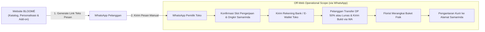

# LAPORAN PEMERIKSAAN RUANG LINGKUP PROYEK (PROJECT SCOPE REVIEW) (v1.1)
## BLOOMÉ — Flowers & Stories
**Task ID:** DOC-002  
**Fase:** Phase 1 — Project Initiation and Documentation  
**Penanggung Jawab:** Jayanti Firdasari (Project Manager & System Analyst)  
**Tanggal Pemeriksaan:** 13 November 2026  
**Tanggal Revisi Penyelarasan:** 20 November 2026  
**Status Task:** Completed (`[x]`)  
**Dependensi:** DOC-001 — Memeriksa Project Charter (Selesai)  

---

## 1. Ringkasan Eksekutif

Pemeriksaan Ruang Lingkup Proyek (Task DOC-002) bertujuan untuk menetapkan batas tegas (*scope baseline*) dari pengembangan sistem informasi **BLOOMÉ — Flowers & Stories**. Melalui evaluasi penyelarasan versi 1.1 ini, batasan antara fitur yang dibangun di sisi web (*In-Scope*), proses operasional yang dialihkan ke WhatsApp (*Off-Web Process*), fitur yang dikecualikan (*Out-of-Scope*), serta item yang masih menunggu konfirmasi operasional (*[Perlu Konfirmasi Owner]*) ditetapkan secara transparan dan selaras dengan 10 dokumen utama di root.

Langkah ini penting untuk mencegah terjadinya *scope creep* (perluasan ruang lingkup tanpa kontrol) dan memastikan seluruh tim bekerja pada ruang lingkup yang telah disepakati: **website sebagai katalog interaktif dan media personalisasi buket bunga, dengan alur pemesanan dialihkan langsung ke WhatsApp**.

---

## 2. Dekomposisi Ruang Lingkup In-Scope (Sisi Website)

Seluruh modul fungsional yang dikembangkan pada website dikelompokkan ke dalam dua ranah aktor:

### 2.1 Ranah Pelanggan (Public Customer Interface)
Pelanggan berinteraksi dengan sistem sebagai tamu (*guest user*) tanpa login atau registrasi akun:

| Kode Modul | Nama Modul | Rincian Fungsionalitas In-Scope (v1.1) |
|---|---|---|
| **SCP-CUST-01** | Beranda Publik (Homepage) | Hero section, identitas merek BLOOMÉ, sorotan buket unggulan, direktori kategori, seksi promosi buket custom, informasi lokasi workshop Samarinda, dan footer informatif. |
| **SCP-CUST-02** | Katalog & Kategori Produk | Menampilkan katalog produk buket siap pesan dalam kartu grid, filter berdasarkan kategori (Buket Bunga, Buket Uang, Buket Snack, Buket Boneka), dan badge status ketersediaan (*Tersedia* / *Habis*). |
| **SCP-CUST-03** | Halaman Detail Produk | Menampilkan galeri foto buket (slider), deskripsi bahan bunga/kertas, harga dasar resmi dalam Rupiah, kategori, status ketersediaan, serta panel personalisasi buket. |
| **SCP-CUST-04** | Konfigurator Personalisasi | Pemilihan variasi personalisasi yang terhubung ke database: pilihan warna kertas pembungkus (*wrapping paper*) dan warna pita satin dengan visual color swatch. |
| **SCP-CUST-05** | Pemilih Item Add-on & Catatan | Pemilihan item pelengkap (kartu ucapan cetak, boneka wisuda, topper akrilik, lampu LED) beserta rincian penambahan harga satuan, dan input teks catatan khusus / ucapan. |
| **SCP-CUST-06** | Ringkasan & Estimasi Harga Live | Kartu ringkasan interaktif yang menghitung estimasi total harga secara *real-time* di sisi browser pelanggan tanpa reload halaman. |
| **SCP-CUST-07** | Generator Pesan Pemesanan WhatsApp | Tombol CTA "Pesan via WhatsApp" yang mengompilasi pilihan buket, variasi, add-on, catatan ucapan, dan estimasi harga menjadi draf pesan teks URL-encoded ke `https://wa.me/...`. |
| **SCP-CUST-08** | Halaman Konsultasi Buket Custom | Halaman panduan layanan buket khusus kreasi bebas dengan tombol langsung ke WhatsApp toko untuk konsultasi desain di luar katalog. |
| **SCP-CUST-09** | Halaman Informasi Profil & Kontak | Halaman *About Us* (profil butik BLOOMÉ Samarinda) dan *Contact Us* (alamat Jalan Cipto Mangunkusumo, jam operasional, dan tautan media sosial resmi). |

---

### 2.2 Ranah Pengelola (Admin Dashboard Interface)
Admin merupakan satu akun terautentikasi (pemilik usaha / Nabila Febriyani) yang mengelola seluruh konten etalase:

| Kode Modul | Nama Modul | Rincian Fungsionalitas In-Scope (v1.1) |
|---|---|---|
| **SCP-ADM-01** | Autentikasi Admin Tunggal | Halaman login admin terproteksi password hashing Bcrypt dan token CSRF, session guard `auth:admin`, serta fungsi logout aman. |
| **SCP-ADM-02** | Dashboard Overview Etalase | Kartu ringkasan metrik konten etalase: total produk buket aktif, produk stok habis, kategori aktif, dan total item add-on terdaftar. |
| **SCP-ADM-03** | Manajemen Kategori Buket | Operasi CRUD kategori produk buket (nama kategori, deskripsi, slug otomatis, toggle status aktif) dengan validasi nama unik. |
| **SCP-ADM-04** | Manajemen Produk Katalog | Operasi CRUD produk buket (nama, slug, harga dasar, deskripsi, kategori, upload foto utama) dan toggle cepat ketersediaan stok (*Tersedia / Habis*). |
| **SCP-ADM-05** | Manajemen Galeri Multi-Foto | Modul upload multi-foto pendukung produk buket ke storage lokal, pengaturan urutan foto (*sort order*), dan penghapusan foto galeri. |
| **SCP-ADM-06** | Manajemen Opsi Personalisasi | Operasi CRUD kelompok opsi personalisasi (Warna Wrapping, Warna Pita) dan nilai variasi spesifik beserta kode warna hex dan biaya tambahan jika ada. |
| **SCP-ADM-07** | Penetapan Personalisasi ke Produk | Antarmuka untuk mengaitkan opsi personalisasi mana saja yang aktif dan berlaku untuk produk buket tertentu. |
| **SCP-ADM-08** | Manajemen Item Add-on & Harga | Operasi CRUD master item tambahan (nama add-on, harga satuan, deskripsi, thumbnail) serta penetapannya ke produk buket terkait. |
| **SCP-ADM-09** | Pengaturan Bisnis & WhatsApp | Pengelolaan data konfigurasi dinamis toko pada basis data: nomor WhatsApp resmi tujuan pemesanan, jam operasional toko, dan alamat galeri Samarinda. |

---

## 3. Batasan Tegas Out-of-Scope (Excluded Features)

Fitur-fitur berikut **secara eksplisit DIKECUALIKAN** dari ruang lingkup pengembangan website:

1. **Registrasi & Login Akun Pelanggan:** Pelanggan mengakses seluruh katalog dan melakukan konfigurasi sebagai *guest user* tanpa registrasi.
2. **Modul Keranjang Belanja & Checkout Web:** Website tidak menyediakan alur keranjang belanja multi-produk yang rumit atau alur checkout mandiri di web.
3. **Penyimpanan Transaksi Pemesanan di Database Web:** Website tidak menyimpan data pesanan (*orders / order_details*) ke basis data web; pesanan diteruskan langsung ke WhatsApp.
4. **Pengelolaan Status Pesanan Internal (ST-01 s/d ST-08 di Web):** Website tidak memproses perubahan status pesanan atau menyediakan audit trail status di web; status pengerjaan dikomunikasikan via WhatsApp.
5. **Payment Gateway Otomatis di Web:** Tidak mengintegrasikan gateway pihak ketiga (Midtrans, Xendit, dll.). Pembayaran dilakukan via transfer bank atau e-wallet melalui percakapan WhatsApp.
6. **Formulir Unggah Bukti Bayar di Website:** Pelanggan mengirimkan bukti transfer pembayaran langsung ke WhatsApp toko.
7. **Verifikasi Pembayaran di Website:** Pemilik toko memverifikasi dana masuk langsung di aplikasi m-banking/e-wallet miliknya tanpa pencatatan mutasi di web.
8. **Negosiasi Harga & Pembatalan di Website:** Negosiasi harga dan pembatalan pesanan dibicarakan langsung dengan pemilik melalui WhatsApp.
9. **Bot WhatsApp Gateway API Otomatis:** Tidak menghubungkan API pesan otomatis pihak ketiga berbayar (Fonnte, Wablas, Twilio); sistem memanfaatkan skema tautan URL `wa.me` yang dikirim manual oleh pemesan.
10. **Pelacakan Live GPS Kurir & Ekspedisi Otomatis:** Tidak menyediakan pelacakan kurir live; koordinasi pengantaran area Samarinda ditangani via WhatsApp.
11. **Sistem Multi-Admin / Multi-Role:** Hanya ada 1 akun admin pemilik usaha tanpa hak akses bertingkat (*RBAC*).
12. **Modul Akuntansi Finansial Otomatis:** Tidak mencakup pembukuan laba/rugi otomatis di web.

---

## 4. Alur Transaksi & Operasional di Luar Website (Off-Web Scope via WhatsApp)

Untuk menjaga kejelasan batasan tanggung jawab, proses bisnis yang berlangsung setelah tombol WhatsApp ditekan diklasifikasikan sebagai alur operasional di luar website (*Off-Web Process*):

---

## 5. Analisis Batasan & Asumsi Ruang Lingkup

1. **Asumsi Tautan WhatsApp:** Tautan menggunakan format standar `https://wa.me/<nomor>?text=<encoded_text>` yang kompatibel di semua browser seluler dan desktop (otomatis membuka aplikasi WhatsApp di mobile atau WhatsApp Web di desktop).
2. **Kalkulasi Sisi Klien:** Perhitungan estimasi total biaya dilakukan secara dinamis menggunakan JavaScript pada browser pelanggan, memastikan antarmuka tetap interaktif dan cepat tanpa membebani server backend.
3. **Penyimpanan Media Foto Produk:** Foto produk dan galeri disimpan pada *local disk storage* Laravel (`storage/app/public/products`) dengan batasan format (JPG, PNG, WebP) dan ukuran berkas maksimal **[Perlu Konfirmasi Owner]** (standar: 2-5 MB).
4. **Basis Data Ramping (10 Tabel):** Basis data hanya menampung master data etalase dan konfigurasi toko (`admins`, `categories`, `products`, `product_images`, `personalization_options`, `personalization_values`, `product_personalization_options`, `add_ons`, `product_add_ons`, `business_settings`).

---

## 6. Prosedur Pengendalian Perubahan Ruang Lingkup (Scope Change Control)

Jika selama fase pengembangan muncul permintaan penambahan fitur di luar dokumen ruang lingkup ini:
1. Permintaan diajukan secara formal kepada Project Manager (Jayanti Firdasari).
2. PM dan Technical Lead (Elsa Futri & Riya Monika) melakukan evaluasi dampak terhadap batas akhir **30 November 2026**.
3. Jika permintaan berisiko menimbulkan penundaan jadwal atau menambah kompleksitas (seperti permintaan checkout mandiri atau integrasi payment gateway), fitur tersebut harus ditunda ke rilis Fase 2 pascaproyek kecuali ada persetujuan tertulis dari Sponsor Nabila Febriyani.

---

## 7. Kesimpulan & Rekomendasi

### 7.1 Status Task DOC-002
Task **DOC-002 (Memeriksa ruang lingkup proyek)** telah diselaraskan penuh dengan konsep sistem terbaru v1.1:
- Batasan in-scope katalog interaktif dan out-of-scope transaksi web telah terdefinisi secara presisi.
- Seluruh kontradiksi dengan alur pemesanan WhatsApp telah dieliminasi.
- Dokumen konsisten 100% dengan `requirement.md`, `prd.md`, dan `architecture.md`.
- Kriteria penyelesaian terpenuhi.

### 7.2 Rekomendasi Langkah Berikutnya:
Melanjutkan penyelarasan deliverable berikutnya pada folder foundation:
- **`DOC-003-team-assignment-review.md` — Pemeriksaan Pembagian Tugas Tim.**
