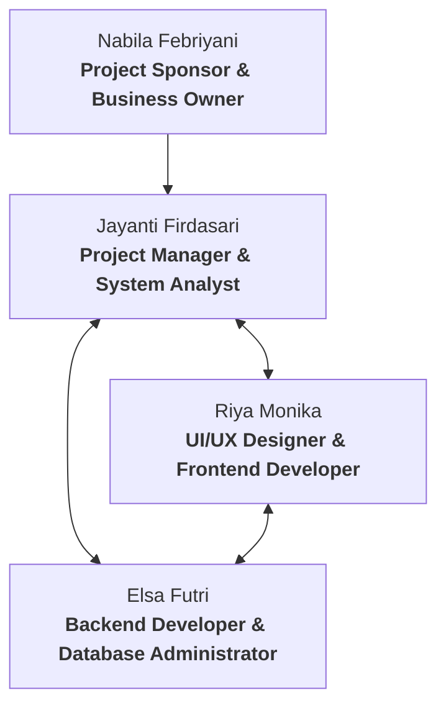

# LAPORAN PEMERIKSAAN PEMBAGIAN TUGAS TIM (TEAM ASSIGNMENT REVIEW) (v1.1)
## BLOOMÉ — Flowers & Stories
**Task ID:** DOC-003  
**Fase:** Phase 1 — Project Initiation and Documentation  
**Penanggung Jawab:** Jayanti Firdasari (Project Manager & System Analyst)  
**Tanggal Pemeriksaan:** 13 November 2026  
**Tanggal Revisi Penyelarasan:** 20 November 2026  
**Status Task:** Completed (`[x]`)  
**Dependensi:** DOC-002 — Memeriksa ruang lingkup proyek (Selesai)  

---

## 1. Ringkasan Eksekutif

Pemeriksaan Pembagian Tugas Tim (Task DOC-003) dilakukan untuk menetapkan dan memvalidasi struktur organisasi proyek, pembagian peran teknis, serta matriks akuntabilitas bagi seluruh anggota tim pengembangan **BLOOMÉ — Flowers & Stories**.

Evaluasi penyelarasan versi 1.1 ini memastikan bahwa seluruh pembagian penugasan rekayasa perangkat lunak selaras penuh dengan konsep sistem terbaru: **website sebagai katalog interaktif dan media personalisasi buket bunga, dengan alur pemesanan dialihkan langsung ke WhatsApp**.

Dengan durasi proyek yang terencana (13 Oktober – 30 November 2026), kejelasan peran (*role clarity*) dan pembagian beban kerja yang seimbang antara Project Manager, Frontend Developer, dan Backend Developer menjamin sistem selesai tepat waktu dengan kualitas terbaik.

---

## 2. Struktur Tim & Profil Peran Utama

Struktur tim terdiri dari 3 personil inti teknis dan 1 penanggung jawab bisnis:

### 2.1 Jayanti Firdasari — Project Manager & System Analyst
- **Tanggung Jawab Utama:**
  - Perencanaan proyek, penjadwalan (*milestones*), dan pemantauan kepatuhan terhadap timeline 7 minggu.
  - Analisis kebutuhan fungsional & nonfungsional serta penyusunan dokumen acuan sistem (`requirement.md`, `prd.md`, `prompt.md`).
  - Pemodelan analisis sistem UML (Use Case Diagram, Use Case Description, Activity Diagrams, Sequence Diagrams) yang mencerminkan alur katalog, personalisasi, dan tautan pemesanan WhatsApp.
  - Koordinasi komunikasi antar anggota tim serta penjembatanan komunikasi dengan Sponsor (Nabila Febriyani).
  - Pengawasan implementasi metodologi Waterfall dan pemenuhan *Cross-Phase Quality Gates*.
  - Koordinasi pengujian mutu (*QA Lead*), pelaksanaan *User Acceptance Testing* (UAT), dan penyusunan laporan akhir proyek.

### 2.2 Riya Monika — UI/UX Designer & Frontend Developer
- **Tanggung Jawab Utama:**
  - Perancangan panduan desain sistem visual (`design-system.md`): Locked Color Tokens (#E99AAF, #642D36, #FFF5F6, #A8B5A0), tipografi (Playfair Display & Poppins), grid/spacing, dan aset grafis floral boutique.
  - Perancangan antarmuka pengguna: Wireframe, High-Fidelity Mockup, dan prototipe interaktif untuk antarmuka katalog publik, konfigurator personalisasi, dan panel dashboard admin.
  - Implementasi frontend berbasis Blade templates, styling CSS modular/Tailwind, dan JavaScript interaktif (`personalization.js`).
  - Pengembangan komponen interaktif pemilih personalisasi: Swatch lingkaran warna wrapping & pita, checkbox card add-on, textarea catatan ucapan, dan kartu ringkasan estimasi harga dinamis (*live price estimator*).
  - Implementasi logika perakit draf pesan teks WhatsApp dan pembentukan tautan URL Scheme `https://wa.me/...`.
  - Penjaminan responsivitas antarmuka pada 3 viewport utama (Mobile ≤ 576px, Tablet 768px, dan Desktop 1280px).

### 2.3 Elsa Futri — Backend Developer & Database Administrator
- **Tanggung Jawab Utama:**
  - Perancangan arsitektur teknis sistem (`architecture.md`) berbasis Three-Layer Architecture pada framework Laravel (PHP 8.2+).
  - Perancangan skema basis data 10 entitas relasional terpadu (`database-design.md`, ERD, normalisasi 3NF, data dictionary).
  - Penyiapan proyek Laravel, konfigurasi `.env`, pembuatan 10 file migrasi database, Eloquent models, dan seeders awal.
  - Pengembangan business logic Laravel: HTTP controllers, form request validation, middleware otentikasi admin (`auth:admin`), dan proteksi CSRF.
  - Implementasi modul admin: CRUD kategori produk, CRUD produk buket, toggle ketersediaan stok, manajemen galeri multi-foto, CRUD opsi & variasi personalisasi, CRUD add-on, dan modul pengaturan nomor WhatsApp bisnis (`business_settings`).
  - Pengembangan domain services: `WhatsAppUrlBuilderService` (pembentukan teks pesan terstandarisasi) dan `ImageUploadService` (validasi format JPG/PNG/WebP, pembatasan ukuran, dan hashing UUID).
  - Pengujian backend, pengujian integrasi database, dan audit keamanan siber (proteksi rute, pencegahan SQL Injection, sanitasi XSS).

### 2.4 Nabila Febriyani — Project Sponsor & Pemilik Usaha (Stakeholder Utama)
- **Tanggung Jawab:**
  - Memberikan arahan visi bisnis, filosofi brand BLOOMÉ, dan rincian katalog produk buket.
  - Memberikan konfirmasi tertulis terhadap parameter operasional terbuka berstatus `[Perlu Konfirmasi Owner]`.
  - Menguji kemudahan pemesanan via WhatsApp dan operasional panel admin pada sesi UAT.
  - Menandatangani Berita Acara Penerimaan Sistem (*Final Acceptance Sign-off*).

---

## 3. Matriks Penugasan per Fase Proyek (Phase-by-Phase Assignment v1.1)

| Fase Proyek | Aktivitas Kunci | Lead (Penanggung Jawab) | Contributor (Pendukung) |
|---|---|---|---|
| **Phase 1 — Inisiasi & Dokumen Dasar** | Charter review, scope baseline v1.1, SRS, PRD, architecture & database baseline | **Jayanti Firdasari** | Elsa Futri, Riya Monika |
| **Phase 2 — Analisis & Desain Sistem** | UML Modeling (Use Case, Activity, Sequence Katalog ke WhatsApp) | **Jayanti Firdasari** | Elsa Futri (Architecture input) |
| **Phase 3 — UI/UX Design & Prototyping**| Design System, Swatch Component, Wireframes, Mockups, Navigasi Alur WA | **Riya Monika** | Jayanti Firdasari (Flow review) |
| **Phase 4 — Database Design & Migrations**| ERD 10 Tabel, Kamus Data, Laravel Migrations, Models, Seeder Awal | **Elsa Futri** | Jayanti Firdasari (Entity validation) |
| **Phase 5 — Laravel Foundation** | Setup Laravel, routing web.php, middleware auth:admin, storage link | **Elsa Futri** | Riya Monika (Vite setup) |
| **Phase 6 — Backend Development** | Controllers CRUD Produk, Kategori, Variasi, Add-on, Settings, WA Service | **Elsa Futri** | Jayanti Firdasari |
| **Phase 7 — Frontend Development** | Blade views, swatch warna, live price calculation JS, WhatsApp URL generator | **Riya Monika** | Elsa Futri (Data binding contract) |
| **Phase 8 — Integrasi Sistem** | Menghubungkan Blade dengan Controller, Database, dan Pengalihan WhatsApp | **Elsa Futri & Riya Monika** | Jayanti Firdasari (Workflow test) |
| **Phase 9 — Security, QA & UAT** | Uji keamanan, fungsionalitas live price & link WA, responsivitas, sesi UAT Sponsor | **Jayanti Firdasari** | Elsa Futri, Riya Monika, Nabila Febriyani |
| **Phase 10 — Deployment & Handover** | Deployment hosting, manual operasional admin, final handover | **Jayanti Firdasari** | Elsa Futri, Riya Monika |

---

## 4. Matriks RACI (Responsible, Accountable, Consulted, Informed)

- **R (Responsible):** Pihak yang mengerjakan tugas teknis.
- **A (Accountable):** Pihak yang memiliki keputusan akhir dan memastikan pekerjaan selesai.
- **C (Consulted):** Pihak yang dimintai masukan atau konsultasi teknis dua arah.
- **I (Informed):** Pihak yang diberi pembaruan progres satu arah.

| Deliverable / Modul Pekerjaan | Nabila (Sponsor) | Jayanti (PM/SA) | Riya (UI/UX & FE) | Elsa (BE & DBA) |
|---|:---:|:---:|:---:|:---:|
| Project Charter & Scope Baseline v1.1 | A | R | C | C |
| SRS (`requirement.md`) & PRD (`prd.md`) | C | A / R | C | C |
| UML Diagrams (Katalog & WhatsApp Flow) | I | A / R | C | C |
| System Architecture (`architecture.md`) | I | C | C | A / R |
| Database Design & 10 Migrations | I | C | I | A / R |
| Design System & UI Components | C | C | A / R | I |
| User Flow & Navigasi WhatsApp | C | C | A / R | C |
| Backend CRUD & WhatsApp URL Service | I | C | C | A / R |
| Blade Templates & Live Estimator JS | I | C | A / R | C |
| Security Testing & Quality Assurance | I | A / R | C | C |
| User Acceptance Testing (UAT) & Sign-Off | A | R | C | C |

---

## 5. Kesimpulan & Rekomendasi

### 5.1 Status Task DOC-003
Task **DOC-003 (Memeriksa pembagian tugas tim)** telah selesai diselaraskan dengan konsep sistem terbaru v1.1:
- Seluruh penugasan teknis untuk Elsa Futri dan Riya Monika telah disesuaikan secara presisi (menghapus modul transaksi/pembayaran/status web dan memfokuskan pada etalase katalog, konfigurator personalisasi, item add-on, generator link WhatsApp, dan dashboard pengelola).
- Akuntabilitas tim dan struktur RACI terdefinisi tegas tanpa tumpang-tindih peran.
- Kriteria penyelesaian terpenuhi.

### 5.2 Rekomendasi Langkah Berikutnya:
Melanjutkan penyelarasan deliverable berikutnya pada folder foundation:
- **`DOC-004-project-schedule-verification.md` — Pemeriksaan & Pemastian Jadwal Proyek.**
