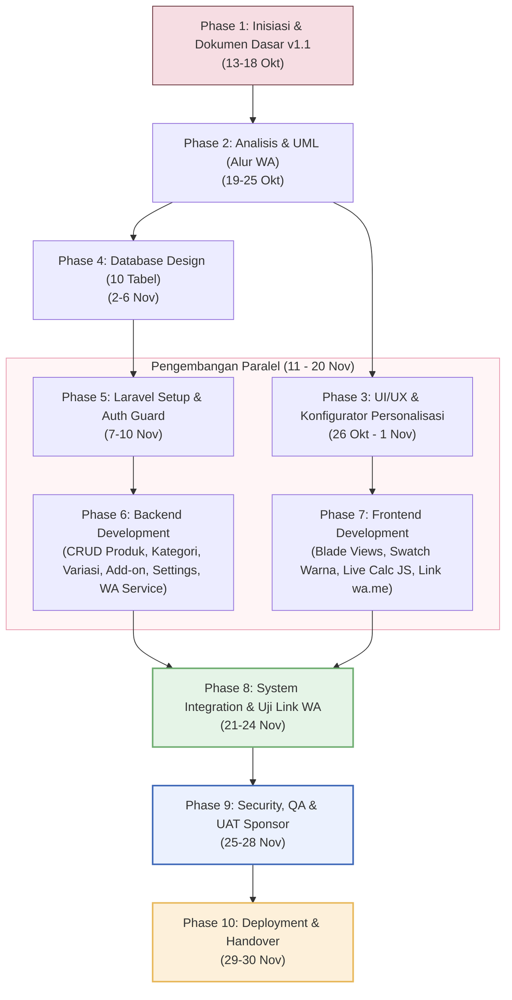

# LAPORAN PEMASTIAN JADWAL PROYEK (PROJECT SCHEDULE VERIFICATION) (v1.1)
## BLOOMÉ — Flowers & Stories
**Task ID:** DOC-004  
**Fase:** Phase 1 — Project Initiation and Documentation  
**Penanggung Jawab:** Jayanti Firdasari (Project Manager & System Analyst)  
**Tanggal Verifikasi:** 13 November 2026  
**Tanggal Revisi Penyelarasan:** 20 November 2026  
**Status Task:** Completed (`[x]`)  
**Dependensi:** DOC-003 — Memeriksa pembagian tugas tim (Selesai)  

---

## 1. Ringkasan Eksekutif

Pemeriksaan dan Pemastian Jadwal Proyek (Task DOC-004) dilakukan untuk memvalidasi kelayakan kerangka waktu (*timeframe feasibility*) pengembangan sistem informasi **BLOOMÉ — Flowers & Stories**. Periode proyek yang ditetapkan dalam Project Charter adalah **13 Oktober 2026 hingga 30 November 2026** (total durasi 49 hari kalender / 7 minggu kerja).

Evaluasi penyelarasan versi 1.1 ini memastikan bahwa seluruh tahapan kerja pada jalur kritis (*Critical Path*), alokasi pekerjaan sekuensial dan paralel, serta titik pemeriksaan kualitas (*Quality Gates*) mencerminkan ruang lingkup teknis yang telah disepakati: **website sebagai katalog interaktif dan media personalisasi buket bunga, dengan alur pemesanan dialihkan langsung ke WhatsApp**.

---

## 2. Rincian Jadwal Fase Proyek (Schedule Baseline v1.1)

Kerangka waktu 7 minggu dibagi ke dalam 10 fase terstruktur dengan alokasi hari kerja sebagai berikut:

| No | Fase Proyek | Tanggal Mulai | Tanggal Selesai | Durasi | Penanggung Jawab |
|:---:|---|---|---|:---:|---|
| **1** | **Phase 1 — Project Initiation & Documentation Baseline v1.1** | 13 Oktober 2026 | 18 Oktober 2026 | 6 hari | Jayanti Firdasari |
| **2** | **Phase 2 — System Analysis & Design (UML Katalog & WA)** | 19 Oktober 2026 | 25 Oktober 2026 | 7 hari | Jayanti Firdasari |
| **3** | **Phase 3 — UI/UX Design (Design System, Mockup, Flow WA)** | 26 Oktober 2026 | 01 November 2026 | 7 hari | Riya Monika |
| **4** | **Phase 4 — Database Design & 10 Table Migrations** | 02 November 2026 | 06 November 2026 | 5 hari | Elsa Futri |
| **5** | **Phase 5 — Laravel Foundation & Admin Auth Guard** | 07 November 2026 | 10 November 2026 | 4 hari | Elsa Futri |
| **6** | **Phase 6 — Backend Development (Core CRUD & WA Service)** | 11 November 2026 | 20 November 2026 | 10 hari | Elsa Futri |
| **7** | **Phase 7 — Frontend Development (Blade, Swatch, Live JS)** | 11 November 2026 | 20 November 2026 | 10 hari | Riya Monika |
| **8** | **Phase 8 — System Integration & WhatsApp Link Testing** | 21 November 2026 | 24 November 2026 | 4 hari | Elsa & Riya |
| **9** | **Phase 9 — Security, QA & User Acceptance Testing (UAT)** | 25 November 2026 | 28 November 2026 | 4 hari | Jayanti Firdasari |
| **10**| **Phase 10 — Deployment, Finalization & Handover** | 29 November 2026 | 30 November 2026 | 2 hari | Seluruh Tim |

---

## 3. Analisis Ketergantungan & Jalur Kritis (Critical Path Method)

Metodologi Waterfall mengharuskan fase inisiasi dan analisis diselesaikan secara sekuensial sebelum pengembangan teknis. Efisiensi waktu dicapai dengan menjalankan Fase 6 (Backend) dan Fase 7 (Frontend) secara paralel setelah basis data 10 tabel dan panduan desain visual terkunci.

### 3.1 Critical Path (Rantai Aktivitas Kritis)
Jalur kritis proyek yang memiliki *zero float* (penundaan pada jalur ini langsung menunda serah terima 30 November):
1. **Penyelesaian Dokumen Persyaratan & PRD v1.1** (Gate 1: 18 Okt)
2. **UML Modeling & Validasi Alur WhatsApp** (25 Okt)
3. **Database Schema & 10 Migrations** (6 Nov)
4. **Laravel Foundation & Admin Auth Guard** (10 Nov)
5. **Backend Core Modules (Produk, Kategori, Variasi, Add-on, Settings, WhatsApp Service)** (20 Nov)
6. **System Integration (Blade terhubung ke Controller, Database, dan Pengalihan URL WhatsApp)** (24 Nov)
7. **Security Review, Functional Testing & Bug Fixing** (28 Nov)
8. **Final Sign-off Sponsor Nabila Febriyani & Handover** (30 Nov)

### 3.2 Pekerjaan Paralel (*Parallel Workstreams*)
- **Fase 6 & Fase 7 (11 – 20 Nov):**
  - Riya Monika membangun antarmuka Blade, CSS, swatch warna wrapping/pita, selector add-on, dan script `personalization.js` berbasis mockup yang sudah disetujui di Fase 3.
  - Elsa Futri mengimplementasikan Controller CRUD produk/kategori, Form Requests, penyimpanan berkas gambar ke storage, dan `WhatsAppUrlBuilderService` secara independen.
  - Kedua stream bertemu secara formal pada tanggal 21 November (Fase 8: Integrasi).

---

## 4. Quality Gate Milestones (Titik Pemeriksaan Kualitas Wajib)

Ditetapkan 6 Quality Gate untuk memastikan setiap fase tuntas secara berkualitas sebelum melangkah ke fase berikutnya:

| Gate | Nama Milestone | Syarat Kelulusan Gate (v1.1) | Batas Waktu |
|:---:|---|---|:---:|
| **Gate 1** | *Requirements Approved* | `requirement.md`, `prd.md`, dan scope baseline v1.1 disetujui tim. | 18 Okt 2026 |
| **Gate 2** | *Design & Modeling Approved* | UML selesai, ERD 10 tabel valid, dan mockup UI/UX katalog disetujui. | 01 Nov 2026 |
| **Gate 3** | *Development Ready* | Struktur Laravel, konfigurasi `.env`, dan 10 migrasi tabel siap dieksekusi. | 10 Nov 2026 |
| **Gate 4** | *Integration Complete* | Seluruh katalog publik, konfigurator personalisasi, dan link WhatsApp terhubung ke backend tanpa error fatal. | 24 Nov 2026 |
| **Gate 5** | *Testing & UAT Approved* | Pengujian live price estimation dan pemicuan WhatsApp 100% lolos, tidak ada bug kritis, sponsor menyetujui hasil UAT. | 28 Nov 2026 |
| **Gate 6** | *Project Handover Completed*| Deployment produksi selesai, dokumentasi lengkap, berita acara serah terima ditandatangani. | 30 Nov 2026 |

---

## 5. Manajemen Risiko Jadwal (*Schedule Risk Management*)

| Potensi Risiko Keterlambatan | Dampak | Strategi Mitigasi / Kontinjensi |
|---|---|---|
| **Keterlambatan Konfirmasi Sponsor (`[Perlu Konfirmasi Owner]`)** | Tertundanya foto produk asli atau nomor WhatsApp definitif | Menggunakan data placeholder katalog realistis dan fallback default nomor toko pada `.env` sehingga arsitektur kode tetap dapat diselesaikan tepat waktu. |
| **Kendala Integrasi WhatsApp URL Scheme pada Browser Tertentu** | Pesan WhatsApp tidak langsung terbuka | Menyediakan mekanisme fallback tautan `https://wa.me/...` standar yang otomatis membuka WhatsApp Web di desktop, serta tombol salin draf teks pesan (*copy to clipboard*). |
| **Ditemukan Defect saat QA** | Mengancam rilis 30 November | Mengalokasikan 4 hari khusus (25–28 Nov) untuk QA dan stabilisasi sistem, serta menjaga ruang lingkup tetap terkendali (*strict scope control* tanpa penambahan fitur liar). |

---

## 6. Kesimpulan & Rekomendasi

### 6.1 Status Task DOC-004
Task **DOC-004 (Memastikan jadwal proyek)** telah diverifikasi dan diselaraskan penuh dengan konsep sistem terbaru v1.1:
- Jadwal dasar (*baseline schedule*) 13 Oktober – 30 November 2026 terbukti realistis, terukur, dan memadai untuk menyelesaikan sistem katalog dan WhatsApp hand-off.
- Jalur kritis dan pekerjaan paralel telah diperbarui sesuai modul etalase dan personalisasi.
- 6 Quality Gate siap diterapkan.
- Kriteria penyelesaian terpenuhi.

### 6.2 Rekomendasi Langkah Berikutnya:
Melanjutkan penyelarasan deliverable penutup pada folder foundation:
- **`DOC-005-documentation-structure.md` — Standar Struktur Direktori Dokumentasi.**
