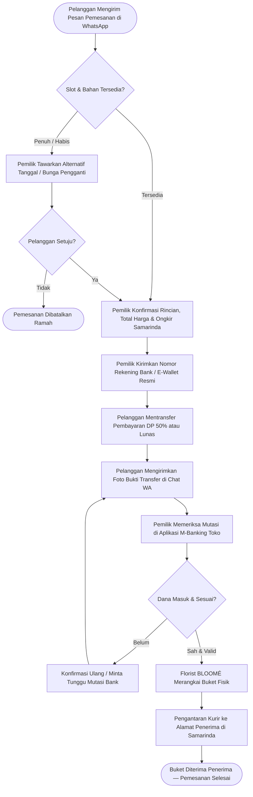

# LAPORAN PENINJAUAN ATURAN BISNIS (BUSINESS RULES & WORKFLOW LOGIC REVIEW) (v1.1)
## BLOOMÉ — Flowers & Stories
**Task ID:** DOC-009  
**Fase:** Phase 1 — Project Initiation and Documentation (Sub-fase 4.2 Requirements Documentation)  
**Penanggung Jawab:** Jayanti Firdasari (Project Manager & System Analyst)  
**Tanggal Peninjauan Awal:** 13 November 2026  
**Tanggal Revisi Penyelarasan:** 20 November 2026  
**Status Task:** Completed (`[x]`)  
**Dependensi:** DOC-008 — Meninjau non-functional requirements (Selesai)  

---

## 1. Ringkasan Eksekutif

Peninjauan Aturan Bisnis (Task DOC-009) dilakukan untuk mengunci seluruh logika operasional, batasan hukum transaksi, kebijakan butik florist, serta alur pemesanan sistem informasi **BLOOMÉ — Flowers & Stories**.

Berdasarkan kesepakatan final baseline **v1.1**:
> **"Website BLOOMÉ berfungsi sebagai katalog interaktif dan media konfigurasi personalisasi buket, sedangkan proses transaksi pemesanan, konfirmasi ketersediaan bahan, negosiasi harga, pembayaran, dan koordinasi pengiriman dilanjutkan secara langsung melalui WhatsApp."**

Hasil peninjauan mengonfirmasi validitas **20 Aturan Bisnis Wajib (BR-001 s/d BR-020)**. Dokumen ini menjadi pedoman mutlak (*mandatory guardrails*) bagi pengembang backend (Elsa Futri) dan frontend (Riya Monika) agar tidak terjadi celah logika (*business logic flaws*) dalam penyusunan draf pesan WhatsApp, penentuan ketersediaan stok, konfigurasi variasi warna, item add-on, dan penanganan transaksi di luar web.

---

## 2. Rincian & Evaluasi 20 Aturan Bisnis Wajib (Business Rules v1.1)

Seluruh aturan bisnis dikelompokkan ke dalam 5 domain operasional:

### 2.1 Domain Pengguna & Akses Sistem (User & Access Control)
| Kode | Pernyataan Aturan Bisnis | Implikasi Teknis & Validasi Sistem |
|---|---|---|
| **BR-001** | Pelanggan mengakses sistem web sebagai tamu (*guest user*) tanpa proses registrasi akun atau login. | Tidak ada tabel/model akun pelanggan di database web. Pelanggan dapat langsung menjelajahi katalog dan mengonfigurasi personalisasi secara bebas. |
| **BR-002** | Sistem web hanya menggunakan 1 (satu) akun administrator yang memegang hak kelola penuh katalog dan konten etalase. | Tabel `admins` di-seed dengan 1 akun kredensial pemilik usaha (Nabila Febriyani). Tidak ada modul multi-role admin atau permission bertingkat. |
| **BR-003** | Website tidak memproses transaksi checkout, tidak menampung pembayaran, dan tidak menyimpan data transaksi di basis data web. | Seluruh pemesanan diteruskan ke WhatsApp melalui tautan URL Scheme `https://wa.me/...`. Tidak ada tabel transaksi pesanan di database web. |

### 2.2 Domain Katalog, Personalisasi & Add-on (Catalog & Personalization)
| Kode | Pernyataan Aturan Bisnis | Implikasi Teknis & Validasi Sistem |
|---|---|---|
| **BR-004** | Produk wajib dikelompokkan ke dalam kategori yang aktif dan terdaftar di basis data. | Tabel `products` berelasi *foreign key* `category_id` ke tabel `categories`. |
| **BR-005** | Harga dasar produk buket dan harga item add-on dikelola oleh admin dan dinyatakan dalam mata uang Rupiah. | Format numerik desimal/integer (IDR). Perubahan harga dikelola admin melalui panel dashboard **[Perlu Konfirmasi Owner]**. |
| **BR-006** | Variasi personalisasi (wrapping, pita, dll.) dan item add-on dapat dikonfigurasikan per produk atau berlaku secara umum. | Relasi many-to-many melalui tabel pivot `product_personalization_options` dan `product_add_ons`. |
| **BR-007** | Total biaya yang dihitung di web merupakan **estimasi harga produk & variasi**; konfirmasi harga akhir dan ongkos kirim Samarinda disepakati melalui WhatsApp. | Kartu ringkasan pesanan wajib menampilkan teks disclaimer transparan kepada pelanggan. |

### 2.3 Domain Pengalihan WhatsApp & Konsultasi Custom (WhatsApp Dispatch)
| Kode | Pernyataan Aturan Bisnis | Implikasi Teknis & Validasi Sistem |
|---|---|---|
| **BR-008** | Teks pesan WhatsApp disusun otomatis oleh sistem web menggunakan pengkodean URL standar (`wa.me` query string). | Menggunakan helper encoding URL (`encodeURIComponent` di JS / `urlencode` di PHP) dengan format teks terstandarisasi. |
| **BR-009** | Pelanggan harus menekan tombol kirim secara manual di aplikasi WhatsApp untuk menyelesaikan inisiasi pemesanan. | Website tidak memiliki kuasa mengirimkan pesan otomatis tanpa persetujuan tindakan sadar dari pelanggan. |
| **BR-010** | Permintaan desain buket custom bebas di luar katalog diarahkan melalui tautan konsultasi chat WhatsApp langsung ke pemilik. | Disediakan tombol CTA khusus di halaman Custom Bouquet yang membuka WhatsApp dengan draf pesan pembuka konsultasi. |

### 2.4 Domain Pembayaran & Kebijakan Transaksi WhatsApp (Off-Web Payment)
| Kode | Pernyataan Aturan Bisnis | Implikasi Teknis & Validasi Sistem |
|---|---|---|
| **BR-011** | Pembayaran dilakukan via transfer bank atau e-wallet melalui informasi nomor rekening yang dikirimkan pemilik via WhatsApp. | Rincian rekening BCA/BRI atau akun e-wallet (DANA, GoPay) diinformasikan langsung oleh pemilik usaha di obrolan WhatsApp **[Perlu Konfirmasi Owner]**. |
| **BR-012** | Bukti transfer pembayaran dikirimkan oleh pelanggan melalui percakapan WhatsApp dan diverifikasi langsung oleh pemilik. | Tidak ada formulir unggah bukti transfer di website. Verifikasi mutasi dilakukan pemilik melalui aplikasi perbankan miliknya. |
| **BR-013** | Skema uang muka (DP) 50% diperbolehkan untuk memulai perangkaian buket, dengan pelunasan sesuai kesepakatan. | Kebijakan DP dan batas waktu pelunasan disepakati bersama pemilik usaha di WhatsApp **[Perlu Konfirmasi Owner]**. |
| **BR-014** | Perubahan spesifikasi pesanan atau negosiasi harga dilakukan secara langsung melalui percakapan WhatsApp. | Website tidak memfasilitasi tawar-menawar harga atau revisi data setelah pesan WhatsApp terkirim. |

### 2.5 Domain Pengantaran, Pembatalan & Pemeliharaan (Delivery, Cancellation & Data)
| Kode | Pernyataan Aturan Bisnis | Implikasi Teknis & Validasi Sistem |
|---|---|---|
| **BR-015** | Layanan pemesanan buket difokuskan untuk pengantaran langsung (*delivery*) area Samarinda. | Koordinasi alamat, jadwal pengantaran, dan ongkos kirim disepakati di WhatsApp; bukan sistem ambil sendiri (*pickup*) **[Perlu Konfirmasi Owner]**. |
| **BR-016** | Pembatalan pesanan wajib dibicarakan via WhatsApp sebelum buket mulai dirangkai dan harus disertai alasan yang jelas. | Website tidak mengelola pengajuan pembatalan mandiri. Pembatalan hanya sah jika disetujui langsung oleh pemilik toko di WhatsApp. |
| **BR-017** | Kebijakan pengembalian dana (*refund policy*) belum ditetapkan secara resmi dan menunggu keputusan pemilik. | Sistem dan dokumentasi dilarang mengarang persentase atau mekanisme refund sebelum disetujui sponsor **[Perlu Konfirmasi Owner]**. |
| **BR-018** | Nomor tujuan WhatsApp resmi dan parameter kontak toko dikelola secara terpusat pada tabel `business_settings`. | Perubahan nomor WhatsApp di dashboard admin langsung memperbarui link tujuan pemesanan di seluruh website secara otomatis. |
| **BR-019** | Berkas foto produk yang diunggah admin wajib berformat JPG, JPEG, PNG, atau WebP dengan batas ukuran yang divalidasi server. | Validasi form request di sisi server dengan batas maksimal ukuran berkas **[Perlu Konfirmasi Owner]** (standar: 2–5 MB). |
| **BR-020** | Kategori tidak dapat dihapus apabila masih memiliki produk yang berelasi aktif di dalamnya (*foreign key restrict*). | Penerapan integritas referensial InnoDB untuk mencegah rusaknya relasi katalog etalase. |

---

## 3. Alur Operasional Transaksi di Luar Website (Off-Web Process Workflow)

Siklus transaksi yang berlangsung setelah pesan WhatsApp diterima oleh pemilik usaha diatur melalui alur operasional berikut:

---

## 4. Evaluasi Konsistensi Logika terhadap Arsitektur Sistem

Peninjauan memvalidasi bahwa seluruh aturan bisnis selaras 100% dengan rancangan sistem v1.1:

1. **Eliminasi Mesin Status di Web:** Penanganan status pesanan tidak lagi dikelola melalui tabel `order_status_histories` di database web, melainkan dijalankan secara fleksibel oleh pemilik toko melalui chat WhatsApp, mengeliminasi beban pemeliharaan sistem backend yang tidak perlu.
2. **Kemandirian Pengelolaan Nomor Kontak (BR-018):** Tabel `business_settings` memberikan fleksibilitas penuh bagi Nabila Febriyani untuk mengganti nomor WhatsApp toko sewaktu-waktu tanpa harus memodifikasi kode sumber aplikasi.
3. **Perlindungan Terhadap Klaim Palsu:** Sistem web dilarang menampilkan klaim konfirmasi sepihak seperti *"Pesanan Anda Telah Berhasil Diterima Toko"* saat tombol diklik. Web hanya mengonfirmasi bahwa draf pesan telah disusun dan dialihkan ke WhatsApp.

---

## 5. Kesimpulan & Rekomendasi

### 5.1 Status Task DOC-009
Task **DOC-009 (Meninjau business rules)** telah selesai diselaraskan ke baseline **v1.1**:
- 20 Aturan Bisnis Wajib (BR-001 s/d BR-020) telah didefinisikan secara tegas, konsisten, dan bebas dari konsep transaksi web lama.
- Batasan tanggung jawab antara website dan komunikasi WhatsApp telah terpetakan jelas.
- Kriteria penyelesaian (*Definition of Done*) terpenuhi 100%.

### 5.2 Rekomendasi Langkah Berikutnya:
Melanjutkan ke task peninjauan berikutnya pada sub-fase 4.2:
- **`DOC-010 — Meninjau acceptance criteria.`**
