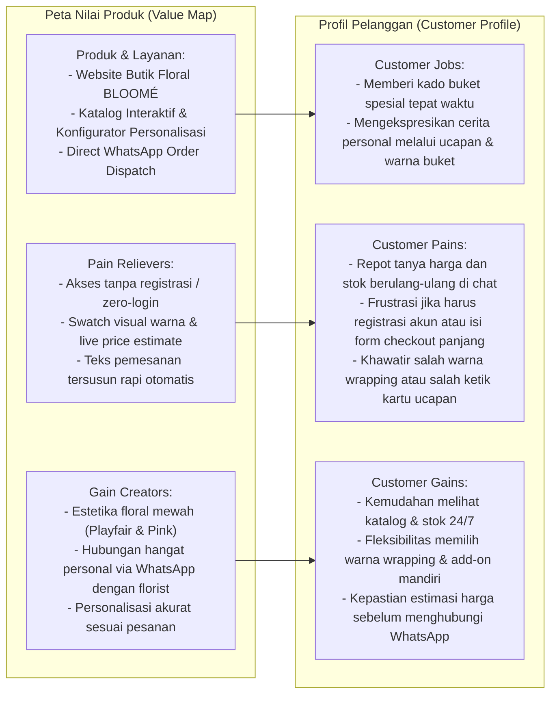

# LAPORAN PENINJAUAN VISI PRODUK (PRODUCT VISION & VALUE PROPOSITION REVIEW)
## BLOOMÉ — Flowers & Stories
**Task ID:** DOC-012  
**Fase:** Phase 1 — Project Initiation and Documentation (Sub-fase 4.3 Product Documentation)  
**Penanggung Jawab:** Jayanti Firdasari (Project Manager & System Analyst)  
**Tanggal Peninjauan:** 13 November 2026 (Diperbarui: 20 November 2026 — Penyelarasan Konsep v1.1)  
**Status Task:** Completed (`[x]`)  
**Dependensi:** DOC-011 — Menyusun `prd.md` (Selesai dan Diselaraskan)  

---

## 1. Ringkasan Eksekutif

Peninjauan Visi Produk (Task DOC-012) dilakukan untuk mengevaluasi ketajaman arah strategis, filosofi nilai (*brand essence*), proposisi nilai (*value proposition*), serta penyelarasan visi produk **BLOOMÉ — Flowers & Stories** terhadap kebutuhan bisnis nyata pemilik usaha (Sponsor Nabila Febriyani) dan preferensi pelanggan di Kota Samarinda.

Hasil peninjauan mengonfirmasi bahwa visi produk telah **KOKOH, KONSISTEN, dan SELARAS** dengan konsep sistem v1.1: **Website BLOOMÉ diposisikan sebagai katalog interaktif dan media personalisasi buket bunga, sedangkan proses pemesanan, konfirmasi harga, pembayaran, negosiasi, dan pengiriman dilanjutkan secara langsung melalui WhatsApp**. Pendekatan ini memadukan keunggulan etalase digital visual modern dengan kehangatan dan fleksibilitas komunikasi langsung dengan sang perangkai bunga (*florist*).

---

## 2. Dekomposisi Visi Produk & Filosofi Merek

### 2.1 Inti Filosofi Merek: *Flowers & Stories*
Buket bunga pada hakikatnya adalah instrumen emosional. Setiap pemesanan selalu membawa sebuah "cerita" personal—baik ungkapan selamat wisuda, perayaan hari jadi (*anniversary*), permohonan maaf, apresiasi rekan kerja, hingga ungkapan belasungkawa.
- **Tantangan Lama:** Komunikasi obrolan chat manual tanpa katalog visual sering kali mereduksi sentuhan personal menjadi transaksi yang melelahkan karena pelanggan harus berulang kali bertanya ketersediaan stok, harga, dan warna kertas wrapping yang ready.
- **Pendekatan Produk BLOOMÉ:** Platform web dirancang dengan nuansa lembut (*soft floral aesthetic*) yang memungkinkan pelanggan mengeksplorasi katalog 24/7, memilih variasi warna wrapping dan pita dengan *swatch visual*, memilih add-on, menuliskan kartu ucapan secara tenang, melihat estimasi harga real-time, lalu beralih ke WhatsApp dengan pesan yang sudah tersusun rapi.

### 2.2 Pernyataan Visi Produk Resmi
> *"Menjadi butik buket bunga digital terdepan di Samarinda yang memberikan pengalaman eksplorasi dan personalisasi buket yang hangat, estetis, transparan, dan interaktif bagi pelanggan melalui website, yang terhubung mulus dengan layanan personal pemilik usaha via WhatsApp dalam merangkai setiap cerita berharga di balik indahnya bunga."*

---

## 3. Posisi Pasar & Keunggulan Kompetitif (Market Positioning)

Di pasar lokal Samarinda dan sekitarnya, mayoritas florist independen masih beroperasi mengandalkan unggahan media sosial Instagram yang tidak terstruktur dan pesan WhatsApp yang tercecer. Peninjauan memetakan keunggulan komparatif BLOOMÉ:

| Aspek Operasional | Florist Konvensional (Status Quo) | BLOOMÉ — Flowers & Stories (Web-Based Catalog & WhatsApp Hand-off) |
|---|---|---|
| **Katalog Produk** | Tercecer dalam feed / highlights IG; harga sering disembunyikan (*"cek DM"*). | Terpusat di etalase web 24/7; harga dasar transparan, kategori rapi, status stok tertera jelas. |
| **Personalisasi Buket** | Diskusi panjang di chat chat menanyakan warna kertas yang tersedia satu per satu. | Konfigurator visual interaktif di web (*color swatches* warna wrapping, varian pita, tema). |
| **Pemilihan Add-on** | Sering lupa ditawarkan oleh penjual atau terlewat dalam teks chat panjang. | Menu pilihan add-on (kartu ucapan khusus, cokelat, boneka) lengkap dengan penambahan harga instan. |
| **Estimasi Biaya** | Pelanggan harus menunggu hitungan kalkulator manual dari penjual di WhatsApp. | Ringkasan estimasi total biaya terhitung otomatis secara live sebelum pesan dikirim. |
| **Format Pemesanan** | Pelanggan mengetik pesan manual yang sering kali tidak lengkap atau membingungkan. | Generator teks WhatsApp otomatis menyusun rincian pesanan secara rapi, baku, dan lengkap. |
| **Permintaan Desain Custom** | Pelanggan bingung cara konsultasi buket di luar katalog. | Tombol direct WhatsApp consultation disediakan khusus untuk mendiskusikan desain kustom secara fleksibel. |
| **Pembayaran & Negosiasi** | Terbatas pada transfer bank tanpa fleksibilitas diskusi personal. | Komunikasi pembayaran (transfer/e-wallet), kesepakatan DP 50%, dan negosiasi dilakukan langsung di WhatsApp. |
| **Konfirmasi Status** | Chat sering tenggelam karena bercampur baur dengan pesanan lain. | Pesan awal yang rapi dari web memudahkan florist mencatat dan mengoordinasikan pengerjaan serta pengiriman. |

---

## 4. Value Proposition Canvas (VPC) Deep Dive

---

## 5. Penyelarasan Strategis Visi terhadap Arsitektur & Aturan Bisnis

Peninjauan memvalidasi bahwa visi produk diharmonisasikan secara sempurna dengan batasan arsitektur teknis dan aturan bisnis yang disepakati:

1. **Visi *Frictionless Access* ↔ Aturan BR-001 (Zero Customer Login & No Web Checkout):**
   - Visi kemudahan berbelanja diwujudkan secara konkret dengan meniadakan pendaftaran akun atau password dan meniadakan formulir checkout bertingkat di web. Pelanggan dapat langsung memilih buket, mengonfigurasi variasi, dan meneruskan pesanan ke WhatsApp dalam hitungan menit.
2. **Visi *Artisan Personalization* ↔ Aturan BR-003, BR-004, & BR-007 (Interactive Configurator & Human Touch):**
   - Visi perangkaian bunga personal dihormati melalui konfigurator variasi (wrapping, pita, add-on, ucapan kartu) di web yang transparan, namun penetapan ketersediaan bahan riil, konfirmasi harga final, dan penyesuaian khusus tetap disepakati secara manusiawi bersama florist Nabila melalui WhatsApp.
3. **Visi *Direct Operational Synergy* ↔ Aturan BR-005, BR-010, & BR-011 (WhatsApp Hand-off & Flexible Settlement):**
   - Website berperan sebagai generator permintaan yang presisi. Seluruh proses penanganan pembayaran (transfer bank / e-wallet), ketentuan DP 50%, negosiasi, dan jadwal pengiriman lokal Samarinda diselesaikan di WhatsApp tanpa beban pemeliharaan infrastruktur payment gateway pihak ketiga.

---

## 6. Kesimpulan & Rekomendasi

### 6.1 Status Task DOC-012
Task **DOC-012 (Meninjau product vision)** telah selesai dilaksanakan:
- Visi produk, positioning pasar di Samarinda, filosofi merek (*Flowers & Stories*), dan proposisi nilai (*Value Proposition Canvas*) telah diselaraskan penuh dengan konsep katalog interaktif dan pemesanan WhatsApp v1.1.
- Kriteria penyelesaian terpenuhi 100%.

### 6.2 Rekomendasi Langkah Berikutnya:
Melanjutkan ke task peninjauan berikutnya pada sub-fase 4.3:
- **`DOC-013 — Meninjau user personas.`**
