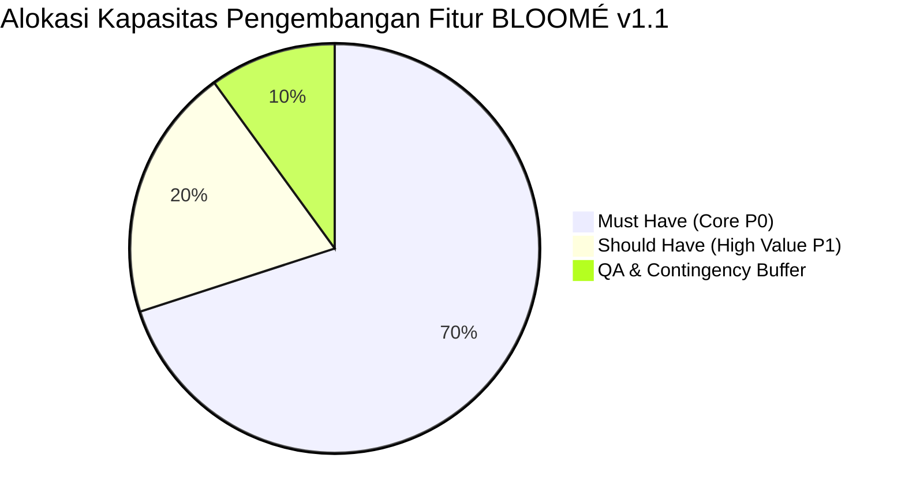

# LAPORAN PENINJAUAN PRIORITAS PRODUK (PRODUCT PRIORITIZATION REVIEW — MoSCoW)
## BLOOMÉ — Flowers & Stories
**Task ID:** DOC-015  
**Fase:** Phase 1 — Project Initiation and Documentation (Sub-fase 4.3 Product Documentation)  
**Penanggung Jawab:** Jayanti Firdasari (Project Manager & System Analyst)  
**Tanggal Peninjauan:** 13 November 2026 (Diperbarui: 20 November 2026 — Penyelarasan Konsep v1.1)  
**Status Task:** Completed (`[x]`)  
**Dependensi:** DOC-011 s/d DOC-014 (Selesai dan Diselaraskan)  

---

## 1. Ringkasan Eksekutif

Peninjauan Prioritas Produk (Task DOC-015) merupakan aktivitas penutup pada sub-fase **4.3 Product Documentation**. Evaluasi ini menerapkan kerangka kerja **MoSCoW Prioritization** (*Must Have, Should Have, Could Have, Won't Have*) terhadap 29 fitur produk resmi pada `prd.md` (F-001 s/d F-029) dan kebutuhan fungsional pada `requirement.md` (FR-001 s/d FR-025).

Penetapan prioritas mutlak ini bertujuan mengunci batasan implementasi teknis bagi Elsa Futri (Backend Developer & DBA) dan Riya Monika (UI/UX Designer & Frontend Developer), mencegah perluasan ruang lingkup liar (*scope creep*), serta memastikan terselesaikannya sistem katalog interaktif dan personalisasi buket berbasis pemesanan WhatsApp secara tepat waktu sebelum batas akhir proyek pada **30 November 2026**.

---

## 2. Matriks Prioritisasi Produk (MoSCoW Framework)

---

### 2.1 MUST HAVE (Prioritas P0 — Non-Negotiable Core)
Fitur pada kelompok ini adalah prasyarat mutlak berjalannya sistem. Tanpa fitur-fitur ini, etalase digital dan alur pemesanan WhatsApp BLOOMÉ tidak dapat berfungsi:

| ID Fitur | Nama Fitur | Justifikasi Bisnis & Nilai Kritis |
|---|---|---|
| **F-001** | Beranda Publik (Homepage) | Titik masuk utama pelanggan; menampilkan identitas merek BLOOMÉ, navigasi kategori, dan alamat butik Samarinda. |
| **F-002** | Katalog Produk & Filter Kategori | Menampilkan etalase buket aktif dengan penyaringan kategori (Buket Bunga, Buket Uang, Buket Snack). |
| **F-003** | Detail Produk & Galeri Foto Multi-Sudut | Menyediakan rincian komposisi rangkaian bunga, harga dasar, dan foto buket resolusi tajam. |
| **F-004** | Badge Ketersediaan Stok | Memberikan indikator jelas (*Tersedia* / *Habis*) dan menonaktifkan tombol pemesanan jika stok kosong. |
| **F-005** | Konfigurator Personalisasi Buket | Fasilitas visual bagi pelanggan memilih opsi variasi (warna wrapping, jenis pita) via *color swatches*. |
| **F-006** | Pemilih Add-on | Memungkinkan pelanggan menambahkan item pendukung (kartu ucapan khusus, cokelat, boneka, topper). |
| **F-007** | Input Catatan Khusus & Teks Ucapan | Kolom penulisan pesan kartu ucapan dan catatan perangkaian personal bagi penerima buket. |
| **F-008** | Kalkulasi Live Estimasi Total Harga | Perhitungan otomatis real-time di sisi antarmuka: `Harga Dasar + Penyesuaian Variasi + Total Add-on`. |
| **F-009** | Generator Teks WhatsApp Otomatis | Penyusunan pesan draf pemesanan secara rapi, baku, dan lengkap berdasarkan konfigurasi pilihan pelanggan. |
| **F-010** | Direct WhatsApp Ordering Hand-off | Tombol "Pesan via WhatsApp" yang membuka tautan `wa.me` langsung ke nomor toko tanpa checkout web. |
| **F-011** | Konsultasi Buket Custom via WhatsApp | Tombol khusus untuk berkonsultasi langsung dengan florist mengenai permintaan desain di luar katalog. |
| **F-015** | Autentikasi Admin Tunggal Aman | Halaman login panel admin terproteksi dengan hashing password bcrypt dan token CSRF. |
| **F-016** | Dashboard Ringkasan Etalase | Kartu metrik total produk aktif, total kategori, opsi personalisasi, item add-on, dan nomor WhatsApp toko. |
| **F-017** | Manajemen Master Kategori (CRUD) | Fasilitas admin mengelola kategori buket dengan validasi nama unik dan proteksi relasi produk. |
| **F-018** | Manajemen Master Produk Buket (CRUD) | Fasilitas admin menambah, mengedit, dan menghapus buket beserta nama, deskripsi, dan harga dasar. |
| **F-019** | Toggle Ketersediaan Stok Produk | Sakelar cepat bagi admin mengubah status produk menjadi *Tersedia* atau *Habis* secara instan. |
| **F-020** | Manajemen Galeri Foto Multi-Upload | Fasilitas multi-upload foto (JPG/PNG ≤ 2MB) dan penetapan satu foto sampul utama (*primary*). |
| **F-021** | Manajemen Opsi Personalisasi & Nilai Variasi | Pengaturan tipe personalisasi dan nilai variasi beserta nominal penyesuaian harganya. |
| **F-022** | Manajemen Master Item Add-on | Fasilitas mengelola nama, harga tambahan, gambar, dan relasi add-on ke produk buket. |
| **F-026** | Konfigurasi Nomor WhatsApp Toko | Pengaturan nomor kontak WhatsApp resmi bisnis toko di tabel `business_settings`. |

---

### 2.2 SHOULD HAVE (Prioritas P1 — Highly Recommended / Fast Follow)
Fitur yang sangat bernilai untuk fleksibilitas operasional dan kenyamanan pengguna, namun sistem inti tetap dapat berjalan jika fitur ini disederhanakan:

| ID Fitur | Nama Fitur | Justifikasi Bisnis & Dampak Operasional |
|---|---|---|
| **F-012** | Pemesanan Multi-Item Buket dalam Satu Pesan WA | Kemampuan memilih beberapa jenis buket ke draf sebelum dikirim ke WA `[Perlu Konfirmasi Owner]`. |
| **F-024** | Template Pesan WhatsApp Konfigurabel | Fasilitas admin mengubah salam pembuka pesan WhatsApp pemesanan di `business_settings`. |
| **F-025** | Pengaturan Jam Operasional & Lokasi Toko | Pengaturan alamat butik dan jam operasional di Samarinda pada `business_settings` untuk footer web. |
| **NFR-UI**| Visual Multi-State Feedback | Ilustrasi ramah saat data kosong (*empty state*), animasi memuat (*loading*), dan alert interaktif. |
| **NFR-RES**| Layout Responsif Layar Smartphone | Penyesuaian tata letak antarmuka mobile-first optimal pada viewport smartphone (360px–414px). |

---

### 2.3 COULD HAVE (Prioritas P2 — Nice to Have / If Time Permits)
Fitur pelengkap yang hanya dikembangkan jika seluruh fitur Must Have dan Should Have telah selesai dan teruji, serta masih tersedia sisa waktu sebelum *code freeze*:

| Fitur Pelengkap | Deskripsi | Batasan Pengerjaan |
|---|---|---|
| **Quick Duplicate Product** | Tombol duplikasi data produk lama di admin untuk mempercepat penambahan varian buket serupa. | Hanya dikembangkan jika Fase 6 selesai lebih cepat dari jadwal. |
| **Printable Order Summary Preview** | Format cetak sederhana (*CSS print stylesheet*) untuk melihat ringkasan konfigurasi sebelum ke WhatsApp. | Fitur opsional non-blocking. |

---

### 2.4 WON'T HAVE (Prioritas P3 — Strictly Excluded in v1.1)
Fitur yang secara formal **DITOLAK dan DITIADAKAN** dari sistem web demi konsistensi konsep katalog WhatsApp hand-off dan kepatuhan jadwal 30 November 2026:

| Fitur Dikecualikan | Alasan Penolakan Tegas |
|---|---|
| **Registrasi / Login Pelanggan** | Membebani pembeli kasual; bertentangan dengan prinsip akses tanpa hambatan (*frictionless guest browsing*). |
| **Formulir Checkout di Web** | Tidak diperlukan karena proses pemesanan dialihkan langsung ke WhatsApp. |
| **Penyimpanan Transaksi Pemesanan di Web** | Database web hanya menyimpan etalase produk dan pengaturan bisnis; transaksi ditangani langsung via WhatsApp. |
| **Manajemen Status Pesanan di Web (ST-01 s/d ST-08)** | Status pesanan, perangkaian, dan pengiriman dikoordinasikan secara fleksibel langsung oleh pemilik melalui obrolan WhatsApp. |
| **Payment Gateway Otomatis** | Memerlukan izin legal merchant dan biaya komisi API; pembayaran dilakukan via transfer bank / e-wallet di WhatsApp. |
| **Unggah Bukti Transfer di Web** | Bukti pembayaran dikirimkan langsung oleh pelanggan ke chat WhatsApp pemilik usaha. |
| **WhatsApp Bot / API Gateway Berbayar** | Mengharuskan biaya langganan API pihak ketiga; interaksi manual dinilai lebih hangat dan personal bagi butik floral. |
| **Pelacakan Pengiriman Live GPS Kurir** | Layanan kurir lokal Samarinda / pickup dikoordinasikan langsung melalui percakapan WhatsApp. |
| **Negosiasi Harga Otomatis di Web** | Negosiasi harga atau kesepakatan DP 50% dibicarakan langsung dengan pemilik usaha via WhatsApp. |
| **Sistem Multi-Role Admin** | Sistem hanya diperuntukkan bagi 1 akun admin utama (pemilik usaha Nabila Febriyani). |

---

## 3. Strategi Alokasi Waktu & Manajemen Kapasitas Tim

Berdasarkan jadwal proyek pada `DOC-004`, dialokasikan 10 hari kerja intensif (11 – 20 November 2026) untuk Fase Pengembangan teknis:
- **70% Kapasitas Kerja (Hari 1 s/d 7):** Fokus 100% menyelesaikan seluruh modul **Must Have (P0)**: katalog, personalisasi swatch, add-on, kalkulator estimasi live, generator WhatsApp, CRUD produk, galeri multi-foto, variasi, dan business settings.
- **20% Kapasitas Kerja (Hari 8 s/d 9):** Integrasi dan penyempurnaan fitur **Should Have (P1)**: multi-item selection draf, pengaturan template WA, dan optimasi tampilan responsif mobile.
- **10% Kapasitas Kerja (Hari 10):** *Buffer freeze*, validasi *data contract*, dan persiapan Fase 8 (Pengujian & Integrasi).
- **Aturan Kontinjensi:** Apabila terjadi kendala tak terduga, fitur Should Have atau Could Have dapat ditunda tanpa boleh mengurangi satupun fitur Must Have.

---

## 4. Kesimpulan & Rekomendasi

### 4.1 Status Task DOC-015
Task **DOC-015 (Meninjau product priorities)** telah selesai dilaksanakan:
- Klasifikasi MoSCoW telah diselaraskan penuh dengan 29 fitur resmi `prd.md` v1.1 dan kebutuhan fungsional `requirement.md` v1.1.
- Seluruh fitur transaksi web yang telah dikecualikan (Won't Have) telah ditegaskan secara transparan.
- Alokasi kapasitas pengembangan dan aturan kontinjensi terkunci.
- Seluruh sub-fase **4.3 Product Documentation (DOC-011 s/d DOC-015) resmi SELESAI 100%**.
- Kriteria penyelesaian terpenuhi 100%.

### 4.2 Rekomendasi Langkah Berikutnya:
Beralih ke fase pengembangan berikutnya sesuai metodologi Waterfall:
- **Fase 5 — Analysis and Design (diawali dengan DOC-016: Menyusun `architecture.md`).**
