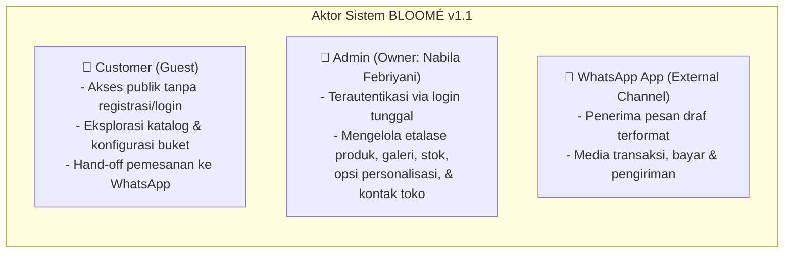
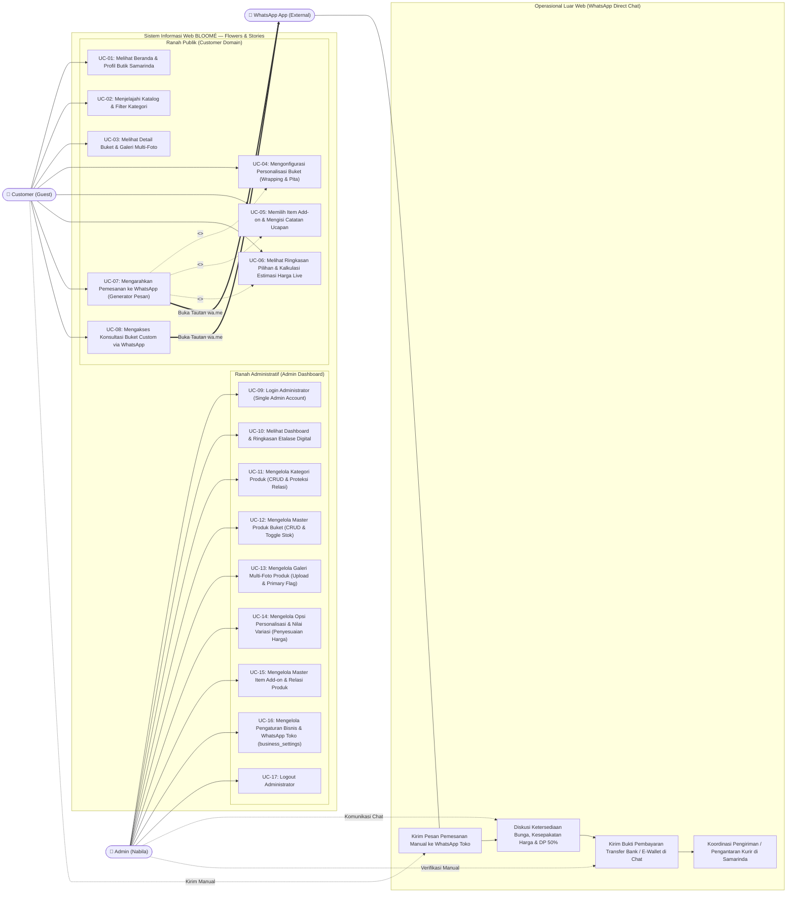

# USE CASE DIAGRAM & SYSTEM INTERACTION SPECIFICATION
## BLOOMÉ — Flowers & Stories
**Task ID:** ANA-001  
**Fase:** Phase 2 — System Analysis and Design (Sub-fase 5.2 System Modeling)  
**Penanggung Jawab:** Jayanti Firdasari (Lead System Analyst & Project Manager)  
**Tanggal Penyusunan:** 13 November 2026 (Diperbarui: 20 November 2026 — Penyelarasan Konsep v1.1)  
**Status Task:** Completed (`[x]`)  
**Dependensi:** DOC-006 s/d DOC-015 (Phase 1 Requirements Selesai dan Diselaraskan)  

---

## 1. Ringkasan Eksekutif

Pemodelan Diagram Use Case (Task ANA-001) mengawali **Phase 2 — System Analysis and Design**. Dokumen ini menetapkan batas sistem (*system boundary*), mendefinisikan aktor pengguna, serta memetakan seluruh kapabilitas fungsional yang dapat dieksekusi oleh pengguna pada website **BLOOMÉ — Flowers & Stories**.

Sesuai dengan keputusan final tim (Konsep Sistem v1.1), sistem informasi BLOOMÉ dirancang sebagai **katalog interaktif dan media konfigurasi personalisasi buket bunga, sedangkan proses pemesanan resmi, konfirmasi harga, pembayaran, negosiasi, dan pengiriman dilanjutkan secara langsung melalui WhatsApp**.

Diagram use case ini memodelkan interaksi antara dua aktor utama dan satu sistem eksternal:
1. **Customer (Pelanggan):** Aktor publik tanpa login (*guest*) yang berinteraksi untuk menelusuri katalog, melihat galeri foto, memilih variasi personalisasi (*color swatches*), memilih add-on, mengisi catatan khusus/ucapan, melihat kalkulasi estimasi harga secara real-time, meneruskan pemesanan ke WhatsApp (*hand-off*), atau berkonsultasi mengenai buket custom di luar katalog melalui WhatsApp.
2. **Admin (Pemilik Usaha):** Aktor terautentikasi tunggal (Nabila Febriyani) yang mengendalikan etalase digital melalui dashboard: mengelola produk & kategori, mengunggah galeri multi-foto, mengatur variasi personalisasi & add-on, mengubah status ketersediaan stok produk, serta mengonfigurasi nomor WhatsApp dan informasi bisnis toko.
3. **Aplikasi WhatsApp (External Communication Channel):** Media komunikasi di luar sistem web tempat pelanggan mengirim pesan pesanan secara manual, mendiskusikan ketersediaan bunga riil, melakukan pembayaran transfer bank / e-wallet, menyepakati DP 50%, dan mengoordinasikan jadwal pengiriman di Samarinda.

---

## 2. Aktor Sistem (System Actors)

| Nama Aktor | Tipe Aktor | Deskripsi Peran & Batasan Hak Akses |
|---|---|---|
| **Customer** | Primer (*Human User*) | Pengguna umum/pelanggan yang mengakses website secara bebas tanpa perlu mendaftar atau login (*zero-login*). Berhak melihat katalog, menyaring kategori, melihat detail & galeri multi-foto, memilih opsi variasi personalisasi (wrapping, pita), memilih add-on, menuliskan kartu ucapan, melihat ringkasan estimasi harga live, menekan tombol "Pesan via WhatsApp", dan menekan tombol "Konsultasi Buket Custom via WhatsApp". Tidak memiliki akses ke panel admin. |
| **Admin** | Primer (*Human User*) | Pemilik usaha BLOOMÉ (Nabila Febriyani) yang memiliki akses administratif penuh melalui otentikasi login aman (Bcrypt & token CSRF). Berhak mengelola master kategori, master produk, galeri multi-foto, toggle ketersediaan stok, opsi personalisasi & nilai variasi, master add-on & penautannya, serta pengaturan nomor WhatsApp dan profil butik di tabel `business_settings`. |
| **WhatsApp App** | Eksternal (*External App*) | Saluran komunikasi obrolan mandiri di luar sistem web yang menerima pesan teks pesanan terformat otomatis dari website melalui URL protocol `wa.me`. Seluruh interaksi lanjutan (konfirmasi stok, negosiasi, bukti transfer manual, update pembuatan buket, dan pengiriman) dilakukan di dalam saluran ini. |

---

## 3. Diagram Use Case Sistem Lengkap (Mermaid Use Case Diagram)

---

## 4. Rincian Paket Use Case Sistem

### 4.1 Paket 1: Eksplorasi Katalog & Personalisasi (Customer Domain)
1. **UC-01: Melihat Beranda & Profil Butik Samarinda:** Mengakses informasi profil butik BLOOMÉ di Samarinda, hero banner floral, sorotan produk unggulan, dan alamat fisik butik tanpa form login.
2. **UC-02: Menjelajahi Katalog & Filter Kategori:** Menampilkan kartu produk buket aktif dan menyaring katalog berdasarkan kategori (Buket Bunga, Buket Uang, Buket Snack, dll.).
3. **UC-03: Melihat Detail Buket & Galeri Multi-Foto:** Menampilkan komposisi rangkaian buket, galeri foto resolusi tajam dari berbagai sudut, deskripsi bahan, harga dasar resmi, dan badge ketersediaan stok (*Tersedia* / *Habis*).
4. **UC-04: Mengonfigurasi Personalisasi Buket (Wrapping & Pita):** Memilih kombinasi warna kertas pembungkus (*wrapping paper*) dan pita satin melalui pemilih visual (*color swatches* / radio buttons) yang langsung memperbarui pilihan.
5. **UC-05: Memilih Item Add-on & Mengisi Catatan Ucapan:** Memilih satu atau lebih item pelengkap (kartu ucapan premium, boneka wisuda, cokelat, lampu LED) dan mengetikkan pesan ucapan khusus bagi penerima buket.
6. **UC-06: Melihat Ringkasan Pilihan & Kalkulasi Estimasi Harga Live:** Meninjau rangkuman seluruh pilihan buket, variasi, dan add-on beserta kalkulasi total estimasi biaya secara otomatis di antarmuka web.
7. **UC-07: Mengarahkan Pemesanan ke WhatsApp (Generator Pesan):** Menekan tombol "Pesan via WhatsApp" yang menyusun pesan teks draf terstruktur rapi dan membuka tautan protokol `wa.me` ke nomor resmi toko tanpa menyimpan transaksi di basis data web.
8. **UC-08: Mengakses Konsultasi Buket Custom via WhatsApp:** Menekan tombol tautan khusus untuk memulai percakapan WhatsApp dengan florist guna mendiskusikan rancangan buket di luar katalog.

### 4.2 Paket 2: Pengelolaan Etalase Digital & Pengaturan Toko (Admin Domain)
1. **UC-09: Login Administrator:** Memasukkan email dan password terdaftar pada tabel `admins` untuk mendapatkan token sesi akses dashboard yang terenkripsi dan terlindungi CSRF.
2. **UC-10: Melihat Dashboard & Ringkasan Etalase Digital:** Memantau metrik statistik katalog: jumlah produk aktif, jumlah kategori, opsi personalisasi aktif, item add-on aktif, dan nomor WhatsApp toko yang sedang aktif.
3. **UC-11: Mengelola Kategori Produk (CRUD & Proteksi Relasi):** Menambah, mengubah nama/slug kategori, dan menghapus kategori dengan proteksi integritas agar kategori yang masih memuat produk aktif tidak terhapus.
4. **UC-12: Mengelola Master Produk Buket (CRUD & Toggle Stok):** Menambah buket baru lengkap dengan nama, deskripsi, harga dasar, dan sakelar cepat toggle ketersediaan (*In Stock* / *Out of Stock*).
5. **UC-13: Mengelola Galeri Multi-Foto Produk:** Mengunggah beberapa berkas foto produk (JPG/PNG ≤ 2MB), menetapkan urutan tampil (*sort order*), menandai foto sampul utama (*primary flag*), dan menghapus foto lama pada tabel `product_images`.
6. **UC-14: Mengelola Opsi Personalisasi & Nilai Variasi:** Mengonfigurasi tipe opsi personalisasi (pada tabel `personalization_options`), menautkannya ke produk, serta menetapkan nilai variasi, kode warna HEX swatch, dan nominal penyesuaian harga tambahan pada tabel `personalization_values`.
7. **UC-15: Mengelola Master Item Add-on & Relasi Produk:** Menambah dan mengedit master add-on (tabel `add_ons`) beserta harga satuan dan fotonya, serta menautkannya ke produk buket tertentu pada tabel pivot `product_add_ons`.
8. **UC-16: Mengelola Pengaturan Bisnis & WhatsApp Toko:** Memperbarui parameter kontak dinamis toko pada tabel `business_settings` (nomor WhatsApp tujuan pesanan, template pesan pembuka, jam operasional, dan alamat butik di Samarinda).
9. **UC-17: Logout Administrator:** Mengakhiri sesi login secara aman dengan menginvalidasi token sesi server.

---

## 5. Matriks Ketertelusuran Kebutuhan Fungsional ke Use Case (Traceability Matrix)

| Kebutuhan Fungsional (SRS v1.1) | ID Use Case | Deskripsi Use Case Terkait |
|---|---|---|
| **FR-001 (Homepage Display)** | `UC-01` | Melihat Beranda & Profil Butik Samarinda |
| **FR-002 (Catalog Browsing & Category Filter)** | `UC-02` | Menjelajahi Katalog & Filter Kategori |
| **FR-003 (Product Detail & Multi-Image Gallery)** | `UC-03` | Melihat Detail Buket & Galeri Multi-Foto |
| **FR-004 (Stock Availability Badge)** | `UC-03` | Melihat Detail Buket & Galeri Multi-Foto |
| **FR-005 (Interactive Personalization Configurator)** | `UC-04` | Mengonfigurasi Personalisasi Buket (Wrapping & Pita) |
| **FR-006 (Add-on Selector)** | `UC-05` | Memilih Item Add-on & Mengisi Catatan Ucapan |
| **FR-007 (Custom Note & Greeting Card Input)** | `UC-05` | Memilih Item Add-on & Mengisi Catatan Ucapan |
| **FR-008 (Live Price Estimation Summary)** | `UC-06` | Melihat Ringkasan Pilihan & Kalkulasi Estimasi Harga Live |
| **FR-009 (Multi-Item Bouquet Selection Draft)** | `UC-06` | Melihat Ringkasan Pilihan & Kalkulasi Estimasi Harga Live `[Perlu Konfirmasi Owner]` |
| **FR-010 (WhatsApp Order Message Generator)** | `UC-07` | Mengarahkan Pemesanan ke WhatsApp (Generator Pesan) |
| **FR-011 (Direct WhatsApp Ordering Hand-off)** | `UC-07` | Mengarahkan Pemesanan ke WhatsApp (Generator Pesan) |
| **FR-012 (Direct Custom Bouquet Consultation Link)** | `UC-08` | Mengakses Konsultasi Buket Custom via WhatsApp |
| **FR-013 (Single Admin Secure Authentication)** | `UC-09`, `UC-17` | Login & Logout Administrator |
| **FR-014 (Admin Dashboard Catalog Overview)** | `UC-10` | Melihat Dashboard & Ringkasan Etalase Digital |
| **FR-015 (Category Management - CRUD)** | `UC-11` | Mengelola Kategori Produk (CRUD & Proteksi Relasi) |
| **FR-016 (Product Management - CRUD)** | `UC-12` | Mengelola Master Produk Buket (CRUD & Toggle Stok) |
| **FR-017 (Product Stock Availability Toggle)** | `UC-12` | Mengelola Master Produk Buket (CRUD & Toggle Stok) |
| **FR-018 (Product Multi-Photo Gallery Management)** | `UC-13` | Mengelola Galeri Multi-Foto Produk (Upload & Primary Flag) |
| **FR-019 (Personalization Type Management)** | `UC-14` | Mengelola Opsi Personalisasi & Nilai Variasi |
| **FR-020 (Personalization Values & Price Adjustment)** | `UC-14` | Mengelola Opsi Personalisasi & Nilai Variasi |
| **FR-021 (Product-Personalization Association)** | `UC-14` | Mengelola Opsi Personalisasi & Nilai Variasi |
| **FR-022 (Add-on Items Management - CRUD)** | `UC-15` | Mengelola Master Item Add-on & Relasi Produk |
| **FR-023 (Product-Add-on Association)** | `UC-15` | Mengelola Master Item Add-on & Relasi Produk |
| **FR-024 (WhatsApp Store Number Configuration)** | `UC-16` | Mengelola Pengaturan Bisnis & WhatsApp Toko |
| **FR-025 (Store Profile & Message Template Settings)** | `UC-16` | Mengelola Pengaturan Bisnis & WhatsApp Toko |

---

## 6. Kesimpulan & Rekomendasi

### 6.1 Status Task ANA-001
Task **ANA-001 (Use Case Diagram)** telah selesai diselaraskan:
- Batas sistem (*system boundary*) secara tegas memisahkan peranan website (katalog interaktif & konfigurator) dengan peranan aplikasi WhatsApp (transaksi, pembayaran, dan koordinasi pengiriman).
- 17 Use Case resmi (UC-01 s/d UC-17) telah dipetakan secara presisi menghubungkan aktor *Customer (Guest)* dan *Admin (Nabila)* ke seluruh 25 kebutuhan fungsional (FR-001 s/d FR-025).
- Seluruh Use Case usang yang menggambarkan checkout web, mutasi transfer di web, dan approval status transaksi web telah dieliminasi.
- Kriteria penyelesaian (*Definition of Done*) terpenuhi 100%.

### 6.2 Rekomendasi Langkah Berikutnya:
Melanjutkan ke task pemodelan deskripsi rincian:
- **`ANA-002 — Use Case Descriptions.`**
