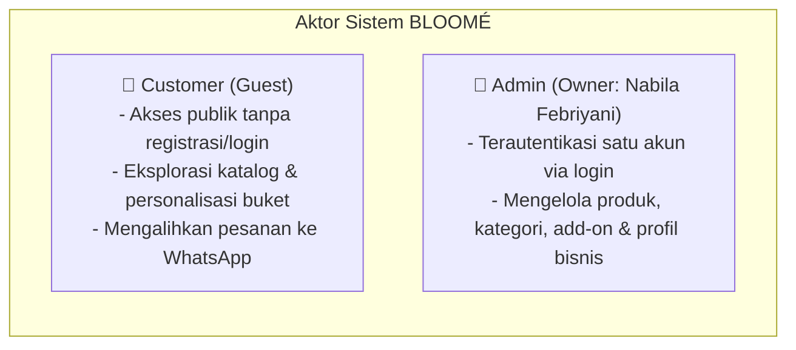
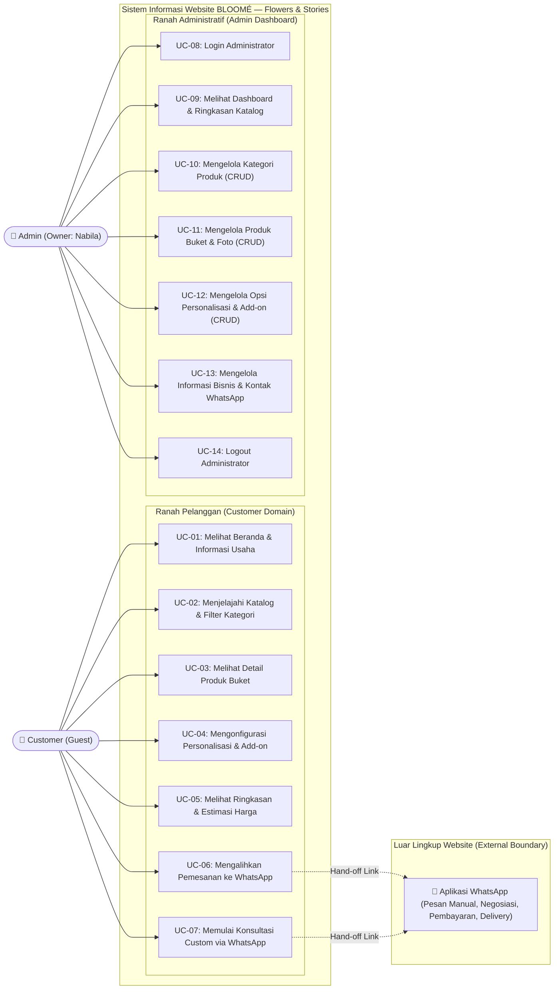

# USE CASE DIAGRAM & SYSTEM INTERACTION SPECIFICATION
## BLOOMÉ — Flowers & Stories
**Task ID:** ANA-001  
**Fase:** Phase 2 — System Analysis and Design (Sub-fase 5.2 System Modeling)  
**Penanggung Jawab:** Jayanti Firdasari (Lead System Analyst & Project Manager)  
**Tanggal Penyusunan:** 13 November 2026 (Revisi Final: 20 November 2026)  
**Status Task:** Completed Final (`[x]`)  
**Dokumen Acuan:** `requirement.md`, `prd.md`, `docs/01-foundation/`, `docs/02-requirements/`  

---

## 1. Ringkasan Eksekutif & Batasan Sistem

Dokumen pemodelan Diagram Use Case (Task ANA-001) menetapkan batas sistem (*system boundary*), mendefinisikan aktor pengguna, serta memetakan seluruh kapabilitas fungsional yang dapat dieksekusi oleh pengguna pada website **BLOOMÉ — Flowers & Stories**.

Sesuai dengan arahan perancangan terbaru:
1. **Hakikat Sistem:** Website BLOOMÉ berfungsi sebagai **katalog interaktif dan media personalisasi buket bunga** yang memfasilitasi eksplorasi visual, pemilihan kustomisasi, pemilihan *add-on*, dan penghitungan estimasi harga.
2. **Batas Transaksi & Alur WhatsApp:** Website **TIDAK** menyediakan keranjang belanja checkout, penyimpanan transaksi pesanan resmi di basis data, *payment gateway*, unggah bukti transfer, manajemen status pesanan, maupun pelacakan pengiriman. Titik akhir dari proses pemesanan di website adalah **pengalihan pemesanan ke WhatsApp (*WhatsApp Order Hand-off*)** dengan pesan terformat otomatis (*pre-filled message*).
3. **Kesepakatan & Pembayaran Luar Sistem (*Out-of-Band*):** Konfirmasi ketersediaan bahan, finalisasi harga, pertukaran foto referensi custom, instruksi transfer perbankan, verifikasi pembayaran manual oleh florist, serta koordinasi pengiriman (*delivery*) berlangsung sepenuhnya secara manual di WhatsApp.
4. **Peran Administrator Tunggal:** Admin hanya memiliki **satu akun** yang difokuskan untuk mengelola master data katalog, kategori, produk buket, opsi personalisasi, add-on, ketersediaan stok, dan informasi kontak bisnis.

---

## 2. Identifikasi Aktor Sistem (System Actors)

| Nama Aktor | Tipe Aktor | Deskripsi Peran & Hak Akses |
|---|---|---|
| **Customer** | Primer (*Human User*) | Pengguna umum/pelanggan yang mengakses website tanpa perlu mendaftar atau masuk (*zero login*). Berhak melihat profil butik, menelusuri katalog, memfilter kategori, melihat detail produk, memilih variasi personalisasi & add-on, melihat estimasi total harga, serta mengklik tombol pemesanan untuk mengirimkan rincian pesanan ke WhatsApp resmi BLOOMÉ. |
| **Admin** | Primer (*Human User*) | Pemilik usaha BLOOMÉ (Nabila Febriyani) yang mengendalikan konten website melalui dashboard terproteksi. Berhak mengelola kategori buket, menambah/mengubah/menghapus produk buket beserta foto, mengelola ketersediaan stok (*is_available*), mengelola opsi personalisasi & add-on beserta tarif dasarnya, serta memperbarui informasi profil usaha dan nomor WhatsApp resmi. |

---

## 3. Diagram Use Case Sistem Lengkap (Mermaid Use Case Diagram)

---

## 4. Rincian Paket Use Case Sistem

### 4.1 Paket 1: Ranah Pelanggan (Customer Domain)
1. **UC-01: Melihat Beranda & Informasi Usaha:** Mengakses profil butik BLOOMÉ Samarinda, nilai keunggulan (*Flowers & Stories*), showcase produk favorit, pengumuman promo, jam buka butik, alamat fisik di Samarinda, serta ketentuan awal layanan delivery.
2. **UC-02: Menjelajahi Katalog & Filter Kategori:** Menampilkan etalase buket aktif dalam tampilan grid responsif dan memfilter produk berdasarkan kategori bunga segar (*fresh flowers*), bunga tiruan (*artificial*), buket uang (*money bouquet*), atau buket makanan ringan (*snack bouquet*).
3. **UC-03: Melihat Detail Produk Buket:** Membuka lembar detail produk untuk memeriksa galeri foto beresolusi tinggi, nama varian, harga dasar katalog, deskripsi bahan/rangkaian bunga, dan status ketersediaan (*Tersedia / Stok Habis*).
4. **UC-04: Mengonfigurasi Personalisasi & Add-on:** Memilih opsi kustomisasi buket yang disediakan (pilihan warna kertas pembungkus/wrapping, warna pita satin), memilih item pelengkap/add-on berbayar (kartu ucapan khusus, boneka wisuda, cokelat, lampu LED), serta mengisi teks pesan kartu ucapan.
5. **UC-05: Melihat Ringkasan & Estimasi Harga:** Meninjau rangkuman rincian buket yang telah dikonfigurasi, mencakup harga dasar produk, total biaya add-on tambahan, estimasi total belanja, tanggal kebutuhan, dan alamat tujuan delivery di Samarinda.
6. **UC-06: Mengalihkan Pemesanan ke WhatsApp:** Sistem mengompilasi seluruh konfigurasi pesanan ke dalam format teks pesan terstruktur (*pre-filled message*), kemudian membuka aplikasi WhatsApp melalui skema URL universal (`https://wa.me/`) langsung ke nomor resmi florist.
7. **UC-07: Memulai Konsultasi Custom via WhatsApp:** Menghubungi florist secara langsung melalui tombol konsultasi cepat WhatsApp pada halaman khusus personalisasi fleksibel untuk mendiskusikan anggaran, pengiriman foto referensi custom, dan ide desain unik.

### 4.2 Paket 2: Ranah Administratif (Admin Domain)
1. **UC-08: Login Administrator:** Memasukkan email dan kata sandi terenkripsi (Bcrypt) untuk mendapatkan sesi akses panel kontrol admin tunggal.
2. **UC-09: Melihat Dashboard & Ringkasan Katalog:** Memantau metrik ringkasan konten website, seperti total kategori aktif, total produk terdaftar, produk berstatus habis, dan total opsi add-on.
3. **UC-10: Mengelola Kategori Produk (CRUD):** Menambah, melihat, mengubah nama dan deskripsi kategori, serta menghapus kategori buket dengan proteksi integritas jika masih memuat produk.
4. **UC-11: Mengelola Produk Buket & Foto (CRUD):** Menambah produk buket baru, mengunggah foto produk ke media penyimpanan lokal (`storage/app/public/products/`), mengubah harga dasar, menyunting deskripsi, dan mengaktifkan/menonaktifkan ketersediaan stok (*In Stock* / *Out of Stock*).
5. **UC-12: Mengelola Opsi Personalisasi & Add-on (CRUD):** Mengelola daftar opsi kustomisasi dan add-on yang tampil di halaman pelanggan, termasuk nama add-on, tarif harga tambahan, dan status ketersediaan item.
6. **UC-13: Mengelola Informasi Bisnis & Kontak WhatsApp:** Memperbarui nomor telepon WhatsApp resmi butik yang menjadi tujuan redirect pemesanan, alamat fisik butik Samarinda, tautan media sosial, dan catatan kebijakan operasional.
7. **UC-14: Logout Administrator:** Mengakhiri sesi administrasi secara aman dan menginvalidasi token sesi peramban.

---

## 5. Matriks Ketertelusuran Kebutuhan Fungsional ke Use Case (Traceability Matrix)

| Kebutuhan Fungsional (SRS Baseline) | ID Use Case | Deskripsi Use Case Terkait | Keterangan Batas Sistem |
|---|---|---|---|
| **Eksplorasi Beranda & Profil** | `UC-01` | Melihat Beranda & Informasi Usaha | Sisi Website (Publik) |
| **Katalog & Penapisan Kategori** | `UC-02` | Menjelajahi Katalog & Filter Kategori | Sisi Website (Publik) |
| **Detail Produk & Komposisi** | `UC-03` | Melihat Detail Produk Buket | Sisi Website (Publik) |
| **Personalisasi & Add-on Buket** | `UC-04` | Mengonfigurasi Personalisasi & Add-on | Sisi Website (Interaktif) |
| **Kalkulasi Estimasi Harga** | `UC-05` | Melihat Ringkasan & Estimasi Harga | Sisi Website (Client/Server Calc) |
| **Hand-off Pemesanan WhatsApp** | `UC-06` | Mengalihkan Pemesanan ke WhatsApp | Jembatan Website $\rightarrow$ WhatsApp |
| **Konsultasi Custom Eksternal** | `UC-07` | Memulai Konsultasi Custom via WhatsApp | Jembatan Website $\rightarrow$ WhatsApp |
| **Otentikasi Admin Tunggal** | `UC-08`, `UC-14` | Login & Logout Administrator | Sisi Website (Admin Guard) |
| **Ringkasan Metrik Katalog** | `UC-09` | Melihat Dashboard & Ringkasan Katalog | Sisi Website (Admin Back-Office) |
| **Manajemen Kategori Buket** | `UC-10` | Mengelola Kategori Produk (CRUD) | Sisi Website (Admin Back-Office) |
| **Manajemen Produk & Foto** | `UC-11` | Mengelola Produk Buket & Foto (CRUD) | Sisi Website (Admin Back-Office) |
| **Manajemen Add-on & Personalisasi**| `UC-12` | Mengelola Opsi Personalisasi & Add-on | Sisi Website (Admin Back-Office) |
| **Manajemen Kontak & Profil Bisnis**| `UC-13` | Mengelola Informasi Bisnis & WhatsApp | Sisi Website (Admin Back-Office) |

---

## 6. Penegasan Batas Alur Transaksi & Kebijakan Operasional

1. **Peniadaan Transaksi pada Website:**
   - Tidak ada entitas `orders`, `payments`, atau `order_status_histories` yang dibuat atau dimutasi melalui website.
   - Website berfungsi murni sebagai etalase pintar dan kalkulator konfigurasi buket bunga yang mempermudah pembeli merangkai pesanannya sebelum diteruskan ke kasir/florist.
2. **Kebijakan Layanan Pengiriman (Delivery):**
   - Keputusan awal layanan disepakati berbentuk **delivery** ke alamat penerima di Samarinda dan sekitarnya (bukan *self-pickup* di butik).
   - Penentuan kurir dan rincian ongkos kirim: `[Perlu Konfirmasi Owner]`.
3. **Penyelesaian Transaksi:**
   - Negosiasi harga khusus, transfer uang ke rekening bank, bukti mutasi, dan pelacakan kurir diselesaikan langsung antara pembeli dan Nabila Febriyani di ruang obrolan WhatsApp.

---

## 7. Kesimpulan
Task **ANA-001 (Use Case Diagram)** telah selesai direkonstruksi penuh. Diagram dan batasan sistem 100% konsisten dengan paradigma katalog interaktif dan pengalihan pemesanan ke WhatsApp.
