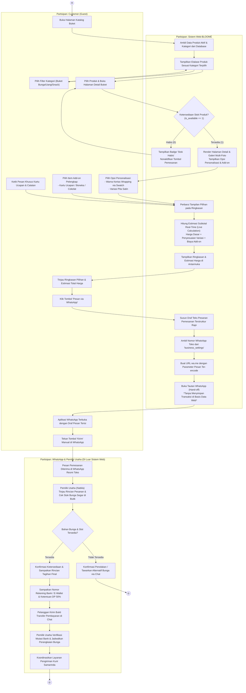

# ACTIVITY DIAGRAM KATALOG, PERSONALISASI, DAN PEMESANAN VIA WHATSAPP
## BLOOMÉ — Flowers & Stories
**Task ID:** ANA-003  
**Fase:** Phase 2 — System Analysis and Design (Sub-fase 5.2 System Modeling)  
**Penanggung Jawab:** Jayanti Firdasari (Lead System Analyst & Project Manager)  
**Tanggal Penyusunan:** 13 November 2026 (Diperbarui: 20 November 2026 — Penyelarasan Konsep v1.1)  
**Status Task:** Completed (`[x]`)  
**Dependensi:** ANA-002 — Use Case Description (Selesai dan Diselaraskan)  

---

## 1. Ringkasan Eksekutif

Pemodelan Diagram Aktivitas Pemesanan Katalog dan Personalisasi (Task ANA-003) dilakukan untuk menggambarkan aliran kerja dinamis (*dynamic workflow*), percabangan keputusan (*decision points*), serta pembagian peran (*swimlanes*) dalam proses eksplorasi katalog, konfigurasi personalisasi, kalkulasi estimasi harga, hingga pengalihan pemesanan ke WhatsApp pada website **BLOOMÉ — Flowers & Stories**.

Sesuai dengan konsep sistem terbaru (v1.1), sistem informasi BLOOMÉ difokuskan sebagai **katalog interaktif dan media konfigurasi personalisasi buket, sedangkan pencatatan pesanan resmi, verifikasi pembayaran, negosiasi harga, dan koordinasi pengiriman dilakukan secara langsung melalui WhatsApp**. 

Diagram ini memetakan koordinasi aktivitas antara tiga partisipan:
1. **Customer (Pelanggan):** Berbelanja langsung tanpa login (*zero-login*), memilih buket, mengonfigurasi variasi, dan mengirimkan pesan pemesanan secara manual di WhatsApp.
2. **Sistem Web BLOOMÉ:** Menangani penyajian katalog dari database, validasi stok produk, konfigurator visual (*color swatches*), kalkulasi harga live di antarmuka pengguna, pembuatan pesan terstruktur otomatis, dan pengalihan ke WhatsApp.
3. **WhatsApp & Pemilik Usaha (Di Luar Sistem Web):** Menerima pesan pemesanan di aplikasi WhatsApp toko, mengonfirmasi stok fisik bunga segar di butik, menyepakati harga final & pembayaran (transfer bank / e-wallet, DP 50%), serta mengatur jadwal pengiriman di Samarinda.

---

## 2. Diagram Aktivitas Pemesanan Katalog & Personalisasi (Swimlane Activity Diagram)

---

## 3. Penjelasan Batas Sistem & Tanggung Jawab Alur

### 3.1 Ranah Sistem Web (Presentation & Calculation)
1. **Navigasi & Visualisasi:** Menampilkan katalog produk, galeri multi-foto, dan filter kategori secara cepat.
2. **Konfigurasi Interaktif:** Memungkinkan pelanggan memilih swatch warna kertas wrapping, pita, serta mencentang item add-on (kartu ucapan, boneka, cokelat).
3. **Kalkulasi Live:** Menghitung total estimasi biaya secara otomatis di antarmuka pengguna tanpa memuat ulang halaman (*zero page reload*).
4. **Generator Pesan:** Menyusun draf pesan pemesanan yang rapi dan baku berdasarkan pilihan pelanggan.
5. **Hand-off Murni:** Mengalihkan pengguna ke tautan `https://wa.me/{nomor_toko}?text={encoded_message}`. Website **tidak menyimpan record transaksi atau membuat invoice resmi** di basis data.

### 3.2 Ranah WhatsApp (Transaction & Fulfillment)
1. **Pengiriman Pesan Mandiri:** Pelanggan menekan tombol "Kirim" secara manual di aplikasi WhatsApp mereka.
2. **Konfirmasi Stok Riil:** Pemilik usaha memeriksa ketersediaan bunga segar riil dan kesiapan slot perangkaian sebelum menyetujui pesanan.
3. **Penyelesaian Pembayaran:** Rincian rekening bank resmi (BCA/BRI/Mandiri) atau e-wallet (DANA/GoPay), persetujuan pembayaran uang muka (DP 50%) `[Perlu Konfirmasi Owner]`, serta verifikasi mutasi transfer dilakukan langsung di WhatsApp.
4. **Pengiriman Lokal Samarinda:** Jadwal pengantaran kurir di wilayah Samarinda dikoordinasikan secara fleksibel melalui obrolan chat.

---

## 4. Kesimpulan & Rekomendasi

### 4.1 Status Task ANA-003
Task **ANA-003 (Activity Diagram Pemesanan Katalog)** telah selesai diselaraskan:
- Alur kerja checkout web fiktif telah dieliminasi dan digantikan dengan alur katalog interaktif, konfigurator personalisasi, live calculation, dan WhatsApp hand-off.
- Batasan sistem antara website dan aplikasi WhatsApp digambarkan secara tegas dan terukur.
- Kriteria penyelesaian terpenuhi 100%.

### 4.2 Rekomendasi Langkah Berikutnya:
Melanjutkan ke pemodelan diagram aktivitas konsultasi buket custom:
- **`ANA-004 — Activity Diagram konsultasi buket custom via WhatsApp.`**
