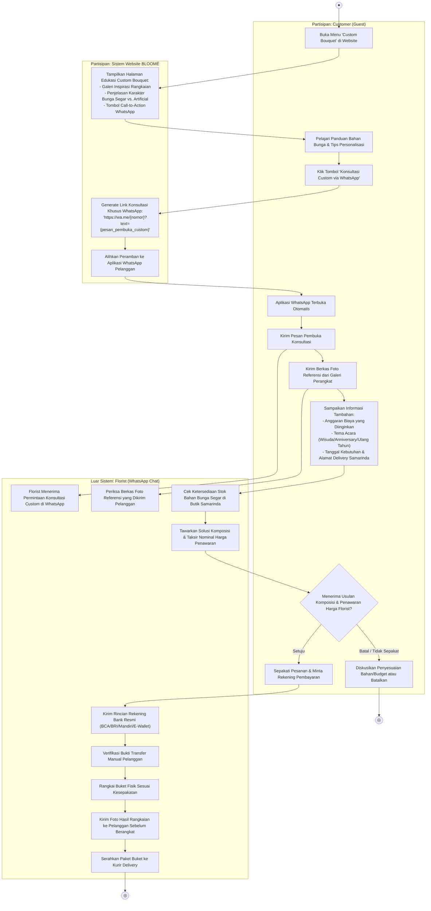

# ACTIVITY DIAGRAM ALUR KONSULTASI PERSONALISASI FLEKSIBEL
## BLOOMÉ — Flowers & Stories
**Task ID:** ANA-004  
**Fase:** Phase 2 — System Analysis and Design (Sub-fase 5.2 System Modeling)  
**Penanggung Jawab:** Jayanti Firdasari (Lead System Analyst & Project Manager)  
**Tanggal Penyusunan:** 13 November 2026 (Revisi Final: 20 November 2026)  
**Status Task:** Completed Final (`[x]`)  
**Dependensi:** ANA-001 — Use Case Diagram, ANA-003 — Activity Diagram Katalog  

---

## 1. Ringkasan Eksekutif & Karakteristik Alur

Pemodelan Diagram Aktivitas Konsultasi Personalisasi Fleksibel (Task ANA-004) menggambarkan alur kerja bagi pelanggan yang menginginkan buket bunga khusus (*fully-customized bouquet*) di luar varian katalog tetap pada website **BLOOMÉ — Flowers & Stories**.

Berbeda dengan alur versi lama yang memaksakan unggah berkas foto ke basis data website dan penetapan harga melalui dashboard admin, alur terkini memindahkan negosiasi custom langsung ke **ruang percakapan interaktif WhatsApp**:
1. Website menyediakan panduan perangkaian bunga, inspirasi galeri, dan tombol pintasan konsultasi WhatsApp.
2. Pelanggan mengirimkan berkas foto referensi dari perangkatnya langsung ke dalam obrolan chat WhatsApp dengan florist.
3. Diskusi mengenai ketersediaan tangkai bunga musiman, penyesuaian anggaran (*budget fitting*), dan kesepakatan harga dilakukan secara luwes dan personal langsung dengan pemilik butik (Nabila Febriyani).

---

## 2. Diagram Aktivitas Konsultasi Custom (Swimlane Activity Diagram)

---

## 3. Penjelasan Batas Sistem & Keunggulan Alur WhatsApp

### 3.1 Jalur Utama (*Happy Path*)
1. Pelanggan membuka menu "Custom Bouquet" pada website BLOOMÉ.
2. Sistem menyajikan panduan inspirasi visual dan informasi tips pemilihan bunga (perbedaan bunga segar vs bunga tiruan).
3. Pelanggan mengklik tombol "Konsultasi Custom via WhatsApp".
4. Sistem menyusun tautan universal WhatsApp dengan pesan pembuka khusus konsultasi dan mengalihkan peramban pelanggan.
5. WhatsApp terbuka; pelanggan mengirimkan pesan pembuka dan melampirkan berkas foto referensi rangkaian bunga dari galeri ponselnya.
6. Pelanggan menginfokan preferensi warna, perkiraan budget, tanggal acara, dan alamat delivery di Samarinda.
7. Florist meninjau foto referensi, memeriksa ketersediaan tangkai bunga di butik fisik, dan menawarkan rincian komposisi beserta penawaran harga.
8. Pelanggan menyetujui penawaran harga dan meminta nomor rekening resmi.
9. Florist memberikan nomor rekening, pelanggan mentransfer dan mengirimkan bukti transfer di chat.
10. Florist memverifikasi mutasi rekening, merangkai buket bunga, memotret hasil akhir untuk konfirmasi pelanggan, dan mengirimkan pesanan via kurir delivery.

### 3.2 Keunggulan Model Konsultasi WhatsApp Dibandingkan Web Upload
- **Kenyamanan Pengguna:** Pelanggan tidak dibatasi oleh batasan ukuran berkas form web atau batas format gambar kaku.
- **Interaktivitas Dua Arah:** Rangkaian buket bunga custom membutuhkan konsultasi dinamis (misal: alternatif warna mawar jika warna tertentu kosong). Diskusi via chat jauh lebih cepat dan humanis dibanding formulir web kaku.
- **Beban Infrastruktur Ringan:** Server website tidak dibebani oleh penyimpanan ribuan berkas foto referensi berukuran besar yang tidak menjadi aset resmi produk.

---

## 4. Kesimpulan
Task **ANA-004 (Activity Diagram Konsultasi Personalisasi Fleksibel)** telah selesai direvisi. Alur menempatkan website sebagai media kurasi informasi dan pengantar konsultasi, sedangkan negosiasi kreatif dan penetapan harga diselesaikan secara luwes di WhatsApp.
