# DIAGRAM AKTIVITAS BATAS SISTEM: WEBSITE VS. WHATSAPP (SYSTEM BOUNDARY WORKFLOW)
## BLOOMÉ — Flowers & Stories
**Task ID:** ANA-005  
**Fase:** Phase 2 — System Analysis and Design (Sub-fase 5.2 System Modeling)  
**Penanggung Jawab:** Jayanti Firdasari (Lead System Analyst & Project Manager)  
**Tanggal Penyusunan:** 13 November 2026 (Revisi Final: 20 November 2026)  
**Status Task:** Completed Final (`[x]`)  
**Dependensi:** ANA-001, ANA-003, ANA-004 (Selesai Final)  

---

## 1. Ringkasan Eksekutif & Tujuan Pemodelan Batas Sistem

Diagram Aktivitas Batas Sistem (Task ANA-005) disusun untuk menetapkan secara tegas dan visual **garis demarkasi (*separation of concerns*)** antara proses yang berlangsung di dalam aplikasi web **BLOOMÉ — Flowers & Stories** dengan proses yang dieksekusi di luar sistem melalui media komunikasi **WhatsApp**.

Sebelumnya, dokumen ini memodelkan proses verifikasi pembayaran transfer manual di dalam dashboard admin website (*Task ANA-005 versi lama*). Pada revisi final ini, fungsi pembayaran di dalam website telah dihapus total. Dokumen ini merekonstruksi pemodelan tersebut menjadi **Diagram Batas Sistem & Alur Alih-Kendali (*System Boundary & Hand-off Activity Diagram*)** guna memastikan tim teknis memahami di mana tanggung jawab perangkat lunak berakhir dan di mana interaksi manusia dimulai.

---

## 2. Diagram Aktivitas Batas Sistem: Website vs. WhatsApp

```mermaid
flowchart TD
    %% Initial Node
    StartNode((●)) --> W1

    %% Boundary Subgraph 1: Ranah Website BLOOMÉ
    subgraph Boundary_Website ["RANAH SISTEM WEBSITE BLOOMÉ (In-Scope Web System)"]
        W1["1. Pelanggan Memilih Buket di Katalog Interaktif"]
        W2["2. Mengonfigurasi Personalisasi & Memilih Add-on"]
        W3["3. Mengisi Catatan Khusus Kartu Ucapan & Alamat Delivery"]
        W4["4. Sistem Menghitung Live Estimasi Total Biaya"]
        W5["5. Pelanggan Meninjau Ringkasan & Klik 'Pesan via WhatsApp'"]
        W6["6. Sistem Mengompilasi Teks Pesan Terformat & Membentuk URL:<br>'https://wa.me/{nomor}?text={encoded_message}'"]
        W7["7. Peramban Memicu Pengalihan (Redirect Hand-off)"]
    end

    %% Demarcation / Transition Gate
    Gate{{"GERBANG HAND-OFF:<br>Aplikasi WhatsApp Dibuka di Perangkat Pengguna"}}

    %% Boundary Subgraph 2: Ranah WhatsApp & Florist
    subgraph Boundary_WhatsApp ["RANAH LUAR SISTEM: WHATSAPP (Out-of-Scope External Interaction)"]
        WA1["8. Pelanggan Mengirim Pesan Terformat ke Florist"]
        WA2["9. Florist Mengonfirmasi Stok Bunga Segar di Butik"]
        WA3["10. Florist Mengonfirmasi Skema Ongkos Kirim Delivery Samarinda"]
        WA4["11. Kesepakatan Final Total Biaya (Buket + Add-on + Ongkir)"]
        WA5["12. Florist Membagikan Nomor Rekening Bank / E-Wallet Resmi"]
        WA6["13. Pelanggan Melakukan Transfer Manual via M-Banking"]
        WA7["14. Pelanggan Mengirim Bukti Transfer di Chat WhatsApp"]
        WA8["15. Florist Mengecek Mutasi Rekening & Konfirmasi Pembayaran"]
        WA9["16. Florist Merangkai Buket Bunga Fisik di Butik"]
        WA10["17. Kurir Mengantar Buket ke Alamat Penerima (Delivery)"]
        WA11["18. Koordinasi Purna-Jual / Perubahan Jadwal / Pembatalan"]
    end

    %% Final Node
    EndNode((◎))

    %% Connections
    W1 --> W2
    W2 --> W3
    W3 --> W4
    W4 --> W5
    W5 --> W6
    W6 --> W7
    W7 --> Gate
    Gate --> WA1
    WA1 --> WA2
    WA2 --> WA3
    WA3 --> WA4
    WA4 --> WA5
    WA5 --> WA6
    WA6 --> WA7
    WA7 --> WA8
    WA8 --> WA9
    WA9 --> WA10
    WA10 --> WA11
    WA11 --> EndNode
```

---

## 3. Matriks Komparasi Batas Tanggung Jawab (*Responsibility Matrix*)

Tabel berikut menjadi pedoman arsitektur yang mengikat pengembang:

| Aspek Operasional | Di Dalam Sistem Website BLOOMÉ | Di Luar Sistem (WhatsApp Florist) |
|---|:---:|:---:|
| **Eksplorasi Produk & Kategori** | **Ya** (Katalog interaktif & filter) | Tidak (Kecuali menanyakan buket lama) |
| **Konfigurasi Personalisasi (Warna Wrapping/Pita)** | **Ya** (Pemilih interaktif di web) | Konfirmasi ketersediaan bahan riil |
| **Pemilihan Add-on (Boneka, Cokelat, LED)** | **Ya** (Checklist pilihan add-on) | Penyesuaian ketersediaan stok fisik |
| **Kalkulasi Estimasi Biaya** | **Ya** (Perhitungan harga dasar + add-on) | Negosiasi harga khusus/diskon musiman |
| **Pengisian Pesan Kartu Ucapan** | **Ya** (Form input ucapan terintegrasi) | Revisi teks ucapan jika ada ralat |
| **Penetapan Ongkos Kirim Delivery** | Catatan pengingat estimasi delivery | **Ya** (Konfirmasi kurir & tarif ongkir) |
| **Pembayaran & Verifikasi Mutasi** | **TIDAK ADA** | **Ya** (Transfer manual & cek m-banking) |
| **Penyimpanan Transaksi Resmi** | **TIDAK ADA** | **Ya** (Pencatatan pembukuan internal florist) |
| **Pelacakan Status Pengerjaan Bunga** | **TIDAK ADA** | **Ya** (Florist kirim foto hasil via chat) |
| **Pengajuan Pembatalan / Retur** | **TIDAK ADA** | **Ya** (Komunikasi langsung pembeli & florist) |

---

## 4. Analisis Titik Alih-Kendali (*Hand-off Mechanism*)

1. **Keutuhan Data Pesan:**
   - Parameter pesan WhatsApp disusun menggunakan standar pengkodean URI (`rawurlencode`), memastikan karakter baris baru (`%0A`), spasi (`%20`), tanda hubung, dan tanda kurung terbaca dengan tepat tanpa terpotong di peramban seluler maupun desktop.
2. **Ketiadaan Session Tergantung:**
   - Karena transaksi diselesaikan di WhatsApp, kegagalan jaringan setelah tombol ditekan tidak merugikan data pelanggan (tidak ada data menggantung di basis data server). Pelanggan cukup mengklik ulang tombol tanpa kehilangan input visual di formulir.
3. **Penyelarasan Kebijakan Pengiriman:**
   - Sesuai kesepakatan bahwa layanan adalah *delivery*, formulir web meminta alamat pengiriman di Samarinda untuk disertakan langsung dalam teks pesan WhatsApp, memangkas waktu florist menanyakan lokasi antar.

---

## 5. Kesimpulan
Task **ANA-005 (Diagram Batas Sistem: Website vs. WhatsApp)** telah selesai disusun. Batas arsitektur telah terdefinisi secara presisi, menjamin sistem bebas dari modul pembayaran online dan bebas dari keranjang checkout website.
