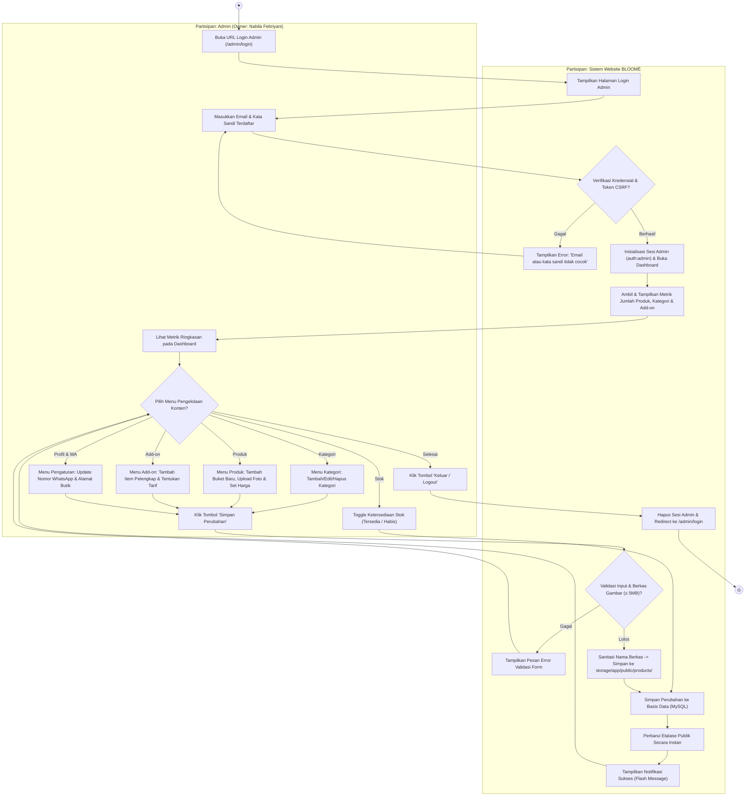

# ACTIVITY DIAGRAM PENGELOLAAN KATALOG DAN ADD-ON OLEH ADMIN
## BLOOMÉ — Flowers & Stories
**Task ID:** ANA-006  
**Fase:** Phase 2 — System Analysis and Design (Sub-fase 5.2 System Modeling)  
**Penanggung Jawab:** Jayanti Firdasari (Lead System Analyst & Project Manager)  
**Tanggal Penyusunan:** 13 November 2026 (Revisi Final: 20 November 2026)  
**Status Task:** Completed Final (`[x]`)  
**Dependensi:** ANA-001 — Use Case Diagram, ANA-002 — Use Case Descriptions  

---

## 1. Ringkasan Eksekutif & Karakteristik Alur

Pemodelan Diagram Aktivitas Pengelolaan Katalog dan Add-on (Task ANA-006) menggambarkan alur kerja administratif pemilik usaha (**Nabila Febriyani**) dalam mengelola seluruh konten website **BLOOMÉ — Flowers & Stories**.

Pada rancangan versi lama, file ini memodelkan proses peninjauan permohonan pembatalan pesanan pelanggan di website (*Task ANA-006 versi lama*). Karena sistem baru tidak lagi memuat pesanan transaksi maupun pembatalan di website, dokumen ini direkonstruksi penuh menjadi pemodelan **Alur Kerja Pengelolaan Master Katalog, Produk, Kategori, Opsi Add-on, dan Pengaturan Bisnis oleh Admin**.

---

## 2. Diagram Aktivitas Pengelolaan Konten oleh Admin (Swimlane Activity Diagram)

---

## 3. Penjelasan Batas Sistem & Kebijakan Bunga Segar

### 3.1 Alur Pengelolaan Produk & Unggah Foto
1. Admin mengakses menu "Produk" dan memilih "Tambah Produk".
2. Admin mengisi nama buket, memilih kategori relasi, menginput harga dasar (IDR), mengetikkan deskripsi komposisi bunga, dan memilih foto buket resmi.
3. Sistem memvalidasi bahwa berkas adalah gambar valid (JPG, JPEG, PNG) dengan ukuran tidak melebihi 5 MB (5.120 KB).
4. Sistem menyimpan berkas foto ke media penyimpanan lokal `storage/app/public/products/` dan mencatat record baru pada tabel `products`.
5. Produk baru langsung tampil di etalase katalog publik pelanggan.

### 3.2 Alur Pembaruan Status Ketersediaan Stok (*Stock Toggle*)
1. Admin melihat antrean produk pada tabel dashboard.
2. Saat bunga segar habis di butik, admin mengklik sakelar (*toggle*) status buket bersangkutan.
3. Sistem secara asinkron memperbarui kolom `is_available = 0`.
4. Tombol pemesanan produk tersebut di katalog publik langsung dinonaktifkan, mencegah pelanggan memesan bunga yang sedang tidak tersedia.

### 3.3 Alur Pengelolaan Opsi Add-on & Personalisasi
1. Admin membuka menu "Add-on & Personalisasi".
2. Admin menambahkan item add-on pelengkap baru (misal: *Topper Akrilik Happy Birthday* seharga *Rp15.000*).
3. Data tersimpan; item baru secara otomatis muncul pada form checklist personalisasi di sisi pelanggan.

### 3.4 Alur Pembaruan Nomor WhatsApp Resmi
1. Admin membuka menu "Pengaturan Profil Usaha".
2. Admin memperbarui nomor WhatsApp tujuan pemesanan (misal jika terjadi pergantian nomor ponsel operasional butik).
3. Seluruh tautan pemesanan WhatsApp yang digenerate oleh sistem di halaman publik otomatis terarah ke nomor baru tanpa perlu mengubah kode sumber (*hardcoded*).

---

## 4. Kesimpulan
Task **ANA-006 (Activity Diagram Pengelolaan Katalog dan Add-on)** telah selesai direvisi. Seluruh proses administratif berfokus murni pada pemeliharaan konten etalase, manajemen foto, stok, dan add-on tanpa memuat antrean transaksi atau pembatalan di website.
