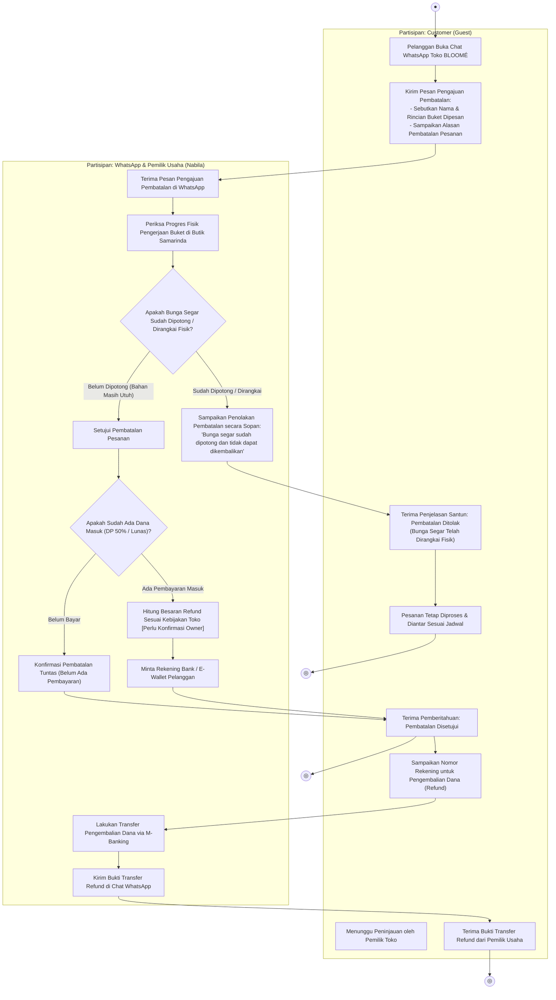

# ACTIVITY DIAGRAM ALUR PENGAJUAN & PENANGANAN PEMBATALAN VIA WHATSAPP
## BLOOMÉ — Flowers & Stories
**Task ID:** ANA-006  
**Fase:** Phase 2 — System Analysis and Design (Sub-fase 5.2 System Modeling)  
**Penanggung Jawab:** Jayanti Firdasari (Lead System Analyst & Project Manager)  
**Tanggal Penyusunan:** 13 November 2026 (Diperbarui: 20 November 2026 — Penyelarasan Konsep v1.1)  
**Status Task:** Completed (`[x]`)  
**Dependensi:** ANA-005 — Activity Diagram alur pembayaran via WhatsApp (Selesai dan Diselaraskan)  

---

## 1. Ringkasan Eksekutif

Pemodelan Diagram Aktivitas Pembatalan (Task ANA-006) dilakukan untuk menggambarkan alur komunikasi pengajuan pembatalan pesanan atau perubahan detail oleh pelanggan serta proses evaluasi dan keputusan oleh pemilik usaha (Nabila Febriyani) melalui saluran obrolan WhatsApp untuk pesanan buket **BLOOMÉ — Flowers & Stories**.

Sesuai dengan keputusan proses bisnis terbaru (v1.1):
- **Website TIDAK memiliki modul pembatalan atau pengubahan pesanan.**
- **Website TIDAK menyimpan status pesanan aktif atau memproses pengembalian dana (*refund*).**
- **Seluruh permohonan pembatalan, revisi ucapan kartu, maupun perubahan jadwal pengiriman dibicarakan dan dikoordinasikan secara langsung melalui WhatsApp.**

Sesuai aturan bisnis **BR-013** (*Pembatalan hanya dapat disetujui jika bunga segar belum dipotong atau dirangkai fisik*) dan **BR-014** (*Keputusan pembatalan berada penuh di tangan pemilik usaha*), diagram ini memodelkan pertimbangan florist terhadap kondisi fisik bahan baku sebelum menyetujui pembatalan.

---

## 2. Diagram Aktivitas Penanganan Pembatalan via WhatsApp (Swimlane Activity Diagram)

---

## 3. Penjelasan Batas Sistem & Kebijakan Bunga Segar

### 3.1 Mengapa Pembatalan Tidak Dilakukan di Website?
1. **Sifat Produk yang Mudah Rusak (*Perishable Goods*):** Bunga segar (*fresh cut flowers*) yang telah dipotong dari batangnya memiliki masa simpan terbatas dan tidak dapat dijual kembali kepada pelanggan lain jika pesanan dibatalkan sepihak. Tombol pembatalan otomatis di website berisiko merugikan butik secara finansial jika ditekan saat buket sudah setengah jadi.
2. **Kebutuhan Diskusi Alternatif:** Sering kali pelanggan membatalkan pesanan bukan karena tidak ingin buketnya, melainkan karena jadwal acara wisuda yang bergeser. Melalui obrolan WhatsApp, florist Nabila dapat menawarkan solusi penjadwalan ulang (*reschedule*) waktu pengiriman alih-alih pembatalan total.

### 3.2 Ketentuan Pengembalian Dana (Refund Policy)
- **Status Kebijakan:** Kebijakan persentase pengembalian dana uang muka (DP) apabila pembatalan dilakukan jauh hari (misal: H-2 sebelum pembuatan) masih berstatus **`[Perlu Konfirmasi Owner]`**.
- **Eksekusi Pengembalian Dana:** Seluruh pengembalian dana ditransfer secara manual oleh Nabila Febriyani melalui mobile banking langsung ke rekening atau nomor e-wallet yang diberikan pelanggan di chat WhatsApp.

---

## 4. Kesimpulan & Rekomendasi

### 4.1 Status Task ANA-006
Task **ANA-006 (Activity Diagram Pembatalan)** telah selesai diselaraskan:
- Seluruh logika form pembatalan di website, tabel riwayat pembatalan, dan mesin status `ST-08` di web telah dieliminasi.
- Alur pengajuan pembatalan manual, verifikasi status fisik bunga segar, dan pengembalian dana via WhatsApp telah dimodelkan secara realistis.
- Kriteria penyelesaian terpenuhi 100%.

### 4.2 Rekomendasi Langkah Berikutnya:
Melanjutkan ke pemodelan diagram sekuensial (Sequence Diagrams):
- **`ANA-007 — Sequence Diagram eksplorasi katalog, konfigurasi personalisasi, dan WhatsApp hand-off.`**
