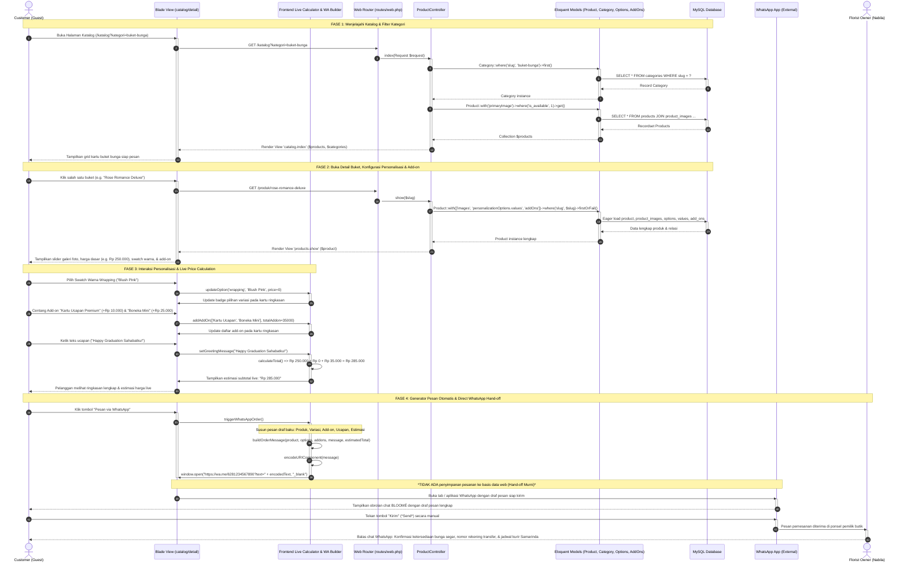

# SEQUENCE DIAGRAM EKSPLORASI KATALOG, PERSONALISASI, DAN HAND-OFF PEMESANAN WHATSAPP
## BLOOMÉ — Flowers & Stories
**Task ID:** ANA-007  
**Fase:** Phase 2 — System Analysis and Design (Sub-fase 5.2 System Modeling)  
**Penanggung Jawab:** Jayanti Firdasari (Lead System Analyst & Project Manager)  
**Tanggal Penyusunan:** 13 November 2026 (Diperbarui: 20 November 2026 — Penyelarasan Konsep v1.1)  
**Status Task:** Completed (`[x]`)  
**Dependensi:** ANA-003, ANA-004, ARC-001 (Three-Layer Architecture), ARC-005 (Routing Architecture)  

---

## 1. Ringkasan Eksekutif & Tujuan Pemodelan

Pemodelan Sequence Diagram Alur Pemesanan dan Personalisasi (Task ANA-007) disusun untuk memetakan interaksi temporal antar-objek (*message exchange lifecycle*) secara runut dan presisi pada website **BLOOMÉ — Flowers & Stories**. Pemodelan ini menerapkan pendekatan *Object-Oriented Analysis and Design* (OOAD) yang disinkronkan dengan arsitektur tiga lapis (*Three-Layer Architecture*: Presentation, Application, dan Data Layer) berbasis framework Laravel.

Berdasarkan kesepakatan final tim (Konsep Sistem v1.1), **website BLOOMÉ berfungsi sebagai katalog interaktif dan media konfigurasi personalisasi buket bunga, sedangkan proses pemesanan resmi, konfirmasi harga, pembayaran, negosiasi, dan pengiriman dilanjutkan secara langsung melalui WhatsApp**. 

Dengan demikian, diagram sekuensial ini memodelkan tiga siklus interaksi inti:
1. **Eksplorasi Katalog & Filter Kategori:** Alur penelusuran buket aktif berdasarkan kategori bunga, uang, atau snack dari basis data.
2. **Detail Buket, Konfigurasi Personalisasi & Live Price Estimation:** Pemuatan galeri multi-foto, pemilih visual warna (*color swatches*), penambahan item add-on, dan kalkulasi subtotal otomatis di antarmuka pengguna tanpa pemuatan ulang halaman.
3. **Penyusunan Pesan Otomatis & Direct WhatsApp Hand-off:** Mekanisme pembentukan draf teks pemesanan terstruktur rapi, pengambilan nomor kontak toko dari `business_settings`, dan pengalihan ke WhatsApp melalui protokol `wa.me`, di mana pelanggan menekan tombol kirim secara manual. **Website tidak menyimpan transaksi pesanan di basis data web.**

---

## 2. Identifikasi Partisipan & Lifeline Objek

| Partisipan / Lifeline | Layer Arsitektur | Tipe Komponen | Peran & Tanggung Jawab Utama |
|---|---|---|---|
| **Customer (Guest)** | Aktor Eksternal | Pengguna | Mengakses katalog tanpa login, memilih buket, memilih warna wrapping/pita, memilih add-on, mengetik pesan ucapan, menekan tombol pesan, dan mengirim pesan manual di WhatsApp. |
| **Blade Views (`resources/views/`)** | Presentation Layer | UI / View | Merender antarmuka katalog (`catalog.blade.php`), halaman detail produk (`product-detail.blade.php`), komponen swatch warna, dan kartu ringkasan estimasi live. |
| **Frontend Script (Live Calc & WA Builder)** | Presentation Layer | JavaScript Module | Menghitung estimasi subtotal secara real-time di browser pengguna dan merangkai teks pesan draf pemesanan terformat rapi. |
| **Web Router (`routes/web.php`)** | Application Layer | HTTP Routing | Menerima request HTTP GET publik untuk rute beranda, katalog, dan detail buket. |
| **Catalog / Product Controllers** | Application Layer | Controllers | Mengorkestrasi pemanggilan data kategori, produk aktif, galeri foto, opsi personalisasi, dan add-on dari Eloquent models. |
| **Eloquent Models (`App\Models\`)** | Data Layer | ORM Entities | Model entitas: `Category`, `Product`, `ProductImage`, `PersonalizationOption`, `PersonalizationValue`, `AddOn`, dan `BusinessSetting`. |
| **MySQL Database Engine** | Data Layer | RDBMS | Menyediakan data master etalase terindeks secara cepat (*response time* < 1 detik). |
| **WhatsApp App (External)** | Saluran Eksternal | External Channel | Menerima tautan `wa.me` dan menampilkan draf pesan pemesanan di antarmuka chat WhatsApp pelanggan. |
| **Florist (Nabila Febriyani)** | Aktor Eksternal | Pemilik Usaha | Menerima pesan pemesanan di ponsel butik, mengecek stok fisik bunga, menyepakati harga final, menerima transfer bayar, dan mengatur pengiriman. |

---

## 3. Sequence Diagram Alur Eksplorasi Katalog & Personalisasi Buket



---

## 4. Analisis Alur & Penegasan Batas Sistem (System Demarcation)

### 4.1 Peniadaan Transaksi Basis Data Web pada Alur Pemesanan
1. **Zero Database Write on Order:** Pada alur pemesanan pelanggan, sistem web hanya melakukan operasi baca (`SELECT`) terhadap tabel `products`, `product_images`, `personalization_options`, `personalization_values`, `add_ons`, dan `business_settings`.
2. **Tidak Ada Tabel `orders` atau `customers`:** Data konfigurasi buket dan identitas pelanggan diolah secara murni di sisi memori antarmuka (*client-side state*) dan diteruskan ke WhatsApp melalui parameter URL `wa.me`. Hal ini menjamin privasi pengguna tanpa risiko kebocoran data transaksi di web.
3. **Penyusunan Pesan Terformat:** Teks pesan yang dihasilkan memuat struktur lengkap:
   ```text
   Halo BLOOMÉ Flowers & Stories, saya ingin memesan buket:
   - Produk: Rose Romance Deluxe
   - Kertas Wrapping: Blush Pink
   - Pita: Satin Burgundy
   - Add-on: Kartu Ucapan Premium, Boneka Wisuda Mini
   - Ucapan Kartu: "Happy Graduation Sahabatku!"
   - Estimasi Harga Web: Rp 285.000
   Mohon konfirmasi ketersediaan bahan, total harga final, dan rekening pembayarannya. Terima kasih!
   ```

### 4.2 Alur di Luar Sistem Web (WhatsApp Operational Hand-off)
1. **Pengiriman Manual:** Pelanggan memiliki kendali penuh untuk meninjau kembali isi pesan di WhatsApp sebelum menekan tombol kirim. Website tidak mengklaim bahwa pesanan telah diterima hanya karena WhatsApp berhasil terbuka.
2. **Konfirmasi Personal oleh Florist:** Florist Nabila menanggapi pesan, memastikan bahan bunga segar siap dirangkai di butik Samarinda, menyampaikan nomor rekening resmi (BCA/BRI/Mandiri/E-Wallet), menyepakati opsi DP 50% `[Perlu Konfirmasi Owner]`, serta mengoordinasikan kurir pengantaran.

---

## 5. Kesimpulan & Rekomendasi

### 5.1 Status Task ANA-007
Task **ANA-007 (Sequence Diagram Pemesanan Katalog & Personalisasi)** telah selesai diselaraskan:
- Seluruh objek transaksi backend lama (`CatalogOrderRequest`, `OrderController`, `OrderCodeGenerator`, `orders`, `order_details`, `order_status_histories`) telah dieliminasi.
- Interaksi Three-Layer difokuskan pada penyajian katalog, konfigurasi variasi visual swatch, kalkulasi harga live di frontend, dan WhatsApp hand-off murni.
- Kriteria penyelesaian terpenuhi 100%.

### 5.2 Rekomendasi Langkah Berikutnya:
Melanjutkan ke pemodelan sequence diagram alur koordinasi pembayaran via WhatsApp:
- **`ANA-008 — Sequence Diagram koordinasi pembayaran & verifikasi via WhatsApp.`**
