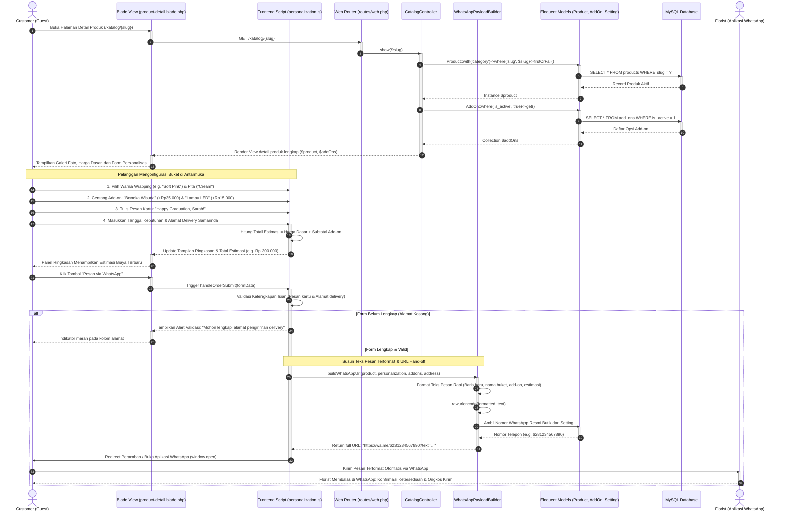

# SEQUENCE DIAGRAM KATALOG, PERSONALISASI, DAN WHATSAPP URL BUILDER
## BLOOMÉ — Flowers & Stories
**Task ID:** ANA-007  
**Fase:** Phase 2 — System Analysis and Design (Sub-fase 5.2 System Modeling)  
**Penanggung Jawab:** Jayanti Firdasari (Lead System Analyst & Project Manager)  
**Tanggal Penyusunan:** 13 November 2026 (Revisi Final: 20 November 2026)  
**Status Task:** Completed Final (`[x]`)  
**Dependensi:** ANA-001, ANA-002, ANA-003 (Selesai Final)  

---

## 1. Ringkasan Eksekutif & Karakteristik Alur

Pemodelan Diagram Sekuensial Katalog, Personalisasi, dan WhatsApp URL Builder (Task ANA-007) memetakan interaksi temporal antar-objek (*message sequence*) dalam proses pemilihan buket bunga, konfigurasi personalisasi, pemilihan add-on, kalkulasi estimasi harga di sisi klien, hingga perakitan URL WhatsApp pada website **BLOOMÉ — Flowers & Stories**.

Pada versi lama, dokumen ini memodelkan transaksi database `DB::transaction()` yang membuat record pada tabel `orders` dan `order_details`. Pada revisi final ini, pemodelan disesuaikan dengan arsitektur **Zero-Checkout & WhatsApp Hand-off**:
- Seluruh konfigurasi diproses secara interaktif di sisi klien (didukung data produk dan add-on dari server).
- Sistem tidak menerbitkan transaksi basis data resmi pada website.
- Akhir dari alur adalah kompilasi parameter pesan terformat dan eksekusi tautan `https://wa.me/`.

---

## 2. Sequence Diagram: Eksplorasi, Personalisasi & Pembangkitan URL WhatsApp

---

## 3. Rincian Teknis Komponen & Tanggung Jawab Objek

1. **`personalization.js` (Frontend State Manager):**
   - Mengelola status lokal antarmuka (*client-side reactive state*) saat pelanggan memilih kertas wrapping, warna pita, dan item add-on.
   - Menghitung secara instan nilai estimasi total tagihan sehingga pelanggan mendapatkan kepastian biaya sebelum berpindah ke WhatsApp.
2. **`WhatsAppPayloadBuilder`:**
   - Bertanggung jawab mengubah objek data formulir menjadi susunan pesan teks yang humanis dan terstruktur rapi.
   - Mengenkoding karakter khusus (`%0A` untuk enter/baris baru, `%20` untuk spasi) agar pesan tampil sempurna di aplikasi WhatsApp pelanggan.
3. **Peniadaan Transaksi Basis Data:**
   - Diagram ini membuktikan bahwa tidak ada operasi `INSERT INTO orders` atau manipulasi tabel pembayaran saat pelanggan mengklik tombol pesan. Integritas sistem tetap ringan dan bebas dari data transaksi menggantung (*abandoned checkout records*).

---

## 4. Kesimpulan
Task **ANA-007 (Sequence Diagram Katalog, Personalisasi & WhatsApp URL Builder)** telah selesai direvisi penuh. Interaksi objek secara eksplisit mengalirkan data pelanggan menuju gerbang hand-off WhatsApp tanpa melalui checkout database internal.
