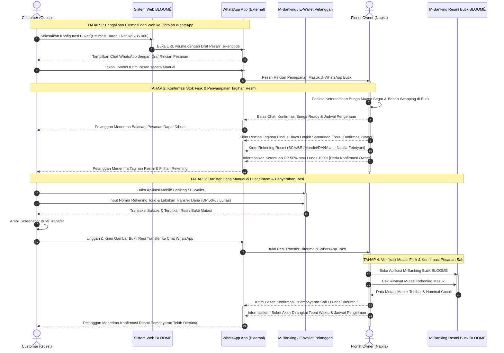

# SEQUENCE DIAGRAM ALUR KOORDINASI PEMBAYARAN DAN KESEPAKATAN HARGA VIA WHATSAPP
## BLOOMÉ — Flowers & Stories
**Task ID:** ANA-008  
**Fase:** Phase 2 — System Analysis and Design (Sub-fase 5.2 System Modeling)  
**Penanggung Jawab:** Jayanti Firdasari (Lead System Analyst & Project Manager)  
**Tanggal Penyusunan:** 13 November 2026 (Diperbarui: 20 November 2026 — Penyelarasan Konsep v1.1)  
**Status Task:** Completed (`[x]`)  
**Dependensi:** ANA-005, ANA-007, ARC-001 (Three-Layer Architecture)  

---

## 1. Ringkasan Eksekutif & Tujuan Pemodelan

Pemodelan Sequence Diagram Koordinasi Pembayaran (Task ANA-008) disusun untuk memetakan secara runtut pertukaran pesan dinamis (*dynamic message sequence*) dalam siklus kesepakatan harga final, penyampaian nomor rekening resmi, pengiriman bukti resi transfer, dan konfirmasi keabsahan dana pada **BLOOMÉ — Flowers & Stories**.

Sesuai dengan keputusan arsitektur (ADR-04) dan aturan bisnis (**BR-010 & BR-011**), sistem BLOOMÉ menerapkan model **pembayaran transfer manual (Bank Transfer & E-Wallet)** yang dikomunikasikan secara langsung melalui **WhatsApp** dengan **verifikasi mutasi fisik oleh pemilik usaha (Nabila Febriyani)** tanpa ketergantungan payment gateway pihak ketiga.

Diagram ini menegaskan titik transisi:
1. **Peran Sistem Web:** Menyediakan estimasi harga live di muka dan meneruskan rincian konfigurasi ke WhatsApp. Sistem web tidak mencatat tagihan, tidak memproses transaksi, dan tidak memiliki formulir pembayaran.
2. **Peran Komunikasi WhatsApp:** Seluruh siklus transaksi riil (konfirmasi ketersediaan stok bunga segar, penetapan biaya ongkir kurir Samarinda, pengiriman nomor rekening BCA/BRI/Mandiri/E-Wallet, opsi DP 50% `[Perlu Konfirmasi Owner]`, penyerahan screenshot mutasi, dan konfirmasi lunas) terjadi di dalam saluran obrolan WhatsApp antara pembeli dan pemilik butik.

---

## 2. Identifikasi Partisipan & Lifeline Objek

| Partisipan / Lifeline | Ranah Operasional | Tipe Komponen | Peran & Tanggung Jawab Utama |
|---|---|---|---|
| **Customer (Guest)** | Sisi Pengguna | Aktor Manusia | Mengirim pesan pemesanan di WhatsApp, memilih rekening tujuan, melakukan transfer dana di m-banking, dan mengirim bukti resi di chat. |
| **Sistem Web BLOOMÉ** | Ranah Web | Sistem Informasi | Menyajikan estimasi harga awal dan mengalihkan pelanggan ke tautan WhatsApp resmi toko. |
| **WhatsApp App (External)** | Saluran Komunikasi | Aplikasi Eksternal | Media percakapan langsung tempat pesan draf dikirim, berkas foto bukti bayar dipertukarkan, dan komunikasi berlangsung. |
| **Aplikasi M-Banking / E-Wallet Pelanggan** | Ranah Keuangan | Aplikasi Eksternal | Sarana eksekusi pemindahan dana perbankan di luar sistem BLOOMÉ. |
| **Florist Owner (Nabila Febriyani)** | Sisi Toko | Aktor Manusia | Menerima pesan, memastikan ketersediaan bahan, mengirim rekening resmi, memverifikasi mutasi dana masuk, dan menyepakati jadwal kurir. |
| **Aplikasi M-Banking Resmi Butik** | Ranah Keuangan Toko | Aplikasi Eksternal | Sarana pemilik usaha memeriksa mutasi rekening bank masuk secara riil. |

---

## 3. Sequence Diagram Alur Koordinasi Pembayaran via WhatsApp

---

## 4. Analisis Batas Sistem & Keandalan Alur Pembayaran

### 4.1 Eliminasi Celah Keamanan Pembayaran pada Sistem Web
1. **Bebas Kerentanan Transaksi Web:** Karena website tidak memproses pembayaran, tidak ada risiko *SQL Injection* pada data transaksi, manipulasi parameter harga via HTTP request tampering, atau kebocoran kredensial pembayaran perbankan di sisi server website.
2. **Tidak Menyimpan Foto Resi di Server Web:** Bukti transfer berupa foto hanya dipertukarkan di dalam aplikasi WhatsApp yang terenkripsi secara *end-to-end* (E2EE), sehingga server web BLOOMÉ tidak memerlukan kapasitas penyimpanan besar untuk berkas pembayaran.
3. **Peniadaan Status Pesanan Fiktif:** Website tidak pernah menampilkan status *Paid* atau *Unpaid* yang dapat memicu kebingungan jika terdapat keterlambatan sinkronisasi data perbankan.

### 4.2 Prosedur Verifikasi Manual oleh Pemilik Usaha
1. **Validasi Mutasi Ganda (*Double-Check*):** Pemilik usaha tidak hanya melihat gambar resi yang dikirimkan pembeli (untuk mencegah resi palsu / editan), tetapi selalu memeriksa mutasi dana masuk secara langsung pada aplikasi perbankan resmi butik.
2. **Penanganan Kasus Transfer Kurang / Selisih:** Jika dana yang ditransfer tidak sesuai dengan kesepakatan tagihan, pemilik usaha dapat langsung memberitahukan selisih dana kepada pembeli di dalam ruang percakapan yang sama secara santun dan cepat.

---

## 5. Kesimpulan & Rekomendasi

### 5.1 Status Task ANA-008
Task **ANA-008 (Sequence Diagram Pembayaran)** telah selesai diselaraskan:
- Seluruh objek backend pembayaran web lama (`PaymentController`, `PaymentConfirmRequest`, `PaymentVerifyRequest`, `payments`, `OrderStatusService`) telah dieliminasi.
- Interaksi pembayaran transfer bank, e-wallet, pengiriman resi, dan verifikasi mutasi rekening di WhatsApp telah dimodelkan dengan runtut.
- Kriteria penyelesaian terpenuhi 100%.

### 5.2 Rekomendasi Langkah Berikutnya:
Melanjutkan ke pemodelan sequence diagram untuk pengelolaan etalase produk dan pengaturan toko oleh admin:
- **`ANA-009 — Sequence Diagram pengelolaan etalase produk, galeri, dan pengaturan bisnis oleh admin.`**
