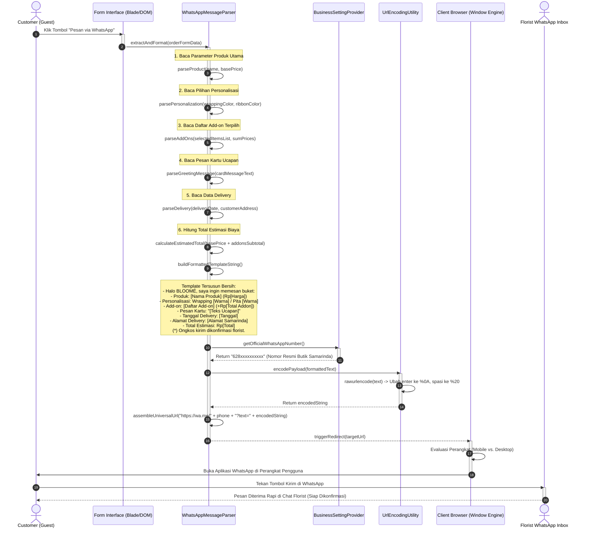

# SEQUENCE DIAGRAM KOMPILASI PESAN WHATSAPP & PARAMETER PEMESANAN
## BLOOMÉ — Flowers & Stories
**Task ID:** ANA-008  
**Fase:** Phase 2 — System Analysis and Design (Sub-fase 5.2 System Modeling)  
**Penanggung Jawab:** Jayanti Firdasari (Lead System Analyst & Project Manager)  
**Tanggal Penyusunan:** 13 November 2026 (Revisi Final: 20 November 2026)  
**Status Task:** Completed Final (`[x]`)  
**Dependensi:** ANA-001, ANA-003, ANA-007 (Selesai Final)  

---

## 1. Ringkasan Eksekutif & Karakteristik Alur

Pemodelan Diagram Sekuensial Kompilasi Pesan WhatsApp (Task ANA-008) mendokumentasikan mekanisme transformasi data terstruktur dari formulir antarmuka pelanggan menjadi untaian teks pesan WhatsApp terenkoding (*encoded message payload*).

Pada rancangan versi lama, berkas ini memodelkan proses verifikasi transfer bank oleh admin di dashboard (*Task ANA-008 versi lama*). Karena alur pembayaran di website telah ditiadakan total, dokumen ini direkonstruksi penuh menjadi **Sequence Diagram Kompilasi Pesan WhatsApp & Parameter Pemesanan**. Diagram ini menjadi rujukan teknis utama bagi pengembang frontend dan backend dalam merancang generator pesan instan yang akurat, terstruktur, dan tidak terpotong saat diparsing oleh WhatsApp Web maupun WhatsApp Mobile.

---

## 2. Sequence Diagram: Kompilasi Pesan WhatsApp & Ekstraksi Parameter



---

## 3. Spesifikasi Format Template Pesan WhatsApp

Template pesan yang dihasilkan wajib mematuhi format baku berikut agar mudah dibaca oleh florist:

```text
Halo BLOOMÉ, saya ingin memesan buket melalui website:

*Rincian Buket:*
- Produk: {product_name} (Rp{base_price})
- Warna Wrapping: {wrapping_color}
- Warna Pita: {ribbon_color}

*Add-on Tambahan:*
{list_of_addons_with_prices}

*Pesan Kartu Ucapan:*
"{greeting_message}"

*Jadwal & Tujuan Pengiriman (Delivery):*
- Tanggal Kebutuhan: {delivery_date}
- Alamat Delivery: {delivery_address}, Samarinda

*Total Estimasi Biaya:*
Rp{estimated_total}
*(Catatan: Biaya di atas belum termasuk tarif ongkos kirim kurir delivery yang akan dikonfirmasi oleh florist).*

Mohon konfirmasi ketersediaan bahan bunganya. Terima kasih!
```

---

## 4. Penanganan Karakter Khusus & Keamanan Parameter

1. **Pencegahan Teks Terpotong (*Text Truncation Defense*):**
   - Menggunakan fungsi enkoding `rawurlencode()` (standar RFC 3986) sehingga karakter tanda petik (`"`), garis miring (`/`), kurung `()`, dan simbol plus (`+`) tidak mengacaukan parameter URL.
2. **Sanitasi Masukan Pengguna (*Input Sanitization*):**
   - Teks pesan kartu ucapan yang diinputkan pengguna dibersihkan dari tag HTML (*strip tags*) dan karakter kontrol berbahaya sebelum dirangkai ke dalam template.
3. **Pemberian Label Transparan Ongkos Kirim:**
   - Parameter pesan secara eksplisit menyertakan catatan bahwa nominal total merupakan **estimasi biaya buket dan add-on**, sedangkan tarif ongkir kurir delivery dikonfirmasi manual florist sesuai jarak butik Samarinda ke alamat pemesan (`[Perlu Konfirmasi Owner]`).

---

## 5. Kesimpulan
Task **ANA-008 (Sequence Diagram Kompilasi Pesan WhatsApp)** telah selesai direvisi penuh. Mekanisme penguraian formulir, pemformatan template, dan perakitan tautan universal WhatsApp telah dimodelkan dengan presisi teknis tinggi.
