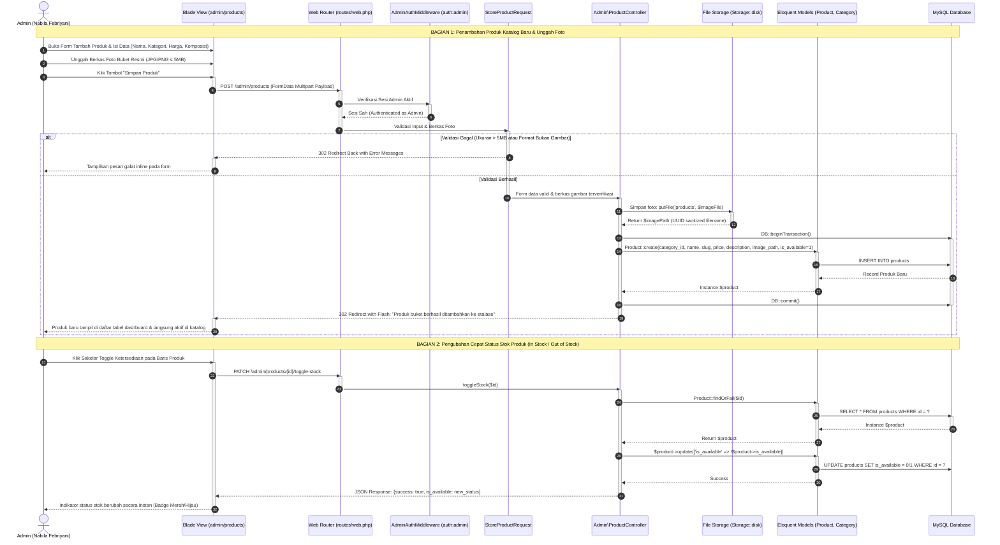
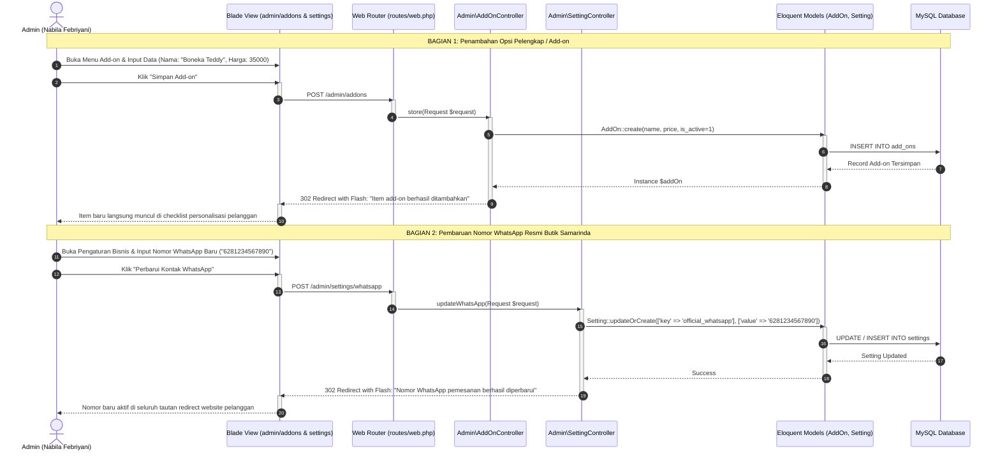

# SEQUENCE DIAGRAM PENGELOLAAN MASTER KATALOG, KATEGORI, DAN ADD-ON OLEH ADMIN
## BLOOMÉ — Flowers & Stories
**Task ID:** ANA-009  
**Fase:** Phase 2 — System Analysis and Design (Sub-fase 5.2 System Modeling)  
**Penanggung Jawab:** Jayanti Firdasari (Lead System Analyst & Project Manager)  
**Tanggal Penyusunan:** 13 November 2026 (Revisi Final: 20 November 2026)  
**Status Task:** Completed Final (`[x]`)  
**Dependensi:** ANA-001, ANA-002, ANA-006 (Selesai Final)  

---

## 1. Ringkasan Eksekutif & Karakteristik Alur

Pemodelan Diagram Sekuensial Pengelolaan Master Katalog, Kategori, dan Add-on (Task ANA-009) memetakan interaksi temporal antar-objek dalam eksekusi operasional administrasi oleh pemilik usaha (**Nabila Febriyani**) pada dashboard terproteksi **BLOOMÉ — Flowers & Stories**.

Pada versi lama, berkas ini memodelkan siklus hidup transisi status transaksi pesanan (*ST-05 $\rightarrow$ ST-06 $\rightarrow$ ST-07*) dan persetujuan pembatalan pesanan di website (*Task ANA-009 versi lama*). Karena alur pesanan resmi, pelacakan, dan pembatalan telah dipindahkan sepenuhnya ke WhatsApp, dokumen ini direkonstruksi penuh menjadi **Sequence Diagram Pengelolaan Master Konten Etalase oleh Admin**, mencakup penambahan produk buket, unggah foto, pengubahan ketersediaan stok, dan manajemen tarif add-on.

---

## 2. Sequence Diagram: Pengelolaan Produk Buket, Foto, & Status Stok

Diagram berikut memodelkan dua interaksi utama: (A) Penambahan produk buket baru beserta unggah foto beresolusi tinggi, dan (B) Pembaruan cepat ketersediaan stok produk:

---

## 3. Sequence Diagram: Pengelolaan Opsi Add-on & Pembaruan Nomor WhatsApp

Diagram berikut memodelkan penambahan master add-on serta pembaruan nomor kontak WhatsApp butik:

---

## 4. Rincian Teknis Komponen & Integritas Data

1. **Keamanan Berkas Foto Produk (`storage/app/public/products/`):**
   - Foto produk divalidasi ketat (ekstensi gambar `.jpg`, `.jpeg`, `.png`, batas ukuran $\le$ 5MB).
   - Penamaan berkas menggunakan string hash acak untuk mencegah penimpaan berkas (*file overwrite*).
2. **Ketersediaan Stok Real-Time:**
   - Perubahan status `is_available` langsung memengaruhi logika tampilan antarmuka publik secara deterministik (jika 0, tombol pemesanan langsung nonaktif).
3. **Penyimpanan Terpusat Nomor WhatsApp:**
   - Nomor WhatsApp tujuan tidak di-hardcode pada template Blade, melainkan dimuat secara dinamis dari tabel pengaturan (`settings`), memastikan fleksibilitas operasional jika butik mengganti nomor ponsel.

---

## 5. Kesimpulan
Task **ANA-009 (Sequence Diagram Pengelolaan Katalog, Kategori & Add-on Admin)** telah selesai direvisi penuh. Seluruh interaksi objek di ranah admin memodelkan manajemen konten etalase murni tanpa adanya antrean pesanan atau proses pembatalan di website.
