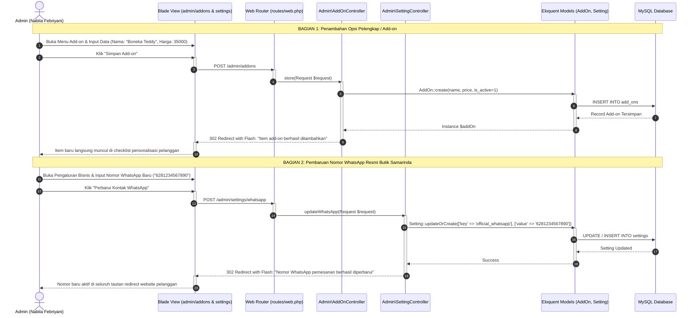

<<<<<<< HEAD
# SEQUENCE DIAGRAM PENGELOLAAN ETALASE PRODUK, GALERI, DAN PENGATURAN BISNIS OLEH ADMIN
=======
# SEQUENCE DIAGRAM PENGELOLAAN MASTER KATALOG, KATEGORI, DAN ADD-ON OLEH ADMIN
>>>>>>> c202b49 (Revise documentation and initial implementation)
## BLOOMÉ — Flowers & Stories
**Task ID:** ANA-009  
**Fase:** Phase 2 — System Analysis and Design (Sub-fase 5.2 System Modeling)  
**Penanggung Jawab:** Jayanti Firdasari (Lead System Analyst & Project Manager)  
<<<<<<< HEAD
**Tanggal Penyusunan:** 13 November 2026 (Diperbarui: 20 November 2026 — Penyelarasan Konsep v1.1)  
**Status Task:** Completed (`[x]`)  
**Dependensi:** ANA-001, ANA-002, ARC-001 (Three-Layer Architecture), ARC-005 (Routing Architecture)  
=======
**Tanggal Penyusunan:** 13 November 2026 (Revisi Final: 20 November 2026)  
**Status Task:** Completed Final (`[x]`)  
**Dependensi:** ANA-001, ANA-002, ANA-006 (Selesai Final)  
>>>>>>> c202b49 (Revise documentation and initial implementation)

---

## 1. Ringkasan Eksekutif & Karakteristik Alur

<<<<<<< HEAD
Pemodelan Sequence Diagram Pengelolaan Etalase dan Pengaturan Toko oleh Admin (Task ANA-009) disusun untuk menggambarkan interaksi temporal antar-objek (*message exchange lifecycle*) dalam modul administrasi website **BLOOMÉ — Flowers & Stories**. Pemodelan ini menerapkan arsitektur tiga lapis (*Three-Layer Architecture*) Laravel untuk memastikan pemisahan tanggung jawab yang bersih antara View, Controller/Service, dan Eloquent Data Layer.

Berdasarkan kesepakatan arsitektur terbaru (v1.1), **website BLOOMÉ tidak mengelola mesin status transaksi (`ST-01 s/d ST-08`), antrean pemesanan transaksi, maupun permohonan pembatalan**. Seluruh operasional pesanan dan pembayaran ditangani langsung oleh pemilik usaha di WhatsApp. Oleh karena itu, tugas utama administrator di sistem web difokuskan pada:
1. **Autentikasi Login Administrator Tunggal:** Mekanisme login aman untuk satu akun admin pemilik usaha (Nabila Febriyani) pada tabel `admins`.
2. **Manajemen Master Produk, Galeri Multi-Foto & Relasi Personalisasi:** Operasi penambahan produk buket baru lengkap dengan unggah beberapa foto ke storage lokal, penanda foto sampul utama (*primary*), serta penautan opsi personalisasi dan add-on yang dibungkus dalam transaksi atomik (`DB::transaction()`).
3. **Pembaruan Cepat Toggle Ketersediaan Stok:** Perubahan status produk (*Tersedia* / *Habis*) secara instan agar etalase web selalu mutakhir sesuai stok bunga segar di butik.
4. **Pembaruan Konfigurasi Kontak WhatsApp & Profil Bisnis:** Pengelolaan parameter dinamis pada tabel `business_settings` seperti nomor WhatsApp tujuan pesanan, jam operasional, dan template pesan pembuka.
5. **Logout Administrator:** Pembersihan data sesi dan pengamanan kembali route admin.
=======
Pemodelan Diagram Sekuensial Pengelolaan Master Katalog, Kategori, dan Add-on (Task ANA-009) memetakan interaksi temporal antar-objek dalam eksekusi operasional administrasi oleh pemilik usaha (**Nabila Febriyani**) pada dashboard terproteksi **BLOOMÉ — Flowers & Stories**.

Pada versi lama, berkas ini memodelkan siklus hidup transisi status transaksi pesanan (*ST-05 $\rightarrow$ ST-06 $\rightarrow$ ST-07*) dan persetujuan pembatalan pesanan di website (*Task ANA-009 versi lama*). Karena alur pesanan resmi, pelacakan, dan pembatalan telah dipindahkan sepenuhnya ke WhatsApp, dokumen ini direkonstruksi penuh menjadi **Sequence Diagram Pengelolaan Master Konten Etalase oleh Admin**, mencakup penambahan produk buket, unggah foto, pengubahan ketersediaan stok, dan manajemen tarif add-on.
>>>>>>> c202b49 (Revise documentation and initial implementation)

---

## 2. Sequence Diagram: Pengelolaan Produk Buket, Foto, & Status Stok

<<<<<<< HEAD
| Partisipan / Lifeline | Layer Arsitektur | Tipe Komponen | Peran & Tanggung Jawab Utama |
|---|---|---|---|
| **Admin (Nabila Febriyani)** | Aktor Internal | Pengguna | Pemilik usaha yang mengelola katalog, foto produk, opsi variasi, stok bahan, dan nomor WhatsApp toko. |
| **Blade Admin Views** | Presentation Layer | UI / View | Merender form login (`auth.login`), dashboard ringkasan (`admin.dashboard`), form produk (`admin.products.create`), dan form pengaturan (`admin.settings.index`). |
| **Web Router (`routes/web.php`)** | Application Layer | HTTP Routing | Mengarahkan rute administratif dengan proteksi middleware otentikasi `auth:admin` dan proteksi CSRF. |
| **Admin Form Requests** | Application Layer | Request Validator | Memvalidasi kredensial login (`AdminLoginRequest`), data produk & berkas foto (`ProductStoreRequest`), serta validasi nomor telepon (`BusinessSettingsRequest`). |
| **Admin Controllers** | Application Layer | Controllers | Mengorkestrasi logika bisnis: `Admin\AuthController`, `Admin\ProductController`, dan `Admin\BusinessSettingController`. |
| **File Storage Subsystem** | Application Layer | File Storage | Menyimpan berkas gambar (JPG/PNG ≤ 2MB) ke folder `storage/app/public/products/` dengan penamaan UUID unik tersanitasi. |
| **Eloquent Models (`App\Models\`)** | Data Layer | ORM Entities | Objek representasi tabel: `Admin`, `Category`, `Product`, `ProductImage`, `PersonalizationOption`, `AddOn`, dan `BusinessSetting`. |
| **MySQL Database Engine** | Data Layer | RDBMS | Menjamin konsistensi penyimpanan master data produk dan relasi pivot melalui transaksi atomik InnoDB. |

---

## 3. Sequence Diagram Alur Pengelolaan Etalase oleh Admin
=======
Diagram berikut memodelkan dua interaksi utama: (A) Penambahan produk buket baru beserta unggah foto beresolusi tinggi, dan (B) Pembaruan cepat ketersediaan stok produk:
>>>>>>> c202b49 (Revise documentation and initial implementation)

```mermaid
sequenceDiagram
    autonumber
<<<<<<< HEAD
    actor A as Admin (Nabila)
    participant V as Blade Admin Views
    participant R as Web Router (routes/web.php)
    participant Val as Form Requests (Store/Update)
    participant Ctrl as Admin Controllers (Auth/Product/Setting)
    participant Store as File Storage Subsystem (Local Disk)
    participant Mod as Eloquent Models (Admin, Product, Image, Pivot)
    participant DB as MySQL Database

    %% ==========================================
    %% SKENARIO 1: Autentikasi Login Admin Tunggal
    %% ==========================================
    Note over A,DB: SKENARIO 1: Autentikasi Login Admin Tunggal Aman (Tabel 'admins')
    A->>V: Buka URL /admin/login
    activate V
    V-->>A: Render Form Login (Email, Password, Token CSRF)
    deactivate V

    A->>V: Input email (nabila@bloome.com) & kata sandi -> Klik "Masuk"
    activate V
    V->>R: POST /admin/login (email, password, _token)
    activate R
    R->>Val: Delegasikan validasi kredensial (AdminLoginRequest)
    activate Val
    Val-->>Ctrl: Input tervalidasi
    deactivate Val
    activate Ctrl

    Ctrl->>Mod: Admin::where('email', $email)->first()
    activate Mod
    Mod->>DB: SELECT * FROM admins WHERE email = ? LIMIT 1
    activate DB
    DB-->>Mod: Record Admin (Password Hash Bcrypt)
    deactivate DB
    Mod-->>Ctrl: Admin instance ($admin)
    deactivate Mod

    Ctrl->>Ctrl: Hash::check($password, $admin->password)
    alt Kredensial Valid
        Ctrl->>Ctrl: Auth::guard('admin')->login($admin)
        Ctrl->>Ctrl: request()->session()->regenerate()
        Ctrl-->>V: 302 Redirect to /admin/dashboard
        activate V
        V-->>A: Tampilkan Dashboard Ringkasan Etalase Digital
        deactivate V
    else Kredensial Salah
        Ctrl-->>V: 302 Redirect Back with Error: "Kredensial tidak valid"
        activate V
        V-->>A: Tampilkan alert merah kesalahan login
        deactivate V
    end
    deactivate Ctrl
    deactivate R

    %% ==========================================
    %% SKENARIO 2: Tambah Produk & Galeri Multi-Foto
    %% ==========================================
    Note over A,DB: SKENARIO 2: Tambah Produk Baru, Upload Galeri & Relasi Personalisasi
    A->>V: Isi Form Tambah Produk (Nama, Kategori, Harga Dasar, Opsi, Add-on, Unggah Foto)
    activate V
    V->>R: POST /admin/products (Multipart FormData)
    activate R
    R->>Val: Validasi input data & berkas gambar <= 2MB (ProductStoreRequest)
    activate Val
    Val-->>Ctrl: Data produk & array berkas gambar valid
    deactivate Val
    activate Ctrl

    Ctrl->>DB: DB::beginTransaction()
    activate DB

    Note over Ctrl,Mod: 1. Simpan Data Master Produk
    Ctrl->>Mod: Product::create(category_id, name, slug, base_price, description, is_available=1)
    activate Mod
    Mod->>DB: INSERT INTO products ...
    activate DB
    DB-->>Mod: Product instance ($product)
    deactivate DB
    Mod-->>Ctrl: Return $product
    deactivate Mod

    Note over Ctrl,Store: 2. Upload Berkas Foto & Simpan ke Galeri
    loop Untuk Setiap Berkas Foto yang Diunggah
        Ctrl->>Store: storeAs('public/products', $uuidName)
        activate Store
        Store-->>Ctrl: Return $path
        deactivate Store
        Ctrl->>Mod: ProductImage::create(product_id, image_path, is_primary)
        activate Mod
        Mod->>DB: INSERT INTO product_images ...
        deactivate Mod
    end

    Note over Ctrl,Mod: 3. Tautkan Opsi Personalisasi & Add-on (Tabel Pivot)
    Ctrl->>Mod: $product->personalizationOptions()->sync($selectedOptionIds)
    activate Mod
    Mod->>DB: INSERT INTO product_personalization_options ...
    deactivate Mod

    Ctrl->>Mod: $product->addOns()->sync($selectedAddOnIds)
    activate Mod
    Mod->>DB: INSERT INTO product_add_ons ...
    deactivate Mod

    Ctrl->>DB: DB::commit()
    deactivate DB
    Ctrl-->>V: 302 Redirect to /admin/products (Flash Success: "Produk berhasil ditambahkan!")
    deactivate Ctrl
    activate V
    V-->>A: Tampilkan daftar produk dengan buket baru yang langsung tayang
    deactivate V
    deactivate R

    %% ==========================================
    %% SKENARIO 3: Toggle Cepat Ketersediaan Stok
    %% ==========================================
    Note over A,DB: SKENARIO 3: Toggle Ketersediaan Stok Produk (In Stock / Out of Stock)
    A->>V: Klik switch status stok pada tabel produk (is_available = 0)
=======
    actor A as Admin (Nabila Febriyani)
    participant V as Blade View (admin/products)
    participant R as Web Router (routes/web.php)
    participant Mdw as AdminAuthMiddleware (auth:admin)
    participant Req as StoreProductRequest
    participant Ctrl as Admin\ProductController
    participant Stor as File Storage (Storage::disk)
    participant Mod as Eloquent Models (Product, Category)
    participant DB as MySQL Database

    %% ==========================================
    %% BAGIAN 1: Penambahan Produk & Unggah Foto
    %% ==========================================
    Note over A,DB: BAGIAN 1: Penambahan Produk Katalog Baru & Unggah Foto
    A->>V: Buka Form Tambah Produk & Isi Data (Nama, Kategori, Harga, Komposisi)
    A->>V: Unggah Berkas Foto Buket Resmi (JPG/PNG ≤ 5MB)
    A->>V: Klik Tombol "Simpan Produk"
    activate V
    V->>R: POST /admin/products (FormData Multipart Payload)
    deactivate V
    activate R
    R->>Mdw: Verifikasi Sesi Admin Aktif
    activate Mdw
    Mdw-->>R: Sesi Sah (Authenticated as Admin)
    deactivate Mdw
    R->>Req: Validasi Input & Berkas Foto
    deactivate R
    activate Req

    alt Validasi Gagal (Ukuran > 5MB atau Format Bukan Gambar)
        Req-->>V: 302 Redirect Back with Error Messages
        activate V
        V-->>A: Tampilkan pesan galat inline pada form
        deactivate V
    else Validasi Berhasil
        Req->>Ctrl: Form data valid & berkas gambar terverifikasi
        deactivate Req
        activate Ctrl

        Ctrl->>Stor: Simpan foto: putFile('products', $imageFile)
        activate Stor
        Stor-->>Ctrl: Return $imagePath (UUID sanitized filename)
        deactivate Stor

        Ctrl->>DB: DB::beginTransaction()
        activate DB

        Ctrl->>Mod: Product::create(category_id, name, slug, price, description, image_path, is_available=1)
        activate Mod
        Mod->>DB: INSERT INTO products
        DB-->>Mod: Record Produk Baru
        Mod-->>Ctrl: Instance $product
        deactivate Mod

        Ctrl->>DB: DB::commit()
        deactivate DB

        Ctrl-->>V: 302 Redirect with Flash: "Produk buket berhasil ditambahkan ke etalase"
        deactivate Ctrl
        activate V
        V-->>A: Produk baru tampil di daftar tabel dashboard & langsung aktif di katalog
        deactivate V
    end

    %% ==========================================
    %% BAGIAN 2: Toggle Ketersediaan Stok
    %% ==========================================
    Note over A,DB: BAGIAN 2: Pengubahan Cepat Status Stok Produk (In Stock / Out of Stock)
    A->>V: Klik Sakelar Toggle Ketersediaan pada Baris Produk
>>>>>>> c202b49 (Revise documentation and initial implementation)
    activate V
    V->>R: PATCH /admin/products/{id}/toggle-stock
    activate R
    R->>Ctrl: toggleStock($id)
<<<<<<< HEAD
    activate Ctrl
    Ctrl->>Mod: Product::findOrFail($id)
    activate Mod
    Mod->>DB: UPDATE products SET is_available = NOT is_available WHERE id = ?
    activate DB
    DB-->>Mod: Record updated
    deactivate DB
    Mod-->>Ctrl: Product updated
    deactivate Mod
    Ctrl-->>V: Return JSON Response {success: true, is_available: 0}
    deactivate Ctrl
    V-->>A: Switch berubah visual menjadi 'Habis'; katalog publik langsung update
    deactivate V
    deactivate R

    %% ==========================================
    %% SKENARIO 4: Pengaturan WhatsApp & Profil Toko
    %% ==========================================
    Note over A,DB: SKENARIO 4: Pembaruan Nomor WhatsApp Resmi Toko ('business_settings')
    A->>V: Buka Menu Pengaturan -> Input Nomor WhatsApp Toko (e.g. "6281234567890")
    activate V
    V->>R: POST /admin/settings (key-value array)
    activate R
    R->>Val: Validasi format nomor telepon internasional (SettingsRequest)
    activate Val
    Val-->>Ctrl: Data valid
    deactivate Val
    activate Ctrl
    Ctrl->>Mod: BusinessSetting::updateOrCreate(['key' => 'whatsapp_number'], ['value' => '6281234567890'])
    activate Mod
    Mod->>DB: INSERT / UPDATE business_settings WHERE key = 'whatsapp_number'
    activate DB
    DB-->>Mod: Setting saved
    deactivate DB
    Mod-->>Ctrl: Setting instance
    deactivate Mod
    Ctrl-->>V: 302 Redirect with Flash: "Pengaturan berhasil diperbarui!"
    deactivate Ctrl
    activate V
    V-->>A: Tampilkan pesan sukses; seluruh tombol WhatsApp web otomatis mengarah ke nomor baru
    deactivate V
    deactivate R
=======
    deactivate R
    activate Ctrl

    Ctrl->>Mod: Product::findOrFail($id)
    activate Mod
    Mod->>DB: SELECT * FROM products WHERE id = ?
    activate DB
    DB-->>Mod: Instance $product
    deactivate DB
    Mod-->>Ctrl: Return $product
    deactivate Mod

    Ctrl->>Mod: $product->update(['is_available' => !$product->is_available])
    activate Mod
    Mod->>DB: UPDATE products SET is_available = 0/1 WHERE id = ?
    Mod-->>Ctrl: Success
    deactivate Mod

    Ctrl-->>V: JSON Response: {success: true, is_available: new_status}
    deactivate Ctrl
    V-->>A: Indikator status stok berubah secara instan (Badge Merah/Hijau)
    deactivate V
>>>>>>> c202b49 (Revise documentation and initial implementation)
```

---

<<<<<<< HEAD
## 4. Analisis Integritas Transaksional & Keamanan Panel Admin

### 4.1 Integritas Transaksi Multi-Tabel (`DB::transaction()`)
Penambahan atau pembaruan produk buket melibatkan minimal 4 tabel relasional (`products`, `product_images`, `product_personalization_options`, dan `product_add_ons`). Dengan membungkus seluruh operasi ini dalam blok `DB::transaction()`:
- Jika salah satu berkas gambar gagal disimpan atau query relasi pivot terputus, sistem secara otomatis melakukan `DB::rollBack()`.
- Hal ini mencegah terbentuknya data yatim (*orphaned rows*) pada basis data MySQL InnoDB.

### 4.2 Keamanan Akun & Proteksi Route Administrator
1. **Otentikasi Tunggal:** Menggunakan tabel `admins` terisolasi yang hanya memuat 1 akun admin resmi (Nabila Febriyani). Tidak ada pendaftaran akun publik.
2. **Perlindungan Hash Bcrypt:** Kata sandi disimpan menggunakan fungsi hash Bcrypt dengan *cost factor* standar industri.
3. **Regenerasi Sesi & CSRF:** Setiap kali admin berhasil login, ID sesi diregenerasi untuk mencegah serangan *Session Fixation*. Semua form POST/PATCH/DELETE diproteksi dengan token CSRF aktif.
4. **Middleware `auth:admin`:** Seluruh route `/admin/*` diproteksi secara ketat. Percobaan akses langsung tanpa login otomatis dialihkan ke `/admin/login`.

---

## 5. Kesimpulan & Rekomendasi

### 5.1 Status Task ANA-009
Task **ANA-009 (Sequence Diagram Pengelolaan Etalase & Pengaturan Admin)** telah selesai diselaraskan:
- Seluruh sequence diagram lama yang memodelkan siklus status pesanan fiktif `ST-01 s/d ST-08`, evaluasi tiket custom, dan approval pembatalan di web telah dieliminasi.
- Interaksi Three-Layer difokuskan secara presisi pada tanggung jawab riil administrator: login tunggal aman, manajemen produk & kategori, galeri multi-foto, toggle stok instan, dan konfigurasi kontak WhatsApp toko.
- Kriteria penyelesaian terpenuhi 100%.

### 5.2 Rekomendasi Langkah Berikutnya:
Melanjutkan ke penyusunan laporan validasi menyeluruh diagram sistem:
- **`ANA-010 — Laporan validasi seluruh diagram sistem.`**
=======
## 3. Sequence Diagram: Pengelolaan Opsi Add-on & Pembaruan Nomor WhatsApp

Diagram berikut memodelkan penambahan master add-on serta pembaruan nomor kontak WhatsApp butik:



---

## 4. Rincian Teknis Komponen & Integritas Data

1. **Keamanan Berkas Foto Produk (`storage/app/public/products/`):**
   - Foto produk divalidasi ketat (ekstensi gambar `.jpg`, `.jpeg`, `.png`, batas ukuran $\le$ 5MB).
   - Penamaan berkas menggunakan string hash acak untuk mencegah penimpaan berkas (*file overwrite*).
2. **Ketersediaan Stok Real-Time:**
   - Perubahan status `is_available` langsung memengaruhi logika tampilan antarmuka publik secara deterministik (jika 0, tombol pemesanan langsung nonaktif).
3. **Penyimpanan Terpusat Nomor WhatsApp:**
   - Nomor WhatsApp tujuan tidak di-hardcode pada template Blade, melainkan dimuat secara dinamis dari tabel pengaturan (`settings`), memastikan fleksibilitas operasional jika butik mengganti nomor ponsel.

---

## 5. Kesimpulan
Task **ANA-009 (Sequence Diagram Pengelolaan Katalog, Kategori & Add-on Admin)** telah selesai direvisi penuh. Seluruh interaksi objek di ranah admin memodelkan manajemen konten etalase murni tanpa adanya antrean pesanan atau proses pembatalan di website.
>>>>>>> c202b49 (Revise documentation and initial implementation)
