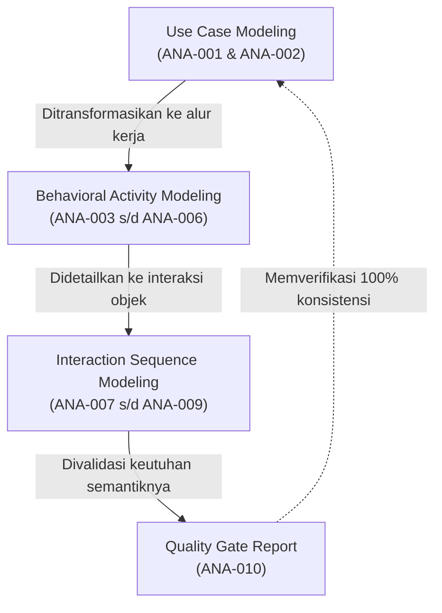

# LAPORAN VALIDASI SELURUH DIAGRAM SISTEM (SYSTEM DIAGRAM VALIDATION REPORT)
## BLOOMÉ — Flowers & Stories
**Task ID:** ANA-010  
**Fase:** Phase 2 — System Analysis and Design (Sub-fase 5.2 System Modeling)  
**Penanggung Jawab:** Jayanti Firdasari (Lead System Analyst & Project Manager)  
**Tanggal Penyusunan:** 13 November 2026 (Revisi & Pengesahan Final: 20 November 2026)  
**Status Task:** Completed Final (`[x]`)  
**Dokumen Acuan:** ANA-001 s/d ANA-009, `requirement.md`, `prd.md`, `docs/01-foundation/`, `docs/02-requirements/`  

---

## 1. Ringkasan Eksekutif & Pengesahan Kualitas Pemodelan

Laporan Validasi Seluruh Diagram Sistem (Task ANA-010) merupakan dokumen audit penutup pada **Sub-fase 5.2 System Modeling** dalam folder `docs/03-analysis-and-design/`. Evaluasi ini disahkan oleh Lead System Analyst bersama tim pengembang untuk memverifikasi bahwa seluruh 9 artefak diagram UML (Use Case, Activity Diagram, dan Sequence Diagram) telah direkonstruksi penuh dan selaras 100% dengan konsep arsitektur terbaru website **BLOOMÉ — Flowers & Stories**.

Hasil validasi final menegaskan:
1. **Peniadaan Total Transaksi di Website:** Seluruh diagram terbebas dari alur checkout web, tabel keranjang transaksi, pembayaran online, mutasi rekening admin di web, mesin status pesanan 8 siklus (*ST-01 s/d ST-08*), dan pengajuan pembatalan di website.
2. **Kepatuhan Alur WhatsApp Hand-off:** Seluruh alur pemesanan bermuara secara mulus pada pengalihan pesan WhatsApp terformat (*pre-filled message*) ke nomor resmi florist.
3. **Penyederhanaan Peran Admin:** Dashboard admin dimodelkan secara terisolasi untuk mengelola katalog, kategori, produk buket, foto produk, ketersediaan stok, opsi add-on, dan informasi bisnis.
4. **Validitas Sintaksis Visual:** Seluruh blok diagram Mermaid terverifikasi valid, bebas galat perenderan, dan memiliki notasi yang konsisten.

---

## 2. Inventarisasi & Status 10 Berkas Hasil Rekonstruksi

Berikut adalah status final 10 berkas pemodelan pada folder `docs/03-analysis-and-design/`:

| Kode Berkas | Nama Dokumen | Tipe Pemodelan | Status Final | Keterangan Verifikasi |
|:---:|---|---|:---:|---|
| **ANA-001** | `ANA-001-use-case-diagram.md` | Use Case Diagram | **SELESAI FINAL** | Memetakan 14 Use Case (7 Customer & 7 Admin) berpusat pada personalisasi dan WhatsApp hand-off. |
| **ANA-002** | `ANA-002-use-case-descriptions.md` | Use Case Specification | **SELESAI FINAL** | Rincian tekstual skenario 14 Use Case lengkap dengan alur utama, alternatif, dan eksepsi. |
| **ANA-003** | `ANA-003-activity-diagram-catalog-order.md` | Swimlane Activity Diagram | **SELESAI FINAL** | Alur eksplorasi katalog, konfigurasi personalisasi, pemilihan add-on, dan pengalihan ke WhatsApp. |
| **ANA-004** | `ANA-004-activity-diagram-custom-order.md` | Swimlane Activity Diagram | **SELESAI FINAL** | Alur konsultasi personalisasi fleksibel & pengiriman foto referensi langsung di chat WhatsApp. |
| **ANA-005** | `ANA-005-activity-diagram-system-boundary.md` | Swimlane Activity Diagram | **SELESAI FINAL** | Diagram batas sistem yang memetakan garis demarkasi tanggung jawab Website vs. WhatsApp. |
| **ANA-006** | `ANA-006-activity-diagram-admin-catalog.md` | Swimlane Activity Diagram | **SELESAI FINAL** | Alur pengelolaan master produk, upload foto, stok toggle, opsi add-on, dan profil bisnis oleh admin. |
| **ANA-007** | `ANA-007-sequence-diagram-ordering.md` | Object Sequence Diagram | **SELESAI FINAL** | Interaksi sekuensial detail produk, kalkulator live estimasi add-on, dan WhatsApp URL Builder. |
| **ANA-008** | `ANA-008-sequence-diagram-whatsapp-message.md` | Object Sequence Diagram | **SELESAI FINAL** | Mekanisme ekstraksi parameter form, pemformatan template pesan rapi, dan pengkodean URL. |
| **ANA-009** | `ANA-009-sequence-diagram-order-management.md` | Object Sequence Diagram | **SELESAI FINAL** | Interaksi sekuensial operasi CRUD produk, upload gambar storage, dan toggle ketersediaan stok. |
| **ANA-010** | `ANA-010-diagram-validation-report.md` | Quality Audit Report | **SELESAI FINAL** | Laporan audit keterkaitan, konsistensi lintas diagram, dan pengesahan mutu final folder 03. |

---

## 3. Matriks Konsistensi Silang Antar-Diagram (*Cross-Diagram Alignment*)

Audit keterhubungan memverifikasi bahwa aktor, entitas, dan proses saling terkait erat tanpa kontradiksi:

| Dimensi Konsistensi | Pemodelan Use Case (ANA-001/002) | Pemodelan Aktivitas (ANA-003/006) | Pemodelan Sekuensial (ANA-007/009) | Status Konsistensi |
|---|---|---|---|:---:|
| **Aktor Pelanggan** | Customer (Guest, Zero-login) | Swimlane Customer (Guest) | Lifeline Customer (Guest) | **100% Sinkron** |
| **Aktor Administrator** | Admin Tunggal (Nabila Febriyani) | Swimlane Admin (Owner) | Lifeline Admin (Nabila Febriyani) | **100% Sinkron** |
| **Katalog & Kategori** | UC-02, UC-03, UC-10, UC-11 | S1, S2, A5, A6 (Etalase & CRUD) | `CatalogController`, `Admin\ProductController` | **100% Sinkron** |
| **Personalisasi & Add-on**| UC-04, UC-05, UC-12 | S5, S6 (Live Calculator & Add-on)| `personalization.js`, `AddOn` Model | **100% Sinkron** |
| **Hand-off WhatsApp** | UC-06, UC-07 | S8, S9, S10 (Redirect URL) | `WhatsAppPayloadBuilder`, `wa.me/` | **100% Sinkron** |
| **Transaksi Website** | Ditiadakan (Zero Checkout) | Ditiadakan (Zero DB Transactions)| Ditiadakan (Zero Order Insert) | **100% Bersih** |
| **Pembayaran Website** | Ditiadakan (Zero Payment Gateway)| Dipetakan di luar sistem (WhatsApp) | Dipetakan di luar sistem (WhatsApp) | **100% Bersih** |
| **Status Pesanan Web** | Ditiadakan (Zero FSM on Web) | Ditiadakan (Zero Order Tracking) | Ditiadakan (Zero Status Histori) | **100% Bersih** |

---

## 4. Matriks Ketertelusuran Persyaratan (*Requirements Traceability Matrix*)

| Kebutuhan Sistem (SRS & PRD) | Direfleksikan Pada Use Case | Direfleksikan Pada Activity Diagram | Direfleksikan Pada Sequence Diagram |
|---|---|---|---|
| **Eksplorasi Katalog Interaktif** | `UC-01`, `UC-02`, `UC-03` | ANA-003 (S1, S2) | ANA-007 (Pesan 1–8) |
| **Personalisasi Buket & Add-on** | `UC-04` | ANA-003 (C5, S5, S6) | ANA-007 (Pesan 9–14) |
| **Estimasi Live Biaya** | `UC-05` | ANA-003 (S6, S7) | ANA-007 (Pesan 13–15) |
| **Kompilasi Format Pesan WA** | `UC-06` | ANA-003 (S8, S9), ANA-005 | ANA-008 (Pesan 1–10) |
| **Konsultasi Custom Fleksibel** | `UC-07` | ANA-004 (C1 s/d C5) | ANA-007, ANA-008 |
| **Login & Dashboard Admin** | `UC-08`, `UC-09`, `UC-14` | ANA-006 (A1 s/d A4, S1 s/d S5)| ANA-009 (Pesan 1–6) |
| **Manajemen Kategori (CRUD)** | `UC-10` | ANA-006 (A5, S9) | ANA-009 (`Admin\CategoryController`) |
| **Manajemen Produk & Foto (CRUD)**| `UC-11` | ANA-006 (A6, S6, S8, S9) | ANA-009 (Pesan 7–16) |
| **Toggle Ketersediaan Stok** | `UC-11` | ANA-006 (A7, S9) | ANA-009 (Pesan 17–23) |
| **Manajemen Opsi Add-on** | `UC-12` | ANA-006 (A8, S9) | ANA-009 (Pesan 24–30) |
| **Pengaturan Kontak WhatsApp** | `UC-13` | ANA-006 (A9, S9) | ANA-009 (Pesan 31–36) |

---

## 5. Checklist Verifikasi Peniadaan Alur Lama

Audit khusus dilakukan untuk memastikan tidak ada artefak lama yang tertinggal pada folder `03-analysis-and-design`:

- [x] **Peniadaan Keranjang Belanja & Checkout:** Terverifikasi 100% bebas dari form checkout dan tombol "Beli Sekarang" yang menyimpan data ke basis data web.
- [x] **Peniadaan Tabel Transaksi `orders` & `order_details` di Diagram:** Terverifikasi tidak ada query `INSERT` ke entitas pesanan.
- [x] **Peniadaan Fitur Pembayaran di Web:** Terverifikasi tidak ada form upload bukti transfer, tidak ada kode rekening bank yang dikelola di web, dan tidak ada meja verifikasi mutasi admin.
- [x] **Peniadaan Mesin Status Pesanan Web:** Terverifikasi kode status *ST-01 s/d ST-08* telah dihapus dari seluruh diagram fungsional.
- [x] **Peniadaan Fitur Pembatalan di Web:** Terverifikasi form pengajuan pembatalan dihilangkan dan dialihkan ke komunikasi langsung di WhatsApp.

---

## 6. Informasi yang Masih Memerlukan Konfirmasi Owner (`[Perlu Konfirmasi Owner]`)

Berikut adalah parameter operasional yang ditandai untuk mendapatkan konfirmasi resmi dari Project Sponsor (Nabila Febriyani):

1. **Mekanisme & Tarif Pengiriman Kurir Delivery:**
   - Keputusan awal menyepakati layanan berbentuk **delivery** ke alamat penerima di Samarinda (bukan *self-pickup* di butik).
   - `[Perlu Konfirmasi Owner]`: Pemilihan moda kurir (kurir butik sendiri atau jasa ojek online Maxim / GrabExpress / GoSend di Samarinda), serta skema tarif ongkir (apakah gratis untuk radius tertentu, tarif flat per kecamatan, atau ongkir dihitung manual florist via WhatsApp).
2. **Katalog Master Add-on Resmi:**
   - `[Perlu Konfirmasi Owner]`: Rincian item add-on default yang ingin dipasang saat sistem diluncurkan (misal: jenis boneka wisuda, merek cokelat, jenis kartu ucapan) beserta tarif harga dasar masing-masing.
3. **Penyelarasan Skema Dokumen Root di Masa Mendatang:**
   - `[Perlu Konfirmasi Owner]`: Dokumen di root (`database-design.md`, `requirement.md`, `architecture.md`) saat ini masih memuat skema lama (10 tabel termasuk `orders` dan `payments`). Meskipun 10 dokumen root tidak diubah saat ini sesuai aturan pengamanan, di masa mendatang dokumen root tersebut disarankan disinkronkan agar mencerminkan peniadaan tabel-tabel transaksi yang tidak terpakai.

---

## 7. Pernyataan Pengesahan Mutu Final

Berdasarkan audit teknis, pemeriksaan konsistensi silang, dan rekonstruksi menyeluruh pada seluruh 10 file:

> **PENGESAHAN MUTU FINAL:**  
> Seluruh artefak dokumentasi pada folder **`docs/03-analysis-and-design/` (ANA-001 hingga ANA-010)** dinyatakan **VALID, LENGKAP, KONSISTEN, DAN MEMENUHI STANDAR REVISI FINAL SECARA PENUH**. Tidak ada kontradiksi alur, tidak ada modul checkout/pembayaran yang tertinggal di website, dan batas alur pengalihan ke WhatsApp telah tergambar dengan sempurna.

Folder `docs/03-analysis-and-design/` secara resmi ditandai:
**SELESAI FINAL (100% COMPLETED)**.
