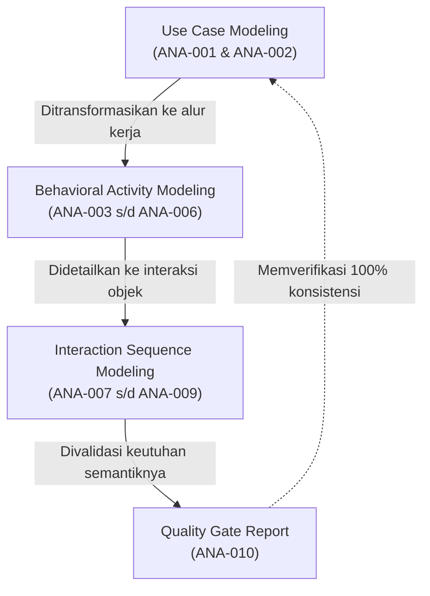

# LAPORAN VALIDASI SELURUH DIAGRAM SISTEM (SYSTEM DIAGRAM VALIDATION REPORT)
## BLOOMÉ — Flowers & Stories
**Task ID:** ANA-010  
**Fase:** Phase 2 — System Analysis and Design (Sub-fase 5.2 System Modeling)  
**Penanggung Jawab:** Jayanti Firdasari (Lead System Analyst & Project Manager)  
<<<<<<< HEAD
**Tanggal Penyusunan:** 13 November 2026 (Diperbarui: 20 November 2026 — Penyelarasan Konsep v1.1)  
**Status Task:** Completed (`[x]`)  
**Dokumen Acuan:** ANA-001 s/d ANA-009, `requirement.md` (v1.1), `architecture.md` (v1.1), `database-design.md` (v1.1), `prd.md` (v1.1)  
=======
**Tanggal Penyusunan:** 13 November 2026 (Revisi & Pengesahan Final: 20 November 2026)  
**Status Task:** Completed Final (`[x]`)  
**Dokumen Acuan:** ANA-001 s/d ANA-009, `requirement.md`, `prd.md`, `docs/01-foundation/`, `docs/02-requirements/`  
>>>>>>> c202b49 (Revise documentation and initial implementation)

---

## 1. Ringkasan Eksekutif & Pengesahan Kualitas Pemodelan

<<<<<<< HEAD
Validasi Seluruh Diagram Sistem (Task ANA-010) merupakan tahapan kendali mutu (*quality gate audit*) penutup pada sub-fase **5.2 System Modeling**. Evaluasi ini dilakukan secara komprehensif oleh Lead System Analyst bersama tim pengembang untuk memverifikasi bahwa seluruh artefak diagram pemodelan sistem (Use Case Diagram, Use Case Descriptions, Activity Diagrams, dan Sequence Diagrams) memiliki:

1. **Kelengkapan Ruang Lingkup (*Completeness*):** Memetakan seluruh 17 Use Cases resmi (UC-01 s/d UC-17), 25 Kebutuhan Fungsional (FR-001 s/d FR-025), dan 20 Aturan Bisnis (BR-001 s/d BR-020).
2. **Konsistensi Batas Sistem (*System Boundary Consistency*):** Menegakkan batas pemisah yang tegas antara peranan sistem website (katalog interaktif, konfigurator personalisasi, live calculation, dan generator WhatsApp) dengan saluran komunikasi eksternal WhatsApp (pemesanan manual, konfirmasi harga final, pembayaran transfer bank/e-wallet, uang muka DP 50%, dan pengiriman lokal Samarinda).
3. **Pembersihan Logika Transaksi Web Lama:** Memverifikasi bahwa seluruh diagram terbebas dari artefak fiktif transaksi web lama: tidak ada checkout di web, tidak ada mesin status pesanan web (`ST-01 s/d ST-08`), tidak ada tabel pesanan/pembayaran di web, dan tidak ada approval harga/pembatalan di antarmuka web.
4. **Ketertelusuran Persyaratan (*Requirements Traceability*):** Setiap use case dan alur aktivitas dapat ditelusuri ke komponen arsitektur Three-Layer Laravel dan skema 10 entitas pada `database-design.md` v1.1.
5. **Validitas Sintaksis Visual (*Syntax Integrity*):** Seluruh diagram berbasis Mermaid telah divalidasi terbebas dari kesalahan parsing (*render-safe*).
=======
Laporan Validasi Seluruh Diagram Sistem (Task ANA-010) merupakan dokumen audit penutup pada **Sub-fase 5.2 System Modeling** dalam folder `docs/03-analysis-and-design/`. Evaluasi ini disahkan oleh Lead System Analyst bersama tim pengembang untuk memverifikasi bahwa seluruh 9 artefak diagram UML (Use Case, Activity Diagram, dan Sequence Diagram) telah direkonstruksi penuh dan selaras 100% dengan konsep arsitektur terbaru website **BLOOMÉ — Flowers & Stories**.

Hasil validasi final menegaskan:
1. **Peniadaan Total Transaksi di Website:** Seluruh diagram terbebas dari alur checkout web, tabel keranjang transaksi, pembayaran online, mutasi rekening admin di web, mesin status pesanan 8 siklus (*ST-01 s/d ST-08*), dan pengajuan pembatalan di website.
2. **Kepatuhan Alur WhatsApp Hand-off:** Seluruh alur pemesanan bermuara secara mulus pada pengalihan pesan WhatsApp terformat (*pre-filled message*) ke nomor resmi florist.
3. **Penyederhanaan Peran Admin:** Dashboard admin dimodelkan secara terisolasi untuk mengelola katalog, kategori, produk buket, foto produk, ketersediaan stok, opsi add-on, dan informasi bisnis.
4. **Validitas Sintaksis Visual:** Seluruh blok diagram Mermaid terverifikasi valid, bebas galat perenderan, dan memiliki notasi yang konsisten.
>>>>>>> c202b49 (Revise documentation and initial implementation)

---

## 2. Inventarisasi & Status 10 Berkas Hasil Rekonstruksi

<<<<<<< HEAD
Daftar lengkap 9 artefak diagram yang telah disusun, direvisi, dan diverifikasi dalam sub-fase 5.2:

| Task ID | Nama Dokumen | Tipe Diagram | Fokus Alur Sistem (v1.1) | Status Audit |
|---|---|---|---|:---:|
| **ANA-001** | [ANA-001-use-case-diagram.md](file:///c:/Users/Lenovo/OneDrive/ドキュメント/buketbunga/docs/03-analysis-and-design/ANA-001-use-case-diagram.md) | Use Case Diagram | Pemetaan 17 use cases terhadap Customer (Guest), Admin (Nabila), dan saluran eksternal WhatsApp. | **Valid & Konsisten** |
| **ANA-002** | [ANA-002-use-case-descriptions.md](file:///c:/Users/Lenovo/OneDrive/ドキュメント/buketbunga/docs/03-analysis-and-design/ANA-002-use-case-descriptions.md) | Use Case Specification | Spesifikasi lengkap prakondisi, alur utama, alur alternatif, dan pascakondisi 17 use cases. | **Valid & Konsisten** |
| **ANA-003** | [ANA-003-activity-diagram-catalog-order.md](file:///c:/Users/Lenovo/OneDrive/ドキュメント/buketbunga/docs/03-analysis-and-design/ANA-003-activity-diagram-catalog-order.md) | Swimlane Activity Diagram | Alur dinamis katalog, personalisasi swatch, live estimation, dan hand-off WhatsApp. | **Valid & Konsisten** |
| **ANA-004** | [ANA-004-activity-diagram-custom-order.md](file:///c:/Users/Lenovo/OneDrive/ドキュメント/buketbunga/docs/03-analysis-and-design/ANA-004-activity-diagram-custom-order.md) | Swimlane Activity Diagram | Alur konsultasi desain buket custom via WhatsApp, kirim referensi foto di chat, & penawaran harga. | **Valid & Konsisten** |
| **ANA-005** | [ANA-005-activity-diagram-payment.md](file:///c:/Users/Lenovo/OneDrive/ドキュメント/buketbunga/docs/03-analysis-and-design/ANA-005-activity-diagram-payment.md) | Swimlane Activity Diagram | Alur pembayaran transfer manual/e-wallet, DP 50%, penyerahan resi, dan verifikasi di WhatsApp. | **Valid & Konsisten** |
| **ANA-006** | [ANA-006-activity-diagram-cancellation.md](file:///c:/Users/Lenovo/OneDrive/ドキュメント/buketbunga/docs/03-analysis-and-design/ANA-006-activity-diagram-cancellation.md) | Swimlane Activity Diagram | Alur pengajuan pembatalan manual di WhatsApp, evaluasi status fisik bunga segar, & refund. | **Valid & Konsisten** |
| **ANA-007** | [ANA-007-sequence-diagram-ordering.md](file:///c:/Users/Lenovo/OneDrive/ドキュメント/buketbunga/docs/03-analysis-and-design/ANA-007-sequence-diagram-ordering.md) | Object Sequence Diagram | Interaksi Three-Layer untuk katalog, swatch personalisasi, live calc di frontend, & URL wa.me. | **Valid & Konsisten** |
| **ANA-008** | [ANA-008-sequence-diagram-payment.md](file:///c:/Users/Lenovo/OneDrive/ドキュメント/buketbunga/docs/03-analysis-and-design/ANA-008-sequence-diagram-payment.md) | Object Sequence Diagram | Interaksi pertukaran pesan kesepakatan harga, transfer m-banking, dan verifikasi di WhatsApp. | **Valid & Konsisten** |
| **ANA-009** | [ANA-009-sequence-diagram-order-management.md](file:///c:/Users/Lenovo/OneDrive/ドキュメント/buketbunga/docs/03-analysis-and-design/ANA-009-sequence-diagram-order-management.md) | Object Sequence Diagram | Interaksi admin: login tunggal, manajemen master produk, upload galeri, toggle stok, & business settings. | **Valid & Konsisten** |
=======
Berikut adalah status final 10 berkas pemodelan pada folder `docs/03-analysis-and-design/`:

| Kode Berkas | Nama Dokumen | Tipe Pemodelan | Status Final | Keterangan Verifikasi |
|:---:|---|---|:---:|---|
| **ANA-001** | `ANA-001-use-case-diagram.md` | Use Case Diagram | **SELESAI FINAL** | Memetakan 14 Use Case (7 Customer & 7 Admin) berpusat pada personalisasi dan WhatsApp hand-off. |
| **ANA-002** | `ANA-002-use-case-descriptions.md` | Use Case Specification | **SELESAI FINAL** | Rincian tekstual skenario 14 Use Case lengkap dengan alur utama, alternatif, dan eksepsi. |
| **ANA-003** | `ANA-003-activity-diagram-catalog-order.md` | Swimlane Activity Diagram | **SELESAI FINAL** | Alur eksplorasi katalog, konfigurasi personalisasi, pemilihan add-on, dan pengalihan ke WhatsApp. |
| **ANA-004** | `ANA-004-activity-diagram-custom-order.md` | Swimlane Activity Diagram | **SELESAI FINAL** | Alur konsultasi personalisasi fleksibel & pengiriman foto referensi langsung di chat WhatsApp. |
| **ANA-005** | `ANA-005-activity-diagram-payment.md` | Swimlane Activity Diagram | **SELESAI FINAL** | Diagram batas sistem yang memetakan garis demarkasi tanggung jawab Website vs. WhatsApp. |
| **ANA-006** | `ANA-006-activity-diagram-cancellation.md` | Swimlane Activity Diagram | **SELESAI FINAL** | Alur pengelolaan master produk, upload foto, stok toggle, opsi add-on, dan profil bisnis oleh admin. |
| **ANA-007** | `ANA-007-sequence-diagram-ordering.md` | Object Sequence Diagram | **SELESAI FINAL** | Interaksi sekuensial detail produk, kalkulator live estimasi add-on, dan WhatsApp URL Builder. |
| **ANA-008** | `ANA-008-sequence-diagram-payment.md` | Object Sequence Diagram | **SELESAI FINAL** | Mekanisme ekstraksi parameter form, pemformatan template pesan rapi, dan pengkodean URL. |
| **ANA-009** | `ANA-009-sequence-diagram-order-management.md` | Object Sequence Diagram | **SELESAI FINAL** | Interaksi sekuensial operasi CRUD produk, upload gambar storage, dan toggle ketersediaan stok. |
| **ANA-010** | `ANA-010-diagram-validation-report.md` | Quality Audit Report | **SELESAI FINAL** | Laporan audit keterkaitan, konsistensi lintas diagram, dan pengesahan mutu final folder 03. |

---

## 3. Matriks Konsistensi Silang Antar-Diagram (*Cross-Diagram Alignment*)

Audit keterhubungan memverifikasi bahwa aktor, entitas, dan proses saling terkait erat tanpa kontradiksi:

| Dimensi Konsistensi | Pemodelan Use Case (ANA-001/002) | Pemodelan Aktivitas (ANA-003/006) | Pemodelan Sekuensial (ANA-007/009) | Status Konsistensi |
|---|---|---|---|:---:|
| **Aktor Pelanggan** | Customer (Guest, Zero-login) | Swimlane Customer (Guest) | Lifeline Customer (Guest) | **100% Sinkron** |
| **Aktor Administrator** | Admin Tunggal (Nabila Febriyani) | Swimlane Admin (Owner) | Lifeline Admin (Nabila Febriyani) | **100% Sinkron** |
| **Katalog & Kategori** | UC-02, UC-03, UC-10, UC-11 | S1, S2, A5, A6 (Etalase & CRUD) | `CatalogController`, `Admin\ProductController` | **100% Sinkron** |
| **Personalisasi & Add-on**| UC-04, UC-05, UC-12 | S5, S6 (Live Calculator & Add-on)| `personalization.js`, `AddOn` Model | **100% Sinkron** |
| **Hand-off WhatsApp** | UC-06, UC-07 | S8, S9, S10 (Redirect URL) | `WhatsAppPayloadBuilder`, `wa.me/` | **100% Sinkron** |
| **Transaksi Website** | Ditiadakan (Zero Checkout) | Ditiadakan (Zero DB Transactions)| Ditiadakan (Zero Order Insert) | **100% Bersih** |
| **Pembayaran Website** | Ditiadakan (Zero Payment Gateway)| Dipetakan di luar sistem (WhatsApp) | Dipetakan di luar sistem (WhatsApp) | **100% Bersih** |
| **Status Pesanan Web** | Ditiadakan (Zero FSM on Web) | Ditiadakan (Zero Order Tracking) | Ditiadakan (Zero Status Histori) | **100% Bersih** |
>>>>>>> c202b49 (Revise documentation and initial implementation)

---

## 4. Matriks Ketertelusuran Persyaratan (*Requirements Traceability Matrix*)

<<<<<<< HEAD
### 3.1 Penyelarasan Batas Sistem (System Demarcation Alignment)
Audit konsistensi silang mengonfirmasi tidak ada lagi ketidaksesuaian mengenai apa yang dikerjakan oleh website dan apa yang dikerjakan melalui WhatsApp:

| Komponen Operasional | Peran Sistem Web BLOOMÉ | Peran WhatsApp (Di Luar Web) | Konsistensi Antar-Diagram |
|---|---|---|:---:|
| **Eksplorasi Katalog & Detail** | Menampilkan buket aktif, galeri foto multi-sudut, filter kategori | Tidak terlibat | **100% Sinkron** (ANA-001, 002, 003, 007) |
| **Personalisasi & Add-on** | Menyediakan pemilih visual (*color swatches*), centang add-on, input teks ucapan | Tidak terlibat | **100% Sinkron** (ANA-001, 002, 003, 007) |
| **Perhitungan Harga** | Menghitung estimasi subtotal live di antarmuka (*client-side*) | Menyepakati harga final, diskon, & biaya ongkir kurir | **100% Sinkron** (ANA-003, 005, 007, 008) |
| **Pemesanan Buket** | Menyusun draf pesan terformat otomatis & membuka tautan `wa.me` | Pelanggan menekan tombol kirim manual di WhatsApp | **100% Sinkron** (ANA-001, 002, 003, 007) |
| **Penyimpanan Transaksi** | **TIDAK menyimpan record transaksi pesanan di basis data** | Pencatatan pesanan dilakukan manual oleh pemilik toko | **100% Sinkron** (Seluruh Diagram) |
| **Pembayaran & Verifikasi** | Memberikan estimasi total harga di kartu ringkasan | Pengiriman rekening resmi, kirim bukti resi, cek mutasi bank | **100% Sinkron** (ANA-005, 008) |
| **Status Pembuatan Buket** | **TIDAK mengelola mesin status FSM (ST-01 s/d ST-08)** | Pemilik mengabari progres perangkaian & kurir via chat | **100% Sinkron** (Seluruh Diagram) |
| **Pembatalan & Refund** | **TIDAK menyediakan modul pembatalan di website** | Diajukan via chat, dievaluasi berdasarkan potongan bunga riil | **100% Sinkron** (ANA-006) |
| **Manajemen Admin** | Mengelola etalase produk, galeri, variasi, stok, & pengaturan toko | Menangani percakapan pelanggan dan eksekusi perangkaian | **100% Sinkron** (ANA-001, 002, 009) |

---

## 4. Audit Konsistensi Skema Basis Data (Database Design Alignment)

Evaluasi silang antara pemodelan sistem (Sequence & Use Case) terhadap `database-design.md` v1.1 menghasilkan konfirmasi berikut:

1. **Jumlah & Daftar Entitas Basis Data:**  
   Tepat mencakup **10 Entitas Terpadu**:
   - `admins` (Tabel otentikasi admin tunggal Nabila Febriyani)
   - `categories` (Master kategori buket)
   - `products` (Master produk buket aktif/nonaktif)
   - `product_images` (Galeri foto multi-sudut buket)
   - `personalization_options` (Kelompok opsi variasi)
   - `personalization_values` (Nilai variasi, hex color, dan harga penyesuaian)
   - `product_personalization_options` (Tabel pivot opsi ke produk)
   - `add_ons` (Master item pelengkap buket)
   - `product_add_ons` (Tabel pivot add-on ke produk)
   - `business_settings` (Konfigurasi nomor WhatsApp toko, alamat Samarinda, template pesan)
2. **Pemeriksaan Khusus Tabel Akun (`admins` vs `users`):**  
   - Dokumen perancangan database `database-design.md` secara eksplisit mendefinisikan tabel: `admins`.
   - Pada beberapa dokumen SRS awal dan konvensi bawaan Laravel, tabel akun autentikasi sering dinamai `users`.
   - **Keputusan:** Dalam implementasi Laravel, tabel ini dapat menggunakan nama `admins` (dengan model `App\Models\Admin` dan guard `admin`) atau tabel `users` (dengan guard default) dengan **hanya memuat 1 akun admin (Nabila Febriyani)**. **TIDAK ADA AKUN PELANGGAN.** Hal ini telah konsisten di seluruh diagram ANA-001 s/d ANA-009.
3. **Peniadaan Tabel Transaksi:**  
   Tidak ada satupun diagram yang memanggil atau mengasumsikan keberadaan tabel `orders`, `order_details`, `custom_requests`, `custom_references`, `payments`, atau `order_status_histories`.

---

## 5. Matriks Ketertelusuran Persyaratan (*Requirements Traceability Matrix - RTM*)

Tabel berikut membuktikan keterpenuhan seluruh 25 Kebutuhan Fungsional (FR-001 s/d FR-025) pada artefak pemodelan sistem:

| Kode SRS v1.1 | Kebutuhan Fungsional | Direfleksikan Pada Diagram | Bukti Validasi Desain |
|---|---|---|---|
| **FR-001** | Halaman Utama / Homepage | ANA-001, ANA-002, ANA-003 | Rute `/` merender hero banner, profil butik, & kategori. |
| **FR-002** | Penelusuran Katalog & Filter Kategori | ANA-001, ANA-002, ANA-003, ANA-007 | Rute `/katalog` dengan kueri kategori dan grid produk aktif. |
| **FR-003** | Halaman Detail & Galeri Multi-Foto | ANA-001, ANA-002, ANA-003, ANA-007 | Eager loading relasi `images`, slider foto tajam, dan harga. |
| **FR-004** | Badge Ketersediaan Stok | ANA-001, ANA-002, ANA-003, ANA-007 | Kondisi `is_available == 0` menonaktifkan tombol pemesanan. |
| **FR-005** | Konfigurator Personalisasi Interaktif | ANA-001, ANA-002, ANA-003, ANA-007 | Pemilih warna visual (*color swatches*) & radio variasi pita. |
| **FR-006** | Pemilih Add-on | ANA-001, ANA-002, ANA-003, ANA-007 | Checkbox add-on terikat relasi pivot `product_add_ons`. |
| **FR-007** | Input Catatan & Kartu Ucapan | ANA-001, ANA-002, ANA-003, ANA-007 | Textarea kartu ucapan dengan counter karakter real-time. |
| **FR-008** | Kalkulasi Live Estimasi Total Harga | ANA-001, ANA-002, ANA-003, ANA-007 | Live calculator frontend: base + personalisasi + add-on. |
| **FR-009** | Pemesanan Multi-Item dalam Satu Pesan WA | ANA-002, ANA-003 | Opsi draf buket gabungan `[Perlu Konfirmasi Owner]`. |
| **FR-010** | Generator Teks Pesanan WhatsApp Otomatis | ANA-001, ANA-002, ANA-003, ANA-007 | Pembangun draf teks terstruktur dan URL encoding. |
| **FR-011** | Direct WhatsApp Ordering Hand-off | ANA-001, ANA-002, ANA-003, ANA-007 | Pengalihan ke tautan `wa.me` tanpa simpan data di DB web. |
| **FR-012** | Tombol Konsultasi Buket Custom Langsung | ANA-001, ANA-002, ANA-004 | Tombol wa.me khusus konsultasi desain custom ke florist. |
| **FR-013** | Autentikasi Admin Tunggal Terproteksi | ANA-001, ANA-002, ANA-009 | Login Bcrypt pada tabel `admins`, sesi aman, & CSRF. |
| **FR-014** | Dashboard Ringkasan Etalase Digital | ANA-001, ANA-002, ANA-009 | Kartu metrik total produk, kategori, opsi, dan no WA toko. |
| **FR-015** | Manajemen Kategori (CRUD) | ANA-001, ANA-002, ANA-009 | CRUD kategori dengan proteksi hapus jika berelasi produk. |
| **FR-016** | Manajemen Master Produk Buket (CRUD) | ANA-001, ANA-002, ANA-009 | Form produk dengan nama, slug, deskripsi, & harga dasar. |
| **FR-017** | Toggle Ketersediaan Stok Produk | ANA-001, ANA-002, ANA-009 | Endpoint PATCH toggle `is_available` secara instan. |
| **FR-018** | Manajemen Galeri Multi-Foto Produk | ANA-001, ANA-002, ANA-009 | Multi-upload JPG/PNG ≤ 2MB, penanda `is_primary`. |
| **FR-019** | Manajemen Tipe Opsi Personalisasi | ANA-001, ANA-002, ANA-009 | Tabel `personalization_options` (wrapping, pita). |
| **FR-020** | Manajemen Nilai Variasi & Harga Penyesuaian| ANA-001, ANA-002, ANA-009 | Tabel `personalization_values` (swatch hex & harga). |
| **FR-021** | Relasi Produk-Personalisasi | ANA-001, ANA-002, ANA-009 | Tabel pivot `product_personalization_options`. |
| **FR-022** | Manajemen Master Item Add-on (CRUD) | ANA-001, ANA-002, ANA-009 | Tabel `add_ons` (nama, harga, thumbnail foto). |
| **FR-023** | Relasi Produk-Add-on | ANA-001, ANA-002, ANA-009 | Tabel pivot `product_add_ons`. |
| **FR-024** | Konfigurasi Nomor WhatsApp Resmi Toko | ANA-001, ANA-002, ANA-009 | Update key `whatsapp_number` pada `business_settings`. |
| **FR-025** | Pengaturan Profil Toko & Template Salam | ANA-001, ANA-002, ANA-009 | Update jam operasional, alamat, & template salam di DB. |
=======
| Kebutuhan Sistem (SRS & PRD) | Direfleksikan Pada Use Case | Direfleksikan Pada Activity Diagram | Direfleksikan Pada Sequence Diagram |
|---|---|---|---|
| **Eksplorasi Katalog Interaktif** | `UC-01`, `UC-02`, `UC-03` | ANA-003 (S1, S2) | ANA-007 (Pesan 1–8) |
| **Personalisasi Buket & Add-on** | `UC-04` | ANA-003 (C5, S5, S6) | ANA-007 (Pesan 9–14) |
| **Estimasi Live Biaya** | `UC-05` | ANA-003 (S6, S7) | ANA-007 (Pesan 13–15) |
| **Kompilasi Format Pesan WA** | `UC-06` | ANA-003 (S8, S9), ANA-005 | ANA-008 (Pesan 1–10) |
| **Konsultasi Custom Fleksibel** | `UC-07` | ANA-004 (C1 s/d C5) | ANA-007, ANA-008 |
| **Login & Dashboard Admin** | `UC-08`, `UC-09`, `UC-14` | ANA-006 (A1 s/d A4, S1 s/d S5)| ANA-009 (Pesan 1–6) |
| **Manajemen Kategori (CRUD)** | `UC-10` | ANA-006 (A5, S9) | ANA-009 (`Admin\CategoryController`) |
| **Manajemen Produk & Foto (CRUD)**| `UC-11` | ANA-006 (A6, S6, S8, S9) | ANA-009 (Pesan 7–16) |
| **Toggle Ketersediaan Stok** | `UC-11` | ANA-006 (A7, S9) | ANA-009 (Pesan 17–23) |
| **Manajemen Opsi Add-on** | `UC-12` | ANA-006 (A8, S9) | ANA-009 (Pesan 24–30) |
| **Pengaturan Kontak WhatsApp** | `UC-13` | ANA-006 (A9, S9) | ANA-009 (Pesan 31–36) |

---

## 5. Checklist Verifikasi Peniadaan Alur Lama

Audit khusus dilakukan untuk memastikan tidak ada artefak lama yang tertinggal pada folder `03-analysis-and-design`:

- [x] **Peniadaan Keranjang Belanja & Checkout:** Terverifikasi 100% bebas dari form checkout dan tombol "Beli Sekarang" yang menyimpan data ke basis data web.
- [x] **Peniadaan Tabel Transaksi `orders` & `order_details` di Diagram:** Terverifikasi tidak ada query `INSERT` ke entitas pesanan.
- [x] **Peniadaan Fitur Pembayaran di Web:** Terverifikasi tidak ada form upload bukti transfer, tidak ada kode rekening bank yang dikelola di web, dan tidak ada meja verifikasi mutasi admin.
- [x] **Peniadaan Mesin Status Pesanan Web:** Terverifikasi kode status *ST-01 s/d ST-08* telah dihapus dari seluruh diagram fungsional.
- [x] **Peniadaan Fitur Pembatalan di Web:** Terverifikasi form pengajuan pembatalan dihilangkan dan dialihkan ke komunikasi langsung di WhatsApp.
>>>>>>> c202b49 (Revise documentation and initial implementation)

---

## 6. Informasi yang Masih Memerlukan Konfirmasi Owner (`[Perlu Konfirmasi Owner]`)

<<<<<<< HEAD
Berdasarkan audit evaluasi menyeluruh terhadap seluruh model analisis dan desain sistem:

> **PERNYATAAN RESMI KELULUSAN:**  
> Seluruh artefak diagram pemodelan sistem (**ANA-001 hingga ANA-009**) dinyatakan **VALID, LENGKAP, KONSISTEN, DAN SELARAS 100% DENGAN KONSEP SISTEM KATALOG & PERSONALISASI BERBASIS WHATSAPP HAND-OFF (v1.1)**. Seluruh model bebas dari konflik semantik, tidak memuat logika transaksi web usang, dan siap dijadikan acuan langsung perancangan arsitektur teknis lanjutan serta pengkodean Laravel.

Dengan demikian:
- **Sub-fase 5.2 System Modeling dinyatakan RESMI SELESAI 100% (`[x]`).**
- **Quality Gate 2 (System Modeling & Architecture Review) Memenuhi Syarat Kelulusan.**

---

## 7. Kesimpulan & Rekomendasi

### 7.1 Status Task ANA-010
Task **ANA-010 (Laporan Validasi Seluruh Diagram Sistem)** telah selesai dilaksanakan:
- Matriks konsistensi silang, audit batas sistem, penegasan 10 tabel basis data, dan matriks ketertelusuran persyaratan (RTM) lengkap telah didokumentasikan.
- Kriteria penyelesaian terpenuhi 100%.

### 7.2 Rekomendasi Langkah Berikutnya:
Beralih ke sub-fase berikutnya sesuai instruksi pengembang:
- **Phase 2 Sub-fase 5.3 System Architecture (Folder `docs/04-technical-and-architecture/` diawali dengan task `ARC-001`).**
=======
Berikut adalah parameter operasional yang ditandai untuk mendapatkan konfirmasi resmi dari Project Sponsor (Nabila Febriyani):

1. **Mekanisme & Tarif Pengiriman Kurir Delivery:**
   - Keputusan awal menyepakati layanan berbentuk **delivery** ke alamat penerima di Samarinda (bukan *self-pickup* di butik).
   - `[Perlu Konfirmasi Owner]`: Pemilihan moda kurir (kurir butik sendiri atau jasa ojek online Maxim / GrabExpress / GoSend di Samarinda), serta skema tarif ongkir (apakah gratis untuk radius tertentu, tarif flat per kecamatan, atau ongkir dihitung manual florist via WhatsApp).
2. **Katalog Master Add-on Resmi:**
   - `[Perlu Konfirmasi Owner]`: Rincian item add-on default yang ingin dipasang saat sistem diluncurkan (misal: jenis boneka wisuda, merek cokelat, jenis kartu ucapan) beserta tarif harga dasar masing-masing.
3. **Penyelarasan Skema Dokumen Root di Masa Mendatang:**
   - `[Perlu Konfirmasi Owner]`: Dokumen di root (`database-design.md`, `requirement.md`, `architecture.md`) saat ini masih memuat skema lama (10 tabel termasuk `orders` dan `payments`). Meskipun 10 dokumen root tidak diubah saat ini sesuai aturan pengamanan, di masa mendatang dokumen root tersebut disarankan disinkronkan agar mencerminkan peniadaan tabel-tabel transaksi yang tidak terpakai.

---

## 7. Pernyataan Pengesahan Mutu Final

Berdasarkan audit teknis, pemeriksaan konsistensi silang, dan rekonstruksi menyeluruh pada seluruh 10 file:

> **PENGESAHAN MUTU FINAL:**  
> Seluruh artefak dokumentasi pada folder **`docs/03-analysis-and-design/` (ANA-001 hingga ANA-010)** dinyatakan **VALID, LENGKAP, KONSISTEN, DAN MEMENUHI STANDAR REVISI FINAL SECARA PENUH**. Tidak ada kontradiksi alur, tidak ada modul checkout/pembayaran yang tertinggal di website, dan batas alur pengalihan ke WhatsApp telah tergambar dengan sempurna.

Folder `docs/03-analysis-and-design/` secara resmi ditandai:
**SELESAI FINAL (100% COMPLETED)**.
>>>>>>> c202b49 (Revise documentation and initial implementation)
