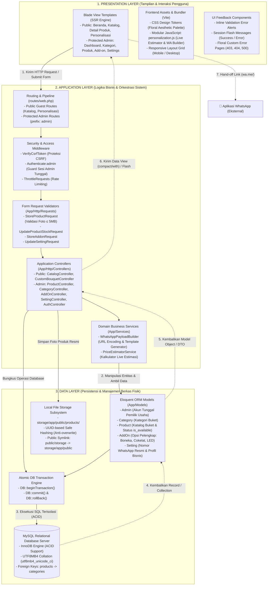

# PENETAPAN THREE-LAYER ARCHITECTURE (THREE-LAYER ARCHITECTURE SPECIFICATION)
## BLOOMÉ — Flowers & Stories
**Task ID:** ARC-001  
**Fase:** Phase 2 — System Analysis and Design (Sub-fase 5.3 System Architecture)  
**Penanggung Jawab:** Elsa Futri (Lead Software Architect & Backend Developer) & Jayanti Firdasari (Project Manager & System Analyst)  
**Tanggal Penyusunan:** 13 November 2026 (Revisi Final: 20 November 2026)  
**Status Task:** Completed Final (`[x]`)  
**Dependensi:** ANA-010 — Validasi seluruh diagram (Selesai Final), DOC-016 — Arsitektur Sistem  

---

## 1. Ringkasan Eksekutif & Landasan Filosofis

Penetapan Three-Layer Architecture (Task ARC-001) dilakukan untuk merumuskan secara tegas dan mengikat pembagian batas tanggung jawab komputasi (*Separation of Concerns - SoC*) dalam pengembangan website **BLOOMÉ — Flowers & Stories**. 

Penerapan pola arsitektur tiga lapis (*Three-Layer Architecture Pattern*) pada ekosistem **Laravel 13.43.0 (PHP 8.5.5; Composer constraint `^8.3`)** dan **MySQL 8.0+** diselaraskan dengan konsep arsitektur terkini:
1. **Hakikat Sistem:** Website bertindak sebagai **katalog interaktif dan media personalisasi buket** yang menghubungkan eksplorasi pelanggan secara langsung ke saluran **WhatsApp resmi butik**.
2. **Peniadaan Transaksi di Website (*Zero-Checkout Architecture*):** Website tidak menyediakan keranjang belanja checkout, tidak menyimpan rekaman transaksi di basis data, dan tidak mengelola pembayaran online. Transaksi, pembayaran manual m-banking, dan konfirmasi pengiriman diselesaikan langsung via WhatsApp.
3. **Pemisahan Lapisan yang Bersih (*Clean Layer Boundaries*):**
   - **Presentation Layer:** Mengelola rendering antarmuka SSR Blade, interaktivitas pemilihan add-on, live kalkulasi estimasi harga, dan pemicuan hand-off WhatsApp.
   - **Application Layer:** Mengelola routing deklaratif, proteksi sesi admin tunggal (`auth:admin`), validasi input form request, serta perakitan URL WhatsApp terenkoding (*pre-filled message builder*).
   - **Data Layer:** Mengelola persistensi data master katalog, produk, kategori, opsi add-on, pengaturan bisnis, dan penyimpanan aman berkas foto produk resmi di storage lokal.

---

## 2. Diagram Spesifikasi Three-Layer Architecture

Arsitektur aplikasi membagi sistem menjadi tiga tingkatan logis dengan arah ketergantungan searah (*unidirectional dependency flow*):



---

## 3. Spesifikasi Mendalam Setiap Lapisan

### 3.1 Lapisan 1: Presentation Layer (Antarmuka Pengguna)
- **Tanggung Jawab Utama:**
  1. Merender antarmuka pengguna berbasis Server-Side Rendering (SSR) menggunakan mesin template Laravel Blade.
  2. Menyajikan etalase katalog produk yang responsif dan estetis sesuai panduan visual `design-system.md` (*Floral Boutique Concept*).
  3. Mengelola interaktivitas formulir personalisasi buket (pilihan warna kertas pembungkus/wrapping, warna pita satin, checklist add-on berbayar, dan penulisan teks kartu ucapan) menggunakan `personalization.js`.
  4. Menampilkan penghitungan *live estimation* total biaya secara real-time di sisi peramban.
  5. Menyusun parameter URL WhatsApp terenkoding dan memicu pengalihan peramban (*browser redirect*) ke aplikasi WhatsApp.
  6. Menyajikan panel dashboard admin untuk pemeliharaan konten etalase.
- **Komponen Teknis:**
  - `resources/views/layouts/`: Kerangka layout induk publik (`app.blade.php`) dan layout induk admin (`admin.blade.php`).
  - `resources/views/pages/public/`: Halaman beranda (`home.blade.php`), katalog (`catalog/index.blade.php`), detail produk & personalisasi (`catalog/show.blade.php`), dan panduan custom (`custom/index.blade.php`).
  - `resources/views/pages/admin/`: Dashboard metrik (`admin/dashboard.blade.php`), manajemen produk (`admin/products/`), kategori (`admin/categories/`), add-on (`admin/addons/`), dan pengaturan profil (`admin/settings/`).
  - `resources/js/personalization.js`: Skrip penanganan state pilihan buket, kalkulasi subtotal add-on, dan generator pesan WhatsApp.
  - `resources/css/`: Variabel token warna, tipografi *Playfair Display* & *Poppins*, serta komponen CSS modular.
- **Batasan Keras (*Constraints*):**
  - **DILARANG** memanggil query database langsung dari file template Blade (misal: dilarang menulis `Product::all()` di dalam view).
  - **DILARANG** menyertakan form checkout belanja yang mengumpulkan data perbankan pelanggan di antarmuka web.

---

### 3.2 Lapisan 2: Application Layer (Logika Bisnis & Orkestrasi Sistem)
- **Tanggung Jawab Utama:**
  1. Mengarahkan rute HTTP yang masuk ke middleware otentikasi/keamanan dan controller yang relevan (`routes/web.php`).
  2. Melindungi akses administratif hanya untuk **satu akun admin pemilik usaha** menggunakan guard `auth:admin`.
  3. Memvalidasi integritas data masukan formulir dan berkas gambar (JPG/PNG $\le$ 5MB) melalui Form Request khusus sebelum data diproses controller.
  4. Menyediakan layanan domain `WhatsAppPayloadBuilder` untuk mengonversi data formulir personalisasi menjadi untaian teks pesan terformat rapi dengan enkoding karakter aman (`rawurlencode`).
  5. Mengelola unggahan berkas foto produk resmi ke storage lokal dengan sanitasi nama berkas hash acak (UUID v4).
- **Komponen Teknis:**
  - `routes/web.php`: Rute publik (katalog, personalisasi buket) dan rute terproteksi admin (`prefix('admin')`).
  - `App\Http\Middleware\`:
    - `Authenticate`: Memvalidasi sesi aktif admin tunggal (`auth:admin`).
    - `VerifyCsrfToken`: Melindungi seluruh formulir POST dari serangan Cross-Site Request Forgery.
    - `ThrottleRequests`: Pembatas frekuensi request login untuk mencegah serangan brute force.
  - `App\Http\Requests\`:
    - `StoreProductRequest`: Validasi nama, kategori, harga, komposisi bunga, dan unggah foto ($\le$ 5MB).
    - `UpdateProductRequest`: Validasi penyuntingan data produk buket.
    - `StoreAddonRequest`: Validasi nama item add-on dan tarif harga tambahan.
    - `UpdateSettingRequest`: Validasi nomor WhatsApp resmi dan data profil bisnis.
  - `App\Http\Controllers\`:
    - Publik: `CatalogController`, `CustomBouquetController`.
    - Admin: `Admin\AuthController`, `Admin\DashboardController`, `Admin\ProductController`, `Admin\CategoryController`, `Admin\AddOnController`, `Admin\SettingController`.
  - `App\Services\`:
    - `WhatsAppPayloadBuilder`: Pembangkit teks pesan WhatsApp terformat otomatis dan perakit tautan universal `https://wa.me/`.
    - `PriceEstimatorService`: Layanan kalkulasi harga estimasi buket + add-on.
- **Batasan Keras (*Constraints*):**
  - Controller **DILARANG** memproses transaksi pesanan, nomor resi kurir, atau mutasi rekening perbankan.

---

### 3.3 Lapisan 3: Data Layer (Persistensi & Manajemen Berkas Fisik)
- **Tanggung Jawab Utama:**
  1. Mengelola skema dan relasi basis data relasional melalui definisi Eloquent ORM.
  2. Menjamin transaksi basis data multi-tabel bersifat atomik melalui `DB::transaction()`.
  3. Mengelola persistensi fisik berkas foto produk resmi pada media penyimpanan lokal `storage/app/public/products/`.
  4. Menjamin keamanan berkas gambar dari eksekusi skrip berbahaya (*Zero Script Execution in Uploads*).
- **Komponen Teknis:**
  - `App\Models\`:
    - `Admin`: Kredensial akun tunggal pemilik usaha (Nabila Febriyani).
    - `Category`: Kategori buket bunga (nama, slug unik, deskripsi).
    - `Product`: Master produk buket katalog (nama, slug, harga, deskripsi, image_path, is_available).
    - `AddOn`: Opsi pelengkap buket (nama, harga_tambahan, is_active).
    - `Setting`: Konfigurasi profil bisnis butik (nomor WhatsApp resmi, alamat butik, jam buka).
  - `database/migrations/`: Skema DDL tabel relasional dengan indeks, primary key, dan foreign key constraints.
  - `database/seeders/`: Data inisialisasi awal (akun admin default, kategori buket, katalog buket default, master add-on awal).
  - `Illuminate\Support\Facades\Storage`: Driver penyimpanan lokal disk untuk foto produk katalog.
- **Catatan Penyelarasan Tabel Root (*Legacy Schema Alignment*):**
  - Entitas `orders`, `order_details`, `custom_requests`, `custom_references`, `payments`, dan `order_status_histories` yang tercantum pada dokumen root `database-design.md` versi lama berstatus **inaktif / deprecated** pada alur kerja operasional website terkini (`[Perlu Konfirmasi Owner]`).

---

## 4. Aturan Penegakan Batas Antar-Lapisan (*Layer Boundary Rules*)

| Lapisan Asal | Lapisan yang Boleh Diakses | Lapisan yang DILARANG Diakses | Protokol Komunikasi yang Sah |
|---|---|---|---|
| **Presentation Layer** | Application Layer (via HTTP Route & Form Action) | Data Layer (Dilarang panggil Model / Database langsung) | Mengirim Form POST/GET, menerima variabel terkompilasi dari Controller. Hand-off ke WhatsApp via `window.location`. |
| **Application Layer** | Presentation Layer (Kirim data view) & Data Layer (Panggil Model & Service) | - | Meneruskan data via `view('nama.view', $data)` atau `redirect()`. Memanggil method Model & Service. |
| **Data Layer** | RDBMS MySQL & Local Disk Storage | Presentation Layer & HTTP Routing | Model hanya mengembalikan data murni (Object/Array/Collection) ke Application Layer. |

---

## 5. Pemetaan Struktur Direktori Proyek Laravel Terkini

```text
buketbunga/
├── app/
│   ├── Http/                           # === APPLICATION LAYER ===
│   │   ├── Controllers/
│   │   │   ├── CatalogController.php        # Eksplorasi katalog & detail produk
│   │   │   ├── CustomBouquetController.php  # Panduan konsultasi custom
│   │   │   └── Admin/                       # Dashboard Back-Office Terproteksi
│   │   │       ├── AuthController.php       # Login & logout admin tunggal
│   │   │       ├── DashboardController.php  # Ringkasan metrik konten
│   │   │       ├── ProductController.php    # CRUD buket, upload foto & toggle stok
│   │   │       ├── CategoryController.php   # CRUD master kategori
│   │   │       ├── AddOnController.php      # CRUD master add-on & tarif
│   │   │       └── SettingController.php    # Update nomor WA & profil bisnis
│   │   ├── Middleware/
│   │   │   └── Authenticate.php             # Guard auth:admin
│   │   └── Requests/                        # Validasi Form Input
│   │       ├── Admin/
│   │       │   ├── StoreProductRequest.php  # Validasi produk & foto ≤ 5MB
│   │       │   ├── UpdateProductRequest.php
│   │       │   ├── StoreAddonRequest.php
│   │       │   └── UpdateSettingRequest.php
│   ├── Models/                         # === DATA LAYER ===
│   │   ├── Admin.php                        # Akun tunggal admin
│   │   ├── Category.php                     # Kategori buket
│   │   ├── Product.php                      # Produk buket & toggle ketersediaan
│   │   ├── AddOn.php                        # Item pelengkap (boneka, LED, dll)
│   │   └── Setting.php                      # Konfigurasi nomor WA resmi butik
│   └── Services/                       # === DOMAIN SERVICES ===
│       ├── WhatsAppPayloadBuilder.php       # Kompilasi pesan & generator tautan wa.me
│       └── PriceEstimatorService.php        # Kalkulator estimasi harga
├── database/                           # === DATA LAYER MIGRATIONS & SEEDS ===
│   ├── migrations/
│   │   ├── 2026_11_13_000001_create_admins_table.php
│   │   ├── 2026_11_13_000002_create_categories_table.php
│   │   ├── 2026_11_13_000003_create_products_table.php
│   │   ├── 2026_11_13_000004_create_add_ons_table.php
│   │   └── 2026_11_13_000005_create_settings_table.php
│   └── seeders/
│       ├── DatabaseSeeder.php
│       ├── AdminSeeder.php
│       ├── CategorySeeder.php
│       ├── ProductSeeder.php
│       └── AddOnSeeder.php
├── resources/                          # === PRESENTATION LAYER ===
│   ├── css/
│   │   ├── app.css
│   │   └── design-system.css                # Token warna, tipografi, grid
│   ├── js/
│   │   ├── app.js
│   │   └── personalization.js               # State selector, live price & WA dispatcher
│   └── views/
│       ├── layouts/
│       │   ├── app.blade.php                # Master layout publik floral
│       │   └── admin.blade.php              # Master layout admin dashboard
│       ├── pages/
│       │   ├── home.blade.php               # Beranda & profil butik
│       │   ├── catalog/
│       │   │   ├── index.blade.php          # Etalase produk & filter
│       │   │   └── show.blade.php           # Detail buket & personalisasi form
│       │   ├── custom/
│       │   │   └── index.blade.php          # Panduan konsultasi custom buket
│       │   └── admin/                       # Panel back-office admin
│       └── errors/
│           ├── 403.blade.php
│           ├── 404.blade.php
│           └── 500.blade.php
├── routes/                             # === APPLICATION LAYER ROUTING ===
│   └── web.php
└── storage/                            # === LOCAL PHYSICAL STORAGE ===
    └── app/public/
        └── products/                        # Berkas foto resmi produk katalog
```

---

## 6. Kesimpulan
Task **ARC-001 (Three-Layer Architecture)** telah diselaraskan secara menyeluruh. Struktur lapisan komputasi telah mematuhi prinsip *Zero-Checkout Architecture*, memposisikan website sebagai media katalog interaktif dan personalisasi buket bunga, dengan WhatsApp sebagai gerbang penyelesaian transaksi.
