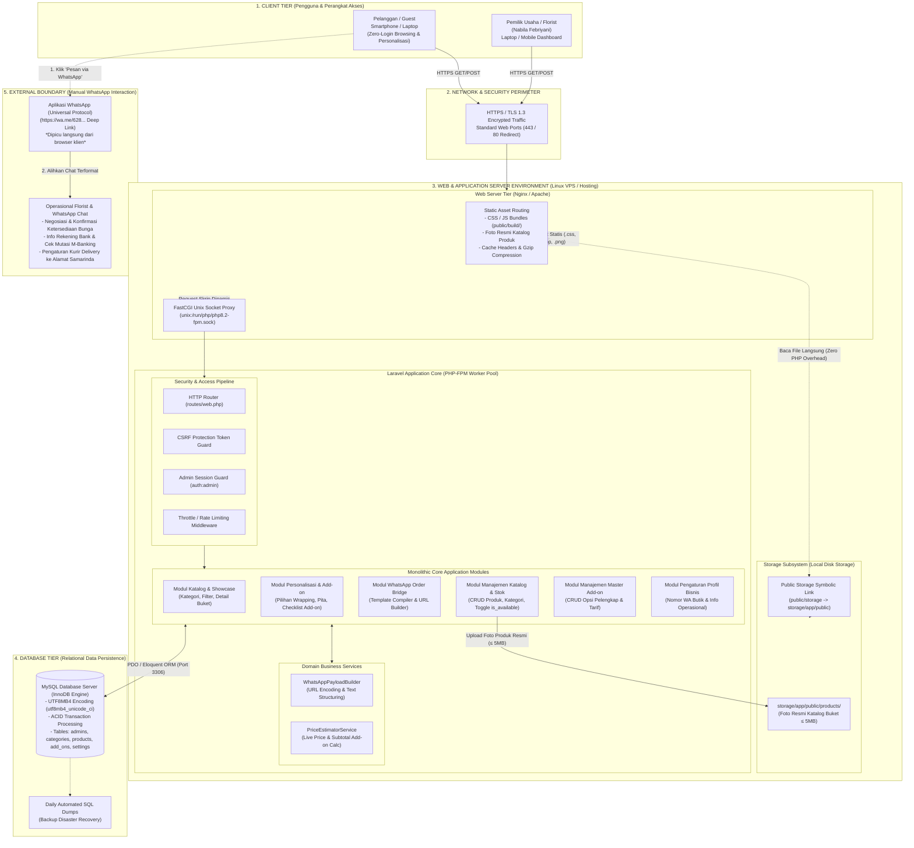

# HIGH-LEVEL ARCHITECTURE DIAGRAM SPECIFICATION
## BLOOMÉ — Flowers & Stories
**Task ID:** ARC-002  
**Fase:** Phase 2 — System Analysis and Design (Sub-fase 5.3 System Architecture)  
**Penanggung Jawab:** Elsa Futri (Lead Software Architect & Backend Developer) & Jayanti Firdasari (Project Manager & System Analyst)  
**Tanggal Penyusunan:** 13 November 2026 (Revisi Final: 20 November 2026)  
**Status Task:** Completed Final (`[x]`)  
**Dependensi:** ARC-001 — Three-Layer Architecture (Selesai Final), DOC-016 — Arsitektur Sistem  

---

## 1. Ringkasan Eksekutif & Karakteristik Topologi

Perancangan High-Level Architecture Diagram (Task ARC-002) bertujuan untuk memberikan gambaran makro terpadu (*bird's-eye view*) mengenai topologi infrastruktur, batasan fisik dan logis, serta alur integrasi data pada website **BLOOMÉ — Flowers & Stories**.

Sesuai konsep sistem terkini:
1. **Client Tier:** Mengakomodasi akses publik tanpa akun (*guest*) bagi pelanggan melalui perangkat seluler dan desktop, serta antarmuka back-office untuk satu akun admin pemilik usaha (Nabila Febriyani).
2. **Network & Perimeter Tier:** Mengamankan kanal transmisi data menggunakan enkripsi wajib HTTPS (TLS 1.3 / Port 443).
3. **Web Server & Runtime Tier:** Pemanfaatan Nginx/Apache untuk penyajian aset statis berkinerja tinggi serta penerusan request dinamis ke worker pool PHP-FPM 8.2+.
4. **Application Core Monolith:** Arsitektur monolitik modern berbasis Laravel 13.43.0 (PHP 8.5.5) yang mengintegrasikan modul katalog, modul personalisasi interaktif, dan generator tautan WhatsApp.
5. **Data & Storage Tier:** Persistensi relasional pada MySQL 8.0+ (InnoDB Engine) dan penyimpanan foto produk buket resmi di disk storage lokal.
6. **External Integration Boundary (WhatsApp Hand-off):** Penegasan model tanpa payment gateway (*gateway-less*) dan tanpa bot otomatisasi (*bot-less*), di mana transaksi, pembayaran m-banking, dan koordinasi pengiriman delivery berlangsung langsung di ruang obrolan WhatsApp.

---

## 2. High-Level System Architecture Diagram

---

## 3. Rincian Arsitektur & Tanggung Jawab Sub-Sistem

### 3.1 Client Tier (Perangkat Pengguna)
- **Pelanggan Publik (Guest):** Mengakses website tanpa proses registrasi atau autentikasi (*zero-login browsing*). Dapat memilih produk, mengonfigurasi warna wrapping dan pita, memilih add-on, melihat estimasi total tagihan, dan mengeksekusi hand-off ke WhatsApp.
- **Admin (Nabila Febriyani):** Mengakses area administratif melalui satu akun login terenkripsi untuk mengelola data etalase dan informasi operasional.

### 3.2 Network Perimeter & Security Tier
- Seluruh trafik data dienkripsi dengan protokol **HTTPS (TLS 1.3 / TLS 1.2)** pada port standar 443.
- Port 80 (HTTP) dialihkan secara permanen (*301 Redirect*) ke HTTPS.
- Port MySQL 3306 dibatasi secara ketat hanya untuk koneksi lokal (*loopback* `127.0.0.1` atau UNIX socket) dan diisolasi dari akses publik.

### 3.3 Web Server & FastCGI Runtime Tier
- **Nginx / Apache:**
  - Melayani aset CSS, JavaScript terkompilasi Vite, dan berkas foto produk secara langsung dari symlink `public/storage` tanpa membebani thread PHP.
  - Berfungsi sebagai reverse proxy yang meneruskan seluruh permintaan dinamis ke soket FastCGI PHP-FPM.
- **PHP-FPM (PHP 8.5.5):**
  - Mengelola worker pool proses PHP untuk mengeksekusi kernel Laravel secara efisien dan terisolasi.

### 3.4 Application Core Tier (Monolithic Laravel Application)
1. **Pipeline Middleware & Keamanan:**
   - `VerifyCsrfToken`: Memastikan keamanan formulir POST admin dari serangan pemalsuan request.
   - `Authenticate:admin`: Melindungi seluruh rute berawalan `/admin/*`.
   - `ThrottleRequests`: Membatasi percobaan login admin untuk mencegah serangan brute force.
2. **Modul Aplikasi Inti:**
   - **Catalog & Showcase Module:** Menampilkan kartu buket, filter kategori bunga, dan lembar detail produk.
   - **Personalization & Add-on Module:** Formulir interaktif pemilihan warna pembungkus/wrapping, pita satin, checklist add-on berbayar, dan input pesan kartu ucapan.
   - **WhatsApp Order Bridge Module:** Merangkum seluruh konfigurasi pesanan menjadi teks pesan terstruktur dan menyusun URL `https://wa.me/`.
   - **Admin Management Modules:** Pengelolaan kategori (CRUD), produk buket & unggah foto resmi (CRUD), toggle status stok ketersediaan, manajemen master add-on, serta pengaturan nomor WhatsApp resmi butik.
3. **Domain Business Services:**
   - `WhatsAppPayloadBuilder`: Layanan perakit string teks pesan rapi dan pengkodean URL RFC 3986 (`rawurlencode`).
   - `PriceEstimatorService`: Layanan kalkulasi live subtotal add-on dan estimasi total biaya.

### 3.5 Data & Storage Tier
- **MySQL Database Server (InnoDB Engine):**
  - Menyimpan data terstruktur untuk entitas `admins`, `categories`, `products`, `add_ons`, dan `settings`.
  - Menggunakan engine InnoDB dengan collation `utf8mb4_unicode_ci` dan foreign key constraints relasi kategori-produk.
- **Local File Storage Subsystem:**
  - Terletak pada direktori aman `storage/app/public/products/`.
  - Berkas foto produk diberi nama acak hash UUID v4 (misal: `d4b8e210-91a3-4a11-824e-b5c6d7e8f9a0.webp`) dan diakses melalui symbolic link `public/storage`.

### 3.6 External Boundary (WhatsApp Hand-off & Out-of-Band Operations)
- Sistem website tidak memiliki dependensi terhadap API pihak ketiga berbayar (seperti Midtrans atau WhatsApp Business Cloud API).
- Seluruh koordinasi transaksi (pemberian nomor rekening bank, bukti transfer m-banking, pengecekan mutasi manual oleh florist, perangkaian fisik buket, konfirmasi tarif kurir delivery Samarinda, dan purna-jual) berlangsung secara manual di ruang obrolan WhatsApp.

---

## 4. Karakteristik & Kualitas Arsitektur (*Quality Attributes*)

| Atribut Kualitas | Strategi Arsitektur yang Diterapkan | Target Kinerja / Keamanan |
|---|---|:---:|
| **Kinerja (*Performance*)** | Penyajian aset statis langsung via web server (zero PHP), optimasi query Eloquent dengan *eager loading*, dan rendering SSR Blade ringan. | Waktu muat halaman (*Response Time*) $\le$ 2,0 detik pada jaringan seluler 4G. |
| **Keamanan (*Security*)** | Enkripsi wajib HTTPS, sanitasi upload gambar (format JPG/PNG $\le$ 5MB), hashing kata sandi Bcrypt, dan proteksi CSRF. | Nol celah kerentanan OWASP Top 10 umum. |
| **Ketersediaan (*Availability*)** | Peniadaan gateway pembayaran online memastikan website tetap dapat beroperasi 100% tanpa risiko terganggu oleh *downtime* pihak ketiga. | Operasional etalase siap 24/7. |
| **Kemudahan Pemeliharaan** | Penerapan Three-Layer Architecture memastikan keterkaitan antar-komponen tetap rendah (*loose coupling*) dan mudah dikembangkan. | Modifikasi tampilan dan penambahan varian buket tidak merusak modul lain. |

---

## 5. Kesimpulan
Task **ARC-002 (High-Level Architecture Diagram)** telah selesai direvisi penuh. Topologi sistem memposisikan website sebagai media katalog interaktif dan media personalisasi buket bunga yang terhubung ke saluran WhatsApp tanpa beban modul transaksi di website.
