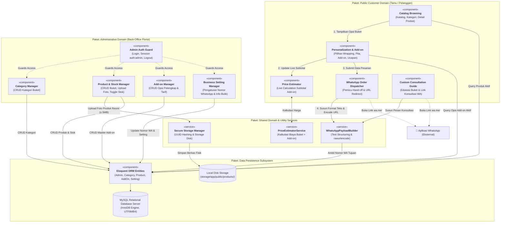

# DIAGRAM KOMPONEN APLIKASI (APPLICATION COMPONENT DIAGRAM SPECIFICATION)
## BLOOMÉ — Flowers & Stories
**Task ID:** ARC-003  
**Fase:** Phase 2 — System Analysis and Design (Sub-fase 5.3 System Architecture)  
**Penanggung Jawab:** Elsa Futri (Lead Software Architect & Backend Developer) & Jayanti Firdasari (Project Manager & System Analyst)  
**Tanggal Penyusunan:** 13 November 2026 (Revisi Final: 20 November 2026)  
**Status Task:** Completed Final (`[x]`)  
**Dependensi:** ARC-001 — Three-Layer Architecture, ARC-002 — High-Level Architecture Diagram  

---

## 1. Ringkasan Eksekutif & Karakteristik Komponen

Perancangan Diagram Komponen Aplikasi (Task ARC-003) disusun untuk mendefinisikan dekomposisi struktural modular dari sistem perangkat lunak **BLOOMÉ — Flowers & Stories**. Diagram ini memetakan komponen-komponen perangkat lunak independen, antarmuka kontrak (*provided & required interfaces*), serta relasi ketergantungan (*dependencies*) antar-subsistem.

Sesuai ketentuan arsitektur baru:
1. **Peniadaan Komponen Transaksional Web:** Komponen checkout, pembayaran transfer online, verifikasi mutasi rekening, dan manajemen siklus status pesanan telah dieliminasi dari sistem perangkat lunak website.
2. **Modularitas Katalog & Personalisasi:** Sistem dibagi ke dalam modul-modul fungsional yang kohesif: penjelajahan katalog, konfigurasi personalisasi & add-on, kalkulator estimasi live, jembatan pengalihan pesan WhatsApp, serta pengelolaan master etalase oleh admin tunggal.
3. **Ketergantungan Asiklis (*Acyclic Dependencies Principle - ADP*):** Struktur paket dirancang bersih searah tanpa adanya dependensi sirkular antar-komponen.

---

## 2. Diagram Komponen Sistem (Component Diagram)

---

## 3. Spesifikasi Kontrak Antarmuka Komponen (*Interface Contracts*)

### 3.1 Komponen Domain Publik (*Public Customer Domain*)

#### 1. Catalog Browsing Component
- **Fungsi:** Menyajikan daftar katalog buket bunga dengan filter kategori, pagination, dan pratinjau detail produk.
- **Provided Interfaces:**
  - `GET /katalog` $\rightarrow$ Menyajikan daftar buket aktif (`is_available = 1`).
  - `GET /katalog/{slug}` $\rightarrow$ Menyajikan detail komposisi buket, foto galeri, dan harga dasar.
- **Required Interfaces:** `Product`, `Category` (Eloquent ORM).
- **Artefak Terkait:** `CatalogController.php`, `catalog/index.blade.php`, `catalog/show.blade.php`.

#### 2. Personalization & Add-on Component
- **Fungsi:** Menyediakan antarmuka interaktif bagi pelanggan untuk memilih warna kertas wrapping, warna pita satin, memilih item add-on (boneka wisuda, cokelat, lampu LED), dan mengisi kartu ucapan.
- **Provided Interfaces:**
  - Client-side selection handlers via `personalization.js`.
- **Required Interfaces:** `Price Estimator Component`, `AddOn` Model.
- **Artefak Terkait:** `resources/js/personalization.js`, partial view `components/personalization-form.blade.php`.

#### 3. Price Estimator Component
- **Fungsi:** Menghitung total perkiraan tagihan secara real-time di sisi antarmuka pengguna: $\text{Estimasi} = \text{Harga Buket} + \sum \text{Harga Add-on}$.
- **Provided Interfaces:**
  - `calculateLiveTotal(basePrice, selectedAddonIds)`.
- **Required Interfaces:** `PriceEstimatorService`.

#### 4. WhatsApp Order Dispatcher Component
- **Fungsi:** Mengambil data konfigurasi pesanan dari form, memanggil layanan penyusun pesan, dan mengalihkan peramban pelanggan ke URL universal WhatsApp.
- **Provided Interfaces:**
  - `handleOrderSubmit(formData)` $\rightarrow$ Memicu `window.location.href = waUrl`.
- **Required Interfaces:** `WhatsAppPayloadBuilder Service`.

#### 5. Custom Consultation Guide Component
- **Fungsi:** Menyajikan halaman inspirasi edukatif bagi pelanggan yang menginginkan rangkaian buket bunga khusus dan menyediakan tombol pintasan konsultasi langsung ke WhatsApp.
- **Provided Interfaces:**
  - `GET /custom-bouquet` $\rightarrow$ Menyajikan panduan buket custom.
- **Artefak Terkait:** `CustomBouquetController.php`, `custom/index.blade.php`.

---

### 3.2 Komponen Domain Administratif (*Administrative Domain*)

#### 1. Admin Auth Guard Component
- **Fungsi:** Melindungi akses panel kontrol administrasi melalui otentikasi sesi terenkripsi bagi akun tunggal pemilik usaha (Nabila Febriyani).
- **Provided Interfaces:**
  - `GET /admin/login`, `POST /admin/login`, `POST /admin/logout`.
  - Middleware: `auth:admin`.
- **Artefak Terkait:** `Admin\AuthController.php`, `Admin.php`.

#### 2. Category Manager Component
- **Fungsi:** Operasi CRUD master kategori buket bunga lengkap dengan validasi slug unik.
- **Provided Interfaces:** Resource routes `/admin/categories`.
- **Required Interfaces:** `Category` Model.
- **Artefak Terkait:** `Admin\CategoryController.php`.

#### 3. Product & Stock Manager Component
- **Fungsi:** Menambah, melihat, menyunting, dan menghapus produk buket, mengunggah foto produk resmi, serta mengubah ketersediaan stok (*In Stock* / *Out of Stock*).
- **Provided Interfaces:**
  - Resource routes `/admin/products`.
  - `PATCH /admin/products/{id}/toggle-stock` $\rightarrow$ Toggle instan status `is_available`.
- **Required Interfaces:** `Secure Storage Manager`, `Product` Model.
- **Artefak Terkait:** `Admin\ProductController.php`, `StoreProductRequest.php`.

#### 4. Add-on Manager Component
- **Fungsi:** Mengelola master item add-on (boneka, cokelat, lampu LED, kartu ucapan) dan tarif harga tambahannya.
- **Provided Interfaces:** Resource routes `/admin/addons`.
- **Required Interfaces:** `AddOn` Model.
- **Artefak Terkait:** `Admin\AddOnController.php`.

#### 5. Business Setting Manager Component
- **Fungsi:** Memperbarui data kontak WhatsApp resmi butik yang menjadi tujuan redirect pemesanan dan informasi profil butik Samarinda.
- **Provided Interfaces:**
  - `GET /admin/settings`, `POST /admin/settings/whatsapp`.
- **Required Interfaces:** `Setting` Model.
- **Artefak Terkait:** `Admin\SettingController.php`.

---

### 3.3 Komponen Layanan Inti Terbagi (*Shared Core Services*)

| Komponen Layanan | Kelas Implementasi | Tanggung Jawab Utama | Konsumen Layanan |
|---|---|---|---|
| **WhatsAppPayloadBuilder** | `App\Services\WhatsAppPayloadBuilder` | Mengompilasi string template pesan WhatsApp terstruktur dan mengenkoding karakter aman (`rawurlencode`). | `WhatsApp Order Dispatcher`, `Custom Guide` |
| **PriceEstimatorService** | `App\Services\PriceEstimatorService` | Menghitung kalkulasi subtotal add-on dan total estimasi buket. | `Price Estimator Component` |
| **Secure Storage Manager** | `Illuminate\Support\Facades\Storage` | Mengamankan berkas foto produk resmi via penamaan hash acak UUID v4 di folder `storage/app/public/products/`. | `Product & Stock Manager` |

---

## 4. Analisis Ketergantungan Komponen (*Coupling & Acyclic Analysis*)

Struktur komponen memenuhi prinsip-prinsip desain berorientasi komponen:
1. **Bebas Dependensi Siklis (*Acyclic Dependencies Principle - ADP*):**
   - Komponen Publik tidak bergantung pada Komponen Admin.
   - Komponen Admin tidak memanggil balik Komponen Publik.
   - Layanan Inti (`Shared Services`) berada pada lapisan bawah dan tidak memiliki ketergantungan ke komponen pengendali (*controllers/views*).
2. **Keterikatan Rendah (*Low Coupling*):**
   - Seluruh interaksi data dilakukan menggunakan model Eloquent sederhana atau Data Transfer Objects (DTOs) ringan.
3. **Kohesi Tinggi (*High Cohesion*):**
   - Setiap komponen memusatkan tanggung jawabnya murni pada satu ranah bisnis (misal: pengelolaan add-on terpisah dari pengelolaan stok produk).

---

## 5. Kesimpulan
Task **ARC-003 (Application Component Diagram)** telah selesai direvisi penuh. Komponen perangkat lunak telah terpetakan secara terstruktur mendukung alur katalog interaktif, kustomisasi buket, dan hand-off WhatsApp tanpa adanya modul checkout atau transaksi web.
